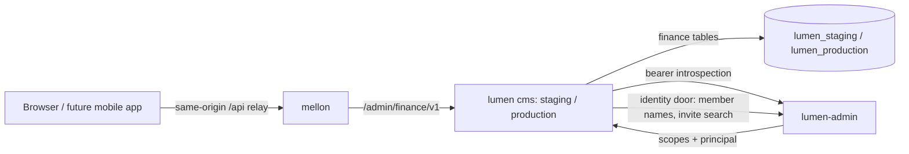

# Finance & Budgeting — Technical Specification

> Companion documents: [PRD](PRD.md) · [ADR](../../decisions/finance-app.md) · [Plan](PLAN.md)

## 1. Architecture



- **Module:** `internal/finance` in lumen (store, service, DTOs). Mounted on the
  cms plane at `/admin/finance/v1`.
- **Database:** each env's existing DB. Two new migrations: `0019` admin (scope
  catalog), `0020` cms (finance schema). No new DB/DSN.
- **Identity:** `lumen-admin` owns users/scopes/sessions. Finance stores only
  `user_id` UUIDs (no users FK). Member display names/invite search use the
  existing token-gated identity door (`internal/identity`), like tasks.
- **Transport:** bearer auth via the cms introspector; authz = estate scope ∩
  workspace role. No cookie/session state in the finance module.
- **Portal:** `/finance` in mellon, desktop sub-sidebar + mobile app-local tab
  bar. The browser never talks to lumen directly; the relay routes
  `/admin/finance` to `CMS_URL`.

## 2. Module layout

```
lumen/
  internal/finance/
    store.go       // SQL, transactions, period generation, ledger writes
    service.go     // rules, authz intersection, DTO assembly
    analysis.go    // accrual/cash/debt/savings formulas
    dto.go         // wire types (no DB rows)
    period.go      // recurrence math, copy policy
    ledger.go      // signs, transfers, balances
  internal/api/admin/finance.go    // HTTP transport + scope gates
  internal/adminsvc/identity.go    // (existing) people lookups
  internal/store/migrations/0019_finance_scope.sql
  internal/store/migrations/0020_finance_cms.sql
mellon/
  src/routes/(app)/finance/[workspaceId]/...
  src/routes/(app)/finance/+layout.svelte
  src/lib/components/finance/...
  src/lib/api/types.ts|client.ts|fetch-adapter.ts|mock.ts|routing.ts
vortex/
  environments/{staging,production}/lumen  // no change; cms migrate applies 0020
  environments/{staging,production}/mellon // route table already in the image
```

## 3. Data model (cms DB)

Conventions: UUID PKs (`gen_random_uuid()`), `BIGINT` minor units, `DATE` for
calendar dates, `TIMESTAMPTZ` for audit timestamps, `archived_at`/`deleted_at`
for soft removal. All workspace-scoped tables carry `workspace_id` for indexing
and authorization. No `users` FKs.

**Optimistic concurrency:** user-edited aggregates carry
`version integer NOT NULL DEFAULT 1` — `finance_workspaces`, `finance_accounts`,
`finance_plans`, `finance_plan_periods`, `finance_categories`,
`finance_budget_lines`, `finance_expenses`, `finance_plan_links`. Reads return
`version`; writes require `If-Match`/`expectedVersion` and use
`UPDATE … WHERE id=$1 AND version=$2`, then increment. **Budget lines are
independent resources**: two admins editing different categories in one period
both succeed; only same-line edits conflict. Planned income is a period field
(period version); editing it conflicts only with another income edit. There is
no whole-period budget PUT. Members/invites use row locks + unique constraints
instead.

### 3.1 `finance_workspaces`

| Column | Type | Notes |
| :--- | :--- | :--- |
| id | uuid PK | |
| name | text | 1–80 chars, trimmed |
| default_currency | char(3) | default `'IDR'`, ISO-4217 uppercase |
| timezone | text | IANA, default `'Asia/Jakarta'` (auto-confirm/period display) |
| created_by | uuid | admin user id |
| archived_at | timestamptz | null = live |
| created_at/updated_at | timestamptz | |

No `kind` column: a one-member workspace is private by fact.

### 3.2 `finance_workspace_members`

| Column | Type | Notes |
| :--- | :--- | :--- |
| workspace_id | uuid FK → workspaces, cascade | |
| user_id | uuid | admin identity |
| role | text | `admin | member` |
| invited_by | uuid | nullable |
| joined_at | timestamptz | |

PK `(workspace_id, user_id)`, index `(user_id)`. Last-admin guard in the
store transaction, under the workspace row lock.

### 3.3 `finance_workspace_invites`

| Column | Type | Notes |
| :--- | :--- | :--- |
| id | uuid PK | |
| workspace_id | uuid FK | cascade |
| inviter_id | uuid | |
| invitee_id | uuid | |
| role | text | default `member` |
| expires_at | timestamptz | 7 days |
| created_at | timestamptz | |

Unique `(workspace_id, invitee_id)`; re-invite upserts the expiry. Accept/decline
delete the row; expired is 410 and consumed.

### 3.4 `finance_accounts`

| Column | Type | Notes |
| :--- | :--- | :--- |
| id | uuid PK | |
| workspace_id | uuid FK | cascade |
| name | text | 1–60 |
| type | text | `cash | bank | ewallet | credit_card | loan` |
| currency | char(3) | defaults to workspace currency |
| opening_balance_minor | bigint | signed; assets +, liabilities − |
| balance_minor | bigint | maintained Postgres projection; starts at opening |
| credit_limit_minor | bigint | nullable, card only |
| statement_day / due_day | smallint | 1–28, card only, nullable |
| interest_rate_bps | int | nullable, loan/card |
| archived_at | timestamptz | |
| created_at/updated_at | timestamptz | |

Indexes: `(workspace_id)`, partial unique `(workspace_id, lower(name)) WHERE
archived_at IS NULL`. `balance_minor` is updated atomically with ledger writes;
a reconciliation test asserts `opening + sum(ledger) = balance`.
The DB enforces the field grammar as the last word: `credit_limit_minor` and
statement/due days are `credit_card`-only; `interest_rate_bps` is card/loan-only.
The account form must offer those fields only for the matching types.

### 3.5 `finance_plans`

| Column | Type | Notes |
| :--- | :--- | :--- |
| id | uuid PK | |
| workspace_id | uuid FK | cascade |
| name | text | 1–80 |
| schedule_type | text | `recurring | fixed` |
| recurrence | text | `weekly|monthly|quarterly|semiannual|yearly`; null for fixed |
| starts_on | date | anchor |
| ends_on | date | fixed required; recurring optional |
| currency | char(3) | defaults to workspace |
| budget_copy_mode | text | `none | all | recurring_only`; default `none` |
| status | text | `active | archived` |
| created_by | uuid | |
| created_at/updated_at | timestamptz | |

Checks: fixed ⇒ `ends_on` not null and ≥ start; recurring ⇒ `recurrence` not
null. Index `(workspace_id, status)`.

### 3.6 `finance_plan_periods`

| Column | Type | Notes |
| :--- | :--- | :--- |
| id | uuid PK | |
| plan_id | uuid FK | cascade |
| starts_on / ends_on | date | inclusive |
| planned_income_minor | bigint | ≥0; MVP recurring income input |
| created_at/updated_at | timestamptz | |

Unique `(plan_id, starts_on)`; check `ends_on >= starts_on`. Status is computed
from today (`past | current | upcoming`), not stored. Fixed plans have exactly
one.

### 3.7 `finance_categories`

| Column | Type | Notes |
| :--- | :--- | :--- |
| id | uuid PK | |
| plan_id | uuid FK | cascade |
| name | text | 1–60 |
| icon / color | text | optional UI tokens |
| recurring | boolean | copy flag |
| sort_order | int | |
| archived_at | timestamptz | |
| created_at/updated_at | timestamptz | |

Partial unique `(plan_id, lower(name)) WHERE archived_at IS NULL`.

### 3.8 `finance_budget_lines`

| Column | Type | Notes |
| :--- | :--- | :--- |
| id | uuid PK | |
| period_id | uuid FK | cascade |
| kind | text | `expense | debt_payment | card_reserve` |
| category_id | uuid FK | required for `expense` |
| account_id | uuid FK | required for debt/card |
| amount_minor | bigint | ≥0 |
| recurring | boolean | debt/card copy flag; default true |
| version | integer | optimistic per-line concurrency; default 1 |
| created_at/updated_at | timestamptz | |

Check constraints per kind; partial unique `(period_id, category_id) WHERE
kind='expense'` and `(period_id, account_id, kind) WHERE kind<>'expense'`.
Savings commitments are **derived from contributions**, not stored here.

### 3.9 `finance_expenses`

| Column | Type | Notes |
| :--- | :--- | :--- |
| id | uuid PK | |
| workspace_id | uuid FK | |
| plan_id | uuid FK | |
| period_id | uuid FK | derived from `occurred_on` |
| account_id | uuid FK | payment account |
| primary_category_id | uuid FK | first item's category, for list display |
| description | text | 1–200; manual or auto |
| total_minor | bigint | sum(items); ≥0 |
| currency | char(3) | plan currency |
| occurred_on | date | |
| client_id | uuid | nullable; idempotency |
| created_by | uuid | |
| deleted_at | timestamptz | soft delete |
| created_at/updated_at | timestamptz | |

Indexes: `(workspace_id, occurred_on DESC, id DESC) WHERE deleted_at IS NULL`;
`(plan_id, period_id, occurred_on DESC, id DESC) WHERE deleted_at IS NULL`;
`(account_id, occurred_on)`; `(primary_category_id)`. Unique
`(workspace_id, client_id) WHERE client_id IS NOT NULL`.

### 3.10 `finance_expense_items`

| Column | Type | Notes |
| :--- | :--- | :--- |
| id | uuid PK | |
| expense_id | uuid FK | cascade |
| category_id | uuid FK | must belong to the expense's plan |
| name | text | 1–200 |
| barcode | text | nullable; unused in MVP |
| quantity | numeric(12,3) | >0, default 1 |
| unit_price_minor | bigint | ≥0 |
| amount_minor | bigint | server: round(quantity × unit price) |
| sort_order | int | |
| created_at | timestamptz | |

Indexes `(expense_id)`, `(category_id)`. At least one item per expense; the
service enforces sum(items) = expense.total.

### 3.11 `finance_ledger_entries`

| Column | Type | Notes |
| :--- | :--- | :--- |
| id | uuid PK | |
| workspace_id | uuid FK | account's workspace |
| account_id | uuid FK | |
| kind | text | `expense | income | transfer | debt_payment | interest` |
| amount_minor | bigint | **signed**: + increases account balance, − decreases |
| currency | char(3) | |
| occurred_on | date | |
| description | text | |
| expense_id | uuid FK | nullable |
| plan_id | uuid FK | nullable; expense/commitment context |
| contribution_id | uuid | nullable; set after contribution insert |
| transfer_id | uuid | nullable; pairs share it |
| counter_account_id | uuid | nullable |
| client_id | uuid | nullable; idempotency |
| created_by | uuid | |
| deleted_at | timestamptz | |
| created_at/updated_at | timestamptz | |

Indexes: `(workspace_id, occurred_on DESC, id DESC) WHERE deleted_at IS NULL`;
`(account_id, occurred_on, id)`; `(expense_id)`, `(contribution_id)`,
`(transfer_id)`. Balance rules in §4.

### 3.12 `finance_plan_links`

| Column | Type | Notes |
| :--- | :--- | :--- |
| id | uuid PK | |
| purpose | text | `plan_funding | workspace_contribution` |
| source_plan_id | uuid FK | |
| target_plan_id | uuid FK | required for plan_funding, null for workspace |
| target_workspace_id | uuid FK | derived/required |
| source_account_id | uuid FK | nullable for envelope |
| target_account_id | uuid FK | required for transfer/workspace contribution |
| amount_minor | bigint | per cadence, >0 |
| currency | char(3) | MVP same as source/target |
| cadence | text | `one_off|weekly|monthly|quarterly|semiannual|yearly` |
| mode | text | `envelope | transfer` |
| anonymous | boolean | default false |
| auto_confirm | boolean | default false |
| starts_on / ends_on | date | |
| status | text | `active | paused | completed | unlinked` |
| created_by | uuid | |
| created_at/updated_at | timestamptz | |

Checks: plan_funding requires target_plan_id; workspace_contribution requires
null target_plan_id and a target operating account. `transfer` requires source
and target accounts. Indexes `(source_plan_id)`, `(target_plan_id)`,
`(target_workspace_id, status)`.

### 3.13 `finance_contributions`

| Column | Type | Notes |
| :--- | :--- | :--- |
| id | uuid PK | |
| link_id | uuid FK | cascade |
| source_period_id | uuid FK | period containing due_on |
| target_period_id | uuid FK | plan funding; nullable |
| due_on | date | |
| amount_minor | bigint | >0 |
| currency | char(3) | |
| fx_rate | numeric(18,8) | nullable; future |
| status | text | `planned | confirmed | skipped` |
| confirmed_at | timestamptz | |
| source_entry_id / target_entry_id | uuid | ledger entries, nullable |
| created_at/updated_at | timestamptz | |

Unique `(link_id, due_on)`. Indexes `(source_period_id)`,
`(target_period_id)`, `(status, due_on)`.

### 3.14 Deferred tables (not in 0020)

- `finance_products` (barcode cache) — after the barcode provider decision.
- FX rates / per-plan conversion — fields exist (`currency`, `fx_rate`); no UI.
- Period/category rollups — only if measured.
- Receipt attachments — media relay is available, not wired.

## 4. Ledger and balance rules

Signs: asset accounts positive, liabilities negative. `amount_minor` is signed.

| Event | Ledger entries | Balance effect |
| :--- | :--- | :--- |
| Expense | one `expense` entry `−total` on the payment account | cash/bank down; card liability more negative |
| Income | one `income` entry `+amount` | asset up |
| Transfer | two rows, same `transfer_id`: source `−amount`, target `+amount` | source down, target up |
| Card payment | transfer bank → card | bank down, card liability less negative |
| Loan disbursement | transfer loan → bank: bank +, loan − | cash up, liability up |
| Loan instalment | transfer bank → loan (principal), interest `interest` − from bank | bank down, liability down, interest expense |
| Plan-funding contribution (transfer) | transfer source account → target savings account | source down, target savings up |
| Workspace contribution (transfer) | transfer source account → target operating account | source down, target operating up |
| Plan-funding contribution (envelope) | none | no account movement; funded metric only |

- Every expense create/update/delete writes/adjusts its ledger entry in the same
  transaction. Plan and period are immutable after create; date changes may move
  the period within the same plan.
- Account `balance_minor` is updated in the same transaction; a reconciliation
  test asserts `opening + sum(ledger) = balance`.
- Cross-workspace transfers write two ledger rows in the same DB transaction,
  one per workspace/account.
- A contribution confirmation locks the contribution row; confirm is idempotent
  by status.

### 4.1 Concurrency and conflict control

| Operation | Mechanism |
| :--- | :--- |
| Last-admin demote/remove | Lock workspace row (`FOR UPDATE`), count admins, update; 409 |
| Invite create | Unique `(workspace_id, invitee_id)`; upsert expiry; 409/200 |
| Invite accept/decline | Lock invite row; check expiry; insert membership + delete invite in one tx |
| Period generation | `INSERT … ON CONFLICT (plan_id, starts_on) DO NOTHING RETURNING id`; creator copies under a per-plan `pg_advisory_xact_lock` |
| Budget line create | `POST /periods/{id}/budget-lines`; unique `(period_id, category_id/account)`; duplicate 409 with current line |
| Budget line edit/delete | Per-line `version` via `If-Match`; 409 only on the same line |
| Planned income edit | Period `version`; 409 only against another income edit |
| Plan/account/category/link edit | Row `version`; 409 on mismatch |
| Expense create | `(workspace_id, client_id)` unique; replay returns existing 200 |
| Expense edit/delete | Lock expense row + version; header/items/ledger/balance in one tx |
| Contribution confirm/skip | Lock/claim `WHERE status='planned'`; idempotent by state |
| Auto-confirm job | Same claim; `FOR UPDATE SKIP LOCKED` or `UPDATE … WHERE status='planned'`; one winner |
| Transfer/ledger | Lock account rows in UUID order; atomic balance updates; entry pair in one tx |
| Cross-workspace transfer | Same DB tx; both memberships re-checked; both accounts locked in order |
| Archive workspace/plan | Lock row; pause future contributions; reject new writes |

**Lock order:** workspace → plan → period → accounts (UUID ascending) → link →
contribution. No identity/HTTP calls inside a write transaction. Transactions
stay short; deadlock/serialization failures (`40P01`/`40001`) are retried a
bounded number of times only for idempotent operations; exhausted retries map to
409/503, never a partial write. `READ COMMITTED` is the default; there is no
global SERIALIZABLE retry loop.

**API:** `If-Match: "<version>"` (or `expectedVersion`) on mutable aggregates;
`409 {error, currentVersion}` on mismatch; `200` on idempotent replay; `404` for
non-membership, never 403 for a hidden row. No live multi-user merge in MVP;
the UI refetches on 409.

**Ledger edits:** MVP updates the expense's ledger entry and balance in the
locked transaction; version + audit timestamps are the history. A future
append-only reversal ledger is an audit enhancement, not a concurrency change.

## 5. Rules

### 5.1 Workspace authorization

Every query resolves the caller's membership:
`workspace_id = $1 AND user_id = $caller`. Non-membership is the one 404. A
workspace `admin` is required for `finance:workspace.manage` actions; a `member`
role with the relevant scope can perform the action. Last-admin guard is in the
transaction.

### 5.2 Period generation

- Fixed: one period at plan creation.
- Recurring: `ensurePeriods(plan, through)` creates missing periods via
  `INSERT … ON CONFLICT (plan_id, starts_on) DO NOTHING`.
- Period starts: anchor `starts_on` + n×recurrence, clamped to month length;
  end = next start − 1 day (or `ends_on`).
- A plan starting in the future gets its first period as `upcoming`; opening the
  app generates through today.
- Expense creation ensures the period containing `occurred_on`; a date outside
  the plan range is 400.

**Triggers (two, both idempotent):**

1. **Lazy** — plan read, budget read, expense create, and contribution
   generation call `ensurePeriods(plan, through)` for the plan they touch. The
   first access after a period start creates/copies it.
2. **One daily cms-worker job** — `finance.period_tick` at **23:55** in the
   estate/server timezone (default `Asia/Jakarta`). It scans active recurring
   plans and calls `ensurePeriods(plan, today + 7 days)`. The 7-day lookahead is
   the correctness mechanism: the next period and its budget already exist days
   before they start, so 23:55 vs midnight is a scheduling preference, not a
   boundary requirement. Workspaces in other timezones are covered by the
   lookahead plus the lazy path; if exact local timing is ever required, run one
   job per distinct workspace timezone at 23:55 local — still **not** per plan
   and not a Kubernetes CronJob. The same tick runs auto-confirm (§5.5).

`ensurePeriods` transaction:

```text
BEGIN
  pg_advisory_xact_lock(hash(plan_id))          -- serialize one plan
  for each missing period start from plan.starts_on to through:
      INSERT INTO finance_plan_periods (...) VALUES (...)
      ON CONFLICT (plan_id, starts_on) DO NOTHING
      RETURNING id
      if inserted:
          copy planned income + budget lines from the previous period
          (copy mode + per-category recurring)
          generate planned contributions for links due in this period
COMMIT
```

- Multiple cms replicas/workers are safe: the unique `(plan_id, starts_on)` and
  the advisory lock mean exactly one creator copies; the others see the existing
  period and do nothing.
- The tick is a safety net, not the only path; a missed tick never blocks a user
  because the lazy trigger runs.
- Index `finance_plans (status, schedule_type, starts_on)` and use a bounded
  query/batch as the plan count grows; no per-plan scheduler rows in MVP.

### 5.3 Copy policy

On generating a period, copy from the previous period:

| Mode | Planned income | Expense lines | Debt/card lines |
| :--- | :--- | :--- | :--- |
| none | 0 | none | none |
| all | copy | all | all |
| recurring_only | copy | categories with `recurring=true` | lines with `recurring=true` |

Savings planned contributions are generated from active links separately.

**Automatic copy** happens only when the period is created (new/empty), under
the period-generation lock; there is no concurrent edit to conflict with.

**Manual “Copy last period”** on an existing period is a MERGE, not a replace:
it creates missing lines only, never overwrites an existing line, and reports
skipped categories. Planned income is copied only if it is still 0. A concurrent
manual edit to a category that the copy is creating returns 409 for the copy
row; the copy reports it and leaves the user's value. This preserves per-line
concurrent editing.

### 5.4 Expense/basket

- `POST /expenses` requires at least one item; `total = sum(item.amount)`.
- Each item category must belong to the expense plan; `primary_category_id` is
  the first item's category unless explicitly supplied.
- Create header + items + ledger entry in one transaction.
- A zero-total expense (every item free) writes **no ledger entry**: ledger
  `amount_minor` is non-zero by contract and the balance is unchanged. The
  expense row still exists for history.
- `client_id` makes create idempotent (replay returns the existing expense).
- No discounts/tax in MVP; the design's discount row is omitted/zero.

### 5.5 Contributions

- Planned contributions are generated for each active link cadence, with
  `(link_id, due_on)` unique.
- The source period budget reserves the sum of planned+confirmed contributions
  for that period; saving is not an expense.
- Confirm: lock; create transfer ledger pair (or no entries in envelope);
  mark confirmed; target plan funded / workspace contribution actual increases.
- Skip: mark skipped; release the reservation.
- Auto-confirm: runs inside the daily `finance.period_tick` after period
  generation (or as a separate job if its cadence differs). Due contributions
  are confirmed at the daily tick (23:55 on the due date); the source budget
  already reserves them from period start. If start-of-day confirmation is
  preferred, run the tick at 00:05 or split the job. It claims planned
  contributions for links with `auto_confirm=true` in the workspace timezone;
  idempotent. A user confirmation and the worker race safely: the
  `WHERE status='planned'` claim gives exactly one winner.
- Reaching funded ≥ expected raises an alert in the API/UI; the link stays
  unless unlinked.
- Unlink/pause cancels future planned contributions; confirmed entries remain.
- Anonymous hides contributor identity in target-facing responses; source sees
  it; the ledger retains `created_by` for audit only.

### 5.6 Plan/workspace target

- Plan funding: target plan + target-workspace savings account; restricted.
- Workspace contribution: target workspace operating account; unrestricted;
  counted as a member contribution, not earned income.
- Both allow one-off and recurring cadences; `envelope` is allowed for plan
  funding, `transfer` for both. Workspace contribution requires transfer.
- Cross-workspace link requires membership/role/scope in both; target account in
  the target workspace; same currency in MVP.

### 5.7 Workspace contribution budget treatment

Expected recurring workspace contributions are computed from active links and
shown in the workspace overview (expected vs actual). They are **not**
auto-injected into an arbitrary plan's `planned_income_minor`; plans are
arbitrary and may not be the workspace operating budget. The workspace admin can
include the expected amount in a plan's planned income manually. Actual
contributions are ledger inflows and are reported separately from earned income.
This is the v1 behavior; a workspace-level operating budget is a future feature.

### 5.8 Analysis formulas

For a period:

- `expenseBudget = sum(expense budget lines)`
- `spent = sum(item.amount)` for non-deleted expenses in the period
- `budgetRemaining = expenseBudget − spent`
- `allocated = expenseBudget + debt/card commitments + planned savings`
- `unallocated = plannedIncome − allocated` (negative allowed; fixed plans may be
  funded by savings)
- `funded = sum(confirmed plan-funding contributions)`
- `plannedSavings = sum(planned+confirmed contributions in the period)`
- `cashAvailable = sum(asset account balances)`
- `debtDue = card statement/outstanding due + loan instalments due`
- `cashAfterDebt = cashAvailable − debtDue`
- `earnedIncome = sum(income ledger entries)`; `memberContributions = sum(confirmed
  workspace-contribution inflows)`; they are reported separately.

## 6. API

Base: `/admin/finance/v1`, cms plane, bearer auth. The app door requires any
`finance:*` scope; each endpoint checks its specific scope and workspace role.
All responses are DTOs; dates are `YYYY-MM-DD`; money is
`{ "amountMinor": 123400, "currency": "IDR" }` or `amountMinor` + a top-level
`currency` where unambiguous.

### 6.1 Effective permissions

Workspace responses include:

```json
{
  "permissions": {
    "read": true,
    "workspaceRead": true,
    "planRead": true,
    "expenseRead": true,
    "analysisRead": true,
    "contributionRead": true,
    "planWrite": true,
    "budgetWrite": true,
    "expenseWrite": true,
    "contributionWrite": true,
    "workspaceManage": true
  }
}
```

`finance:read` implies all `*Read` flags; writes are granular.

### 6.2 Endpoints

| Method | Path | Purpose |
| :--- | :--- | :--- |
| GET | `/workspaces` | caller's workspaces + role + permissions |
| POST | `/workspaces` | create workspace; creator is first admin |
| GET/PATCH | `/workspaces/{id}` | workspace settings |
| POST | `/workspaces/{id}/archive` | archive |
| GET | `/workspaces/{id}/members` | roster (names via identity) |
| GET | `/workspaces/{id}/people?q=` | admin invite typeahead (members excluded) |
| POST | `/workspaces/{id}/invites` | invite by username (7-day TTL; re-invite upserts) |
| DELETE | `/workspaces/{id}/invites/{iid}` | admin revoke a pending invitation |
| PATCH | `/workspaces/{id}/members/{uid}` | role |
| DELETE | `/workspaces/{id}/members/{uid}` | remove (last admin 409) |
| GET | `/invites` | caller's inbox |
| POST | `/invites/{id}/accept\|decline` | consume |
| GET | `/workspaces/{id}/plans` | plans |
| POST | `/workspaces/{id}/plans` | create plan + first period |
| GET/PATCH | `/plans/{id}` | plan settings |
| POST | `/plans/{id}/archive` | archive |
| GET | `/plans/{id}/periods` | periods |
| POST | `/plans/{id}/periods/ensure` | generate through a date |
| GET | `/periods/{id}` | budget + totals + commitments; lines carry `version` |
| PATCH | `/periods/{id}` | planned income (period `If-Match`); no whole-budget PUT |
| POST | `/periods/{id}/budget-lines` | create a category/debt/card line; duplicate 409 |
| PATCH/DELETE | `/budget-lines/{id}` | edit/delete one line (per-line `If-Match`) |
| GET/POST | `/plans/{id}/categories` | plan categories |
| PATCH/DELETE | `/categories/{id}` | edit/archive |
| GET | `/workspaces/{id}/expenses` | all-plans ledger list |
| GET | `/periods/{id}/expenses` | plan-period list |
| POST | `/expenses` | create basket (items + ledger) |
| GET/PATCH/DELETE | `/expenses/{id}` | detail/edit/soft delete |
| GET/POST | `/workspaces/{id}/accounts` | accounts/balances |
| PATCH | `/accounts/{id}` | edit/archive |
| GET/POST | `/workspaces/{id}/income` | actual income entries |
| POST | `/workspaces/{id}/transfers` | transfer pair |
| POST | `/workspaces/{id}/debt-payments` | principal + interest |
| GET/POST | `/plans/{id}/links` | savings/workspace links |
| PATCH | `/links/{id}` | amount/status/flags |
| POST | `/links/{id}/unlink` | stop future contributions |
| GET | `/contributions` | filter by link/status/period |
| POST | `/contributions/{id}/confirm\|skip` | lifecycle |
| GET | `/workspaces/{id}/overview` | plan/period overview |
| GET | `/plans/{id}/analysis` | plan analysis |
| GET | `/workspaces/{id}/analysis` | workspace rollup |

Pagination: `?limit=50&cursor=<opaque>`; responses include `nextCursor`.
Create idempotency: `clientId` on expenses/income/transfers; replay returns 200
with the existing row. Concurrency: mutable aggregates carry `version`; writes
send `If-Match: "<version>"` (or `expectedVersion`) and a mismatch is
`409 {error, currentVersion}`; the client refetches. Statuses: 200/201/204; 400
invalid; 401; 403 scope/role; 404 non-member/foreign; 409 last admin/duplicate/
version conflict/contribution state; 410 expired invite; 428 a versioned write
without `If-Match`/`expectedVersion`. Finance responses are
`Cache-Control: no-store` at BOTH hops (lumen and the mellon relay/SSR load).

### 6.3 Plan/period selectors

- `GET /workspaces/{id}/plans` returns schedule metadata and `currentPeriodId`.
- `GET /plans/{id}/periods` returns periods with computed status.
- The UI stores the selected workspace/plan/period in the URL query; switching a
  plan resets the period to current.
- Plan creation returns the plan and generated first period; the UI selects it.

## 7. Migrations

### 7.1 `0019_finance_scope.sql` (admin)

Insert the scope catalog rows (ON CONFLICT DO NOTHING):

- `finance:read`
- `finance:workspace.read`
- `finance:plan.read`
- `finance:expense.read`
- `finance:analysis.read`
- `finance:contribution.read`
- `finance:plan.write`
- `finance:budget.write`
- `finance:expense.write`
- `finance:contribution.write`
- `finance:workspace.manage`

Update `internal/scopes/scopes.go` `Seed` so the catalog test derives the same
set. Classification: `role.PlaneAdmin`. No cms DB scope table.

### 7.2 `0020_finance_cms.sql` (cms)

Create the tables/indexes in §3 (workspaces, members, invites, accounts, plans,
periods, categories, budget lines, expenses, items, ledger, links,
contributions). **No users table, no users FKs.** Classification:
`role.PlaneCMS`.

### 7.3 Classification and safety

- `migrationRoles["0019_finance_scope.sql"] = role.PlaneAdmin`
- `migrationRoles["0020_finance_cms.sql"] = role.PlaneCMS`
- Exact-role boundary test; cms subset must not create `users`; admin subset
  must not create finance tables.
- `0014_tasks.sql` stays frozen; `0018_tasks_cms.sql` untouched.
- Admin migrate job applies 0019; cms migrate job applies 0020. No new DSN,
  secret or epoch.
- The cms process's `LUMEN_IDENTITY_TOKEN` (already present) is used for member
  names/invite search.

## 8. Frontend

### 8.1 Routes

```
src/routes/(app)/finance/+layout.svelte          // workspace load, shell
src/routes/(app)/finance/[workspaceId]/+layout.svelte
src/routes/(app)/finance/[workspaceId]/overview/+page.svelte
src/routes/(app)/finance/[workspaceId]/budget/+page.svelte
src/routes/(app)/finance/[workspaceId]/expenses/+page.svelte
src/routes/(app)/finance/[workspaceId]/analysis/+page.svelte
src/routes/(app)/finance/[workspaceId]/settings/+page.svelte
```

- `/finance` redirects to the last workspace (cookie/localStorage) or onboarding.
- Plan/period are query params (`?plan=...&period=...`); the header selectors
  drive them. `All plans` is an option for Expenses/Analysis.
- Desktop: finance sub-sidebar (workspace selector at top + nav); plan/period in
  the content header; one workspace selector only.
- Mobile: app-local `AppTabBar` (Overview/Budget/Expenses/Analysis) + FAB; the
  workspace/plan selectors live in the header.

### 8.2 Components

- `FinanceSubNav` / `WorkspaceSwitcher` (dropdown with `+ New workspace`).
- `PlanSwitcher` (dropdown with `+ New plan`, `Manage plans`), `PeriodSwitcher`.
- `BudgetTable`, `CommitmentList`, `CategoryProgress`, `MoneyRing`,
  `CashDebtCard`.
- `ExpenseList`, `ExpenseBasket`, `ExpenseSheet`, `AccountPicker`.
- `ContributionDialog`, `ContributionProgress`.
- `AppTabBar` (generic; finance first, later the console shell).
- Use portal `Button`, `Select`, `Input`, `Card`, `Tag`, `Sheet`, `Dialog`;
  Inter for UI, JetBrains Mono for money; 8/6/4px shape grammar.

### 8.3 Data flow

- The layout loads principal scopes and the workspace list through the relay.
- Pages call the finance API client-side through the same-origin relay (tasks
  pattern); mutations use `clientId` for expenses.
- The client derives visibility from the API `permissions` (never from cookie
  folklore).
- Plan creation and empty states are in the plan selector; no floating create
  button.
- **Budget lines save independently**: each row has its own version and
  autosave/row-save; a 409 refetches only that row. The “Save budget” control is
  a convenience that saves dirty rows, not a period lock, and two admins editing
  different categories never conflict. Planned income is a separate period-level
  save.
- The design reference:
  [Flowstep](https://app.flowstep.ai/file?activeFileId=c92688f2-4123-4448-9d3f-1eb4864d3f60).

## 9. Performance and caching

**There is no Redis/Valkey/external cache.** The terms in this spec mean
Postgres-side projections:

- `finance_accounts.balance_minor` is a **maintained column** (opening + ledger
  sum), updated in the same transaction as the ledger write; a reconciliation
  test proves it. It is not a cache server.
- `finance_period_totals` (period × category) is an optional **Postgres summary
  table/materialized view** for analysis, introduced only when measured.
- Postgres indexes, prepared statements and the connection pool are the read
  path. A read-replica pool for heavy analysis is optional and later; the
  Patroni read service exists.

No in-process cache of finance data: the cms may have multiple replicas and
balances/budgets must not be stale. The only existing in-process cache is the
cms auth introspection cache (`internal/authz`, ~30s), unrelated to finance.
Member display names come from the identity door; if a cache is ever added
there, it is a short TTL for names only — never permissions or balances.

Finance responses are `Cache-Control: no-store`; the relay must not cache private
finance data; no CDN. Other rules:

- Header totals; items only for detail.
- Indexes in §3; keyset pagination on `(occurred_on DESC, id DESC)`.
- Aggregate SQL; no N+1; one query for a page's totals.
- Partition `finance_ledger_entries`/`finance_expenses` by month only at scale;
  not in MVP.
- Query budget: overview < 50ms at family volume; list endpoints < 100ms; add
  `EXPLAIN` integration tests for the top three queries.

## 10. Testing

- **Unit:** money/currency parsing, period math, copy policy, contribution
  lifecycle, ledger signs, analysis formulas.
- **Integration (real Postgres):** fresh cms schema migrated with 0020 (no
  users); workspace/member/role/last-admin; plan periods; budget copy; basket
  mixed categories; ledger balances; transfer pairs; cross-workspace contribution;
  credit-card/loan; analysis.
- **API:** contract shapes, statuses, scope/role matrix, non-member 404,
  anonymous hiding, idempotent create, pagination, `If-Match` 409.
- **Concurrency (real Postgres, two sessions):** two admins editing different
  budget lines both succeed; two editing the same line one wins/one 409; planned
  income conflict is separate from line edits; duplicate `client_id` creates one
  row; two contribution confirms (user + auto-confirm) confirm once; concurrent
  period generation creates one period; concurrent last-admin demotions leave
  one admin; transfer deadlock ordering passes; balance reconciliation after
  concurrent writes.
- **Migration:** exact role boundary; cms subset has no users; admin subset no
  finance tables; 0014 frozen.
- **Frontend:** svelte-check, vitest for helpers, lint, build; manual theme/mode
  and mobile QA.
- **Performance:** seeded family volume + a synthetic 100k expense/ledger run;
  EXPLAIN the overview/list/analysis queries.
- **Security:** no email in finance payloads; membership join in every query;
  last-admin; invite TTL; anonymous.

## 11. Rollout

1. Land `0019` + `0020` + module/API + UI behind the finance scope (no users
   granted yet = app hidden).
2. Release lumen; the cms migrate job applies 0020 to staging/production; the
   admin job applies 0019.
3. Release mellon; the finance route is visible only with a finance scope.
4. Grant `finance:*` to the owner; create the first workspace.
5. Invite family members; grant scopes; verify.
6. Later: barcode, FX, offline, dedicated mobile auth/extraction.

No new database, DSN, Bao key, cluster, or placement budget. The only new
runtime dependency is the existing identity door for member names.

## 12. Risks

- Cross-workspace contribution authorization and atomic two-workspace ledger
  writes (test both memberships).
- Accrual/cash UX confusion (label both numbers; never show one as the other).
- Plan/period/copy complexity (default `none`, empty states).
- Scope catalog growth (group finance scopes in the admin UI).
- Shared workspace privacy (warn at invite; personal workspace is the boundary).
- Performance of ledger aggregates (balance cache + measured rollups).
- Future mobile auth/offline are unresolved; do not promise them in the UI.
