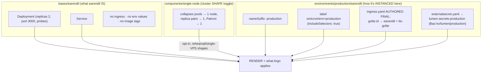
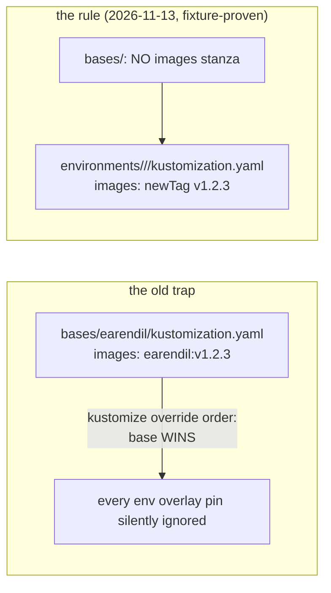

# The environments model — one axis, any cluster shape

## The problem this solves

A blog estate needs at least two copies of the content plane: one where the
owner can test a release before readers see it (**staging**), one readers
use (**production**). The naive answers all rot: a second manifests repo
forks and drifts; `sed`-rewriting copies loses the plot; per-env Helm values
hide the actual shape. The estate's answer (owner ruling, runbook Phase 11;
converged 2026-11-13/14): **one repo, three environment trees, rendered by
Kustomize** — and an environment is a *portable unit*, not a cluster
property.

## The axis

| tree | nameSuffix | label `omicron/env` | what lives there |
| :-- | :-- | :-- | :-- |
| `environments/foundation/*` | — (explicit plain names) | `shared` | openbao, external-secrets, secrets-plane, lumen-db, meilisearch, observability, **lumen-admin** (the Control Plane) |
| `environments/staging/*` | `-staging` | `staging` | lumen, earendil, mellon — the staging content world |
| `environments/production/*` | `-production` | `production` | lumen, earendil, mellon — the live content world |

Read the table as: the **foundation** is the shared plumbing every
environment needs exactly once of. The **content worlds** are per-environment
copies of the same three apps. Foundation is unsuffixed because there is
always exactly one of it; content apps carry their environment in their very
name (`earendil-staging`).



## Co-tenancy: all three worlds on one cluster

The trees are **environment files, not cluster files**. One cluster can run
foundation+production, foundation+staging, or all three at once. The
mechanics that make co-tenancy safe:

- **Namespace ownership:** the app namespaces (`lumen`, `earendil`,
  `mellon`) are rendered ONCE — by the foundation lumen-admin tree. Env
  trees `$patch: delete` their own copy of the Namespace object, so no two
  hubs ever fight over one Namespace.
- **Selector hygiene:** every env overlay patches its Deployment/Service
  selectors with the environment label (`includeSelectors: true`), so
  earendil-production's Service can never route to earendil-staging's pods.

## The naming contract (load-bearing)

Kustomize's `nameSuffix` rewrites `metadata.name` **only** — not the places
that *reference* names (Service selectors, `envFrom` refs, Ingress backends,
TLS secret names). The contract closes that gap two ways:

1. **Authored final** in files the overlay owns: each env overlay has its own
   `ingress.yaml` (hosts, backend service name, TLS secret stated as literal
   strings) and its own `externalsecret.yaml` (ES `spec.target.name` =
   `lumen-secrets-production`).
2. **JSON6902-patched** for base-internal references: deployments'
   `envFrom` secretRef/configMapRef, the migrate Job envFrom.

**And vault values must name the suffixed Services.** The seeded
`API_BASE` in `kv/lumen/production` is literally
`http://lumen-http-server-production.lumen.svc.cluster.local` — the suffix
is part of the SEEDED VALUE, not something manifests rewrite. The admin ES
`LUMEN_ADMIN_URL` precedent: a service URL is a VALUE (it lives in Bao), not
a manifest constant.

## Where versions live (the pin-free bases rule)

Image tags are written ONLY in the env trees:



A base `images:` stanza outranks every overlay in kustomize's override
order — so bases carry none. The release ladder's bump PRs edit exactly the
env-tree stanzas (see [releases-and-ci.md](releases-and-ci.md)).

## Shared-by-design services (foundation)

- **ONE Patroni cluster** (`db` ns) declaring THREE logical databases, one
  per consumer:

  ```mermaid
  flowchart LR
      subgraph patroni["Patroni (Zalando operator) — one cluster"]
        DB1["lumen_admin<br/>owner db_user_admin"]
        DB2["lumen_staging<br/>owner db_user_staging"]
        DB3["lumen_production<br/>owner db_user_production"]
      end
      A["lumen-admin (foundation)<br/>kv/lumen/shared"] -->|"LUMEN_DB_URL"| DB1
      B["lumen cms -staging<br/>kv/lumen/staging"] -->|"LUMEN_DB_URL"| DB2
      C["lumen cms -production<br/>kv/lumen/production"] -->|"LUMEN_DB_URL"| DB3
  ```

  Credentials are GENERATED by the operator into its dotted-naming Secrets
  (`lumen-pg.db_user_*`); the runbook harvests them into Bao (the seed
  AFTER the data plane exists — runbook M3 ordering).
- **ONE Meilisearch** (`search` ns); environments coexist as per-env INDEX
  names (`LUMEN_MEILI_INDEX_POSTS` etc. are VALUES behind each cms overlay's
  Bao path).
- **ONE each:** openbao, external-secrets, secrets-plane, observability (the
  Grafana door `anor.gofar.id` is production-owned DNS hosted foundation-side —
  [network-and-doors.md](network-and-doors.md)).

## Moving an environment to another cluster

Because an environment is expressed entirely in its tree + its hub CR:
repaint the `destination` in `apps/staging/*.yaml`'s hub, seed a vault on the
new cluster, apply the hub there — **zero manifest edits**. The staging
twins (`staging.gofar.id`, `staging-console.gofar.id`) are contractual
already; their DNS records and vault seeds land when staging first goes live
on a real cluster (runbook [`07-go-public.md`](../../runbook/07-go-public.md)
carries the door procedure).

**Operate it:** runbook [`04-gitops.md`](../../runbook/04-gitops.md) (the
model, walked); [`00a-run-order.md`](../../runbook/00a-run-order.md) (the
co-tenanted rehearsal: foundation + observability + production on ONE local
cluster); [`INFRA_ARCHITECTURE.md`](../../INFRA_ARCHITECTURE.md) §9 (the
shape's rationale).
