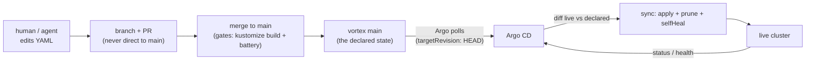
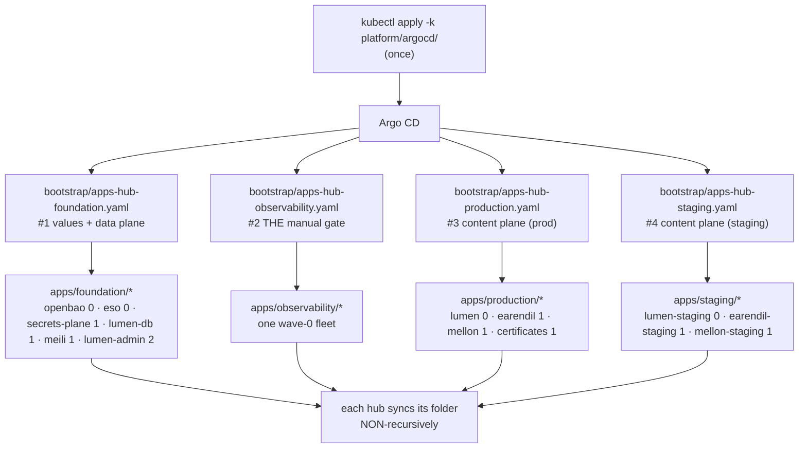

# GitOps — how a git push becomes a cluster state

The estate's operating promise: **the cluster takes orders from Git and from
nothing else.** No human runs `kubectl apply` for workloads (except the
bootstrap ritual); no CI system touches the cluster directly. This note
explains the mechanism, the repo shape that makes it work, and the places
where the naive version would hurt you.

## The reconciliation loop



Two things make this safe rather than just automatic:

- **prune** — a resource removed from Git is removed from the cluster (no
  snowflake leftovers).
- **selfHeal** — a manual `kubectl edit` is reverted on the next sync (no
  drift, by design). The ONE exception: the database app disables selfHeal in
  the blueprint shape so a real Patroni failover isn't stomped by Git
  ([vortex AGENTS.md §7](https://github.com/kanatabi/vortex/blob/main/AGENTS.md)).

## The repo shape (vortex, top to bottom)

```text
platform/argocd/      Argo CD itself — applied ONCE by hand, then self-hosts.
bootstrap/            THE manual entrypoints (hubs). Four + one blueprint.
apps/                 Application CRs ONLY. Never raw manifests here.
bases/<app>/          raw manifests: suffix-free, env-free, ESO-free, pin-free.
components/           optional toggles: single-node (collapse pools), config-gate (PreSync epoch gate).
environments/         the env axis: foundation / staging / production /<app>/
```

Why the split? **Bases** describe what an app IS (its Deployment, Service,
ports, probes). **Environments** describe how an app is INSTANCED here
(suffix, labels, values, hosts). Keeping them separate is what lets the same
base serve a single-VPS cluster today and a 3-node cluster tomorrow with
zero rewrites.

## App-of-apps: the hub tree

Argo CD applies Applications; who applies Argo's own Applications? An
Application that applies Applications — the **app-of-apps** pattern:



Rules that fall out of this shape:

- The **numbers are sync waves** (order within a hub): wave 0 first, then 1,
  then 2. Production's lumen at wave 0 means the cms exists before earendil's
  proxy needs it.
- **Exactly one hub SET may own a cluster** (foundation + at least one app
  hub). Non-recursive syncs are what prevent two hubs from fighting over the
  same objects.
- **Adding an app** = a new `bases/<name>/` + an Application CR in the folder
  its hub syncs (+ env overlays). Never edit a hub file for this.
- The observability hub is **applied by a human, deliberately, only after the
  grafana four-key seed verifies** — see
  [secrets-and-vault.md](secrets-and-vault.md) for why an early apply wedges
  the sync-op permanently.

## What "sync" actually does

Argo diffs the live cluster against the rendered manifests and applies the
difference. Rendered — because Kustomize transforms the YAML on the way:
`nameSuffix` renames resources per environment, patches wire env vars and
ExternalSecret targets, and components collapse shapes. What Argo applies is
**the render**, not the files — which is why every validation step in the
estate validates RENDERED output (the battery, the diff tool, the gates).

**Operate it:** runbook [`04-gitops.md`](../../runbook/04-gitops.md)
(the chapter that walks this loop against a real cluster);
[`00a-run-order.md`](../../runbook/00a-run-order.md) sequences it with
everything else on the local rehearsal track.

## The validation habit (no cluster needed)

```bash
kubectl kustomize environments/production/earendil   # render one dir
bin/validate-all.sh <path-to-vortex>                 # anvil's full battery
```

The battery (anvil `validate-all.sh`) goes far beyond "does it build":

1. **Rendered-loss baseline** — render the merge-base and the branch; every
   document that existed before must still exist (a dropped doc in a pruned
   sync is a live DELETION of a cluster object).
2. **Structural invariants over the rendered output** — zero inline config
   literals in Deployment docs; `envFrom` required wherever an
   ExternalSecret + Deployment coexist; the wave contract asserted from the
   `*migrate*` file existing in a dir.
3. **The epoch TRIO** — wherever `omicron/config.epoch` / `--declared`
   appear in a render, all three sides must exist and be equal.

Builds of `bases/external-secrets` and its chains need `--enable-helm`
(the ESO Application installs an OCI Helm chart); remote-pinned Argo
overlays need network on first fetch.

## Worked example: bump the memory request of earendil

1. Branch `chore/earendil-mem` in vortex; edit
   `bases/earendil/deployment.yaml` requests.
2. `kubectl kustomize environments/production/earendil` — eyeball the
   rendered Deployment (the base is shared, so the render is where the truth
   shows).
3. If requests changed materially, update the §1 budget table in
   [`INFRA_ARCHITECTURE.md`](../../INFRA_ARCHITECTURE.md) (the master has
   ~100 Mi slack; don't schedule there).
4. PR, battery green, merge. Argo notices on its poll interval; selfHeal
   enforces it. No deploy pipeline involvement — merges gate, never deploy.

## Where this breaks if you're not careful

The hard-won traps (each with its story) live in
[vortex AGENTS.md §9](https://github.com/kanatabi/vortex/blob/main/AGENTS.md):
a base `images:` stanza outranking every overlay; `patches:`-with-`path:`
shape rules; `nameSuffix` only touching `metadata.name`; ESO's
all-or-nothing render. Read that section before your first manifest edit —
it is cheaper than re-learning them live.
