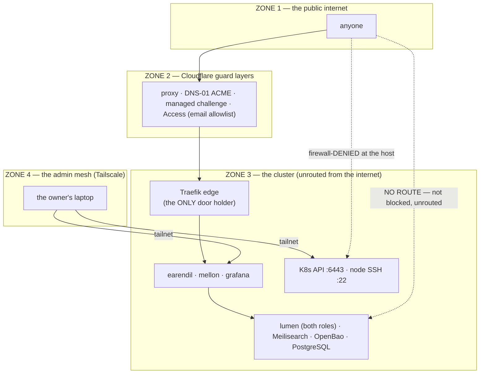
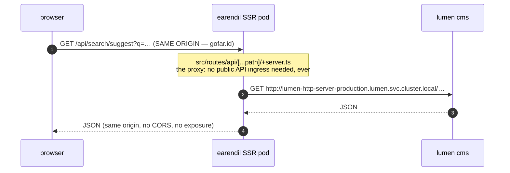
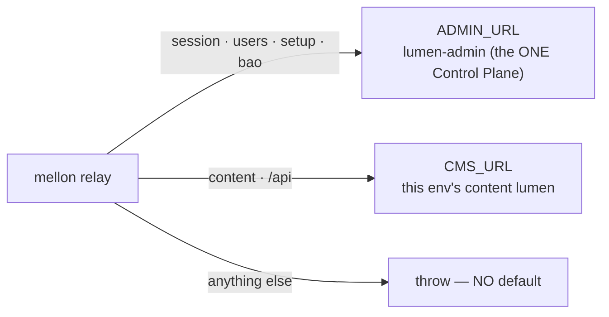
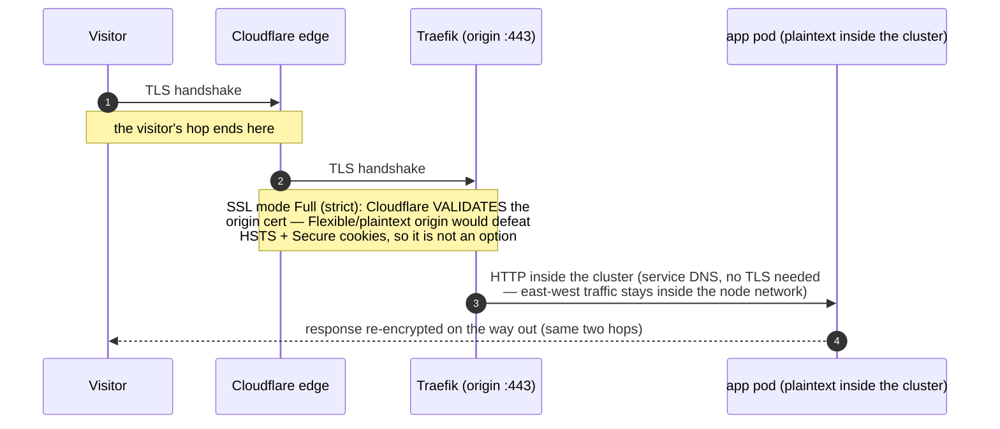
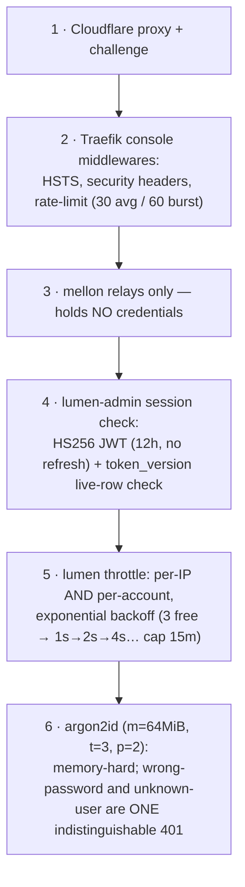

# Network and doors — what is public, what is never

The estate's most load-bearing security property fits in one sentence:
**two sanctioned public surfaces + one dashboard door, never a public API**
(INFRA §2, amended 2026-11-08; dashboard door added 2026-11-13). This note
explains what that means in practice, how a request flows through each door,
and where the estate deliberately does NOT build doors.

## The three zones

The distinction between "blocked" and "unrouted" matters: lumen has no
Ingress object at all — there is nothing to hack through, because no door
exists. The K8s API is the harder case (it must listen), so it is
firewall-denied at the host and mesh-reached.

## The doors

| Door | Serves | Layering | State |
| :-- | :-- | :-- | :-- |
| `gofar.id` + `www.gofar.id` | earendil (content reads) | Cloudflare proxy → Traefik → SSR pods. Unauthenticated reads; writes don't exist here | **LIVE — walked 2026-11-15**: 200 with the real Let's Encrypt cert (`gofar-id`); DNS cutover 2026-11-11; www is production-only by ruling |
| `console.gofar.id` | mellon (the owner's portal) | Cloudflare → Traefik + console middlewares (HSTS/headers/rate-limit) → mellon → relays to lumen. Service stays **ClusterIP**; only Traefik routes | **LIVE — walked 2026-11-15**: 303 → login, cert valid; HUMAN-GATE #10 still gates the PRODUCTION DNS flip (this walk rode the local k3d rehearsal cluster); port-forward remains break-glass |
| `anor.gofar.id` | Grafana dashboards (per-env filtered) | the ONLY door with a guest list: proxied DNS → managed challenge (whole host) → Access email allowlist → Grafana OIDC. Access IS the identity | ruling 2026-11-13; cert issued + 302 → OIDC (walked 2026-11-15) |
| `img.gofar.id` | photos | R2 bucket custom domain — never touches the server; outside ACME (bucket-side TLS) | GATE #9 closed 2026-11-13 |
| `staging.gofar.id` / `staging-console.gofar.id` | the staging world's twins | same Traefik, same ClusterIssuer | contractual; DNS + seeds land when staging first goes live |

## Why there is no API door — and how traffic reaches lumen anyway

The browser can only speak to what the edge routes. The edge routes exactly
three hostnames. lumen isn't behind any of them. So how does the blog work?

**Pattern 1 — the same-origin SSR proxy (earendil).** The browser's ONE
client-side API call (search suggest) goes to earendil itself:

Every other page's data is fetched server-side during SSR (in
`+page.server.ts`), so the browser sees only rendered HTML.

**Pattern 2 — the relay with a routing table (mellon).** The portal holds no
credentials; lumen mints its session; and WHICH lumen answers each call is
one auditable table (`src/lib/api/routing.ts`):

The split (2026-11-13) exists so the content worlds can't mint sessions and
the Control Plane can't be reached through a cms. A failing call is fixed by
the routing table or the seeded env — **never by adding an API Ingress**;
that "fix" is the estate's most tempting bug (root AGENTS.md non-negotiable
#2).

## TLS: DNS-01 everywhere

### Who does the handshake (the termination map)

**Traefik terminates TLS for every public door.** It holds the only 443
listener at the edge, presents each door's certificate during the
handshake, and decrypts before routing to the SSR/portal pods. The
certificates are issued by **cert-manager via DNS-01** through the shared
`ClusterIssuer` and referenced as secrets (`tls-gofar`, `tls-console`,
`tls-anor`, the staging twins) — never stored in Git.

With the doors behind the **Cloudflare proxy**, there are two TLS hops:

Reading the map as rules:

1. **Traefik is the estate's TLS terminator** — the single place public
   certificates are served from. (You had it right.)
2. **Cloudflare terminates the visitor hop** when a door is proxied — that's
   Cloudflare's edge cert, not ours.
3. **Full (strict) is the required SSL mode** — the origin hop must be real
   TLS with a validated cert, otherwise the HSTS/`Secure`-cookie posture is
   theater.
4. **Inside the cluster, east-west traffic is plaintext HTTP** (pod ↔ pod
   over service DNS) — a deliberate boundary: the cluster network is the
   trust domain; mTLS everywhere is a later, deliberate project, not an
   accident.
5. **Non-edge TLS is not Traefik's business:** the K8s API (`:6443`) uses
   k3s's own certs (the ones the observability cert-expiry alert watches —
   `k3s_certificate_expiration_seconds`); OpenBao's API is TLS-terminated by
   Bao itself mesh-side; break-glass paths (port-forward, mesh tunnels)
   terminate locally on the owner's machine.

### DNS-01, and why

- The zone (`gofar.id`) lives on **Cloudflare**; cert-manager solves ACME
  challenges via **DNS-01** through one shared `ClusterIssuer` — which is why
  staging rides the same issuer from any cluster (DNS-01 doesn't need the
  cluster to be publicly reachable, unlike HTTP-01).
- The self-signed rehearsal component died with the rehearsal trees.
- `console.gofar.id` must **resolve before first issuance** (same ordering
  constraint as every host: the DNS record exists before cert-manager
  tries) — and only AFTER GATE #10 clears.
- Certificates are created in-cluster and referenced — never stored in Git.

**Operate it:** runbook [`07-go-public.md`](../../runbook/07-go-public.md)
Act 1 has the CURRENT record table + procedure (the cutover walk is proven
there, 2026-11-11); runbook [`02-security.md`](../../runbook/02-security.md)
carries the ufw/host-lockdown posture.

## The admin mesh (zone 4)

The owner's laptop reaches the cluster through **Tailscale** (ruling
2026-11-13, replacing the NetBird-agent assumption: open-source client,
zero-ops hosted control plane, Headscale as a later escape hatch; NetBird
remains the answer if self-hosting the coordinator ever becomes a
requirement). Through the mesh: node SSH (port 22 closed publicly, root
login disabled once mesh SSH verified), the K8s API (dual `--tls-san` so the
cert covers both node and mesh IPs), and break-glass paths (Argo UI via
port-forward, the Grafana admin).

Node-to-node traffic (API, overlay, replication) rides the provider private
plane when available ("Path A") or the mesh ("Path B") — the full decision
matrix with its latency/MTU/staticity trade-offs is
[`INFRA_ARCHITECTURE.md`](../../INFRA_ARCHITECTURE.md) §2–§3.

## The mellon door's full defense, layer by layer

Because the portal is a WRITE surface, its layering is worth naming
explicitly:

Honest limits are documented, not hidden: the throttle state is per-replica
in-memory (accepted — the durable variant is a drop-in); a strict CSP is
deferred because the palette ships inline `style=` (the XSS posture therefore
assumes compromise — which is why revocation, not trust, is the load-bearing
mitigation). The full threat analysis (V1–V7, R1–R5) is archived in the
vault: [../archive/mellon-THREAT-NOTE.md](../archive/mellon-THREAT-NOTE.md) —
its owner read-through (GATE #5) is still the open item it says it is.
