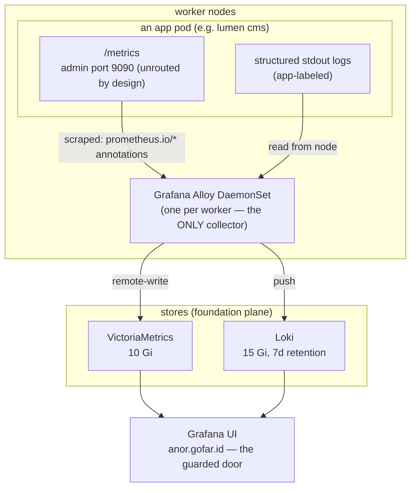
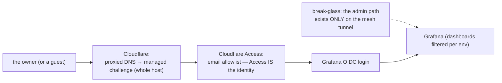

# Observability — the eyes and their doors

The estate watches itself with a small, deliberately boring stack. The
design contract (INFRA Phase 5) is: **no sidecars** — telemetry is
opt-in-per-app via annotations, collected by a DaemonSet, stored in two
single-instance stores, viewed behind one guarded door. This note explains
the pieces, the opt-in mechanism, what is watched today, and what is
deliberately OFF.

## The pipeline



Reading it: the app exposes metrics on port **9090** — an admin port with no
Service route attached, so the only reader is the node-local Alloy. Logs go
to stdout (the K8s-native contract), the node's Alloy reads them from disk.
Apps that want to be scraped add three annotations; apps that don't, stay
invisible. No sidecar containers anywhere (the budget is too small and the
complexity too real — that ruling's rationale is INFRA Phase 5).

## The opt-in contract

```yaml
annotations:
  prometheus.io/scrape: "true"
  prometheus.io/port: "9090"
  prometheus.io/path: "/metrics"
```

That's the whole integration. The port is deliberately **unrouted** (no
Service points at 9090) — scraping happens node-locally, so a pod's metrics
are unreachable from the network even in-cluster. The structured-stdout
logs follow the app-label contract: every pod log carries its app label
(the precedence was fixed 2026-11-14, vortex `0e18f0f`, after the fallback
stomped the short label).

## The door (anor.gofar.id)

The one human-facing observability surface, ruled in 2026-11-13:



Layering reads bottom-up as: nobody reaches Grafana without passing
Cloudflare's challenge, nobody passes the challenge without an allowlisted
email, nobody gets Grafana superpowers without OIDC. Break-glass admin
doesn't ride the public door at all — it exists only on the Tailscale path
([network-and-doors.md](network-and-doors.md), zone 4).

**Its seeds are structural:** the grafana feed (`kv/grafana/production`)
must exist and verify BEFORE the observability hub is applied — an
ExternalSecret erroring on a missing key wedges the sync-op permanently.
This is why bootstrap has ONE manual gate, and it's this hub. See
[secrets-and-vault.md](secrets-and-vault.md) and runbook
[`10-observability.md`](../../runbook/10-observability.md).

## What's watched today (walked 2026-11-15)

**Alert #1 — control-plane certificate expiry.** The k3s node certificate
(mTLS for the API server) is a real single-point-of-expiry: when it lapses,
kubectl, Argo, and the mesh all fail at once. The live signal:

- Gauge: `k3s_certificate_expiration_seconds` — a **REMAINING-seconds**
  gauge (verified by drift test: 10800 s of decay over exactly 3 h across
  all 22 series; the shipped `rate()`-based expr was always-true and never
  fired).
- The corrected expr is a bare threshold:
  `min(k3s_certificate_expiration_seconds) < 1814400` (21 days before
  expiry; k3s renews leaf certs under 120 days remaining, so 21d is a
  genuinely loud early warning).
- Facts that shape the rule: cert-manager v1.16.2 exports no per-cert
  gauge; k3s renews leaf certs on startup when <120d remain (90d before
  2025-05) and NEVER auto-renews CAs; the gauge refreshes ~every 30m.

The walked lesson (evaluate the SHIPPED expr against the live store; the
bad expr lived ~15m, under its own `for: 30m`, so it never paged) is the
vortex ledger's top entry:
[../repos/vortex/LEARNING.md](../repos/vortex/LEARNING.md).

## What is deliberately OFF

- **Traces** — no Tempo, no OTLP collector chain (yet). The statsd listener
  exists in config but stays commented. The estate adds observability
  machinery when a question demands it, not speculatively.
- **OTLP at the edge is the toe-hold** — the Traefik semconv door went live
  2026-11-14 (vortex `1a353e7`), so trace wiring has a path when needed.
- **No per-app alerting beyond the cert rule** — the estate is
  single-operator; alert fatigue is a bigger risk than blind spots. The
  dashboards carry the state; the one pager-worthy failure (cert expiry)
  pages.

**Operate it:** runbook [`10-observability.md`](../../runbook/10-observability.md)
(the stack, its seeds, its sizing — noted as OPEN for the 3-node shape);
alert procedures in [`12-operations.md`](../../runbook/12-operations.md);
the budget this stack fits in:
[`INFRA_ARCHITECTURE.md`](../../INFRA_ARCHITECTURE.md) §1.
