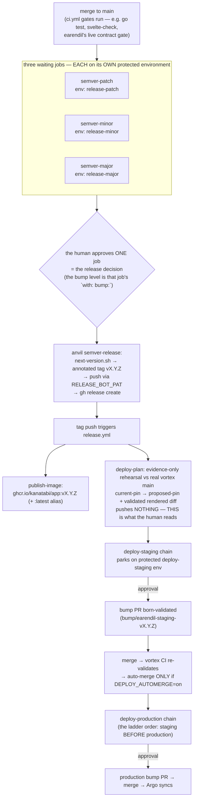

# Releases and CI — the approval ladder

This is the estate's most rule-dense area, because it is where "small
team, real money, public site" meets GitHub's automation semantics. The
doctrine (owner rulings 2026-11-13/14): **branch merges gate and NEVER
deploy.** A release exists only because a human approved one of three
waiting jobs; the tag that approval pushes is the only deployable artifact.
This note walks the ladder end-to-end, names every trap that shaped it, and
points at the operator procedures.

## The ladder



Why this shape? Because **merging is cheap and deploys are not.** Every
merge is safe to do all day; the release is a separate, reviewed, logged
decision with a tag as its receipt.

## The rules that exist because of incidents

Each rule below is load-bearing and has a story attached — the kind of thing
a future maintainer must not "simplify" away:

1. **ONE environment per bump job.** GitHub's environment approvals release
   EVERY job waiting on that environment. The estate once used a shared
   `release` environment: one approval pushed v0.1.0 AND v1.0.0 (the patch
   job died red on the duplicate-tag guard). Job-per-environment makes the
   review card equal the choice.
2. **`gate-audit` before any deploy job, fail-closed.** GitHub
   auto-creates referenced-but-missing environments UNPROTECTED — the
   2026-11-13 v3.0.0 incident: a deploy job parked on a nonexistent
   environment, GitHub silently created it with no reviewers, and the
   release fired unattended. Now: no environment or no required_reviewers =
   the chain goes red before anything deploys.
3. **A `GITHUB_TOKEN`-pushed tag never triggers a workflow.** The silent
   no-deploy trap: the tag lands, the release looks green, and
   `release.yml` never ran. Proven via the events API — the incident's
   pushes produced ReleaseEvents and ZERO PushEvents. Hence
   `push-release.sh` REFUSES to run without `RELEASE_BOT_PAT`, and that PAT
   needs Contents + Workflow + Actions write (Workflow is not optional).
4. **Settle declines the sibling jobs.** After the release, this run's
   un-approved bump reviews are declined automatically (warn-only — a red
   settle would lie; the release already happened), so ONE approval
   completes the pipeline and frees the CI concurrency queue.

## The bump PR: what a release actually changes in Git

The deploy is a Git commit in vortex — the app's image pin (and optionally
the config epoch) in ONE environment's tree:

```diff
 # environments/production/earendil/kustomization.yaml
 images:
   - name: earendil
-    newTag: v1.2.2
+    newTag: v1.2.3
```

…plus, when the release carries config, the **epoch TRIO** — three lines
moved TOGETHER in the same commit, byte-equal:

| side | where |
| :-- | :-- |
| pod-template annotation | `omicron/config.epoch: "N"` (kustomization patches) |
| the gate's argument | `--declared "N"` on the config-gate Job |
| ES annotation | `omicron/config.epoch: "N"` on the ExternalSecret metadata |

The TRIO exists so the config-gate (a PreSync Job) can REFUSE to sync when
the declared epoch doesn't match the rendered one — and so a secret refresh
declares which config epoch it shipped. A 2-of-3 flip leaves one witness
blind; validate-all's class-4 rule refuses any render where a side appears
without the others or the values differ. **A bump PR may even be
CONFIG-ONLY** (same tags, trio flips).

Guardrails around that diff:

- **Same-env lockstep:** a bump moves every `name: <app>` stanza in ITS OWN
  env only — a production bump never re-pins staging (fence makes cross-env
  unmergeable; bases carry no pins at all).
- **Branch grammar carries the env:** `bump/<app>-<env>-<tag>`; the legacy
  `bump/<app>-<tag>` (⇒ production) is deprecated; anything unparseable
  makes auto-merge BAIL — no silent env, no widening.
- **The fence works by line SHAPE, never by app name** — lines that are
  `images:`-stanza or `config.epoch`/`--declared` lines, in files under the
  branch's `environments/<env>/`. A non-canonical file would be silently
  reflowed by `kustomize edit` and trip the fence (fail-safe: the PR lands
  on a human instead).
- **Born-validated:** the bump action renders and validates BEFORE pushing
  the branch; a PR whose manifests don't build is refused at creation.
- **Auto-merge needs everything:** author == bot, label deploy-bump, env
  parsed, fence-clean diff, validation green, AND the repo variable
  `DEPLOY_AUTOMERGE=on` — absent means OFF (fail-safe).

## The pin dance (why upgrading the tooling is also reviewed)

anvil's Actions are consumed **by SHA, never by tag** (renovate-style
auto-bumps are a hard NO — anvil's changes are deploy-capable code).
lumen/earendil/mellon pin anvil's SHAs; vortex pins its validate-manifests
ref. So a toolkit change is a reviewed cascade: the anvil PR lands, then
consumers bump their pins in reviewed PRs (a structure change pairs the pin
bump with the vortex commit in the SAME PR). It's friction on purpose — the
tooling that deploys production should never move invisibly.

## Tag doctrine

- Deploy pins are **`vX.Y.Z` only** — immutable release identity. The
  `:latest` alias exists for tests/tooling; a manifest referencing an alias
  is a bug the fence can't catch, so reviewers must.
- Tagless repos start at `v0.1.0` (minor|patch); only `major` jumps to
  `v1.0.0`. Semver arithmetic is VENDORED (semver-tool 3.4.0, pinned,
  sha256-audited) because `git describe` sorts equidistant tags by TAGGER
  DATE — a live-fire bug (2026-11-13).
- Rollback = a human-merged `git revert` of the bump commit (or re-dispatch
  release.yml with an older tag — redeploy IS a release).

## Status & operate it

The first live walk proved the ladder end-to-end (first bump #17: staging
before production, evidence-first, three-environment locks). The full
operator view lives in runbook [`09-releases.md`](../../runbook/09-releases.md)
(the ladder), [`12-operations.md`](../../runbook/12-operations.md)
(day-2 ops), and [`00a-run-order.md`](../../runbook/00a-run-order.md)
(the rehearsal order). The machinery's own documentation:
[anvil AGENTS.md](https://github.com/kanatabi/anvil/blob/main/AGENTS.md)
(§5 contract + trap ledger, §6 environment model) and vortex's sync side:
[gitops.md](gitops.md).
