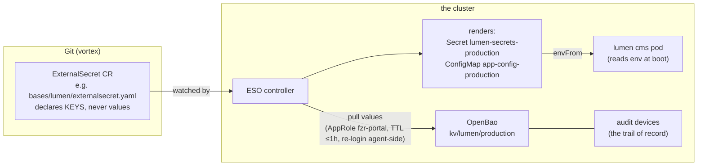
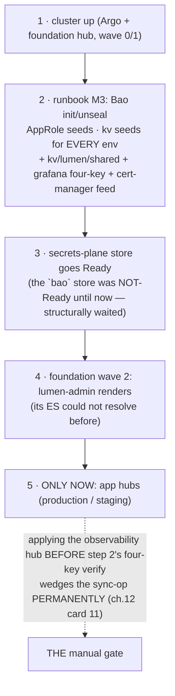
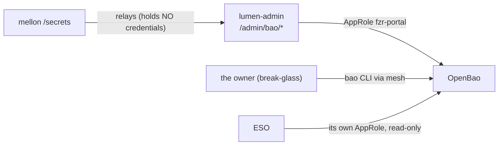
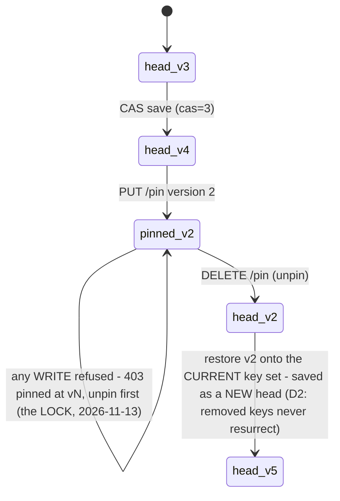

# Secrets and vault — the values plane

The estate's first non-negotiable: **config and secret VALUES never live in
Git — not even encrypted** (INFRA §5). This note explains what lives where
instead, how a value travels from the vault into a pod's environment, why
the seeding order is structural rather than polite, and who is allowed to
touch a value at all.

## The cast (junior-friendly definitions)

- **OpenBao ("Bao")** — an open-source, Vault-compatible secrets server.
  Runs INSIDE the cluster (ClusterIP-only, no door). Holds every credential
  and config value in **KV v2** — a versioned key-value store: writes create
  new versions, history is kept, `cas` (check-and-set) makes writes
  compare-and-swap safe.
- **ExternalSecret (ES)** — a Kubernetes CRD *declared in Git* that says
  "a Secret named X should exist, its keys come from Bao path Y". Git holds
  the SHAPE, never the values.
- **External Secrets Operator (ESO)** — the controller that watches
  ExternalSecrets and materializes real in-cluster Secrets/ConfigMaps by
  pulling from Bao. Installs as an OCI Helm chart (the estate's one non-git
  Application).
- **ClusterSecretStore `bao`** — the ESO configuration object: "the vault is
  THERE, authenticate with THIS AppRole". Exactly one, foundation-owned.
- **AppRole** — Bao's machine-auth: a role-id + secret-id pair. lumen's
  identity (`fzr-portal`) is the estate's only door to values.

## The render chain (the whole mechanism in one diagram)

At sync time ESO renders; at `refreshInterval` (1h) it **drift-pulls**
(re-render if Bao moved). A pinned-immutable variant exists (`"none"` as the
interval) for pin-per-deploy semantics — the default keeps drift-pull so a
vault fix reaches pods without a release.

## The render contract: an ES mirrors the role's real binds

An ExternalSecret's `data:` list is not a wishlist — it must equal what the
deployed role actually reads. For lumen this truth is machine-checkable
(`lumen config keys --role admin|cms`):

| Plane | ES carries | Never |
| :-- | :-- | :-- |
| `lumen-admin` (admin) | `LUMEN_DB_URL` + `LUMEN_SESSION_JWT_SECRET` (the signing key has exactly ONE home) | anything else |
| `lumen cms` (each env) | the content keys + `LUMEN_ADMIN_URL` (source `kv/lumen/shared` — a service URL is a VALUE) | the JWT secret |
| earendil / mellon | `API_BASE` / `ADMIN_URL` / `CMS_URL` (suffixed service URLs are seeded VALUES), per-env index names | any credential |

**`LUMEN_ROLE` stays inline on the pods** — deployment IDENTITY, not
configuration. If the role were a vault value, the vault could silently
re-role a fleet; inline means only a Git commit (and a bump PR) can.

## Where values live (the path scheme)

| Path | Holds |
| :-- | :-- |
| `kv/{app}/{env}` | app + env values (earendil, mellon: `API_BASE`, `ADMIN_URL`, `CMS_URL`, media keys…) |
| `kv/lumen/{staging,production}` | each cms's DB URL + Meili keys + index names |
| `kv/lumen/shared` | the admin identity: `LUMEN_DB_URL` (→ `lumen_admin` DB), `LUMEN_SESSION_JWT_SECRET`, `LUMEN_ADMIN_URL` |
| `kv/grafana/production` | the grafana feed — FOUR keys, verified before the observability hub may apply |
| `kv/cert-manager/production` | the Cloudflare DNS-01 credential |

Onboarding a new app seeds the trio `dev/staging/production` by default
(a DEFAULT, not a schema — add-env extends later). Namespaces are **DATA**:
the frozen contract at
[decisions/secrets-control-plane.md](../decisions/secrets-control-plane.md).

## Seeding order is structural (the all-or-nothing render)

ESO fails the WHOLE render if ONE declared key is missing from Bao. There is
no partial success. Consequences the estate embraces:

That last arrow is why the **observability hub is applied by a human, only
after the grafana four-key put verifies**: an ES erroring on a missing key
blocks that sync operation forever, and the un-wedge is manual surgery.
This is the difference between "seeding order is a runbook nicety" and
"seeding order is structural".

**Operate it:** runbook [`05-vault.md`](../../runbook/05-vault.md) (M3: the
init/unseal/AppRole/kv-seed procedure, walked against the rehearsal cluster);
[`00a-run-order.md`](../../runbook/00a-run-order.md) orders it against
everything else.

## Who may touch values (the relay)

- **lumen is the only programmatic door.** The relay surface is exactly:
  list paths, read (`?version=N`), version list, CAS write, create-if-absent
  (`cas=0`), metadata PATCH (the pin's home). **No `sys/`, no destroy** —
  app/env teardown is an operator drill, not a UI button (decision D5).
- **The portal is UI-only by doctrine** — mellon adds no credentials, so a
  full mellon compromise buys nothing that the session doesn't already grant.
- **Audit:** Bao's audit devices log every relay operation (the trail of
  record); lumen logs `op + app + env + version + key-counts`, NEVER values —
  and that redaction is TESTED (`bao_integration_test.go` captures the slog
  stream and demands a marked value's absence).

## Pins and versions (the state machine)

Reading it in words: **head is what you see and what ESO renders** — a pin
never reroutes reads (D1, original ruling); it only REFUSES WRITES while
set (redefined 2026-11-13). Every write mirrors the KEY SET to sibling envs
(adds land empty, removes propagate; values stay per-env) — the mirror is
how the estate guarantees "the key sets of an app's envs are structurally
identical". The restore flow (D2) is the only "rollback", and it is honest
about it: restoring v2 onto today's key set creates a NEW head version.

**Operate it:** the walk-through of pins/mirror/restore lives in the
runbook's operations chapters ([`12-operations.md`](../../runbook/12-operations.md));
the contract's own decision log (append-only, with every walked date) is the
[decision record](../decisions/secrets-control-plane.md).
