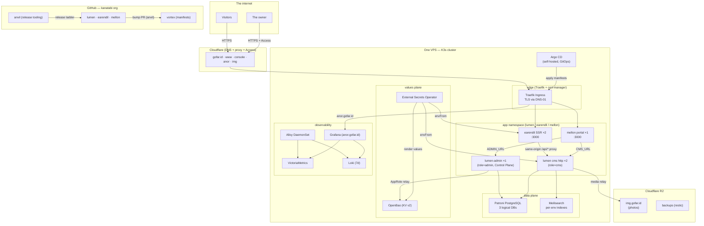
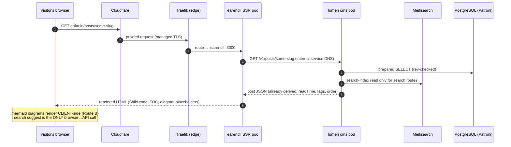
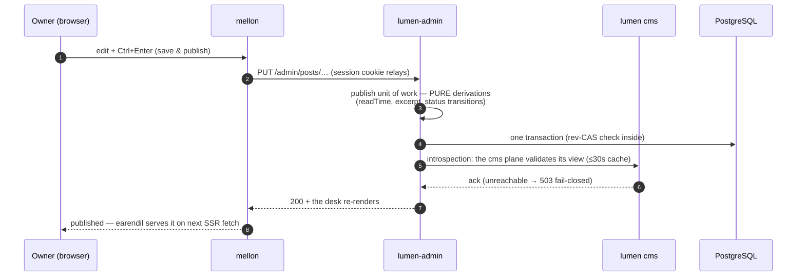
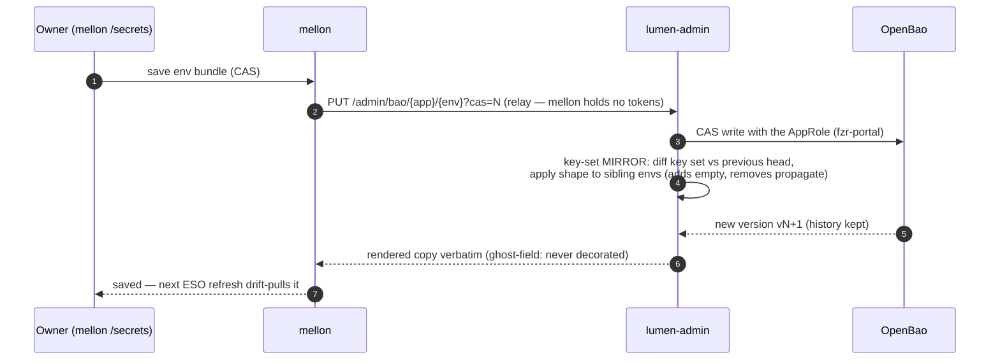
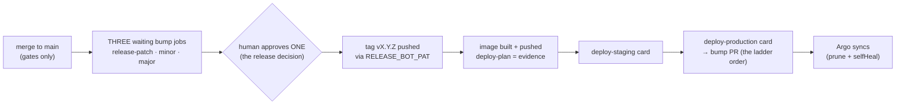

# System overview — the estate end-to-end

This is the one page to read before any other. It answers: what is this
thing, who talks to whom, and where does a request actually go? Everything
here is explained in depth by the sibling notes in this folder; each section
links to its deep-dive.

## The system in one paragraph

A personal blog (the pen-name **`gofar;`**, legal identity **Faiz Ainur
Rofiq**) published at **`gofar.id`**, plus the private tooling that operates
it. The blog is a SvelteKit server-rendered frontend (**earendil**) backed by
a Go API (**lumen**) with search on Meilisearch and storage on PostgreSQL
(Patroni). The owner writes and administers through **mellon**, a private
portal at `console.gofar.id` that holds no credentials of its own — it
relays to lumen. Everything running in the cluster is declared as YAML in
**vortex** and applied by Argo CD (GitOps). Releases ship through **anvil**,
an approval-gated ladder where a human click is always the deploy decision.
Secrets live in **OpenBao** inside the cluster; Git never holds a value. The
whole estate runs on **one small VPS (~$12/month)** today, with a 3-node
shape declared as the scale-out blueprint.

## The big picture

## The five repos (and why they're separate)

Each repo is independently versioned and released — a blog bug fix should
never force a manifests change, and vice versa.

| Repo | One job | Language / shape | Released via |
| :-- | :-- | :-- | :-- |
| [earendil](https://github.com/kanatabi/earendil) | render the blog | SvelteKit 3 (Svelte 5 runes) + `adapter-node` container | anvil ladder |
| [lumen](https://github.com/kanatabi/lumen) | the only backend | Go (chi), layered handlers→services→store | anvil ladder |
| [mellon](https://github.com/kanatabi/mellon) | the owner's control surface | SvelteKit 3, UI-only relay | anvil ladder |
| [vortex](https://github.com/kanatabi/vortex) | declare the cluster | YAML (Kustomize + Argo CD) | commits = syncs |
| [anvil](https://github.com/kanatabi/anvil) | the release ladder | shell scripts + composite Actions | pinned by SHA |

The superproject [omicron](https://github.com/kanatabi/omicron) pins all five
as git submodules and owns the blueprint
([`INFRA_ARCHITECTURE.md`](../../INFRA_ARCHITECTURE.md)), the operating
procedure ([`runbook/`](../../runbook/00-overview.md)), and this vault.

## The three planes

The runbook (ch.00) teaches the system as three planes — hold onto this
model:

1. **Content plane** — what readers see: earendil ← cms lumen ←
   PostgreSQL/Meilisearch. Per environment (staging / production).
2. **Control plane** — what the owner uses: mellon → `lumen-admin` (ONE,
   unsuffixed, foundation-owned) → sessions, users, the TOFU wizard, and the
   Bao relay. Also Argo CD and the release ladder.
3. **Values plane** — OpenBao + ESO: where every credential and config value
   lives and how it reaches pods. Foundation-owned, shared.

## Walkthrough: a reader opens a post

The load-bearing rules visible here: the browser never reaches lumen (there
is no route — see [network-and-doors.md](network-and-doors.md)); the FE
renders payloads as-is (ordering/derivation happens BE-side, at publish
time); and the API has no public ingress, ever.

## Walkthrough: the owner publishes a post

Why two lumen planes? The role split (2026-11-13): the **admin** plane is
ONE instance holding sessions/users/TOFU/Bao; **cms** instances exist per
environment and hold content only. A cms can serve `gofar.id` without ever
being able to mint a session.

## Walkthrough: the owner edits a secret value

The full frozen contract (apps-are-data, the mirror, pins-as-locks) is the
[secrets control plane decision record](../decisions/secrets-control-plane.md);
the values-plane mechanics are [secrets-and-vault.md](secrets-and-vault.md).

## How changes reach the cluster (the 30-second version)

Deep dive: [releases-and-ci.md](releases-and-ci.md). **Operate it:**
runbook [`09-releases.md`](../../runbook/09-releases.md).

## Where to go next

| You want to… | Read |
| :-- | :-- |
| understand how Git becomes cluster state | [gitops.md](gitops.md) |
| understand staging vs production vs foundation | [environments-model.md](environments-model.md) |
| know what's public and what's never | [network-and-doors.md](network-and-doors.md) |
| follow a secret from Bao to a pod | [secrets-and-vault.md](secrets-and-vault.md) |
| know how the estate is watched | [observability.md](observability.md) |
| ship a release | [releases-and-ci.md](releases-and-ci.md) |
| run the whole thing from zero | runbook [`00a-run-order.md`](../../runbook/00a-run-order.md) (the execution map) |
| learn the vocabulary | [glossary.md](../glossary.md) |
