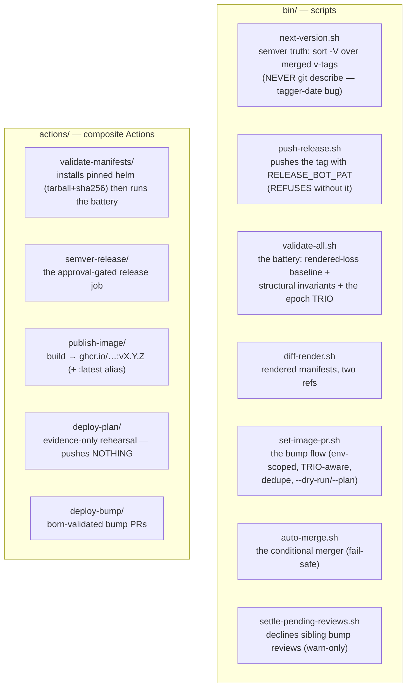
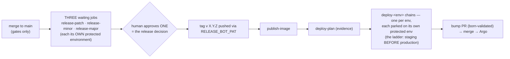

# anvil — the release toolkit

> **Sync duty (workspace rule, 2026-11-15):** this note is the vault's
> learning home for the repo. Any change that alters the scripts, actions,
> contracts, or state recorded here must update this note in the SAME
> round — and [LEARNING.md](LEARNING.md) if it minted a lesson. See
> [../doc-map.md](../../doc-map.md) §"Context sync".

## 1. Role in the estate

anvil is HOW CODE REACHES THE CLUSTER — the shared scripts and composite
GitHub Actions used by lumen, earendil, mellon, and vortex CI. It is
deliberately PUBLIC (nothing here holds a secret), deliberately
dependency-free (ZERO third-party actions, nothing fetched at runtime),
and deliberately consumed **by SHA, never by tag** — anvil's code is
deploy-capable and is reviewed as such (renovate-style auto-bumps: hard
NO).

Scope rule: anything with **≥2 consumers** across the estate, or belonging
to the deploy/ops lifecycle. Per-repo gates (gofmt, vitest, svelte-check)
stay in their own repos — YAGNI is a feature.

## 2. What's in the box



The full per-entry annotations live in
[anvil AGENTS.md §2](https://github.com/kanatabi/anvil/blob/main/AGENTS.md)
— the authoritative catalog.

## 3. The release contract (the short version)

The estate deploys through an **approval ladder**, never through merges:



The load-bearing rules and the incidents that minted them (one
environment per bump job; gate-audit fail-closed; the never-triggering
`GITHUB_TOKEN` tag; settle) are told in full in
[../architecture/releases-and-ci.md](../../architecture/releases-and-ci.md)
— read that before touching any of the ladder scripts.

## 4. The bump PR anatomy (what anvil writes to vortex)

A bump touches EXACTLY:

1. the app's `images:` stanza lines in the bump's OWN env
   (`environments/<env>/<app>/kustomization.yaml` — same-env lockstep),
2. optionally the **epoch TRIO** (pod annotation + gate `--declared` + ES
   annotation, byte-equal, `--config-epoch` refuses unless all three sides
   pre-exist), and nothing else. The auto-merge fence works by **line
   shape** (`images:`-stanza / `config.epoch` lines), never by app name;
   the branch grammar `bump/<app>-<env>-<tag>` carries the env; a
   non-canonical kustomization file reflows under `kustomize edit` and
   trips the fence (fail-safe: the PR lands on a human). Detail: anvil
   AGENTS §5–§6.

## 5. The credentials matrix (never stored here)

| Name | Scope | Why it exists / failure mode |
| :-- | :-- | :-- |
| `VORTEX_BOT_PAT` | fine-grained, `kanatabi/vortex` ONLY (contents + PR write) | clones vortex + opens bump PRs; lapsed → 401/403 at the bump step, nothing else breaks |
| `RELEASE_BOT_PAT` | fine-grained, lumen/earendil/mellon ONLY (Contents + **Workflow** + Actions RW) | pushes release tags so the cascade fires; without Workflow: the tag lands and NO workflow ever runs (the silent no-deploy trap — proven via the events API); revocation = the emergency brake |
| `DEPLOY_AUTOMERGE` | repo/org VARIABLE (`on`/`off`, absent = off) | the auto-merge master switch — fail-safe by absence |

Environments (`release-patch|minor|major`, `deploy-staging`,
`deploy-production`) are PROTECTED with required reviewers — and their
existence must predate the workflows (GitHub auto-creates missing
environments UNPROTECTED; the 2026-11-13 incident). The deferred fix
(`provision/`, Path 1) is the repo's recorded backlog.

## 6. Local testing (all dry)

```bash
bin/next-version.sh minor                        # semver truth
DRY_RUN=1 GITHUB_REPOSITORY=kanatabi/lumen bin/push-release.sh v1.2.3
bin/validate-all.sh <path-to-vortex> [--base <ref>]
bin/diff-render.sh <path-to-vortex> <base-ref>
VORTX=<path-to-vortex> bin/set-image-pr.sh --app lumen \
  --image ghcr.io/kanatabi/lumen --tag v9.9.9-test --dry-run
VORTX=<path-to-vortex> bin/set-image-pr.sh --app earendil --env staging \
  --image ghcr.io/kanatabi/earendil --tag v9.9.9-test --config-epoch 1 --plan
```

No tokens needed for the dry shapes; nothing pushes.

## 7. State & history (walked)

- **2026-11-13** — the live-fire day: shared-env double release, the
  Workflow-permission discovery (events-API proof), the git-describe
  bug, the get-helm-3 mutable-CDN find. All four minted permanent rules.
- **2026-11-14** — `expected-kinds.txt` retired (the four-repo pin
  cascade + phantom reds) in favor of the runtime merge-base baseline;
  the `bases/` rename follow-through.
- **2026-11-13** — the ladder proved live: first bump (#17), staging
  before production, evidence-first.
- **Open:** the centralized provisioning backlog (owner-deferred);
  the transition-pattern removal once vortex's `overlays/` tree is gone.

## 8. When you change this repo — the sync checklist

1. Remember the blast radius: anvil changes are deploy-capable in FOUR
   repos. Every consumer bump is a reviewed PR.
2. Zero third-party actions; vendored deps stay sha256-audited and
   byte-identical to upstream.
3. Update this note if §2–§6 drifted; update [LEARNING.md](LEARNING.md)
   if the change minted a lesson (anvil mints them often — it's where
   GitHub's sharp edges get discovered).
4. The consumers bump their pins deliberately, in reviewed PRs, paired
   with any vortex-side validation change.
