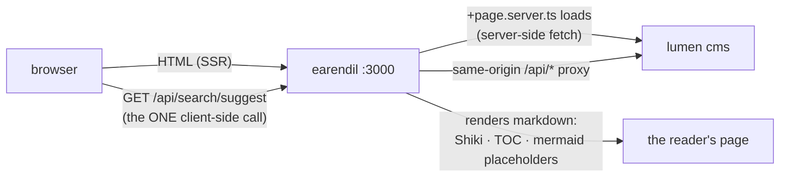
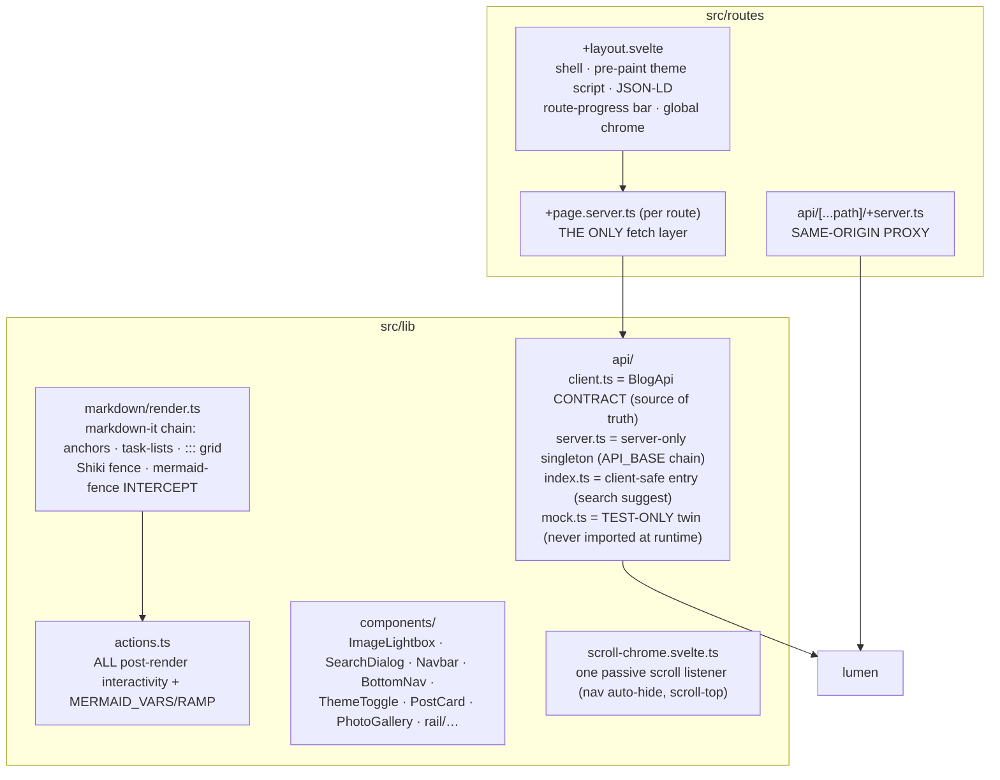
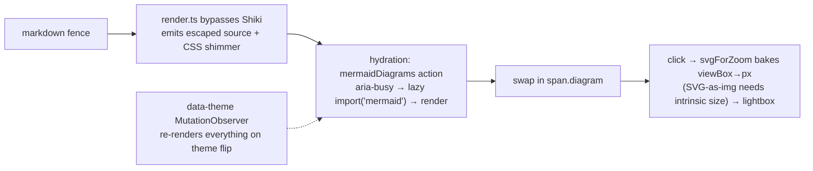

# earendil — the blog frontend

> **Sync duty (workspace rule, 2026-11-15):** this note is the vault's
> learning home for the repo. Any change that alters the stack, anatomy,
> contract, commands, conventions, or state recorded here must update this
> note in the SAME round — and [LEARNING.md](LEARNING.md) if it minted a
> lesson. See [../doc-map.md](../../doc-map.md) §"Context sync".

## 1. Role in the estate

earendil is the only thing readers ever see: the server-rendered blog at
`gofar.id` (+ `www.gofar.id`, production-only). It is a **SvelteKit 3**
app (Svelte 5 runes, Vite) shipped as a container via **`adapter-node`**
(listens on **:3000**, 2 replicas in the base shape, placed on both
workers). It owns NOTHING persistent: content arrives at runtime from
lumen, search lives in Meilisearch, and even the browser's one API call
rides earendil's own same-origin proxy.



Why this shape: **SEO needs SSR** (crawlable articles), **security needs
the proxy** (lumen has no public route — see
[../architecture/network-and-doors.md](../../architecture/network-and-doors.md)),
and **simplicity needs one data source** (real-first, owner ruling
2026-11-09: the runtime always fetches lumen; unset `API_BASE` falls back
to the local dev default `http://localhost:8080`).

## 2. Stack, and why each piece

| Piece | Why it's here |
| :-- | :-- |
| Svelte 5 runes + SvelteKit (Kit 3) | small bundle + fine-grained interactivity (search palette, lightbox gestures); file-based routing; SSR |
| TypeScript | the API contract (`BlogApi`) is typed — FE/BE drift fails at compile time |
| Tailwind v4 (CSS-config `@theme`) | design tokens live in `src/routes/layout.css`; NO `tailwind.config.js`; ~7 deliberate raw-CSS exceptions (DESIGN §7) |
| markdown-it + anchor + container + task-lists | runtime content from the API → build-time mdsvex doesn't apply; token access powers TOC/anchors/`::: grid` |
| Shiki (server-side, dual-theme) | VS Code-grade highlighting; ships plain highlighted HTML; themes flip via CSS vars without refetch |
| DOMPurify (isomorphic, server-side) | mandatory — API content is treated as untrusted |
| mermaid 12.2.0 (exact pin) | diagrams render CLIENT-side ("Route B" — see §4); the pin is exact because v12 changed the whole theming story |
| `@fontsource` self-hosted fonts | Inter (variable) + JetBrains Mono + **Fraunces** (brand serif, wordmark only — `SOFT 40 / WONK 1`) — no external request/FOUT |
| vitest (node env, no jsdom) | the offline battery — see §7 |

**Brand:** the wordmark is **`gofar;`** — the pen-word ("go far"; travel
motif, cf. the repo's Tolkien-mariner codename) and a legitimate
Arabic/Indonesian given name. The violet semicolon is the only violet
accent on the wordmark. The legal identity (Faiz Ainur Rofiq) anchors in
the About page, the © footer, and the `Person` JSON-LD in the root layout
(`alternateName: Gofar`). Canonical URL `https://gofar.id`;
`ainurrofiq.com` 301s in (DESIGN §9).

## 3. Anatomy (the code spine)



Facts that matter when touching anything here:

- **Server-only boundary:** `$app/env/private` (and anything reading
  `process.env`) must never be imported from shared code — it breaks the
  client build. That's why server loads use `#lib/api/server.ts` and
  components use `#lib/api/index.ts`. (`#lib/*` is a package.json `imports`
  alias — don't rewrite it to `$lib` or back.)
- **The proxy is load-bearing:** `routes/api/[...path]` is how the browser
  reaches lumen without a public API ingress. Don't "fix" a 404 on
  `/api/...` by exposing the backend.
- **`app.html` `<noscript>`** restores raw mermaid source when JS is off —
  deleting it orphans the no-JS path.
- **The escaped diagram source is the DOM's ground truth** — SSR emits
  `<pre class="mermaid-src"><code>escaped</code></pre>`, which is also the
  shimmer skeleton (pure CSS from first paint). Never remove it from SSR
  output.

## 4. The diagram subsystem (Route B — the subtle area)

Backend ships **raw** ` ```mermaid ` fences; everything after is FE-owned:



Theming contract (violating any line regresses the look;
`theming.contract.test.ts` guards what it can): `--diagram-*` tokens in
`layout.css` are the ONLY color source (hex-only — mermaid ignores
`oklch()`); JS holds zero color values; neutrals come from tokens, the
primary/secondary/tertiary trio is deliberately UNMAPPED (entity colors
cycle the theme's built-in 12-hue arrays — that variance IS the look);
themes are `redux-color`/`redux-dark-color` with `darkMode` derived from
`data-theme`. The full contract: earendil
[AGENTS.md §7](https://github.com/kanatabi/earendil/blob/main/AGENTS.md).

## 5. Pages (what readers get)

| Route | Content |
| :-- | :-- |
| `/` | identity hero (Fraunces headline, ASCII profile portrait with luminance-baked alpha mask, hover-revealed BW cutout + violet glow) + full post list, SSR-paginated (`?page=N`, size 10) + `lg`-only sticky rail (search pill, `topics;` cloud, identity card) that becomes a draggable bottom sheet below `lg` |
| `/posts/[slug]` | serif title, breadcrumb, hero thumb, mono masthead, tag chips, inline + sticky TOC, body with diagram/code tools, "Further reading", end-of-read watermark |
| `/search` | query (`?q=`) + facets (`?tag=` OR, `from`/`to` dates), SSR-paginated, `noindex` on queries; filter rail (topics checkboxes, date presets, reading-time slider, sort chips) behind an `apply;` button; zero-params = the archive |
| `/gallery` | full mixed-aspect masonry with lightbox |
| `/about` | FE-owned content (`src/lib/content/about.ts`) — bio, experience, education, research, stack; scroll-following experience rail |

Shell facts worth knowing: article links preload **data on tap, code on
hover** (hover-preloading them causes render storms — AGENTS §10.8); the
route-progress bar has a minimum-visible-beat state machine; the mobile
bottom bar auto-hides on deliberate scroll-down; `+error.svelte` covers
all statuses with brand voice. The full anatomy: earendil
[DESIGN.md §2](https://github.com/kanatabi/earendil/blob/main/DESIGN.md).

## 6. Running it

```bash
npm install
npm run dev          # REAL lumen (API_BASE unset → localhost:8080 fallback)
make dev             # same but refuses to start a blind server (readyz gate)
npm run dev -- --host   # LAN QA (phone)
npm run build && npm run preview   # adapter-node production shape (:4173)
```

| Env var | Meaning | Unset |
| :-- | :-- | :-- |
| `API_BASE` | server-only lumen base (the runtime data source) | `http://localhost:8080` (dev fallback) |
| `PUBLIC_API_BASE` | browser base — ALWAYS `/` in the cluster (rides the proxy) | `/` |
| `PUBLIC_SITE_URL` | canonical origin for RSS/canonical absolutes | reserved |

One image runs everywhere — **runtime env only**; `VITE_*` build-time
inlining is banned for anything that differs between environments.

## 7. Testing (what proves what)

| Gate | Command | Proves |
| :-- | :-- | :-- |
| type check | `npm run check` | svelte-check 0/0 |
| lint | `npm run lint` | prettier + eslint exit 0 standalone (piping through `tail` produced false "it passed" moments) |
| offline battery | `npm run test:unit` | 51 tests vs the fixture twin — corpus shape, render pipeline, diagram zoom, theming contract — with ZERO backend |
| live contract | `LUMEN_URL=http://localhost:8080 npx vitest run src/lib/api/contract.spec.ts` | the FE/BE contract against a RUNNING lumen (13/13) |

The twin (`mock.ts`, 12 posts + photos + 3 mermaid fences) is TEST-ONLY:
api tests assert the corpus matches `BlogApi`; the live-vs-twin contract
baseline keeps them equivalent. New endpoints: extend `BlogApi` + the twin
in the same change. The runtime import graph must NEVER touch `mock.ts`.

## 8. How it ships

Merges run gates only. A release = anvil ladder approval → tag `vX.Y.Z` →
image `ghcr.io/kanatabi/earendil:vX.Y.Z` → bump PR into
`vortex/environments/<env>/earendil` → Argo syncs → the pods carry it.
The door: `gofar.id` + `www` via Traefik, DNS-01 TLS. Full flow:
[../architecture/releases-and-ci.md](../../architecture/releases-and-ci.md).

## 9. State & history (walked)

- **2026-11-21** — the unbreakable-token overflow round (**merged to `main`
  `e2f241b`**): `.prose` carries `overflow-wrap: break-word` (typography 0.5.19
  ships none — space-free tokens painted past the article column and, on
  phones, panned the whole page: body looked half-width, fixed chrome slid,
  full-page captures came out ~2× wide) + `break-words` on the post h1/preview;
  AGENTS §10 #10 minted (`45e416d`); mellon's preview mirrors the guard.
  Proven in the built bundle (the prose rule and the `.break-words` utility
  both emit `overflow-wrap:break-word`). Deploy rides the release ladder.
  **Audit addendum** (branch `fix/article-overflow-audit`, `94155b3`, pending
  merge): the same failure class had more exposed surfaces — tables (min-content
  is intrinsic; the renderer now wraps every table in a `.table-wrap` scroll
  box), the base `html { overflow-wrap: break-word }` guard for every text
  surface outside `.prose`, and `min-w-0` on the flex/grid items holding user
  text (breadcrumb title, TOC entries, tag chips). Audit matrix: images ✓
  (preflight), code ✓ (`pre` scrolls), mermaid ✓ (svg width 100%), truncate
  sites ✓. Torture-post QA script in the round notes.
- **2026-11-11** — the DNS-side domain cutover verified live (`gofar.id`
  resolves; the old domain 301s in). The SSR dependency-bundling lesson
  minted the bundle-the-markdown-family rule (`8609828`).
- **2026-11-15** — the first production-hub walk: the cms fleet (lumen)
  went green; earendil's pods rolled when the certs landed (the wave-2
  hold → lifted; **gofar.id serves 200 with the real cert**) — the site's
  public DNS flip (GATE #10) is the remaining go-public act.
- **2026-11-15** — the correlation round (`7f4dc0c`): every outbound
  lumen call mints a request-id (`src/lib/api/requestid.ts` — the
  vocabulary in ONE file), sends it as `X-Request-Id` (lumen adopts it
  verbatim), logs the access line (`hop=ssr|proxy`), and carries lumen's
  echo in `ApiError.requestId`; the `/api` proxy mints/forwards/echoes
  too — the browser hop joins the chain.
- **2026-11-15** — the metrics + budgets round (`7b872ad`): prom-client,
  the ONE registry (`src/lib/server/metrics.js`, plain JS) shared by the
  SvelteKit hooks and the custom server; every outbound call COUNTED
  (outbound_request_total, ok/error/timeout) and BOUNDED
  (AbortSignal.timeout, flat `EARENDIL_TIMEOUT_*` env keys, missing or
  empty = default); the inbound RED pair in a `handle` hook keyed on
  route IDs; `server.js` runs TWO listeners in ONE process (app on PORT,
  unrouted `/metrics` on `EARENDIL_METRICS_PORT` default 9090 — the
  no-sidecar contract's scrape door; Docker CMD `node server.js`);
  vortex's pod annotations opt the scrape in.
- **2026-11-15** — the boot fixes: package.json ships in the runtime
  image (the `#lib/*` alias needs it — `50bd8d0`, pre-empted before the
  next release could crash-loop like mellon's v3.1.0) and the static
  `/healthz` door (the probes rendered the homepage — the fake /api/*
  traffic the metrics exposed).
- **2026-11-09** — real-first ruling replaced mock-first (the BE exists).
- **Earlier (dated in git log)** — Route B adopted (publish-time SVG
  rejected); the theme bloom retired (clip-path re-rasterized the viewport
  per frame); hover-preload storm fixed; View-Transition element split.
  The ten standing lessons:
  [earendil AGENTS.md §10](https://github.com/kanatabi/earendil/blob/main/AGENTS.md);
  the ledger: [LEARNING.md](LEARNING.md).
- **2026-11-15** — `PLAN.md` became the owner's local-only journal
  (gitignored); the superseded single-node ARCHITECTURE draft moved to the
  vault [archive](../../archive/earendil-ARCHITECTURE.md).

## 10. When you change this repo — the sync checklist

1. Gates: `prettier --write` → `npm run lint` → `npm run check` →
   `npm run test:unit` → `npm run build` (lint must exit 0 standalone).
2. Contract change? Extend `BlogApi` + the twin + lumen's mirror in ONE
   coordinated change (its DESIGN §1).
3. Update this note if §2/§3/§5/§6/§7/§9 drifted; update
   [LEARNING.md](LEARNING.md) if the change minted a lesson.
4. Release via the anvil ladder only — never a hand-rolled deploy.
