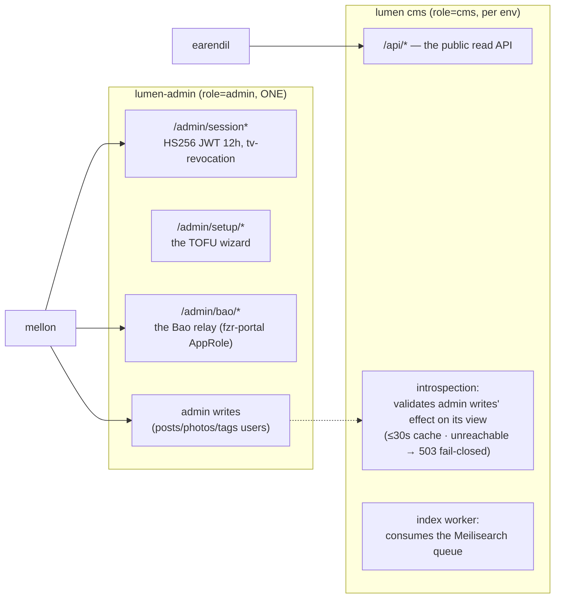
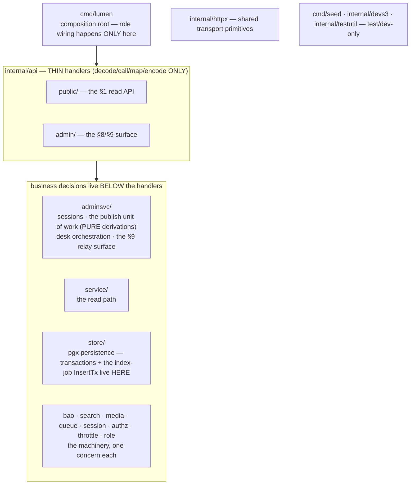

# lumen — the REST backend

> **Sync duty (workspace rule, 2026-11-15):** this note is the vault's
> learning home for the repo. Any change that alters the stack, anatomy,
> contract, commands, conventions, or state recorded here must update this
> note in the SAME round — and [LEARNING.md](LEARNING.md) if it minted a
> lesson. See [../doc-map.md](../../doc-map.md) §"Context sync".

## 1. Role in the estate

Live Go service (M1–M6 merged 2026-11-09; secrets control plane
2026-11-13; the count-pipeline redesign 2026-11-15) — a Go service that
wears up to three hats depending on the **role** each deployment is given
(`LUMEN_ROLE`, inline on the pods — deployment identity, never a vault
value):

| Role | Instances | Serves | Namespace |
| :-- | :-- | :-- | :-- |
| `admin` | exactly ONE (the Control Plane) | sessions, users, passkey ceremonies (WebAuthn, C1), the TOFU setup wizard, the Bao relay (`/admin/bao/*`), admin writes | `lumen` (foundation-owned, unsuffixed) |
| `cms` | per environment | the public content API + introspection of admin writes | `lumen`, suffixed (`lumen-http-server-{staging,production}`) |
| `all` | dev only | everything in one process (the dev loop) | — |



No role ever gets a public route — the API has no ingress, ever.

## 1b. The RBAC spine (2026-11-24 — migration 0010, the decisions tier)

User ROLES are gone: users carry explicit SCOPES (`content:manage`,
`secrets:admin`, `users:manage`, `settings:manage` seeded; the catalog is
PORTAL-MANAGED — onboarding a scope is a portal action, never SQL). users
gains a surrogate UUID `id` (the relational key; username stays the unique
login handle). The MINT stamps the grant set (the spine ruling) and every
scope mutation BUMPS token_version — a demotion is immediate, never
12h-stale. Enforcement is per-surface middleware (`requireScope` — 403 with
the scope's own name); the cms desks require `content:manage` on both the
introspected and legacy-local paths. The verify door answers
`{username, id, scopes, mustChange}` — the cms introspection client carries
them. The contract for FUTURE app BEs: introspect (cache ≤30s positives,
fail closed), enforce your own namespace — lumen stays the identity
authority, never an app gateway. Full record:
[../decisions/rbac-spine.md](../../decisions/rbac-spine.md).

## 2. The deep-dive library (learn a subsystem here)

| File | Answers |
| :-- | :-- |
| [content-pipeline.md](content-pipeline.md) | how a post becomes public: the §2 publish unit of work, the derivations, the state machine, the transactions |
| [auth-and-sessions.md](auth-and-sessions.md) | where credentials live, the JWT mint/verify, tv-revocation, the TOFU wizard, the cms plane's introspection, the throttling |
| [worker-and-queue.md](worker-and-queue.md) | River's Postgres queue, the index jobs, the server/worker prod-split, the janitor, the itest rule |
| [media-relay.md](media-relay.md) | the upload path: multipart → hash → R2 → the CDN URL; the region lesson |
| [search.md](search.md) | the engine's contract, the three indexes, the count pipeline (the counter's death) |
| [logging.md](logging.md) | the correlation seam: the request-id's lifecycle, the speaking-errors rule, the debug flow |

Observability (2026-11-15) rides the same seam: `internal/obs` is ONE
package with ONE vocabulary — the outbound RED pair for every outside
dependency (`outbound_request_total{dependency,operation,result}` +
duration + in-flight), the inbound pair on chi route TEMPLATES, queue job
counters, pool gauges. `/metrics` serves on the UNROUTED admin port
(`LUMEN_METRICS_PORT`, default 9090) on every process shape — server,
worker, all. Every outbound call is also BOUNDED: the timeout table lives
in the same registry, resolved `op override > dep default > in-code
default` through viper's flat `timeout_*` keys (missing or empty env =
default). Label doctrine: `dependency`/`operation`/`result` + static
`service` — never ids or slugs.

## 3. Stack, and why each piece

| Piece | Why |
| :-- | :-- |
| Go + **chi** router (`go-chi/chi/v5`) | owner ruling at HUMAN-GATE #2 (2026-11-08), overriding the stdlib-first default: middleware ecosystem without a framework |
| **pgx** via `store.NewPool` | Postgres access with `QueryExecModeCacheStatement` asserted EXPLICITLY — prepared statements are doctrine (§5 below) |
| **viper** (env-first) | config precedence env > optional `env.yaml` (`LUMEN_CONFIG`) > defaults — so ESO-rendered pod env always wins; NO dotenv autoload |
| **Meilisearch** client | typo-tolerant search + suggest; indexes updated through an in-process QUEUE (atomicity is a persistence concern) |
| **hashicorp/vault/api** | works unmodified against OpenBao (wire-compatible) — the Bao client |
| **argon2id** | password hashing (m=64MiB, t=3, p=2 — memory-hard, OWASP-side) |
| Zalando Postgres operator (outside) | generates DB credentials; lumen only consumes `LUMEN_DB_URL` |

## 4. Anatomy (the layering is load-bearing)



The layering rule is enforced by review, not a compiler: **a handler
importing store, queue, or bao is a layering violation by definition.**
Composition happens only in `cmd/lumen`.

## 5. The contract surface

**Public API (§1) — earendil's `BlogApi` mirrors this exactly; the FE types move in ONE coordinated change:**

| Route | What |
| :-- | :-- |
| `GET /api/posts` | paginated list (curation order computed BE-side, at publish time) |
| `GET /api/posts/:slug` | one post (derivations included: readTime, tags, status-verified) |
| `GET /api/photos` · `GET /api/photos/featured` | gallery + hero photo |
| `GET /api/tags` | the curated tag cloud |
| `GET /api/search` · `GET /api/search/suggest` | Meilisearch-backed results + suggest |
| `GET /api/feed.xml` | RSS |

**Admin API (§8) — mellon's contract; session bearer required:**

| Area | Route | Semantics |
| :-- | :-- | :-- |
| Sessions | `POST /admin/session` | login → `{ token, expiresIn }` — HS256 JWT, 12 h, **no refresh** |
| | `POST /admin/session/verify` | re-check a bearer (the 428 forced-change gate lives here) |
| | `DELETE /admin/session` | logout = `token_version` bump = **instant revocation across replicas** |
| Setup (TOFU) | `GET /admin/setup` | one-bit probe — is the estate unclaimed? (nothing enumerable) |
| | `POST /admin/setup/register` | the wizard: ONE transaction under `pg_advisory_xact_lock` — exactly one winner ever, losers get `410 Gone` (terminal) |
| Users | `POST /admin/users` | admin-created accounts (server-generated once-only temp passwords) |
| Posts | `GET /admin/posts?status&tag&sort&dir&page&q` | paged envelope (the desk/list) |
| | `GET /admin/posts/:slug` | the editor's door — FULL detail incl. raw markdown |
| | `POST /admin/posts` | create draft |
| | `PUT /admin/posts/:slug` | update draft (optimistic-locked `rev`) |
| | `POST /admin/posts/:slug/publish` | **the §2 unit of work** — PURE derivations (readTime, excerpt, ordering) computed at PUBLISH time, never per-request; the status machine draft → published |
| | `POST /admin/posts/:slug/unpublish` | the status machine in reverse |
| | `DELETE /admin/posts/:slug` | soft-delete (media retained for the GC window) |
| Photos | `GET /admin/photos?collection&gallery&from&to&sort&dir&page&q` | paged envelope (the darkroom) |
| | `POST /admin/photos` (multipart) | **the media relay** (§5): probe dims, hash-name, stream to object storage · the OPTIONAL `exif` field = mellon's client-side capture; lumen stores ONLY the allowlist (takenAt/camera/lens/shutter/iso/aperture — GPS denied by construction) as `photos.exif` jsonb |
| | `PATCH /admin/photos/:id` | curation metadata (alt / collection / gallery) |
| | `GET /admin/photos/:id` | the detail page's door |
| | `GET /admin/photos/:id/references` | posts embedding the photo (the used-in guard) |
| | `DELETE /admin/photos/:id` | removes the library row AND best-effort deletes the OBJECT (row first, loud log on failure; a sibling row sharing the content-addressed object keeps it — owner call 2026-11-22) |
| Collections | `GET /admin/collections` · `POST /admin/collections` | curation vocabulary (slugified names) |
| Tags | `GET /admin/tags` · `POST /admin/tags` | vocabulary (BE-curated; the name is canonical) |
| | `GET /admin/tags/search?q&page&pageSize` | desk bar: ENGINE fuzzy over the whole vocabulary |
| | `PATCH /admin/tags/{name}` | rename (propagates via id-keyed FKs) / feature toggle |
| | `PATCH /admin/tags/bulk` | `{names[], featured}` — one transaction |
| | `DELETE /admin/tags/{name}` | refuses `409` while ANY live post references it |
| Search | `GET /admin/search?q` | cross-resource: `{ posts, photos, tags }` |

**Bao relay (§9) — the frozen contract (D1–D5; apps-are-data):**

| Route | Semantics |
| :-- | :-- |
| `GET /admin/bao/paths` | list mounts/paths, policy-scoped — the app picker's feed |
| `GET /admin/bao/summary` | the ESTATE MATRIX (C1): every app × env — head version, pin state, key counts, empty-key signals |
| `POST /admin/bao/apps` | onboard an app: `{app, envs?}` — slug `^[a-z][a-z0-9-]{1,31}$`, seeds the `dev/staging/production` trio (`409` if it exists) |
| `POST /admin/bao/{app}/envs` | add an env, seeded to the canonical KEY-SET union of its siblings |
| `GET /admin/bao/{app}/{env}` | read head — or `?version=N` (a pin NEVER reroutes reads, D1) |
| `GET /admin/bao/{app}/{env}?meta` | version list + `pinnedVersion` (the history panel's CAS numbers) |
| `PUT /admin/bao/{app}/{env}` | CAS write (`{data, cas}`) + the **key-set MIRROR** fan-out (sibling writes CAS against their own heads — stale ⇒ `409 mirror stale`) |
| `PUT /admin/bao/{app}/{env}/pin` | set the pin — **a LOCK**: writes to the path answer `403 pinned at vN — unpin first` until unpinned |
| `DELETE /admin/bao/{app}/{env}/pin` | clear the pin (the release ritual's first step) |

Invariants that hold across every row: no `sys/` routes; no destroy
surface (D5 — teardown is an operator drill); logging is
`op + app + env + version + key-counts`, NEVER values. Full frozen
semantics + the append-only decision log:
[secrets-control-plane.md](../../decisions/secrets-control-plane.md).

## 6. Conventions that bite

- **Prepared statements always:** every query uses `$n` parameters;
  `ORDER BY` variants switch over fixed SQL strings; the ONE exception is
  multi-statement DDL migrations (trusted checked-in files, simple
  protocol).
- **Names are spelled out** (`queueClient` not `qc`) — standing exceptions
  are language contract only (`w`/`r`/`ctx`, wire names like the `tv` JWT
  claim).
- **Logging:** `op + app + env + version + key-counts`, NEVER values — and
  redaction is TESTED (`bao_integration_test.go` demands a marked value's
  absence from the slog stream).
- **`Cache-Control` per §5:** content JSON short-lived; `/media/*`
  `public, max-age=31536000, immutable` (safe: content-hash filenames).
- **Migrations** run at boot (initContainer); the DSN arrives as
  `LUMEN_DB_URL` per environment.

## 7. Running it

```bash
make dev          # the one-command loop: containers (pg+meili+openbao) +
                  # dev-plane, seed, run — reuses whatever already runs
make dev-plane    # bootstrap the dev OpenBao §5.6 shape (kv/policy/approle)
make user         # upsert the dev admin account (token_version preserved)
make seed         # migrations + engine reconcile (FORCE=1 resets)
make run          # serve role 'all' (no infra steps)
make worker / make server   # the prod-split processes
```

| Env var | Meaning |
| :-- | :-- |
| `LUMEN_ROLE` | `admin` \| `cms` \| `all` — deployment identity, inline on pods |
| `LUMEN_CONFIG` | optional `env.yaml` path (env beats file) |
| `LUMEN_DB_URL` | the DSN (ESO-rendered from the env's Bao path) |
| `LUMEN_SESSION_JWT_SECRET` | the signing key (admin plane only — ONE home) |
| `LUMEN_ADMIN_URL` | cms → the admin plane (introspection) |
| `LUMEN_MEILI_URL` / `LUMEN_MEILI_INDEX_*` | search engine + per-env index names |

`env.yaml.sample` is the schema; real values never leave Bao/dev-plane.env.

## 8. Testing (the battery, strictness order)

| Gate | Proves | Infra |
| :-- | :-- | :-- |
| `make test` | unit + harness against the in-memory twin | none |
| `make test-integration` | every gated suite vs real pg + meili + embedded S3 + dev OpenBao | containers |
| `make test-media` | upload relay vs a REAL S3-protocol server (gofakes3) | containers |
| `make contract` | earendil's live vitest gate (`contract.spec.ts`) | a running lumen |

Integration tests own the **`itest/` Bao prefix** — never purge/reseed
paths a human browses (the shared-queue incident, 2026-11-13).
Plus: `go vet ./...`, `go test ./...` before any commit; the Postman
catalog preserves live captures (identical 401 bodies, 429 + Retry-After,
token-replay-401).

## 9. How it ships

Same ladder as every app repo (anvil; tag `vX.Y.Z` → image
`ghcr.io/kanatabi/lumen` → bump PR). The wrinkle: lumen deploys in TWO
places — the foundation `lumen-admin` (wave 2, after the `bao` store is
Ready) and each env's cms (wave 0 of its env's hub, the dependency root) —
and the **epoch TRIO** gate pins the config/render agreement. Detail:
[../architecture/releases-and-ci.md](../../architecture/releases-and-ci.md).

## 10. State & history (walked)

- **2026-11-09** — M1–M6 merged to `main` (the API is LIVE code).
- **2026-11-26** — the passkey round (C1) is LIVE code: `d0a9250` +
  `12b95c5` (discoverable credentials, the auth-method seam, rp-id = the
  REGISTRABLE DOMAIN `gofar.id` so ONE admin serves console AND
  staging-console), proven by a fake-authenticator integration walk. Its
  operational half was missing and cost a debugging session: the admin
  ExternalSecret never rendered `LUMEN_WEBAUTHN_RP_ID`/`_ORIGINS`
  (vortex `976e510`), so every passkey route 404'd "no such method" while
  mellon showed it as a generic failure. The pair is part of the admin
  render contract (§9's epoch machinery): the vault property keeps its
  PRE-RENAME singular name and the ES maps it to the canonical pod env —
  see [LEARNING.md](LEARNING.md), 2026-11-26, for why one key SET per app
  forbids adding a shared-only key.
- **2026-11-27** — the passkey audit hardened the C1 flow: the begin-state
  TTL now matches the library's 5-minute prompt (3m failed slow
  ceremonies), the library's clone signal (counter regression) refuses the
  mint, a duplicate registration is a 409 (23505 mapped), the label is
  capped at 64 runes, the register response carries a real `createdAt`,
  and the mode's comment says TAMPER-proof (not "replay-proof"). §8 now
  documents the six routes + the rp-id/env contract. The same day's LIVE
  login caught the audit's last gap: the credential's WebAuthn flags were
  never stored, so every **synced** passkey (BE=1) registered fine and
  then 401'd with "BackupEligible flag inconsistency". 0013 adds
  `backup_eligible`/`backup_state`; rows written before it must be
  deleted and re-registered.
- **2026-11-27 (later)** — the tasks application's **M0** landed
  (`efb2928`): `0014_tasks.sql` (projects/members/invites/tasks/
  subtasks/comments/activity — soft delete + completion flags, many
  admins per project, 24h invites, no ordering) and
  `0015_notifications.sql` (the estate-generic table: plain title,
  sanitized-HTML body, JSONB payload, TTL). Both ADMIN-classified; the
  scope trio `tasks:create|update|manage` seeded. The module code (M1+)
  follows the approved plan in `/home/fzr/.opencode/plan/tasks-notifications.md`.
- **2026-11-27 (later)** — the tasks application's **M1 stores** landed:
  `internal/notifications` (`9890f80`: batch send, TTL-filtered reads,
  cursor, mark-read denials) and `internal/tasks` (`a581871`: membership
  as authorization for reads AND writes, project-row locks for the
  last-admin invariant, KEY SHARE assignment races, soft delete, the
  invite state machine, timezone-aware views/stats, the user-delete
  repair hook). Both proven against real Postgres in private schemas.
  **M2.A landed** (`31a1daf`): the notifications service (bluemonday
  inline-HTML policy, slug/payload/URL rules, 100-recipient cap, 120/min
  limiter, ONE env-only send token) + the five routes (four bell reads
  any-authenticated, the public token-gated SEND door unmounted when the
  token is unset) + the mount/matrix/wiring. **M2.B (tasks service +
  routes) is next.**
- **2026-11-15** — the observability round (`a9d71f9`): `internal/obs`
  (RED pairs + timeouts + `/metrics` on 9090 every shape), adapters
  wrapped, sample made loadable, `.gitignore` doctrine gap closed. The
  correlation chain reached the frontends the same day (earendil
  `7f4dc0c`, mellon `be18712`): every SSR/portal hop mints a request-id
  lumen adopts.
- **2026-11-13** — secrets control plane landed (`846f98b`): onboard/
  mirror/pin foundations + the C1 estate matrix (`9544ce4`) + the epoch
  gate and **pin-as-lock** (`28e7811`); role split (admin/cms) minted in
  vortex + lumen (`8b` round); the `itest/` isolation rule (C5).
- **2026-11-08** — chi chosen (GATE #2); media D1 resolved (revised):
  object storage + CDN with backend-relay upload.
- **Open:** D2 (RSS delivery shape) — runbook-era decision; Phase C4
  (vortex prod seeds for new apps).

## 11. When you change this repo — the sync checklist

1. `go test ./... && go vet ./...` (+ the battery tier the change
   deserves).
2. Contract change? Coordinate earendil's `BlogApi` + twin (+ mellon if
   admin-side) in the same round.
3. Frozen-contract change (the `/admin/bao/*` surface)? The decision
   record's log updates BEFORE the code ships.
4. Update this note if §1–§10 drifted; update [LEARNING.md](LEARNING.md)
   if the change minted a lesson.
5. Release via the anvil ladder only.
