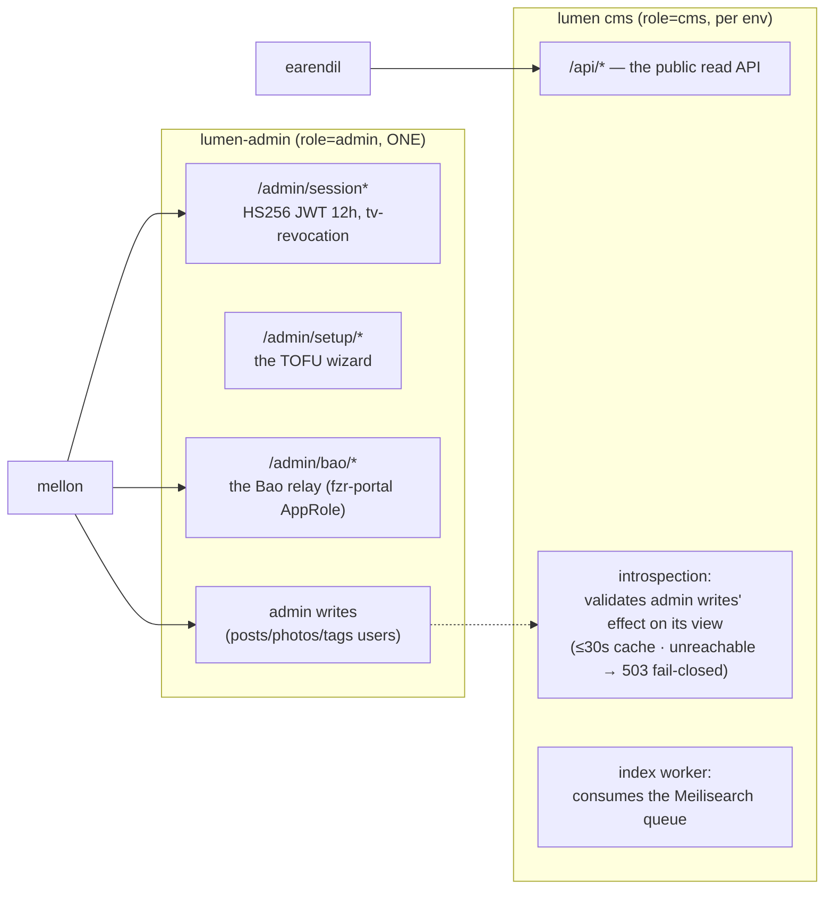
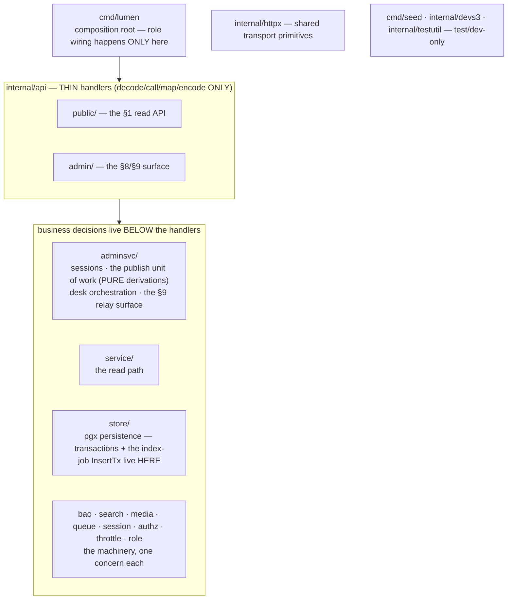

# lumen — the REST backend

> **Sync duty (workspace rule, 2026-11-15):** this note is the vault's
> learning home for the repo. Any change that alters the stack, anatomy,
> contract, commands, conventions, or state recorded here must update this
> note in the SAME round — and [LEARNING.md](LEARNING.md) if it minted a
> lesson. See [../doc-map.md](../../doc-map.md) §"Context sync".

## 1. Role in the estate

lumen is the estate's ONLY backend — a Go service that wears up to three
hats depending on the **role** each deployment is given (`LUMEN_ROLE`,
inline on the pods — deployment identity, never a vault value):

| Role | Instances | Serves | Namespace |
| :-- | :-- | :-- | :-- |
| `admin` | exactly ONE (the Control Plane) | sessions, users, the TOFU setup wizard, the Bao relay (`/admin/bao/*`), admin writes | `lumen` (foundation-owned, unsuffixed) |
| `cms` | per environment | the public content API + introspection of admin writes | `lumen`, suffixed (`lumen-http-server-{staging,production}`) |
| `all` | dev only | everything in one process (the dev loop) | — |



No role ever gets a public route — the API has no ingress, ever.

## 2. Stack, and why each piece

| Piece | Why |
| :-- | :-- |
| Go + **chi** router (`go-chi/chi/v5`) | owner ruling at HUMAN-GATE #2 (2026-11-08), overriding the stdlib-first default: middleware ecosystem without a framework |
| **pgx** via `store.NewPool` | Postgres access with `QueryExecModeCacheStatement` asserted EXPLICITLY — prepared statements are doctrine (§5 below) |
| **viper** (env-first) | config precedence env > optional `env.yaml` (`LUMEN_CONFIG`) > defaults — so ESO-rendered pod env always wins; NO dotenv autoload |
| **Meilisearch** client | typo-tolerant search + suggest; indexes updated through an in-process QUEUE (atomicity is a persistence concern) |
| **hashicorp/vault/api** | works unmodified against OpenBao (wire-compatible) — the Bao client |
| **argon2id** | password hashing (m=64MiB, t=3, p=2 — memory-hard, OWASP-side) |
| Zalando Postgres operator (outside) | generates DB credentials; lumen only consumes `LUMEN_DB_URL` |

## 3. Anatomy (the layering is load-bearing)



The layering rule is enforced by review, not a compiler: **a handler
importing store, queue, or bao is a layering violation by definition.**
Composition happens only in `cmd/lumen`.

## 4. The contract surface

**Public (§1 — earendil's `BlogApi` mirrors this exactly; FE types move in
ONE coordinated change):**

| Route | What |
| :-- | :-- |
| `GET /api/posts` | paginated list (curation order computed BE-side, at publish time) |
| `GET /api/posts/:slug` | one post (derivations included: readTime, tags, status-verified) |
| `GET /api/photos` · `GET /api/photos/featured` | gallery + hero photo |
| `GET /api/tags` | the curated tag cloud |
| `GET /api/search` · `GET /api/search/suggest` | Meilisearch-backed results + suggest |
| `GET /api/feed.xml` | RSS |

**Admin (§8 — mellon's contract; session bearer required):** `POST
/admin/session` (login), `POST /admin/session/verify`, `DELETE
/admin/session` (logout = `token_version` bump = instant revocation across
replicas), the TOFU wizard (`GET /admin/setup` one-bit probe; `POST
/admin/setup/register` — one transaction under `pg_advisory_xact_lock`,
exactly one winner ever, `410 Gone` terminal), user creation, admin
CRUD for posts/photos/tags (PUT/DELETE), admin search. The publish path is
a **unit of work with PURE derivations** — content-derived values
(readTime, excerpt, ordering) are computed at PUBLISH time, never
per-request (§2: "the FE renders payloads as-is").

**Bao relay (§9 — the frozen contract):** `GET /bao/paths`, `POST
/bao/apps`, `POST /bao/{app}/envs`, `PUT /bao/{app}/{env}` (CAS + key-set
mirror), `GET /bao/{app}/{env}` (`?version=N`, `?meta` adds
`pinnedVersion`), `PUT/DELETE /bao/{app}/{env}/pin`, plus `GET
/bao/summary` (the estate matrix, C1). Full frozen semantics:
[../decisions/secrets-control-plane.md](../../decisions/secrets-control-plane.md).

## 5. Conventions that bite

- **Prepared statements always:** every query uses `$n` parameters;
  `ORDER BY` variants switch over fixed SQL strings; the ONE exception is
  multi-statement DDL migrations (trusted checked-in files, simple
  protocol).
- **Names are spelled out** (`queueClient` not `qc`) — standing exceptions
  are language contract only (`w`/`r`/`ctx`, wire names like the `tv` JWT
  claim).
- **Logging:** `op + app + env + version + key-counts`, NEVER values — and
  redaction is TESTED (`bao_integration_test.go` demands a marked value's
  absence from the slog stream).
- **`Cache-Control` per §5:** content JSON short-lived; `/media/*`
  `public, max-age=31536000, immutable` (safe: content-hash filenames).
- **Migrations** run at boot (initContainer); the DSN arrives as
  `LUMEN_DB_URL` per environment.

## 6. Running it

```bash
make dev          # the one-command loop: containers (pg+meili+openbao) +
                  # dev-plane, seed, run — reuses whatever already runs
make dev-plane    # bootstrap the dev OpenBao §5.6 shape (kv/policy/approle)
make user         # upsert the dev admin account (token_version preserved)
make seed         # migrations + engine reconcile (FORCE=1 resets)
make run          # serve role 'all' (no infra steps)
make worker / make server   # the prod-split processes
```

| Env var | Meaning |
| :-- | :-- |
| `LUMEN_ROLE` | `admin` \| `cms` \| `all` — deployment identity, inline on pods |
| `LUMEN_CONFIG` | optional `env.yaml` path (env beats file) |
| `LUMEN_DB_URL` | the DSN (ESO-rendered from the env's Bao path) |
| `LUMEN_SESSION_JWT_SECRET` | the signing key (admin plane only — ONE home) |
| `LUMEN_ADMIN_URL` | cms → the admin plane (introspection) |
| `LUMEN_MEILI_URL` / `LUMEN_MEILI_INDEX_*` | search engine + per-env index names |

`env.yaml.sample` is the schema; real values never leave Bao/dev-plane.env.

## 7. Testing (the battery, strictness order)

| Gate | Proves | Infra |
| :-- | :-- | :-- |
| `make test` | unit + harness against the in-memory twin | none |
| `make test-integration` | every gated suite vs real pg + meili + embedded S3 + dev OpenBao | containers |
| `make test-media` | upload relay vs a REAL S3-protocol server (gofakes3) | containers |
| `make contract` | earendil's live vitest gate (`contract.spec.ts`) | a running lumen |

Integration tests own the **`itest/` Bao prefix** — never purge/reseed
paths a human browses (the shared-queue incident, 2026-11-13).
Plus: `go vet ./...`, `go test ./...` before any commit; the Postman
catalog preserves live captures (identical 401 bodies, 429 + Retry-After,
token-replay-401).

## 8. How it ships

Same ladder as every app repo (anvil; tag `vX.Y.Z` → image
`ghcr.io/kanatabi/lumen` → bump PR). The wrinkle: lumen deploys in TWO
places — the foundation `lumen-admin` (wave 2, after the `bao` store is
Ready) and each env's cms (wave 0 of its env's hub, the dependency root) —
and the **epoch TRIO** gate pins the config/render agreement. Detail:
[../architecture/releases-and-ci.md](../../architecture/releases-and-ci.md).

## 9. State & history (walked)

- **2026-11-09** — M1–M6 merged to `main` (the API is LIVE code).
- **2026-11-13** — secrets control plane landed (`846f98b`): onboard/
  mirror/pin foundations + the C1 estate matrix (`9544ce4`) + the epoch
  gate and **pin-as-lock** (`28e7811`); role split (admin/cms) minted in
  vortex + lumen (`8b` round); the `itest/` isolation rule (C5).
- **2026-11-08** — chi chosen (GATE #2); media D1 resolved (revised):
  object storage + CDN with backend-relay upload.
- **Open:** D2 (RSS delivery shape) — runbook-era decision; Phase C4
  (vortex prod seeds for new apps).

## 10. When you change this repo — the sync checklist

1. `go test ./... && go vet ./...` (+ the battery tier the change
   deserves).
2. Contract change? Coordinate earendil's `BlogApi` + twin (+ mellon if
   admin-side) in the same round.
3. Frozen-contract change (the `/admin/bao/*` surface)? The decision
   record's log updates BEFORE the code ships.
4. Update this note if §1–§9 drifted; update [LEARNING.md](LEARNING.md)
   if the change minted a lesson.
5. Release via the anvil ladder only.
