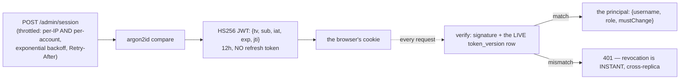

# Auth and sessions — credentials, tokens, and who decides what

The estate's identity plane. The two pillars: **the admin plane owns
identity** (the users table, the mint, the revocation) and **every other
plane asks it** (the introspection door, fail-closed).

## Where credentials live (and never live)

| Credential | Home | Never |
| :-- | :-- | :-- |
| the admin password | **argon2id hash** in `users.passhash` (Postgres) — m=64MiB, t=3, p=2 | plaintext anywhere, logs, Git, argv (the CLI takes `LUMEN_PASSWORD` env) |
| the session bearer | the browser's cookie — HttpOnly, SameSite=Strict, Secure | JS-visible, mellon's storage, logs |
| the JWT signing key | OpenBao `kv/lumen/shared` → ESO-rendered pod env (`LUMEN_SESSION_JWT_SECRET`) — **exactly ONE home** | Git, compose beyond the dev placeholder |
| the Bao AppRole pair | lumen's pod env (ESO, from the bootstrap family) | mellon (any layer) |
| the temp password (admin-created users) | returned ONCE in the create response; argon2id-hashed at rest | logged, stored, recoverable |

## The mint and the verify



- **`token_version` (tv)** — the revocation's whole mechanism: logout (and
  password resets) bump the row's version; every verify checks the token's
  tv claim against the LIVE row — a logout kills every outstanding bearer
  instantly, with no cache to invalidate.
- **roles** — row facts, never JWT claims (`admin` | `editor`; 0007). A
  demotion takes effect on the next verify.
- **the TOFU wizard** — `POST /admin/setup/register`: ONE transaction under
  `pg_advisory_xact_lock` — exactly one winner ever, losers get `410 Gone`
  (terminal); audited (`setup.register`, no credentials). The 428
  forced-change gate arms every bearer created with a temp password (the
  escape triad: whoami / change-password / logout).

## The cms plane's introspection (the role split's auth)

The cms plane holds NO users table and NO signing key — an auth decision
is ASKED of the admin plane:

```mermaid
sequenceDiagram
    participant REQ as a desk write (mellon → cms)
    participant C as lumen cms
    participant A as lumen-admin

    REQ->>C: POST /admin/photos (bearer forwarded as-is)
    C->>A: POST {LUMEN_ADMIN_URL}/admin/session/verify (bearer as-is)
    Note over C,A: cache keyed by the token's SHA-256, TTL 30s;<br/>only OK verdicts cached — a 401 is re-asked immediately
    alt verdict 200
        A-->>C: {username, role, mustChange}
        C->>C: the write proceeds
    else verdict 401
        A-->>C: invalid
        C-->>REQ: 401
    else unreachable / timeout (5s budget)
        C-->>REQ: 503 — FAIL CLOSED (never "probably still valid")
    end
```

The trust ruling: **no extra shared secret on the introspection call** —
the path is ClusterIP-only (lumen has no public ingress, INFRA §2); anyone
who can reach `verify` already rides the internal network. The knobs are
greppable constants: `CacheTTL = 30s`, `RequestTimeout = 5s`
(`internal/authz/authz.go`).

## The Bao relay's identity (the AppRole)

lumen talks to OpenBao as the `fzr-portal` AppRole (role-id + secret-id,
ESO-rendered pod env): secret-id TTL ≤ 1h in production (5m in dev) with
**agent-side re-login** — the relay's client re-authenticates
automatically; the token NEVER outlives its lease. The relay's surface +
the policy: [search.md](search.md) for the count pipeline,
[../decisions/secrets-control-plane.md](../decisions/secrets-control-plane.md)
for the frozen contract.

## The throttling (V1's answer)

`internal/throttle`: per-IP **and** per-account, exponential (3 free, then
1s → 2s → 4s… capped 15m), `Retry-After` honored; wrong-password and
unknown-user answer ONE indistinguishable 401 body. Known limit: the
state is per-replica in-memory (accepted, documented — the durable variant
is a drop-in).

## Where the code lives

- the mint/parse/argon2id: `internal/session/session.go`
- the verify door + the wire contract: `internal/api/admin/session.go`
- the introspection client: `internal/authz/authz.go`
- the users (TOFU, temp passwords, roles): `internal/adminsvc/users.go`,
  `internal/store/users.go`
- the throttle: `internal/throttle`
