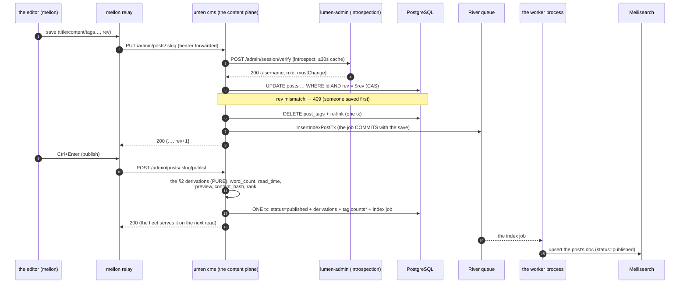

# Content pipeline — the §2 publish unit of work

How a post goes from the editor's textarea to the public API. The design's
spine: **derivations are PURE functions, the persistence is ONE
transaction, and re-publishing unchanged content is a byte-stable no-op.**

## The full journey



*The tag-count line died 2026-11-15 — see [search.md](search.md) (the
counts now derive from the engine's facet at read; the column's death is
migration 0008).*

## The state machine

```
draft ──publish──► published ──unpublish──► unpublished ──publish──► published
  ▲                     │                                                   
  └─── create ──────────┘         published→published (CHANGED content) = the
                                  §2 re-publish; byte-identical = NO-OP
delete = soft (deleted_at) → the worker DELETES the doc; the row remains
for the GC window (media retention), then operator cleanup
```

Legal edges enforced in the store (`ErrBadTransition` — a draft→unpublish
is a 409 by machine, not by handler logic).

## The derivations (PURE — `internal/adminsvc/publish.go`)

| Field | Rule |
| :-- | :-- |
| `word_count` | `len(strings.Fields(md))` |
| `read_time` | `max(1, (words+199)/200)` — ~200 wpm, floor 1 |
| `preview` | **the author's value wins**; empty/whitespace ⇒ `FirstParagraph(content)` — headings, fences, tables, blockquotes skipped; clamped at a word boundary (280 chars, never mid-word) |
| `content_hash` | sha256 of the final content — the idempotence witness |
| `rank` | `MAX(rank)+1` over live posts — the curation order's assignment |

The unit tests prove each one with no database (`publish_test.go`) —
`TestDerivePreviewExplicitWins` pins the preview rule.

**Idempotence:** a re-publish whose `content_hash` equals the stored hash
is a **no-op — rank unmoved** (deterministic caches depend on the rank's
stability). The decision happens in LOGIC (the service reads the row
facts, compares, returns) — never in SQL cleverness.

## The transaction (`store.ApplyPublish`)

One `pgx.BeginFunc`: the post's UPDATE (status + derivations + `rank` +
`published_at` COALESCE) + the index job's INSERT **inside the tx** — the
queue row commits with the content, so a crash can never leave "published
but never indexed". The job carries the post's ID only; the worker reads
CURRENT truth at run time (retries converge to the now-state).

## Where the code lives

- the derivations + the orchestration: `internal/adminsvc/publish.go`
- the persistence: `internal/store/admin.go` (`ApplyPublish`,
  `UpdateAdminPost`, `UnpublishAdminPost`, `DeleteAdminPost`)
- the contract: DESIGN.md §2; the wire: §8's posts routes
  ([the API surface](https://github.com/kanatabi/lumen/blob/main/DESIGN.md))
