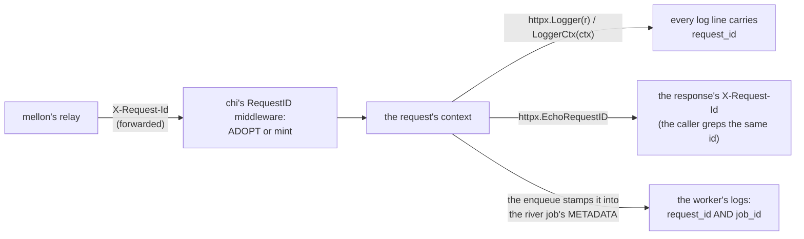

# Logging — the correlation seam (every line knows its chain)

The observability amendment (2026-11-15): **every API call carries a
request-id, every worker job carries it + its own job-id, and every log
line down the call stack prints them.** The debug flow: an error anywhere
→ copy its request-id → one grep (or one Loki query) → the whole chain:
the caller's relay, the auth verdict, the store, the queue, the worker,
the S3 call.

## The machinery (half of it was always there)

- **chi's `RequestID` middleware was mounted from day one** (mint or
  adopt `X-Request-Id`) — the amendment made it SPEAK: the seam
  (`internal/httpx/requestid.go`) extracts it everywhere.
- **The id's shape**: `hostname/random-000001` (chi's) — unique across
  processes; the ADOPTED caller ids pass through verbatim.
- **The worker's side**: the correlation rides **river's job metadata**
  (`insertOpts` reads it from the creating ctx) — deliberately NOT the
  args: the `ByArgs` uniqueness must keep coalescing an edit-burst
  regardless of who called. The workers log `job_id` + `request_id`.

## The speaking-errors rule (log every error wherever possible)

| Path | Line | Level |
| :-- | :-- | :-- |
| the catch-all 500 (`httpx.Fail`'s default) | `http.unhandled` with `err` + method + path + request_id | ERROR — **the silent-500 class is dead** (the media relay's 500s were invisible: the old catch-all literally did `_ = r`) |
| the S3 media calls | `media.put.failed` / `media.bucket.failed` — op + bucket + key + the S3 error code, never payloads | ERROR |
| the verify's denials | `session.verify.deny` — WHICH half died (parse / unknown-user / tv-mismatch); the wire copy stays the one `401 invalid token` | INFO |
| the worker's failures | `job.failed` with `err` (+ the ids) | ERROR |
| the login denials | `session.deny` (the throttle's audit — pre-existing) | INFO |
| reads | silent (the ops doctrine: consequential events only) | — |
| **every incoming request** | `http.access`: method, path, status, duration_ms, bytes + the id — the transport's nginx-style line; the query string never logs (URLs can carry secrets); the probes skip | INFO |
| **every FAILED outbound call** | `outbound.failed`: dependency, operation, result (`error`\|`timeout`), duration_ms, err + request_id — the generic line is the alert's grep; the rich site lines above stay for the human | ERROR |

The redaction stance is UNCHANGED by all of this: the ids are identifiers,
not payloads — `op + app + env + version + key-counts`, never values.

## The chain now reaches the frontends (2026-11-15)

The seam used to start at lumen's edge. It now starts at the BROWSER:

- **earendil** (`src/lib/api/requestid.ts`, landed `7f4dc0c`): every SSR
  load and the `/api` proxy MINT a UUID per call, send it as
  `X-Request-Id` (lumen adopts it verbatim), log their own access line
  (`hop=ssr|proxy`), echo lumen's response id back to the browser, and
  carry the id in `ApiError.requestId` — a page-level catch names the
  same id the backend's logs print.
- **mellon** (`src/lib/api/requestid.ts`, landed `be18712`): the
  fetch-adapter's `call()` and `addPhoto` do the same (`hop` comes free
  from the routing table's `upstreamFor`); `AdminApiError.requestId`
  rides for logs — the wire error copy stays verbatim (ghost-field
  doctrine). The id is MINTED per call, never adopted from the browser:
  a client-supplied header is a log-injection surface.

So the debug flow's step 2 is now reachable from a user's screenshot,
and the chain has FOUR hops: earendil/mellon's outbound line → lumen's
`http.access` → lumen's op line → the queue job.

## The debug flow, end to end

1. An error surfaces anywhere (the portal's panel, earendil's page, a curl).
2. Its `X-Request-Id` (the response header; mellon's relay logs it too).
3. One query: Grafana/Loki `request_id = "…"` → the chain: the relay's
   line, lumen's auth verdict, the store's failure, the queue's job, the
   worker's outcome, the S3 error code.
4. The job side chains FORWARD too: the publish's request-id appears in
   the index job's metadata — the worker's line carries it.

## Where the code lives

- the seam: `internal/httpx/requestid.go`
- the speaking catch-all: `internal/httpx/httpx.go` (`Fail`)
- the queue's correlation: `internal/queue/util.go` (`insertOpts`,
  `jobLogger`) + the three workers
- the explicit spots: `internal/adminsvc/photos.go`,
  `internal/adminsvc/session.go` (`VerifyBearer`'s split)
- the middleware mount: `internal/api/router.go`
