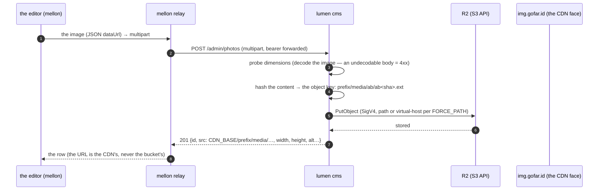

# Media relay — the upload path (D1, resolved)

The D1 decision (resolved, revised 2026-11-08): **object storage + CDN,
with the upload relayed through lumen** — the browser never talks to the
bucket, the bucket's keys never leave lumen's env, and every image gets a
content-hash name (the immutability that makes `Cache-Control: immutable`
safe).

## The flow

## The config (the rendered env, per environment)

| Key | Production value (shape) | Note |
| :-- | :-- | :-- |
| `LUMEN_MEDIA_ENDPOINT` | `https://<account>.r2.cloudflarestorage.com` | the S3 API's base |
| `LUMEN_MEDIA_BUCKET` | `omicron-media` | ONE bucket, both envs |
| `LUMEN_MEDIA_REGION` | **`auto`** | **the only valid value set**: wnam/enam/weur/eeur/apac/oc/auto — `r2` is INVALID (InvalidRegionName, walked 2026-11-15 — the seed said `r2` and the relay 500'd silently) |
| `LUMEN_MEDIA_FORCE_PATH` | `false` | both addressing forms reach R2's API — walked; the flip was a red herring during the diagnosis |
| `LUMEN_MEDIA_PREFIX` | `production/` / `staging/` | never empty — the envs' objects stay apart in the one bucket |
| `LUMEN_MEDIA_CDN_BASE` | `https://img.gofar.id` | the returned URLs are the CDN's — the bucket's own URL never leaves |
| `LUMEN_MEDIA_ACCESS_KEY` / `SECRET_KEY` | the R2 API token (Object Read & Write, scoped to the bucket) | seeded in ch.07's act |

## The silent-500 lesson (the logging gap)

The relay's failure mode during the walk: a 500 with the generic
`{"error":"internal error"}` body and **ZERO log lines** — the media
handler swallows the S3 error. Queued code fix: `media.put.failed` must
log op + bucket + key + the S3 error code (never payloads). The
diagnosis tool that cracked it: a one-off `amazon/aws-cli` pod with the
SAME rendered credentials — the S3 error names itself out loud
(`InvalidRegionName` — see [../README.md](README.md) §worker, and the
runbook ch.05's seed note).

## The curation model

The upload creates the row + the object; the darkroom curates AFTER:
`PATCH /admin/photos/:id` (alt / collection / gallery), the delete removes
the library row while the OBJECT keeps (the GC window — the soft-delete
pattern for media), and `GET /admin/photos/:id/references` names the posts
embedding the photo (the used-in guard).

## Where the code lives

- the client + the config: `internal/media/media.go` (`UsePathStyle =
  ForcePath` — the S3 client's options)
- the handler/orchestration: `internal/adminsvc/photos.go`
- the D1 record: DESIGN.md §5 (resolved, revised)
