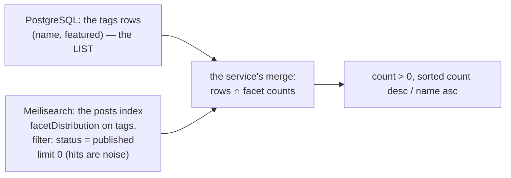

# Search — the engine's contract and the count pipeline

The search doctrine (owner ruling, 2026-11-08): **Meilisearch answers
lists, facets, and relevance; Postgres is the truth that results hydrate
from.** There is NO Postgres fallback path for search — the engine down
means a visible 503 (the pure-engine ruling).

## The three indexes

| Index | Documents | Filterable | Serves |
| :-- | :-- | :-- | :-- |
| `posts` (per-env name via `LUMEN_MEILI_INDEX_POSTS`) | every non-deleted post — **drafts too** (`status: draft/published/unpublished`); the public queries carry the leak rule `status = published` FIRST | `status`, `tags`, `day`, `readTime` | §1 lists/search/suggest + the facet counts |
| `photos` (per-env) | the photos | `gallery`, `collection` | the gallery + the darkroom's search |
| `tags` (constant name — the one shared-engine story) | `{id, name}` ONLY | — | the desk's typo-tolerant engine search |

The display truth never lives in the index: results hydrate from Postgres
by ID (a stale doc degrades to a dropped item, never to stale display).
`content` is searchable-but-never-returned.

## The count pipeline (the counter's death — design amendment 2026-11-15)

`tags.posts` (the denormalized counter) is GONE (migration 0008). The
published count per tag now derives at READ:

Why the index is the right source: **every save re-enqueues the post's
index job** (the queue's job commits inside the save's transaction), so
the index is the FRESHEST copy of tag usage — a stored counter was a
third copy that lagged (the update path never recomputed it: the
tag-desk zero of 2026-11-15). The facet approach makes the count correct
by construction — **eventually consistent** at the queue's latency
(sub-second; the tests drain before asserting).

The two counts' clear semantics:
- **posts** (the facet): PUBLISHED + non-deleted only — what the widget
  and the desk's POSTS column show.
- **references** (the junction, Postgres): ANY status — the delete guard
  ("N posts still reference it") and the dialog's USED-BY roster.

## The engine's exactness contract

The facet counts are exact only because:
1. the index holds exactly the non-deleted posts (soft-deletes DELETE the
   doc — the phantom-total lesson),
2. the status filter is the leak rule (drafts sit in the index but never
   count),
3. `tags` is filterable (it already was — `?tag=` search uses it).

If a read-path optimization is EVER needed (it is not, at blog scale),
the sanctioned place is a CACHE layer (Redis) — never a DB column (the
owner ruling, 2026-11-15).

## Where the code lives

- the client + the index settings: `internal/search/search.go`
  (`TagCounts` in `queries.go`)
- the merge: `internal/service/service.go` (the public widget's path),
  `internal/adminsvc/vocab.go` (the desk's)
- the queue → engine writes: `internal/queue/`
- the engine-tier tests: the integration battery (`make test-integration`
  — real Meili; `TestTagCountsFromSearch` is the count pipeline's proof)
