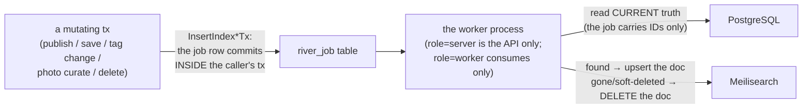

# Worker and queue — River, the index jobs, and the prod-split

The estate's async muscle: **River** (a Postgres-native job queue) — the
same database as the content, so a job commits INSIDE the transaction that
wants it. No extra broker, no outbox pattern to build — the outbox IS the
queue table.

## The job lifecycle

The load-bearing rule: **jobs carry IDs, never payloads.** The worker reads
CURRENT truth at run time (`PostDocByID` et al) — retries and edit-bursts
converge to the now-state instead of replaying stale snapshots. A
soft-deleted post's row reads as VANISHED → the worker DELETES the doc
(the deleted_at filter — the phantom-total lesson, found by the mellon
cutover e2e).

## The three workers

| Job kind | Triggered by | Engine effect |
| :-- | :-- | :-- |
| `index_post` | publish / save / unpublish / delete | upsert or delete the post's doc (the doc carries tags + status — the public queries filter status) |
| `index_photo` | photo create / curate / delete | upsert or delete the photo's doc |
| `index_tag` | tag create / rename / feature | re-index the AFFECTED POSTS (a rename propagates through the posts' tags attributes; the tags index itself is `{id, name}` only) |

Uniqueness: pending jobs dedupe (`pendingUniqueness`) — an edit-burst
(ten saves in a second) leaves ONE pending job that reads final truth.
The out-of-transaction form (`EnqueueIndexPost`) exists for the seed /
reconcile tools.

## The prod-split (why two processes)

The §1 read path and the queue consumer share the binary but not the
process in production:

| Process | `LUMEN_ROLE`-shape | Does |
| :-- | :-- | :-- |
| the API server | `role=cms` (`make server`) | HTTP only — the §1 reads + the content desks |
| the worker | `role=cms` (`make worker`) | consumes the index queue only |

`role=all` (dev) = both in one process — a DEV affordance, never a cluster
posture. The split exists so a Meilisearch outage (slow retries) cannot
stall the API's request handling: the queue absorbs the burst, the worker
drains at its own pace, the API keeps serving reads.

## The janitor (the migrate corpse's cleaner)

Job pod templates are IMMUTABLE: an image bump can't patch the COMPLETED
migrate Job — Argo would retry "field is immutable" until the retries
exhaust, blocking wave 2 behind it (walked 2026-11-14). The **janitor**
(PreSync hook, sync-wave -3) deletes the corpse BEFORE the sync applies
the bumped Job — which is then created fresh. `--ignore-not-found`: fresh
clusters no-op cleanly.

## The itest ownership (C5's rule)

Integration tests own the **`itest/`** Bao prefix and integration-% rows —
NEVER purge/reseed paths a human browses (the shared-queue incident:
an old worker + a shared path = the human's data vanished mid-walk).

## Where the code lives

- the queue client + the workers: `internal/queue/` (index_post/photo/tag)
- the run-time truth reads: `internal/store/pg.go` (the doc lookups —
  the deleted_at filter lives there)
- the enqueue-inside-the-tx contract: the store's mutating methods
  (`ApplyPublish`, `replaceTagsTx`, …)
- the role gating: `internal/role/role.go`, `internal/api/routes.go`
