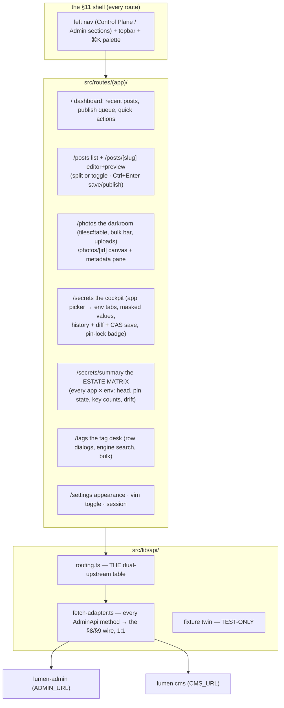
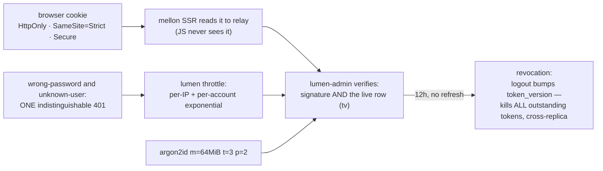

# mellon — the private admin portal

> **Sync duty (workspace rule, 2026-11-15):** this note is the vault's
> learning home for the repo. Any change that alters the stack, anatomy,
> contract, commands, conventions, or state recorded here must update this
> note in the SAME round — and [LEARNING.md](LEARNING.md) if it minted a
> lesson. See [../doc-map.md](../../doc-map.md) §"Context sync".

## 1. Role in the estate

mellon is the owner's keyboard-first control surface: content management
for the blog and env/secret management for the estate, in ONE web app. Its
defining property is the doctrine ([DESIGN.md §2](https://github.com/kanatabi/mellon/blob/main/DESIGN.md)
— load-bearing, read before any feature work):

1. **Never serves content traffic** — `earendil → lumen` is the blog's
   data path; mellon going down cannot break the blog.
2. **The relay forwards; it never decides** — all logic, auth, credentials,
   and policy live in lumen. Mellon holds NO secrets (no Bao tokens, no
   GitHub tokens, no DB creds — any layer, any era).
3. **Public at `console.gofar.id`** (amended 2026-11-08) — TLS at the
   shared Traefik edge with the console middlewares, JWT sessions minted
   ONLY by lumen-admin with `token_version` revocation; the service itself
   stays **ClusterIP** (only Traefik routes); `kubectl port-forward` is
   break-glass. Go-live is **HUMAN-GATE #10**.
4. **Anything reachable by mouse is reachable by keyboard** — the palette +
   shortcuts are the vocabulary; no hover-only affordances.
5. **GitOps purity** (future infra tab): the portal may PROPOSE
   (commit/PR to vortex) and trigger convergence — it never applies to the
   cluster itself.

## 2. Stack, and why it mirrors earendil

SvelteKit 3 + Svelte 5 runes + TypeScript + Tailwind v4 + `adapter-node`
(Node 22, exact pins, gates in order) — deliberately the same stack as
earendil so one mental model covers both SSR apps, and the same
`adapter-node` container shape (:3000, 1 replica — it has one user).

## 3. Anatomy



**The routing table is the architecture** (role-split round, 2026-11-13):
session/users/setup/bao → `ADMIN_URL`; content + `/api` → `CMS_URL`;
unknown → **throw (no default)**. Legacy `API_BASE` feeds both planes in
the single-binary dev shape; unset everywhere falls back to
`http://localhost:8080`.

## 4. The ghost-field doctrine (and the other honesty rules)

- **Relayed server copy is rendered verbatim, never decorated.** When lumen
  answers `403 pinned at vN — unpin first`, mellon shows exactly that
  string (plus affordances like a re-pin offer). Paraphrasing the wire
  would lie about who refused and why.
- **Masked values are UI-only** — the editor can always reveal/copy the
  real value; hiding it in the DOM would be theater (and the threat model
  assumes a stolen session bearer IS an admin, so revocation — not
  hiding — is the mitigation).
- **Validation belongs to lumen** (pin locks, CAS 409s, key-set mirror
  conflicts): the UI may afford (disable save while pinned), but never
  re-implements or pre-empts the rule.
- **The markdown stack is bundled + lazy-loaded on purpose** — one broken
  chunk once killed the ENTIRE relay (`499d595`); keep that chunk boundary.

## 5. Security posture in one view



The full threat analysis (credential stuffing, stolen bearer, direct Bao
assault, AppRole extraction, lost-update, content mutation, the TOFU
window) lives in the vault archive:
[../archive/mellon-THREAT-NOTE.md](../../archive/mellon-THREAT-NOTE.md) —
owner re-review (GATE #5) is the open item it records.

## 6. Running it

```bash
cd ../lumen && make dev    # the backend first
make dev                   # readyz-gated real mode (LUMEN= / PORT= overridable;
                           # reuses a live server)
make live                  # the gated acceptance suite vs a RUNNING lumen:
                           # login · drafts-at-the-door · CAS 409s · multipart
                           # upload · secrets relay · instant revocation
npm run dev · check · lint · test:unit · build   # the SvelteKit gates
```

Dev login: `gofar` / `mellon-dev-password` (the dev placeholder). The
setup wizard (`/setup`) is the TOFU path — first admin claims the estate
once, terminal `410 Gone` after; forced-change (428) gates every bearer
until the password changes (escape triad: whoami / change-password /
logout).

## 7. Testing

| Gate | Proves |
| :-- | :-- |
| `npm run test:unit` | offline battery vs the twin (runtime graph never touches it) |
| the console harness (79/79) | keyboard-first + view anatomy invariants |
| `make live` | the acceptance suite against a real lumen — the relay is only honest when it relays |

## 8. How it ships

Same anvil ladder (tag → image `ghcr.io/kanatabi/mellon` → bump PR). The
door (`console.gofar.id`) rides the production Traefik edge with the
console middlewares installed at the edge since Phase 3 —
[network-and-doors.md](../../architecture/network-and-doors.md) has the full
layering; HUMAN-GATE #10 is the go-live checklist.

## 9. State & history (walked)

- **2026-11-13** — secrets control plane merged (`a224950`: cockpit,
  compare, mobile honesty); the estate matrix (`7fb8ffa`); pin-as-lock
  rendering (`4f14eaa`); the IA round (Control Plane / Admin sections,
  `60bbdf1`); the chunk incident (`499d595`).
- **2026-11-11** — setup wizard surfaces; the TOFU threat analysis (V7)
  added to the threat note.
- **2026-11-08** — the public-door amendment (was port-forward-only).
- **2026-11-15** — `PLAN.md` became local-only; THREAT-NOTE moved to the
  vault archive; this vault note created.
- **Open:** GATE #5 owner read-through; GATE #10 run (prod seeds first —
  the decision record's C4).

## 10. When you change this repo — the sync checklist

1. Gates: `npm run check` → `npm run lint` → `npm run test:unit` →
   `npm run build` (+ `make live` when the relay moved).
2. New surface? It goes in the routing table explicitly (or it throws —
   that's the design).
3. Never add a credential, a default upstream, or a decorated error copy.
4. Update this note if §1–§9 drifted; update [LEARNING.md](LEARNING.md)
   if the change minted a lesson.
5. Release via the anvil ladder only.
