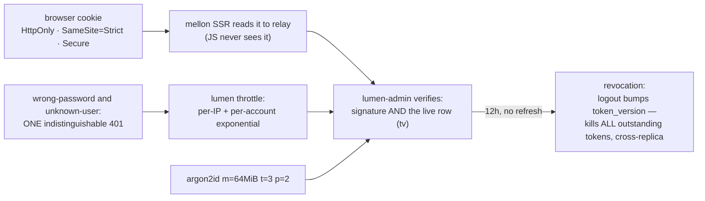

# mellon — the private admin portal

> **Sync duty (workspace rule, 2026-11-15):** this note is the vault's
> learning home for the repo. Any change that alters the stack, anatomy,
> contract, commands, conventions, or state recorded here must update this
> note in the SAME round — and [LEARNING.md](LEARNING.md) if it minted a
> lesson. See [../doc-map.md](../../doc-map.md) §"Context sync".

## 1. Role in the estate

mellon is the owner's keyboard-first control surface: content management
for the blog and env/secret management for the estate, in ONE web app. Its
defining property is the doctrine ([DESIGN.md §2](https://github.com/kanatabi/mellon/blob/main/DESIGN.md)
— load-bearing, read before any feature work):

1. **Never serves content traffic** — `earendil → lumen` is the blog's
   data path; mellon going down cannot break the blog.
2. **The relay forwards; it never decides** — all logic, auth, credentials,
   and policy live in lumen. Mellon holds NO secrets (no Bao tokens, no
   GitHub tokens, no DB creds — any layer, any era).
3. **Public at `console.gofar.id`** (amended 2026-11-08) — TLS at the
   shared Traefik edge with the console middlewares, JWT sessions minted
   ONLY by lumen-admin with `token_version` revocation; the service itself
   stays **ClusterIP** (only Traefik routes); `kubectl port-forward` is
   break-glass. Go-live is **HUMAN-GATE #10**.
4. **Anything reachable by mouse is reachable by keyboard** — the palette +
   shortcuts are the vocabulary; no hover-only affordances.
5. **GitOps purity** (future infra tab): the portal may PROPOSE
   (commit/PR to vortex) and trigger convergence — it never applies to the
   cluster itself.

## 1b. The RBAC surface (2026-11-24 — the coordinated wire flip)

User ROLES are gone: mellon renders lumen's scope truth as affordances.
The users page (now the users:manage surface, `/admin/users`) carries the
scope PICKER at creation (the grant is exact), a per-user scope editor
(the assignment REPLACES the set — lumen bumps token_version, the user's
other sessions die), and the PORTAL-MANAGED scope catalog (add/list/
delete; delete refuses while held — lumen's 409 copy renders verbatim).
The nav's Admin group, the settings shell's Users door, and the page gate
all read `principal.scopes`; the account menu wears the scope list.
`Principal` gains `id`+`scopes` (role is GONE from the wire). Full record:
[../../decisions/rbac-spine.md](../decisions/rbac-spine.md).

## 1c. The dashboard home — the coordinate widget canvas (2026-11-24/25)

The dashboard is the USER'S HOME: visible to every authenticated user,
and its server load dials NO scoped API (a scope-less user's home is
the empty-state hint, never an error page — the 500-cliff rule). The
layout core is the **Grafana classic schema** (the coordinate round,
66ab9ed): every widget carries `{ id, x, y, w, h }` on a
24-column canvas of fixed 44px rows — free placement, holes stay
holes (the Round D model, f985b2a: schema v4 dropped the hidden flag —
placed-or-absent, below). A pure engine (`dashboard/layout.ts`, 21+ unit tests) backs it:
collision, vertical-gravity compaction (gaps with something above stay;
voids fill), drop resolution, and the chained v2→v3→v4 migration
(simulates the
old dense flow so stored arrangements render identically; migrations
run by SHAPE, not by a version stamp that can lie). Entries render
absolutely — percent columns with the gutter in the geometry (the RGL
margin rule: cell pitch = `(canvasWidth + 16px)/24`, each widget one
gap narrower), position transitions make engine moves glide.

The machinery on top: the card HEADER is the free-drag handle (a
pointer machine with a 4px click threshold — HTML5 DnD retired
entirely, so the native-drag hijack class is structurally impossible);
other widgets glide out of the way live via the resolved shadow layout
(`view = $derived(resolveDrop(...))` in the store), the blue
placeholder marks the landing cell, Escape cancels. Resize = right
edge (width) / bottom edge (height) / corner (both) — the card floats
pixel-continuously from its own PIXEL size (a unit-mix regression
taught: a rename is a semantic change — the float once collapsed to
the minimum because unit counts fed pixel math). Keyboard parity:
Alt+arrows nudge by whole cells, Shift+Alt+arrows resize — one clamp
path. Below md the canvas stacks.

The availability model is **placed-or-absent** (Round D, f985b2a,
schema v4): the canvas holds only placed widgets — the card's trash
button deletes (no confirm; re-add restores the default span at a free
slot), and the **Add Widget** side panel lists the registry with
STATIC previews (the real body never mounts there — zero relay calls
on open), multi-select rows and a one-action footer commit
(`firstFit` — the first free slot, holes before growth); the tray
retired, reconcile stopped appending (deleted stays deleted), and a
brand-new user's canvas auto-adds their scope-held widgets.

The picker's previews show the widget's REAL structure with
placeholder content (every body honors a `preview` prop that never
fetches — the owner's middle path between static thumbnails and live
bodies). The **auth-method seam** (the passkey round, d0a9250 + the portal half
dbab7ee): login methods normalize to begin → finish → the ONE session
mint — `passkey` is the first implementation (WebAuthn; the private key
never leaves the authenticator; lumen stores the public half in
`webauthn_credentials`, schema 0012), **oauth:github/google later adds a
sibling method file, not a second mint**. The transport:
`/admin/session/auth/methods` (the capability probe — the login UI is
data-driven), `webauthn/login/begin|finish` (public — the mint happens
inside finish), register/roster/delete (authenticated setup). Env:
`LUMEN_WEBAUTHN_RP_ID` (the REGISTRABLE DOMAIN gofar.id — one shared
admin serves every env's mellon; the passkey space is shared, matching
the shared users table) + `LUMEN_WEBAUTHN_ORIGINS` (the comma-separated
browser origins; optional — unset = off). The browser half:
`#lib/webauthn.client.ts` (codec + `navigator.credentials`); the ACTION
half rides `#lib/action-post.ts` — the ONE place that unwraps Kit's
`{type,status,data}` envelope, follows a `redirect()` envelope to the
server's `location` (cookies already set) and turns `fail()` into
`ActionFailure`. Action bodies are FORM fields (JSON stringified inside
its field); `request.json()` on that wire is the 415 round's other half.
The settings page's Passkeys card is the setup door; the
fake-authenticator integration test drives the lumen flow offline, and
the browser walk (register → sign out → sign in with the passkey) is
the QR-able last mile.

The plugin seam is `widgets/registry.ts` — **adding a widget = one
folder + one registry line**; `scope` gates the MOUNT (unheld = the
body never mounts, its calls never fire — lumen's truth over the
browser's memory). Layout persists per-USER in localStorage behind a
`DashboardLayoutStorage` seam (schema version 3; a server-side
per-user table is the recorded second implementation). The init effect
guard (70a940f) keeps `init()` once-per-username and never reading its
own $state write (that loop depth-exploded every hydration once).

**Where the docs live:** the walkthrough for adding a widget is the
omicron runbook **ch. 15** (`runbook/15-portal-widgets.md`); the
contract is mellon `DESIGN.md` §11.4 ("The widget home"). The full
rounds A→C spec lived in the owner's local plan file.

## 2. Stack, and why it mirrors earendil

SvelteKit 3 + Svelte 5 runes + TypeScript + Tailwind v4 + `adapter-node`
(Node 22, exact pins, gates in order) — deliberately the same stack as
earendil so one mental model covers both SSR apps, and the same
`adapter-node` container shape (:3000, 1 replica — it has one user).

## 3. Anatomy

```mermaid
flowchart TB
    subgraph shell["the §11 shell (every route)"]
        NAV["left nav (Content / Control Plane / Admin) + topbar (⌘K pill centered · account avatar menu)<br/>ONE chrome mass — no internal borders; content scrolls in the rounded box: flush top/left at lg, 12px ring right/bottom (§11.1, 2026-11-16/17)<br/>breadcrumbs IN-PAGE, sub-pages only, parent-naming (editor `posts ›`), Secrets kv-path above the title<br/>collapsed rail = centered icon column (36px squares, labels out of layout)<br/>dropdowns are the house Select (no native <select>); content-mode palette rows wear cast-hued type pills"]
    end
    subgraph app["src/routes/(app)/"]
        DASH["/ dashboard: the widget home — the registry's widgets on a coordinate canvas"]
        POSTS["/posts list + /posts/[slug] editor+preview<br/>(split or toggle · Ctrl+Enter save/publish · source pane colored from the §11 tokens, not CodeMirror's light default)"]
        PHOTOS["/photos the darkroom (tiles⇄table, bulk bar, uploads)<br/>/photos/[id] canvas + metadata pane"]
        SEC["/secrets the cockpit (app picker → env tabs, masked values,<br/>history + diff + CAS save, pin-lock badge)"]
        SUM["/secrets/summary the ESTATE MATRIX<br/>(every app × env: head, pin state, key counts, drift)"]
        TAGS["/tags the tag desk (row dialogs, engine search, bulk)"]
        SET["/settings — the master/detail shell: section nav (appearance / editor / security) + users→"]
    end
    subgraph lib["src/lib/api/"]
        RT["routing.ts — THE dual-upstream table"]
        FA["fetch-adapter.ts — every AdminApi method → the §8/§9 wire, 1:1"]
        TWIN["fixture twin — TEST-ONLY"]
    end
    NAV --> app
    app --> RT
    RT --> FA
    FA --> A["lumen-admin (ADMIN_URL)"]
    FA --> C["lumen cms (CMS_URL)"]
```



**The routing table is the architecture** (role-split round, 2026-11-13):
session/users/setup/bao → `ADMIN_URL`; content + `/api` → `CMS_URL`;
unknown → **throw (no default)**. Legacy `API_BASE` feeds both planes in
the single-binary dev shape; unset everywhere falls back to
`http://localhost:8080`.

## 4. The ghost-field doctrine (and the other honesty rules)

- **Relayed server copy is rendered verbatim, never decorated.** When lumen
  answers `403 pinned at vN — unpin first`, mellon shows exactly that
  string (plus affordances like a re-pin offer). Paraphrasing the wire
  would lie about who refused and why.
- **Masked values are UI-only** — the editor can always reveal/copy the
  real value; hiding it in the DOM would be theater (and the threat model
  assumes a stolen session bearer IS an admin, so revocation — not
  hiding — is the mitigation).
- **Validation belongs to lumen** (pin locks, CAS 409s, key-set mirror
  conflicts): the UI may afford (disable save while pinned), but never
  re-implements or pre-empts the rule.
- **The markdown stack is bundled + lazy-loaded on purpose** — one broken
  chunk once killed the ENTIRE relay (`499d595`); keep that chunk boundary.

## 5. Security posture in one view



The full threat analysis (credential stuffing, stolen bearer, direct Bao
assault, AppRole extraction, lost-update, content mutation, the TOFU
window) lives in the vault archive:
[../archive/mellon-THREAT-NOTE.md](../../archive/mellon-THREAT-NOTE.md) —
owner re-review (GATE #5) is the open item it records.

## 6. Running it

```bash
cd ../lumen && make dev    # the backend first
make dev                   # readyz-gated real mode (LUMEN= / PORT= overridable;
                           # reuses a live server)
make live                  # the gated acceptance suite vs a RUNNING lumen:
                           # login · drafts-at-the-door · CAS 409s · multipart
                           # upload · secrets relay · instant revocation
npm run dev · check · lint · test:unit · build   # the SvelteKit gates
```

Dev login: `gofar` / `mellon-dev-password` (the dev placeholder). The
setup wizard (`/setup`) is the TOFU path — first admin claims the estate
once, terminal `410 Gone` after; forced-change (428) gates every bearer
until the password changes (escape triad: whoami / change-password /
logout).

## 7. Testing

| Gate                        | Proves                                                                              |
| :-------------------------- | :---------------------------------------------------------------------------------- |
| `npm run test:unit`         | offline battery vs the twin (runtime graph never touches it)                        |
| the console harness (79/79) | keyboard-first + view anatomy invariants                                            |
| `make live`                 | the acceptance suite against a real lumen — the relay is only honest when it relays |

## 8. How it ships

Same anvil ladder (tag → image `ghcr.io/kanatabi/mellon` → bump PR). The
door (`console.gofar.id`) rides the production Traefik edge with the
console middlewares installed at the edge since Phase 3 —
[network-and-doors.md](../../architecture/network-and-doors.md) has the full
layering; HUMAN-GATE #10 is the go-live checklist.

## 9. State & history (walked)

- **2026-11-13** — secrets control plane merged (`a224950`: cockpit,
  compare, mobile honesty); the estate matrix (`7fb8ffa`); pin-as-lock
  rendering (`4f14eaa`); the IA round (Control Plane / Admin sections,
  `60bbdf1`); the chunk incident (`499d595`).
- **2026-11-11** — setup wizard surfaces; the TOFU threat analysis (V7)
  added to the threat note.
- **2026-11-08** — the public-door amendment (was port-forward-only).
- **2026-11-15** — the portal ROLLED and the door answered: `console.gofar.id`
  → 303 → login behind the real cert (the wave-2 hold lifted once the
  cf-token seed issued the certs); the upload relay's first walk hit the
  R2 region seed bug (lumen's ledger has it — fixed via `auto`) and the
  upload went 201 through the fixed relay.
- **2026-11-15** — the correlation round (`be18712`): the fetch-adapter's
  `call()` and `addPhoto` mint a request-id per call, send it as
  `X-Request-Id`, log the access line (`hop=admin|cms` free from
  `upstreamFor`), and carry lumen's echo in `AdminApiError.requestId` —
  the wire copy untouched (ghost-field).
- **2026-11-15** — the metrics + budgets round (`c86c9cd`): prom-client,
  the ONE registry (`src/lib/server/metrics.js`) shared by the hooks and
  the custom server via prom-client's DEFAULT register; every lumen call
  COUNTED (outbound_request_total — the dependency axis maps from the
  routing table: admin→lumen-admin, cms→lumen-cms) and BOUNDED
  (AbortSignal.timeout; `photos.upload` gets the 30s budget); ops are
  ENUMERATED per call site and typed (`OpName` — a misspelled op is a
  compile error; the paths embed slugs so a path-derived label would be
  a cardinality bomb); the inbound RED pair in a `handle` hook;
  `server.js` runs TWO listeners in ONE process (unrouted `/metrics` on
  `MELLON_METRICS_PORT` default 9090); vortex's pod annotations opt the
  scrape in.
- **2026-11-15** — `PLAN.md` became local-only; THREAT-NOTE moved to the
  vault archive; this vault note created.
- **2026-11-22** — **the delete dialog's copy follows lumen's eager object
  GC** (`b846a8b`): the file is deleted WITH the row now (lumen 269e423 —
  row first, object best-effort, siblings keep shared objects alive), so
  "keeps being served until storage GC" was a lie; the embeds warning is
  unchanged (the references warn-list predates this round).
- **2026-11-22** — **the EXIF capture at upload + the panel's EXIF block**
  (`439226b`; lumen `bcaf72b` = the allowlist + `photos.exif` jsonb): exifr
  reads the CURATED keys client-side (GPS never requested), ships as the
  multipart `exif` field; the panel renders the photographer's order with
  the resolution in the header and the honest empty state for pre-capture
  uploads. Lock ops rode npm 10 (exifr 7.1.3).
- **2026-11-22** — **the diff page's pane headers** (`302b5c4`): the
  combined file-header bar (identity + stats + the side-story blob) was
  AMBIGUOUS — nothing pointed at a pane. Two cells now, sitting over
  their panes on the split-table's own grid: `HEAD · rev N` (−dels) left,
  `PENDING · forked from rev M` (+adds) right — per-side stats (the
  owner's option 1: the deletion count lives where the deletions live).
  ONE chevron (the HEAD cell) collapses the whole comparison; the same
  snippet pair rides the Changed-only view; NO visible separator (the
  owner: the grid geometry is the separator).
- **2026-11-22** — **the pane fully contained** (`2922f99`): the diff page
  lacked the `h-full` bound the b61dead lists got — the tall content grew
  the whole `min-h-svh` flex chain (the wrapper can GROW, so `min-h-0`
  clamps nothing), the document became the scroller, the pane had no
  bottom edge. **The lesson: a `min-h-*` ancestor un-bounds every
  `flex-1`/`min-h-0` chain below it — percentage (`h-full`) re-binds one
  element at a time, and EVERY wrapper between the bound and the scroller
  needs it too (an auto-height block in the chain breaks the percentage).**
  The scroller now lives INSIDE the pane card: the header pair pinned,
  only the lines scroll; the metadata tab scrolls both axes in its own
  pane; the tabpanel remains the mobile full view's scroller (the trace
  rows' sticky-trigger region). The header typography = the chrome voice
  (tracked mono uppercase muted) — an indicator, not a headline.
- **2026-11-22** — **the cards FIT, they don't FILL** (`cd4f618`): `h-full`
  on the pane cards held the height even for three regions (the void) and
  even COLLAPSED (the header-only card stretched — the chevron worked,
  the height lied). **`max-h-full` is the fit-wrap-with-a-cap pattern**:
  the card hugs its content, the height fixes at the pane only when the
  content crosses it, the rows scroll inside, headers pinned. `min-h-0`
  stays on the card — flex's content-based min-height would defeat the
  cap. And the header cells' flexes are `h-full`: both titles center in
  the SAME row height (the chevron's 24px drove the HEAD cell taller —
  the baselines sat ~3px apart).
- **2026-11-22** — **the guard makes the toggle** (`4ce50dc`): the
  Changed-only view's chevron rotated the state but the REGIONS never
  hid — the `{#if mdOpen}` wiring existed only in the full view's body.
  The lesson: **a shared collapse state is only as real as its weakest
  render site** — every view rendering the toggled body carries the
  guard, or the button lies in the views that don't. mdOpen stays
  SHARED across both views (one comparison body; collapse in either,
  both obey).
- **2026-11-22** — **the trace skin on the pane headers** (`30c8040`):
  the cells kept their grid position but wear the TraceRow's anatomy —
  the FileDiff icon chip, the mono title in the trace's voice
  ('saved (head) · rev N' / 'pending'), the muted fork note in the
  description slot, the bg-muted band. The per-side stats stay and are
  COLORED (−dels red, +adds green). Two squeeze fixes rode along: the
  mobile gutter 2rem→2.75rem + `whitespace-nowrap` on the number span
  (a 780-line doc wrapped '77 / 7' mid-number), and the regions view
  renders the SAME `diffCells` snippet (hoisted to the shared scope —
  a snippet is scoped to its branch; the regions view couldn't see the
  full view's) — numbered context lines, so the blank rows read as
  file lines, not white voids.
- **2026-11-22** — **the DiffFileHeader component** (`2e0287a`): the
  mobile Changed-only view's two cells sat over a single-column stack —
  indicators over nothing. The phone gets the GitHub file-header: ONE
  row (chevron, the FileDiff chip, the identity, the COLORED combined
  stats, the muted fork note). **The component is built mode-agnostic
  on purpose — the owner plans the unified inline diff**: title +
  `stats?` (colored) + `note?` + `bind:open` (the chevron renders only
  when bound) + the `actions` snippet slot — the unified view reuses
  it as-is; the split view keeps its two-cell header (responsive:
  `md:hidden` vs `hidden md:grid` — CSS splits the surfaces, no JS).
- **2026-11-22** — **the unified inline view** (`d2bb8f9`): the full
  comparison's body splits by the view mode. `unifiedLines` (pure) —
  **the alignment FLATTENED, never re-diffed**: a del+add pair row
  becomes the − then + consecutive lines; the same line carries BOTH
  numbers, a − line the head's bar only, a + line the pending's only
  (the GitHub's two-bar anatomy, the owner's reference). The state:
  **the remembered choice wins** (`mellon.diff-view` localStorage);
  no memory = the viewport default — INLINE on mobile (the trace
  pair retires to the explicit Split pick), SPLIT on desktop. The
  band's segmented control (the tabs' grammar) drives it, hidden
  while Changed-only owns the pane.
- **2026-11-22** — **the toggle drives the regions too** (`80bb6e1`):
  the regions were split all along (the cells at md+, the stacked
  single-header on the phone) — the toggle shows in the markdown tab
  ALWAYS now. The flattener decomposed: **`unifyRows(rows)` = the
  rows-level primitive** (the regions' rows ARE SplitRows — the
  composition is free), `unifiedLines` = its thin wrapper. The inline
  regions = ONE body = the ONE DiffFileHeader on EVERY viewport (one
  body, one header — the cells give way); the gap bands survive the
  flattening (view-agnostic) and hide with the collapse.
- **2026-11-22** — **one split-table everywhere + the preferences menu**
  (`8b703f4`): the md+/mobile divide in the split view is GONE — the
  6-column table renders at every width, the body scrolls BOTH axes
  inside the card (`min-w-[42rem]` floor: a 390px screen pans, the
  cells still wrap — the scroll is the safety valve). The TraceRow
  pair retired and **TraceRow.svelte DELETED** (no consumers; its
  anatomy lives on in the pane headers + DiffFileHeader). The view
  mode moved to a **preferences DropdownMenu** (the GitHub ⋯ /
  GitLab ⚙ pattern): the Ellipsis trigger, the checkable items with
  the check = the active, `closeOnSelect={false}` — the check updates
  live; the menu opens fine in jsdom (`menuitemcheckbox` roles
  answer). The Changed-only toggle stays in the band.
- **2026-11-22** — **the menu owns BOTH preferences; the band is one
  line** (`4ca96b7`): the Changed-only JOINED the menu (the amber
  button dead) as a checkable item — **and it DEFAULTS ON everywhere**
  (the compact review view = the first paint; the matchMedia viewport
  default for it is dead); the uncheck remembers itself
  (`mellon.diff-changed-only`). The band = the tabs left, the ⋯ right,
  one line (`flex-nowrap`). And the mobile split = **the TRUE
  side-by-side** (the owner's correction of the correction): the
  min-w floor REMOVED — the two panes share the viewport, the cells
  wrap (the GitHub mobile's look); overflow-auto = the long-token
  safety valve only.
- **2026-11-22** — **the leading back arrow + the uniform split**
  (`9b69a6b`): the title row's text pill died — the ArrowLeft icon
  button LEADS the title on EVERY viewport ([←] Hello World · pending
  diff; the mobile app's nav-bar pattern). The link stays a link:
  **the kit's Tooltip.Trigger renders a BUTTON — it cannot front a
  navigation; the native `title` + the `aria-label` carry the name**.
  The empty state's text CTA stays (a CTA in a void is not a back
  button). And the Changed-only's split mode = the full view's exact
  anatomy (the two-pane rows + the two-cell header at EVERY width) —
  **split means the same thing in both views; the phone's
  single-header stand-in in split mode is dead**.
- **2026-11-22** — **ONE per-key table: DiffTable** (`caf8259`): the same
  grain was built twice — the configs/compare's `tableDiff` presentation
  and the post's metadata tab. The shared skeleton (the semantic table,
  the headings, the chips, the same-row dimming, the foot) = one
  component; **the VALUE CELLS = the callers' whole-<td> snippets** —
  the decisive reason: the configs' cells mask + hover-title, and a
  SHARED cell could never own the title without leaking the mask (the
  ghost-field doctrine's neighbor). `DiffTableRow` lives in diff.ts (the
  generic engine's home); the chip maps died at both call sites.
  Metadata stays table-only (the fields are not lines). The CI caught
  the leftover `lineCls` helper the move orphaned — and exposed the
  real sin: the local gate ran with `tail -1` on the chained output,
  which HID the eslint failure. **The standalone-gates rule exists for
  exactly this: never pipe the gates, never tail their output** (`6bcba93`).
- **2026-11-23** — **the AnuPpuccin set joins the picker** (`a1b724e`):
  24 generated themes ported from the Obsidian theme's own stylesheets
  (`scripts/gen-anp-themes.mjs` — Catppuccin-style variables make the
  port mechanical; the mapping table lives in the generator) — Nord
  (light+dark+darker), Gruvbox, Dracula, Everforest, Rosé Pine, Kanagawa,
  Solarized, Flexoki, Atom, Biscuit, Coffee, Notion, Rosebox, Royal
  Velvet, AMOLED, Material Mint, Luminescence, Sandy Beaches, Thorns,
  Generic, plus Frappé/Macchiato/Mocha Old/Rosé Pine-light alongside the
  catppuccin theme. **Per-theme modes** (Dracula is dark-only; Sandy
  Beaches light-only): the segmented renders only available modes,
  `setTheme` validates, the layout corrects impossible cookie pairs.
  The picker **groups by family** — Portal / Catppuccin / Your themes /
  AnuPpuccin — section headers, never tabs. GPL-3.0 attribution rides
  the generated CSS; the README carries the credit. The settings page
  became the **master/detail shell** (`66225a2`): `settings/+layout.svelte`
  = the section nav (sticky on lg, chips on mobile) + slot, sections as
  child routes (`appearance/` — the theme grid, `editor/` — vim,
  `security/` — password) with their actions traveling along, `/settings`
  redirecting to the first; USERS left as a nav item to `/admin/users`.
  The extendability contract: a new section = a folder + one nav entry.

- **2026-11-23** — **the theming round COMPLETE: mode/theme split, the
  first ported families, custom themes, the editor** (`03c230b` + `6db050b`
  + `37948d3` + `8cff892`): ONE composite cookie `theme=<themeId>-<mode>`
  resolves into TWO attributes — `data-theme` (palette family) +
  `data-mode` — set by the pre-paint script (no flash); the legacy
  `light`/`dark` cookies upgrade in place. **The `dark:` variant is
  MODE-keyed (`[data-mode='dark']`) — theme-keyed would have starved every
  future theme's dark half** (and the shiki dark override was portal-scoped:
  it is mode-keyed too, or catppuccin-dark would have kept light code
  blocks). The token blocks stay CORE-only per theme — the shadcn aliases
  live in `:root` and flip per element through var() resolution. The
  settings Appearance card is the **theme grid** (each `ThemeCard` paints
  its light+dark mini-mockup from INLINE custom properties — the house
  utilities resolve inside the swatch's scope); the palette gains
  `Theme: <name>` rows; `theme-registry.ts` is the ONE list, pinned to the
  CSS by the palette test. Ported: **catppuccin** (latte/mocha, brand=mauve)
  and **tokyonight** (day/night, the day ink is the family's blue; derived
  blends marked in the CSS). Custom themes are DATA in localStorage
  (`mellon.theme.custom.<slug>`, ~2–3 KB — zero perf cost): the structural
  validator is the ONLY door into the apply seam; customs apply as INLINE
  custom properties on `<html>` (they out-rank every CSS block — switching
  back to a built-in must REMOVE them); the import door lifts ONLY core
  custom-property declarations out of a detached stylesheet (arbitrary CSS
  never executes — the injection guard IS the design; gaps inherit the
  theme being worn). The editor (`/settings/themes/edit/[id]`) seeds via
  fork (reading a built-in's UNWORN mode out of our own `cssRules` —
  `getComputedStyle` only sees the worn cascade), paints its live draft
  over the app through the same seam with a revert-first effect cleanup,
  and never persists unless Save validates the WHOLE grammar. The picker
  follow-up (`4f51398`): the stock `<input type="color">` is GONE — the
  Figma-anatomy picker (`color.ts`: hex↔hsv + the oklch↔srgb bridge,
  pure and round-trip-tested; Grid/Spectrum/Sliders tabs; the shared
  checkerboard opacity bar writing `#rrggbbaa`; swatch row = the draft's
  other token values + recents), the chip painted via inline
  `background-color` (CSS renders hex AND oklch), single-open owned by
  the page's ONE `openToken`, and the drag surfaces are real
  keyboard-operable sliders.
- **2026-11-23** — **the multipart wire + the 100 MB ceilings + the
  Attachment queue** (`e749f03` + `05149a5`; lumen `8aff8db`, vortex
  `0a76ae7`): the mock-era base64 detour is DEAD — `addPhoto` takes
  `{ file }` (browser FormData) or `{ body }` (the relay's ONE
  transport-only path: the incoming multipart streams to lumen VERBATIM,
  `duplex:'half'`, unparsed — no `request.formData()` buffer on the
  100 MB path). The ceilings stack honestly: the picker's pre-check
  (`MAX_UPLOAD_BYTES` = lumen's `media.MaxBytes`, the formatted
  "132.6 MB · over the 100 MB limit" row, no request) → the relay's
  101 MiB content-length 413 → lumen's own 413 copy → adapter-node's
  `BODY_SIZE_LIMIT=110M` as the image-level backstop (it reads the knob
  at import — Dockerfile ENV, not server.js). `photos.upload` rides a
  180s budget, `requestTimeout` 10 min, and the hooks reject
  >16 MiB bodies on every OTHER route. The queue wears the VENDORED
  shadcn `attachment` (vega registry, direct fetch — the CLI would have
  clobbered our cast `button`) + an 8-line `spinner` on the project's
  `lucide-svelte` + the `shimmer` utility; states
  `queued → preparing → uploading → done | error`, size · status per
  row, ONE sr-only live region. And the library grid is gated on
  `onPick` — the /photos dialog's inert grid is gone (lesson ledger).
  The follow-up round (`05149a5` + the trash round): **Option B row
  styling** — the row is text-on-dialog by default, the border only
  speaks when it means something (dashed = waiting, the base's red
  state border on error); **the trash on done rows** (gated on
  `!onPick` — the /photos dialog only, where a fresh upload has no
  references; in the editor the photo is already in the doc) runs
  lumen's delete through a `deleting` status and flips the row to
  error with lumen's copy on failure; X dismisses queued/errored
  rows. And the owner's icon ruling: **X is the DISMISS voice,
  `Trash2` is the DELETE voice** — the tag desk's `<X /> delete` and
  the vault's `×`-glyph key-remove (the only two delete-as-X sites;
  every other X is a clear/dismiss and stays) now wear `Trash2`,
  and the refresh primitive is honest: the per-upload/per-delete
  `invalidate(url)` predicates were NO-OPS (a load must `depends()` a
  URL for the predicate to match — none ever did, the lesson ledger
  has it); `refreshAll()` re-runs the page's loads, so the listing
  updates live under the open dialog and Done closes onto fresh rows.
- **2026-11-21** — **shadcn S5 built and merged — the experiment COMPLETE,
  pending the owner's parity pass + graduation** (`feat/shadcn-s5-overlays` →
  integration): DeleteDialog over alert-dialog (type-to-confirm kept, the
  focus scope lands on the arm) and RailDrawer over the block's sheet
  (side=bottom; the drag-fling NOT preserved — veto-able; the rounded-t-2xl
  corners are furniture per D9b's sense). The no-transform centering + the
  radius ceiling reached the new vendored files. 195 tests; bundle 1,906 KiB
  gz; the exit gate's five mechanical clauses verified in place (§10.1
  amended to the integration model — the ladder runs ONCE at the end). What
  remains is the owner's: the §6 parity pass over 14 pages, then promote
  (DESIGN §11.6 + AGENTS §2, separate round) or delete.
- **2026-11-21** — **shadcn S4 built and merged** (`feat/shadcn-s4-choice` →
  integration): every choice widget now rides bits-ui — `Select.svelte`
  DELETED (230 lines; compare's four pickers + vault's fill picker join the
  users dialog), Combobox rewritten IN PLACE over popover+command (the state
  machine gone, the five mounts untouched), DatePicker and DateRange over
  the block's calendars (Monday-first held via locale=en-GB). The calendars'
  4 smuggled native `<select>`s rewired (doctrine §5.3 held). 195 tests
  (7 new contract tests on behaviors that ran untested for months); bundle
  1,904 KiB gz (+37 for calendars/command/@internationalized/date); the
  editor chunk held. The wire re-seed + tv-ordering lessons in
  [LEARNING.md](LEARNING.md).
- **2026-11-21** — **shadcn S3 built and merged** (`feat/shadcn-s3-forms` →
  integration): the button cast (`primary` violet pill / `quiet` mono chip /
  `danger` / `soft`, registry names kept for the vendored overlays) mapped
  from a 48-button evidence sweep — the plan's sm/md-rectangle guess was
  wrong, the tree's actions are pills. House lines landed verbatim in
  `ui/input` (the 10× anatomy) and `ui/textarea`; `ui/label` gained the mono
  variant. Full page sweep (login → photos/[id]): page-level ACTION buttons
  are 0; the residue (77 buttons / 20 inputs) is moat + brand furniture +
  stateful segmented chips (deferred to S5 toggle-group) + inline cell
  editors + action-bound fields (actions can't ride components). 190 tests;
  bundle 1,867 KiB gz (down 24 from S2). Deviations ledgered in
  SHADCN-PLAN §3; the tv emit-order + destructure-defaults lessons in
  [LEARNING.md](LEARNING.md).
- **2026-11-20** — the editor's syntax palette became token-driven (owner
  report: dark-mode links and fence language washed out). `@codemirror/language`
  - `@lezer/highlight` promoted to direct deps; one non-fallback
    `HighlightStyle` outranks `basicSetup`'s light fallback. Links now match the
    preview (`--foreground` + underline), metadata steps down to
    `--muted-foreground`. DESIGN §11.3 gained the token clause; the lesson is in
    [LEARNING.md](LEARNING.md).
- **2026-11-20** — **the 500-page-loses-its-shell bug fixed on the
  integration branch** (`3eb72dd`): the dashboard's 500 rendered the ROOT
  error boundary because a hydration crash (`bind:ref={undefined}` into
  `$bindable(null)` — the hamburger) threw inside the error-boundary render.
  Null-init + fixtures + dom tests pin it. A favicon landed with it (the
  access log was eating a 404 per page view). The dashboard's 404s
  themselves are the lumen door's truth (see below).
- **2026-11-20** — **collapsible nav sections** (`afa4feb`, owner ask — the
  doc's sidebar-07 structure): each group collapses via the CANONICAL
  collapsible-group pattern — `Collapsible.Root` (vendored `ui/collapsible`,
  2 files, zero deps) wraps the group, the label IS the trigger, the chevron
  rotates off `data-state`, height animates. Not persisted: a fresh visit
  opens every destination. Same round: a `//` comment in the layout's MARKUP
  rendered as literal page text (Svelte only treats `//` as a comment inside
  script blocks) — the owner screenshotted the leak; HTML comments only,
  outside script tags.
- **2026-11-20** — **shadcn S2 merged to the integration branch**
  (`feat/shadcn-integration`, `5dd78f9`): the hand-built 459-line shell now
  rides the sidebar block (`+layout.svelte` → 189 lines + `app-sidebar.svelte`)
  — rail with collapse toggle in the footer (owner call 2026-11-16), mobile
  sheet below lg (breakpoint moved 768→1024, D12), ⌘B guard on text surfaces
  (D5), UserMenu on dropdown-menu, content box = the doctrine line
  (`rounded-lg`, no shadow — D9). The block runs `variant="sidebar"` not
  `inset` (D13). **New UI branches: slice branches fork from and merge into
  `feat/shadcn-integration`; main merges ONCE at the end** (owner call — the
  per-slice release ladder is suspended for this experiment). S3 (form
  primitives) is next. Lessons in [LEARNING.md](LEARNING.md).
- **2026-11-20** — **shadcn S1 landed on a branch** (`feat/shadcn-s1-foundation`,
  PR open): the substrate for the A2 UI experiment — `components.json`,
  `cn()` (`clsx` + `tailwind-merge`, no `cn` package), 18 shadcn token aliases
  declared once in `:root` + their 18 `--color-*` twins, and a filename-split
  DOM test project (`*.dom.test.ts` → happy-dom + forced runes). Zero visual
  diff (no route imports `ui/` yet; JS bundle byte-identical). Docs live in
  `SHADCN.md` + `SHADCN-PLAN.md` (D3: DESIGN.md untouched while experimental);
  lessons in [LEARNING.md](LEARNING.md).
- **2026-11-21** — preview parity fix (**merged to `main` `d7e55e5`**): the
  vendored `.preview .prose` carries earendil's `overflow-wrap: break-word`
  prose guard — space-free tokens overflowed the preview column identically
  (typography ships no wrap rule). **Audit addendum** (branch
  `fix/portal-overflow-parity`, **merged to `main` `1b35941`**): preview tables now
  ride a `.table-wrap` scroll box (vendored renderer parity — previously the
  whole pane panned), and the base `html { overflow-wrap: break-word }` guard
  covers dialogs, toasts and the posts-list title link (no truncate). The
  admin's own tables were already contained (shadcn wrapper + explicit
  `overflow-x-auto`); first test on the vendored pipeline pins the wrapper.
  Lesson in [LEARNING.md](LEARNING.md).
- **2026-11-21 — editor autosave + the pending-diff page (**merged to `main`
  `e336826`**): local autosave behind the `PostEditStore` port
  (`pending-edit.ts`) — the buffer is localStorage today and a future lumen
  working-copy by constructor swap (the `{ draft, baseRev }` payload is the
  proposed wire shape; `baseRev` is the versioning primitive); the staleness
  knob is vault-fed (`EDITOR_AUTOSAVE_SECONDS`, kv/mellon/shared, integer
  seconds, code default 60 on missing/invalid); the save-confirm dialog
  lists changed attribute NAMES and offers Check diff (→
  `/posts/[slug]/diff` — aligned two-pane markdown split + del/add metadata
  rows) or Save directly; the conflict (409) story is a review door with
  save-anyway (rebase to head rev) / discard. The buffer never touches the
  network — explicit save stays the only server path. 19 new tests (221
  green); `alignDiff`/`SplitRow` generalized into `diff.ts` (secrets-compare
  re-exports). **Same round, the vault side:** the live `portal` policy was
  seeded NARROWER than INFRA §5.5 — writes worked only on `kv/data/lumen/*`;
  the first real write to a mellon path (the autosave knob) 403'd at Bao.
  Owner ruling: **the portal governs the estate's config** — the policy now
  carries write on every `kv/data/+/…` path (runbook §3.3 amended, INFRA
  §5.5 re-aligned note); ESO stays strictly read-only. The editor's
  `EDITOR_AUTOSAVE_SECONDS` is the first value set through the governing
  surface (kv/mellon/shared — both env feeds read that property).
  **Restore amended the same day** (owner ruling: "restore should replace
  everything we had currently in the HEAD with the target version"): the
  value-overlay restore (D2) could never recover keys the mirror's fan-out
  dropped — a v2 sharing NO keys with the current shape overlaid NOTHING
  while the banner claimed success. Restore now REPLACES the form with the
  chosen version exactly (keys + values, +/− delta named in the banner,
  dirty draft confirms first); the save rides CAS + the mirror as any
  write. 2 dom tests (223 green). **Pin follow-up (same day):** the PIN
  verb 403'd too — the seeded policy lacked `patch` on `kv/metadata/*`
  (§5.5's table always specified it). The live policy now grants it;
  pin/unpin swept end-to-end through the AppRole (204/204, unpin
  RFC7396-clears the key, final state verified clean). The control
  plane's full designed surface is now live: read/list, CAS save,
  pin/unpin, onboard, add-env. **The SHAPE-UNIFORMITY law (owner ruling,
  same day):** every path of an app carries the SAME key set; unused keys
  EMPTY — the mirror enforces it on every save, the runbook §6 seeds now
  ESTABLISH it (lumen paths 3/13/13 → uniform 15; mellon → uniform 4 with
  per-key used-by notes), a post-seed guard asserts it, and the live
  estate was re-seeded to the law (lumen shared v1 was still the
  walkthrough's 3-key shape — the next mirror save would have flattened
  it). JWT secret verified byte-identical through the reseed. **And the
  shared path itself is GONE (third ruling, same day):** with uniform
  shapes, a `shared` path for a per-env app is a class without a consumer
  (nothing deploys from it — unlike `kv/lumen/shared`, which feeds
  lumen-admin, a real second foundation-plane deployment). Both mellon
  ESes now pull ALL FOUR keys from their OWN env path — filled before the
  remoteRef flip (the render contract's ordering: fill, flip, verify,
  delete), both renders green, then `kv/mellon/shared` deleted. The knob
  is per-env-tunable now; the staging trio moved 8 → 10 the same hour
  (the gate's re-dispatch remedy — ladder epoch #79 predated the
  recovery writes) and a stale test pin (v8, pin≠head) was cleared en
  route — the config-gate held BOTH blockages correctly. **The pending-diff
  presentation round** (**merged to `main` `72840bd`**): the markdown tab is
  two TEXT PANES (not a bordered grid), whole file by default, changed lines
  block-highlighted (`bg-diff-del/15`/`bg-diff-add/15`), a `Changed only`
  toggle collapsing to regions + gap bands; the metadata tab is the VAULT's
  table view (status chips + Hide-unchanged button, body EXCLUDED — it used
  to render the whole document twice); the autosave pill states the truth
  (`Unsaved` → `Autosaved locally · HH:MM`, tooltip: local-only); the
  DIFF_BLOCK vocabulary unifies block highlighting across the compare page
  and the vault drawer; six lowercase button labels normalized. **Perf +
  streaming round** (**merged `bc3e014` + `b950637`**): the `[slug]` load is
  STREAMED — the click renders the editor-shaped skeleton immediately
  (awaiting had stuck the user on the list behind the progress bar; the
  recent-cookie write moved client-side, `recent.ts`); the preview skeleton
  covers the FIRST render only (live edits keep the stale render; a seq
  guard paints only the latest response); the dialog is uniform with the
  changed list as a LIST; the action bar ordered toggle → Discard (danger)
  → Save; the mermaid SVG CACHE (source+theme) hydrates unchanged diagrams
  instead of re-rendering per preview swap; the autosave effect drops the
  per-keystroke `$state.snapshot` clone; the word count is debounced;
  slide→fade on pills/banners; preview debounce STAYS 120ms (the cache
  carries it). A raw NUL byte rode the cache-key literal (git binary-diffed
  the file) — space separator now. **Synced scrolling** (owner round,
  mellon `68d638b` + earendil `364a565`): the pipelines stamp every
  top-level block with `data-source-lines` (markdown-it token.map,
  1-based, fences include the closing line; the Shiki renderer drops
  token attrs — the anchor is re-injected); `preview-sync.ts` maps the
  editor fold ⇄ the preview fold through the anchors (binary search +
  interpolation inside a block's pixel range, hidden mermaid fences
  donate their box's geometry), rAF-throttled, suppression-latched; the
  meta-bar Sync toggle (lg+ only, persisted `mellon.syncscroll`, default
  ON). **Flush-before-navigate landed with it**: EVERY SPA navigation
  flushes the live draft to the store first — the diff page's contract
  is HEAD vs what you were ACTUALLY editing (the dialog and the diff
  page cannot disagree); the flush resets the scheduler's window.
  **The vite-8 dev walk** (mellon `3416b18` + earendil `328b4cc`): the
  local live-preview died with `{"error":"module is not defined"}` —
  vite 8's dev module-runner INLINES CJS-only deps as ESM and
  `markdown-it-task-lists` (2016, module.exports) explodes — ONLY in
  dev (the built app bundles fine). The knob MOVED in vite 8: the
  top-level `ssr.external` is IGNORED (silently) — the live one =
  `environments.ssr.resolve.external`, dev-only (command === 'serve')
  so the build keeps bundling for the adapter image. The debug ritual
  that cracked it: instrument the relay's preview branch to log the
  caught error + curl the endpoint with a session; the stack named the
  package. The TABLE cue joined the LIST family (blue; the region fill
  vs the bold mark = the differentiator).
  **The cue layer's rendering round** (**merged `69b20c7`** — the owner
  reported the cues invisible on the LIVE staging (v4.4.0)): three
  rendering bugs — (1) CM's Range constructor is PRIVATE; ranges are
  built via `deco.range(from, to)` and the (from, startSide) ordering
  contract delegated to `RangeSet.of(ranges, sort=true)` (a hand-rolled
  comparator could throw the builder and SILENTLY kill the plugin — CM
  catches + disables crashed plugins); (2) CM injects its highlight
  styles at runtime — every cue rule is scoped `.cm-editor …` (two
  classes beat the injected single-class styles deterministically);
  (3) a dom fixture's plain-let value is invisible to a runes-mode
  binding — `$state`. The dom tests now MOUNT the real editor (5 tests:
  the marks, the quote's block border, the fence fill, and a live
  follow — a newly typed block gains its cue in the same update).
  **THE EDITOR GETS A BRAIN** (**merged to `main` `6d57f9b`**): the
  LIST region tint (the blue family: the row structures — the tables'
  sibling), the emoji/sub/sup green blocks (the parser ships them
  natively), and the REGEX CUE LAYER (`regex-cues.ts`) for what the
  grammar can't see — `==highlight==` (the amber block), the footnote
  refs/defs, the deflist `:` lines, `{#custom-id}` — viewport-scoped,
  line-anchored, tree-EXCLUDED (a `==` inside a go fence = comparison,
  never a cue). **The fence languages**: `@codemirror/language-data`
  embedded via `codeLanguages` — the fences render TRUE per-language
  syntax colors (143 languages, lazy). **The completions**
  (`completions.ts`): the Slack-style `:emoji:` menu (1,903 static
  shortcodes — no API; the apply inserts the RAW shortcode; the
  preview renders it live) + the per-language keyword sources inside
  the fences (the keyword tier — not LSP). The popup = CM's tooltip
  lifecycle skinned to the shadcn Command's look. The debugging ritual
  of the round: the plugin was crashing silently (CM disables crashed
  plugins) — the console.error capture + the DOM span-anatomy dump =
  the diagnosis; the vite-8 walk's `environments.ssr.resolve.external`
  = the dev-only CJS escape (the top-level `ssr.external` silently
  ignored).
  Hunk-level
  conflict resolution PARKED (the two-way compose design is in the vault
  notes — no ancestor exists, posts have no version history).
  **Test infra lesson (same day, CI walked it):** a dom test can pass every
  assertion and still FAIL the run — happy-dom's Web Animations REJECTS
  `finished` with an AbortError on cancel(), and Svelte's teardown aborts
  any slide/fade still in flight at unmount → unhandled rejection → vitest
  exits 1 at 223/223 green. Fix: stub `Element.prototype.animate` with a
  cancel-noop in the test (per-file until a second page needs it). **And a
  process lesson with teeth: reading the gate's exit code through a pipe
  (`npm run test:unit | grep …`) reads GREP's exit, not vitest's — the
  failure was invisible locally and CI caught it. Gates must run unpiped
  (output to a file, `$?` of the gate itself).**
  Lesson in [LEARNING.md](LEARNING.md).
- **2026-11-21 — GRADUATED:** `feat/shadcn-integration` merged to `main`
  (PR #4) and tagged **v4.0.0** — the A2 preset is the production UI.
  Same day, its first patch: **v4.0.1 pending** (`49000ef`) — a hydration
  500 on /posts + /photos (`bind:ref={undefined}` against a fallback-
  bearing bindable; three route-mount smokes added — no gate mounted a
  route page before). Lessons in [LEARNING.md](LEARNING.md).
- **Open:** GATE #5 owner read-through; GATE #10 run (prod seeds first —
  the decision record's C4).

## 10. When you change this repo — the sync checklist

1. Gates: `npm run check` → `npm run lint` → `npm run test:unit` →
   `npm run build` (+ `make live` when the relay moved).
2. New surface? It goes in the routing table explicitly (or it throws —
   that's the design).
3. Never add a credential, a default upstream, or a decorated error copy.
4. Update this note if §1–§9 drifted; update [LEARNING.md](LEARNING.md)
   if the change minted a lesson.
5. Release via the anvil ladder only.
