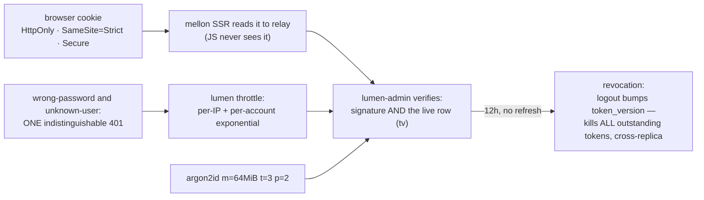

# mellon — the private admin portal

> **Sync duty (workspace rule, 2026-11-15):** this note is the vault's
> learning home for the repo. Any change that alters the stack, anatomy,
> contract, commands, conventions, or state recorded here must update this
> note in the SAME round — and [LEARNING.md](LEARNING.md) if it minted a
> lesson. See [../doc-map.md](../../doc-map.md) §"Context sync".

## 1. Role in the estate

mellon is the owner's keyboard-first control surface: content management
for the blog and env/secret management for the estate, in ONE web app. Its
defining property is the doctrine ([DESIGN.md §2](https://github.com/kanatabi/mellon/blob/main/DESIGN.md)
— load-bearing, read before any feature work):

1. **Never serves content traffic** — `earendil → lumen` is the blog's
   data path; mellon going down cannot break the blog.
2. **The relay forwards; it never decides** — all logic, auth, credentials,
   and policy live in lumen. Mellon holds NO secrets (no Bao tokens, no
   GitHub tokens, no DB creds — any layer, any era).
3. **Public at `console.gofar.id`** (amended 2026-11-08) — TLS at the
   shared Traefik edge with the console middlewares, JWT sessions minted
   ONLY by lumen-admin with `token_version` revocation; the service itself
   stays **ClusterIP** (only Traefik routes); `kubectl port-forward` is
   break-glass. Go-live is **HUMAN-GATE #10**.
4. **Anything reachable by mouse is reachable by keyboard** — the palette +
   shortcuts are the vocabulary; no hover-only affordances.
5. **GitOps purity** (future infra tab): the portal may PROPOSE
   (commit/PR to vortex) and trigger convergence — it never applies to the
   cluster itself.

## 2. Stack, and why it mirrors earendil

SvelteKit 3 + Svelte 5 runes + TypeScript + Tailwind v4 + `adapter-node`
(Node 22, exact pins, gates in order) — deliberately the same stack as
earendil so one mental model covers both SSR apps, and the same
`adapter-node` container shape (:3000, 1 replica — it has one user).

## 3. Anatomy

```mermaid
flowchart TB
    subgraph shell["the §11 shell (every route)"]
        NAV["left nav (Content / Control Plane / Admin) + topbar (⌘K pill centered · account avatar menu)<br/>ONE chrome mass — no internal borders; content scrolls in the rounded box: flush top/left at lg, 12px ring right/bottom (§11.1, 2026-11-16/17)<br/>breadcrumbs IN-PAGE, sub-pages only, parent-naming (editor `posts ›`), Secrets kv-path above the title<br/>collapsed rail = centered icon column (36px squares, labels out of layout)<br/>dropdowns are the house Select (no native <select>); content-mode palette rows wear cast-hued type pills"]
    end
    subgraph app["src/routes/(app)/"]
        DASH["/ dashboard: recent posts, publish queue, quick actions"]
        POSTS["/posts list + /posts/[slug] editor+preview<br/>(split or toggle · Ctrl+Enter save/publish · source pane colored from the §11 tokens, not CodeMirror's light default)"]
        PHOTOS["/photos the darkroom (tiles⇄table, bulk bar, uploads)<br/>/photos/[id] canvas + metadata pane"]
        SEC["/secrets the cockpit (app picker → env tabs, masked values,<br/>history + diff + CAS save, pin-lock badge)"]
        SUM["/secrets/summary the ESTATE MATRIX<br/>(every app × env: head, pin state, key counts, drift)"]
        TAGS["/tags the tag desk (row dialogs, engine search, bulk)"]
        SET["/settings appearance · vim toggle · session"]
    end
    subgraph lib["src/lib/api/"]
        RT["routing.ts — THE dual-upstream table"]
        FA["fetch-adapter.ts — every AdminApi method → the §8/§9 wire, 1:1"]
        TWIN["fixture twin — TEST-ONLY"]
    end
    NAV --> app
    app --> RT
    RT --> FA
    FA --> A["lumen-admin (ADMIN_URL)"]
    FA --> C["lumen cms (CMS_URL)"]
```



**The routing table is the architecture** (role-split round, 2026-11-13):
session/users/setup/bao → `ADMIN_URL`; content + `/api` → `CMS_URL`;
unknown → **throw (no default)**. Legacy `API_BASE` feeds both planes in
the single-binary dev shape; unset everywhere falls back to
`http://localhost:8080`.

## 4. The ghost-field doctrine (and the other honesty rules)

- **Relayed server copy is rendered verbatim, never decorated.** When lumen
  answers `403 pinned at vN — unpin first`, mellon shows exactly that
  string (plus affordances like a re-pin offer). Paraphrasing the wire
  would lie about who refused and why.
- **Masked values are UI-only** — the editor can always reveal/copy the
  real value; hiding it in the DOM would be theater (and the threat model
  assumes a stolen session bearer IS an admin, so revocation — not
  hiding — is the mitigation).
- **Validation belongs to lumen** (pin locks, CAS 409s, key-set mirror
  conflicts): the UI may afford (disable save while pinned), but never
  re-implements or pre-empts the rule.
- **The markdown stack is bundled + lazy-loaded on purpose** — one broken
  chunk once killed the ENTIRE relay (`499d595`); keep that chunk boundary.

## 5. Security posture in one view



The full threat analysis (credential stuffing, stolen bearer, direct Bao
assault, AppRole extraction, lost-update, content mutation, the TOFU
window) lives in the vault archive:
[../archive/mellon-THREAT-NOTE.md](../../archive/mellon-THREAT-NOTE.md) —
owner re-review (GATE #5) is the open item it records.

## 6. Running it

```bash
cd ../lumen && make dev    # the backend first
make dev                   # readyz-gated real mode (LUMEN= / PORT= overridable;
                           # reuses a live server)
make live                  # the gated acceptance suite vs a RUNNING lumen:
                           # login · drafts-at-the-door · CAS 409s · multipart
                           # upload · secrets relay · instant revocation
npm run dev · check · lint · test:unit · build   # the SvelteKit gates
```

Dev login: `gofar` / `mellon-dev-password` (the dev placeholder). The
setup wizard (`/setup`) is the TOFU path — first admin claims the estate
once, terminal `410 Gone` after; forced-change (428) gates every bearer
until the password changes (escape triad: whoami / change-password /
logout).

## 7. Testing

| Gate                        | Proves                                                                              |
| :-------------------------- | :---------------------------------------------------------------------------------- |
| `npm run test:unit`         | offline battery vs the twin (runtime graph never touches it)                        |
| the console harness (79/79) | keyboard-first + view anatomy invariants                                            |
| `make live`                 | the acceptance suite against a real lumen — the relay is only honest when it relays |

## 8. How it ships

Same anvil ladder (tag → image `ghcr.io/kanatabi/mellon` → bump PR). The
door (`console.gofar.id`) rides the production Traefik edge with the
console middlewares installed at the edge since Phase 3 —
[network-and-doors.md](../../architecture/network-and-doors.md) has the full
layering; HUMAN-GATE #10 is the go-live checklist.

## 9. State & history (walked)

- **2026-11-13** — secrets control plane merged (`a224950`: cockpit,
  compare, mobile honesty); the estate matrix (`7fb8ffa`); pin-as-lock
  rendering (`4f14eaa`); the IA round (Control Plane / Admin sections,
  `60bbdf1`); the chunk incident (`499d595`).
- **2026-11-11** — setup wizard surfaces; the TOFU threat analysis (V7)
  added to the threat note.
- **2026-11-08** — the public-door amendment (was port-forward-only).
- **2026-11-15** — the portal ROLLED and the door answered: `console.gofar.id`
  → 303 → login behind the real cert (the wave-2 hold lifted once the
  cf-token seed issued the certs); the upload relay's first walk hit the
  R2 region seed bug (lumen's ledger has it — fixed via `auto`) and the
  upload went 201 through the fixed relay.
- **2026-11-15** — the correlation round (`be18712`): the fetch-adapter's
  `call()` and `addPhoto` mint a request-id per call, send it as
  `X-Request-Id`, log the access line (`hop=admin|cms` free from
  `upstreamFor`), and carry lumen's echo in `AdminApiError.requestId` —
  the wire copy untouched (ghost-field).
- **2026-11-15** — the metrics + budgets round (`c86c9cd`): prom-client,
  the ONE registry (`src/lib/server/metrics.js`) shared by the hooks and
  the custom server via prom-client's DEFAULT register; every lumen call
  COUNTED (outbound_request_total — the dependency axis maps from the
  routing table: admin→lumen-admin, cms→lumen-cms) and BOUNDED
  (AbortSignal.timeout; `photos.upload` gets the 30s budget); ops are
  ENUMERATED per call site and typed (`OpName` — a misspelled op is a
  compile error; the paths embed slugs so a path-derived label would be
  a cardinality bomb); the inbound RED pair in a `handle` hook;
  `server.js` runs TWO listeners in ONE process (unrouted `/metrics` on
  `MELLON_METRICS_PORT` default 9090); vortex's pod annotations opt the
  scrape in.
- **2026-11-15** — `PLAN.md` became local-only; THREAT-NOTE moved to the
  vault archive; this vault note created.
- **2026-11-21** — **shadcn S4 built and merged** (`feat/shadcn-s4-choice` →
  integration): every choice widget now rides bits-ui — `Select.svelte`
  DELETED (230 lines; compare's four pickers + vault's fill picker join the
  users dialog), Combobox rewritten IN PLACE over popover+command (the state
  machine gone, the five mounts untouched), DatePicker and DateRange over
  the block's calendars (Monday-first held via locale=en-GB). The calendars'
  4 smuggled native `<select>`s rewired (doctrine §5.3 held). 195 tests
  (7 new contract tests on behaviors that ran untested for months); bundle
  1,904 KiB gz (+37 for calendars/command/@internationalized/date); the
  editor chunk held. The wire re-seed + tv-ordering lessons in
  [LEARNING.md](LEARNING.md).
- **2026-11-21** — **shadcn S3 built and merged** (`feat/shadcn-s3-forms` →
  integration): the button cast (`primary` violet pill / `quiet` mono chip /
  `danger` / `soft`, registry names kept for the vendored overlays) mapped
  from a 48-button evidence sweep — the plan's sm/md-rectangle guess was
  wrong, the tree's actions are pills. House lines landed verbatim in
  `ui/input` (the 10× anatomy) and `ui/textarea`; `ui/label` gained the mono
  variant. Full page sweep (login → photos/[id]): page-level ACTION buttons
  are 0; the residue (77 buttons / 20 inputs) is moat + brand furniture +
  stateful segmented chips (deferred to S5 toggle-group) + inline cell
  editors + action-bound fields (actions can't ride components). 190 tests;
  bundle 1,867 KiB gz (down 24 from S2). Deviations ledgered in
  SHADCN-PLAN §3; the tv emit-order + destructure-defaults lessons in
  [LEARNING.md](LEARNING.md).
- **2026-11-20** — the editor's syntax palette became token-driven (owner
  report: dark-mode links and fence language washed out). `@codemirror/language`
  - `@lezer/highlight` promoted to direct deps; one non-fallback
    `HighlightStyle` outranks `basicSetup`'s light fallback. Links now match the
    preview (`--foreground` + underline), metadata steps down to
    `--muted-foreground`. DESIGN §11.3 gained the token clause; the lesson is in
    [LEARNING.md](LEARNING.md).
- **2026-11-20** — **the 500-page-loses-its-shell bug fixed on the
  integration branch** (`3eb72dd`): the dashboard's 500 rendered the ROOT
  error boundary because a hydration crash (`bind:ref={undefined}` into
  `$bindable(null)` — the hamburger) threw inside the error-boundary render.
  Null-init + fixtures + dom tests pin it. A favicon landed with it (the
  access log was eating a 404 per page view). The dashboard's 404s
  themselves are the lumen door's truth (see below).
- **2026-11-20** — **collapsible nav sections** (`afa4feb`, owner ask — the
  doc's sidebar-07 structure): each group collapses via the CANONICAL
  collapsible-group pattern — `Collapsible.Root` (vendored `ui/collapsible`,
  2 files, zero deps) wraps the group, the label IS the trigger, the chevron
  rotates off `data-state`, height animates. Not persisted: a fresh visit
  opens every destination. Same round: a `//` comment in the layout's MARKUP
  rendered as literal page text (Svelte only treats `//` as a comment inside
  script blocks) — the owner screenshotted the leak; HTML comments only,
  outside script tags.
- **2026-11-20** — **shadcn S2 merged to the integration branch**
  (`feat/shadcn-integration`, `5dd78f9`): the hand-built 459-line shell now
  rides the sidebar block (`+layout.svelte` → 189 lines + `app-sidebar.svelte`)
  — rail with collapse toggle in the footer (owner call 2026-11-16), mobile
  sheet below lg (breakpoint moved 768→1024, D12), ⌘B guard on text surfaces
  (D5), UserMenu on dropdown-menu, content box = the doctrine line
  (`rounded-lg`, no shadow — D9). The block runs `variant="sidebar"` not
  `inset` (D13). **New UI branches: slice branches fork from and merge into
  `feat/shadcn-integration`; main merges ONCE at the end** (owner call — the
  per-slice release ladder is suspended for this experiment). S3 (form
  primitives) is next. Lessons in [LEARNING.md](LEARNING.md).
- **2026-11-20** — **shadcn S1 landed on a branch** (`feat/shadcn-s1-foundation`,
  PR open): the substrate for the A2 UI experiment — `components.json`,
  `cn()` (`clsx` + `tailwind-merge`, no `cn` package), 18 shadcn token aliases
  declared once in `:root` + their 18 `--color-*` twins, and a filename-split
  DOM test project (`*.dom.test.ts` → happy-dom + forced runes). Zero visual
  diff (no route imports `ui/` yet; JS bundle byte-identical). Docs live in
  `SHADCN.md` + `SHADCN-PLAN.md` (D3: DESIGN.md untouched while experimental);
  lessons in [LEARNING.md](LEARNING.md).
- **Open:** GATE #5 owner read-through; GATE #10 run (prod seeds first —
  the decision record's C4).

## 10. When you change this repo — the sync checklist

1. Gates: `npm run check` → `npm run lint` → `npm run test:unit` →
   `npm run build` (+ `make live` when the relay moved).
2. New surface? It goes in the routing table explicitly (or it throws —
   that's the design).
3. Never add a credential, a default upstream, or a decorated error copy.
4. Update this note if §1–§9 drifted; update [LEARNING.md](LEARNING.md)
   if the change minted a lesson.
5. Release via the anvil ladder only.
