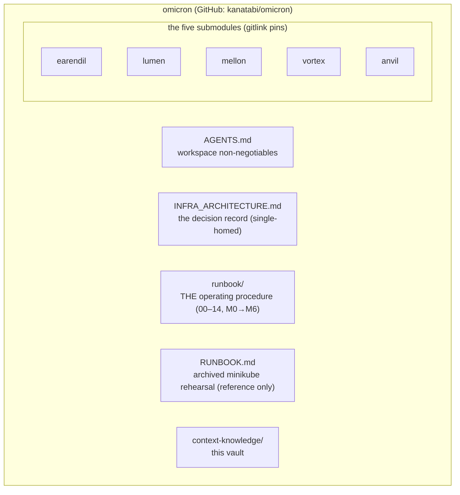
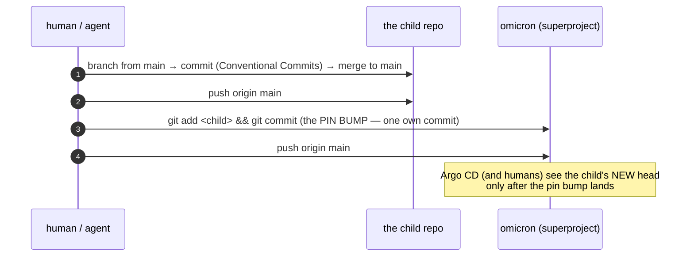

# omicron — the superproject

> **Sync duty (workspace rule, 2026-11-15):** this note is the vault's
> learning home for the workspace itself. Changes to the root docs, the
> runbook shape, or the submodule set must update this note in the SAME
> round. See [../doc-map.md](../doc-map.md) §"Context sync".

## 1. Role in the estate

omicron is not an application — it's the **connective tissue**: the git
repo that pins the five submodules beside their shared artifacts (the
blueprint, the runbook, this vault). A fresh clone of omicron plus
`git submodule update --init` is the entire estate.

## 2. What lives at the root

| Artifact | What it is | When it changes |
| :-- | :-- | :-- |
| `AGENTS.md` | the non-negotiables: no values in Git · two public surfaces + the dashboard door · explicit placement · pinned v-tags · app-of-apps shape · no-sidecars observability | when the OWNER amends doctrine (dated, append-only spirit) |
| `INFRA_ARCHITECTURE.md` | the decision record: 3-node phases, budgets §1, secrets design §5, the amendment ledger | whenever a decision changes — the SAME round as the change |
| `runbook/` | the operating procedure, milestone-ordered (M0 prepare → M6 maturity; `00a-run-order` is the execution map; each chapter's frontmatter carries its proof `status:`) | walked every time the estate changes shape |
| `context-knowledge/` | this vault | per the sync duty |
| submodule pins | one gitlink per child | after EVERY child push (see §3) |

## 3. The submodule mechanics (the daily dance)

Each child is an independent repo with its own GitHub primary
(`git@github.com:kanatabi/<name>.git`; GitLab `arkoi/omicron/*` trees are
mirrors where protection rules allow). The flow for any change:

Rules: granular commits, one logical change each; the pin bump is its OWN
commit (all five children may batch into one bump commit when a round
touched several); never edit child files from the superproject side.

## 4. The workspace's own rules (pointers)

The root [AGENTS.md](../../AGENTS.md) is the authoritative list — the
short form: two sanctioned public surfaces + the dashboard door and NEVER
a public API; values never in Git; explicit placement with a ~100 Mi
master-slack warning; only released v-tags deploy; CI bump PRs fenced by
line shape; observability without sidecars; the doc tier
([doc-map.md](../doc-map.md)).

## 5. State & history (walked)

- **2026-11-11** — production doors live; first full runbook walk (Part A)
  on minikube.
- **2026-11-13/14** — the environment-model re-cut (three planes, role
  split, per-env deploy chains); the release-ladder incidents.
- **2026-11-15** — the doc-consolidation round: this vault created, the
  INFRA fork retired (single-homed at root), the PLAN journals made
  local-only, every repo got an AGENTS.md, the context-sync rule minted.

## 6. When you change the workspace — the sync checklist

1. Root docs (`AGENTS.md`, `INFRA_ARCHITECTURE.md`, `runbook/`) change in
   the SAME round as the decision they record — the decision record is the
   first commit, not a memory exercise.
2. Child pushed → bump its pin here in the same sitting.
3. Update this note if the artifact map (§2) drifted.
4. The two untracked root images (`ascii-profile-img.png`,
   `bw-nonformal.jpg`) are the owner's — leave them untracked.
