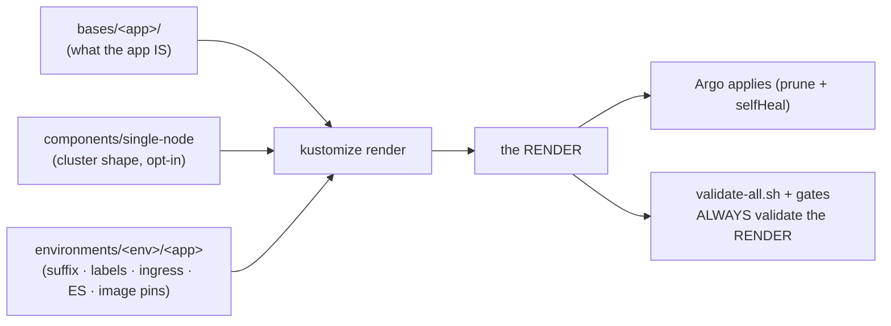
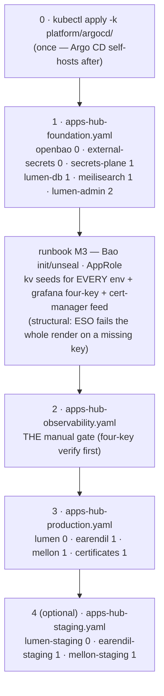

# vortex — the GitOps source of truth

> **Sync duty (workspace rule, 2026-11-15):** this note is the vault's
> learning home for the repo. Any change that alters the shape, contracts,
> or state recorded here must update this note in the SAME round — and
> [LEARNING.md](LEARNING.md) if it minted a lesson. See
> [../doc-map.md](../../doc-map.md) §"Context sync".

## 1. Role in the estate

vortex DECLARES the cluster. Every workload that runs (except Argo CD
itself, which self-hosts from `platform/argocd/`) is YAML here, applied by
Argo CD via app-of-apps. It is the GitOps **source of truth**: if it isn't
in vortex, it doesn't exist; if it is, the cluster converges to it.

Three properties are non-negotiable (root AGENTS non-negotiables):

- **No real values in Git** — schema and `ExternalSecret` templates only;
  values live in OpenBao ([secrets-and-vault.md](../../architecture/secrets-and-vault.md)).
- **Placement is explicit** — every Deployment carries `node-pool` affinity
  and (where 2-replica) hostname anti-affinity.
- **Pinned, released versions only** — exact versions for everything;
  deploy tags are `vX.Y.Z` only.

## 2. The repo tour

```text
platform/argocd/     Argo CD's install: pinned upstream manifests + overlays
                     (the labelSelector pinning patch auto-pins future components).
bootstrap/           the FOUR manual hub entrypoints + the 3-node blueprint hub.
apps/<hub>/          Application CRs ONLY — one per deployed app, per hub:
                     foundation (6 CRs), observability (1), production (4),
                     staging (3).
bases/<app>/         raw manifests, one kustomize dir per app (10 of them):
                     earendil, mellon, lumen, lumen-db, observability,
                     meilisearch, openbao, secrets-plane, certificates,
                     external-secrets. Suffix-free, env-free, ESO-free, pin-free.
components/          shape toggles: single-node (collapse pools/replicas to one),
                     config-gate (the PreSync epoch gate: Job + RBAC).
environments/        THE env axis: foundation / staging / production, per app.
```

The render pipeline that turns this into cluster objects:



## 3. The hub topology and bootstrap order



Exactly one hub SET owns a cluster; every hub syncs its folder
**non-recursively** (the trees never see each other's CRs). Adding an app =
new `bases/<name>/` + a CR in the folder its hub syncs — never a hub edit.

## 4. The contracts this repo owns

- **The naming contract** — `nameSuffix` rewrites `metadata.name` only;
  references are authored-final in overlays (each env's `ingress.yaml`,
  ES `spec.target.name`) or JSON6902-patched (base `envFrom` refs); vault
  values must name the suffixed Services. Full contract:
  [vortex AGENTS.md §3](https://github.com/kanatabi/vortex/blob/main/AGENTS.md).
- **The env axis** — foundation (shared, unsuffixed) / staging
  (`-staging`) / production (`-production`); co-tenancy via env-restricted
  selectors; app namespaces rendered ONCE by the foundation lumen-admin
  tree (`$patch: delete` elsewhere). Deep-dive:
  [../architecture/environments-model.md](../../architecture/environments-model.md).
- **The ES render contract** — every ExternalSecret's `data:` list mirrors
  the role's real binds; `LUMEN_ROLE` stays inline on pods (identity, not
  config).
- **The epoch TRIO + config-gate** — the PreSync Job (`components/
  config-gate`) decodes `omicron/config.epoch` from the rendered output and
  REFUSES the sync unless declared == rendered — and since the pin-as-lock
  round, a set pin makes lumen 403 any writes while locked. The TRIO moves
  byte-equal in ONE commit (the bump flow edits all three lines; CI asserts).
- **Shared-by-design services** — ONE Patroni cluster (3 logical DBs), ONE
  Meilisearch (per-env indexes), ONE of every platform piece.

## 5. Validation (every manifest edit, no cluster needed)

```bash
kubectl kustomize environments/production/earendil        # render one dir
bin/validate-all.sh <path-to-vortex>   # anvil's battery (from the anvil repo)
```

`bases/external-secrets` and its chains need `--enable-helm`; the
remote-pinned Argo overlay needs network on first fetch. The battery adds
the rendered-loss baseline + structural invariants + the TRIO rule —
detail: [../architecture/gitops.md](../../architecture/gitops.md).

## 6. How it ships (and doesn't)

- **This repo's "releases" ARE its commits**: Argo polls `targetRevision:
  HEAD`. That's why direct commits to `main` are forbidden (branches + PRs,
  Conventional Commits) — main is prod.
- **Image versions** arrive only via the bump ladder (anvil) editing the
  env trees' `images:` stanzas (+ the TRIO when config changes).
- **Config epochs** ride the same ladder (the TRIO flip).

## 7. State & history (walked)

- **2026-11-11** — the DNS-side domain cutover verified (the doors are
  DECLARED; the hubs that would serve them are not yet applied — 2026-11-15
  status); first live runbook walk (Part A) on the rehearsal cluster.
- **2026-11-13/14** — the great convergence: `applications/` → `bases/`
  rename; bases lost Ingress (env overlays author their own) and lost image
  pins (the override-order proof); env trees became the only version homes;
  the role split (lumen-admin foundation / cms per env); the staging hub
  landed; the first live bump (#17) proved the ladder.
- **2026-11-14/15** — observability rounds: pod-log label contract, OTLP
  semconv door, the TLS-alert expr corrected to remaining-seconds
  semantics (`1b2d7b7`).
- **2026-11-15** — the in-repo INFRA copy retired (stale fork — link,
  don't copy); AGENTS.md added; README slimmed.
- **Open:** staging DNS records + vault seeds (when staging first goes
  live); the transition `overlays/` patterns' removal condition.

## 8. When you change this repo — the sync checklist

1. `kubectl kustomize <dir>` after ANY manifest edit (+ the battery before
   merge).
2. Version change? It must ride the bump ladder — env trees only.
3. Budget-relevant change? Update the §1 tables in
   [`INFRA_ARCHITECTURE.md`](../../../INFRA_ARCHITECTURE.md).
4. Update this note if §2–§6 drifted; update [LEARNING.md](LEARNING.md)
   if the change minted a lesson.
5. Never: hub edits for new apps, values in Git, `latest`/branch-SHA tags,
   ESO in bases.
