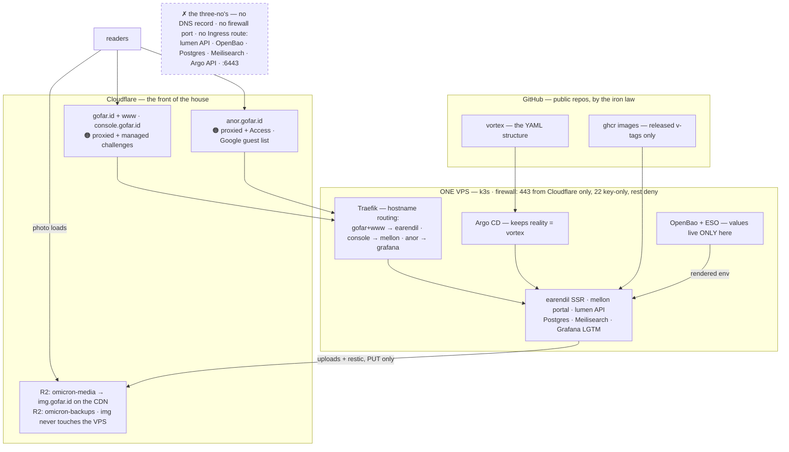

# 00 · Overview — what we're building and why

**TL;DR:** four doors face the world, all through Cloudflare's guard layers
(proxy · managed challenge · Access · R2), never directly: the blog
(`gofar.id` + `www`), the portal (`console.gofar.id`), the dashboard
(`anor.gofar.id` — the only door with a guest list), and photos
(`img.gofar.id`, served from R2 without ever touching the server). Behind
them, one small Linux server (~$12/month) runs the entire system: photos and
backups live in R2 buckets, secrets live in an encrypted vault *inside* the
cluster, and all config arrives from one public YAML repo via GitOps. You
push code → approve a release → the internet updates itself.

> **Ready to work?** [00a Run Order](00a-run-order.md) is the execution map —
> what to type, on which machine, in what order. This chapter is the *why*.

## In words a human can hold

- **Kubernetes (k3s)** is a traffic controller for little programs ("pods").
  k3s is a complete Kubernetes that fits in one package — we run it on one
  server, and rehearse the exact same engine on a laptop with **k3d** (§03).
- **GitOps** means: the folder of YAML (`vortex` repo) *is* the truth of what
  runs. A robot (Argo CD) watches it and constantly nudges the server to look
  like it. You never change the server by hand — you change the folder, the
  robot copies. The repo is public; that is safe, see the iron law below.
- **The secrets vault (OpenBao)** holds every password *inside* the cluster.
  Another robot (ESO) copies values from vault into where programs look.
- **Cloudflare** sits in front of every public door: hides the server's real
  address, absorbs floods, proves visitors are human, checks the dashboard's
  guest list (Access — Google login in, Grafana out), and hosts photos and
  backups in two R2 buckets. The origin firewall answers 80/443 to
  Cloudflare's own address ranges and nobody else.

## The estate at a glance

Traffic, honestly, in five sentences: there are exactly **four public
routes** (gofar+www, console, anor, img) and Traefik picks between them by
hostname. `img` is the odd one: Cloudflare↔R2 only, the VPS never sees a
photo request. `anor` is the only door with **Access** in front. Everything
internal — lumen, Bao, Postgres, Meili, Argo's API, the kubelet's :6443 —
lives under the ✗ rule above. A browser reaches lumen **only** via the
same-origin proxy inside the earendil/mellon pods, and there are **two TLS
legs**: browser↔Cloudflare (CF's edge cert) and Cloudflare↔Traefik (our
Let's Encrypt cert, Full strict). Responses travel back out the same path.

## The estate's one iron law

> **Values live ONLY in Bao. Git holds structure.**
>
> Every repo here — code, `vortex` YAML, even the images on ghcr — is
> **public**, and that is a feature, not an accident: the YAML describes
> *shapes* (Deployments, services, ExternalSecrets that say "fetch key X
> from path Y"), and every *value* (passwords, tokens, URLs with secrets in
> them) exists only in the vault inside the cluster. This is also why Argo
> CD needs **no repo credentials**: there is nothing to protect in the clone.
> The structure itself is checkable: `anvil`'s validate-all asserts every
> config-shaped value is absent from Git, and its table reads **32 dirs
> GREEN** against the production shape
> (`../anvil/bin/expected-kinds.txt`). Break the iron law and CI says so.

## The folder — milestones in order

| # | Chapter | Milestone | One line |
|---|---|---|---|
| 00 | [Overview](00-overview.md) | — | you are here — the *why* |
| 00a | [Run Order](00a-run-order.md) | — | the *execution map*: local track, then VPS track |
| 01 | [Prerequisites](01-prerequisites.md) | M0 · prepare | buys, accounts, R2 buckets + tokens, toolbelt, k3d |
| 02 | [VPS Hardening](02-security.md) | M1 · VPS-only | locks on the front door — the k3d track deliberately skips it |
| 03 | [K3s](03-k3s.md) | M1 | the cluster — same k3s on k3d (first) and the VPS |
| 04 | [GitOps & Argo](04-gitops.md) | M2 | the robot arrives; the public-vortex note |
| 05 | [Secrets Vault](05-vault.md) | M3 | OpenBao + ESO bootstrap: values live only here |
| 06 | [Apps & First Release](06-apps-first-release.md) | M4 | the production hub wakes the fleet; first green |
| 07 | [Go Public](07-go-public.md) | M5 | records, challenges, real certs, Access, img domain + Traffic Anatomy |
| 08 | [Backups](08-backups.md) | M6 | restic → R2 + the drill — start it "when boring" |
| 09 | [Releases](09-releases.md) | day-2 | the ritual: bump approval → evidence → deploy gate |
| 10 | [Observability](10-observability.md) | day-2 | Grafana/anor, LGTM stack, family lab |
| 11 | [Access from Laptop](11-access.md) | day-2 | tunnels, Tailscale, the break-glass road |
| 12 | [Operations Calendar](12-operations.md) | day-2 | weekly/monthly/quarterly + incident cards |
| 13 | [References](13-references.md) | — | official docs for every claim |

The numbering is the execution order: M0→M6 in one straight walk (00a holds
the checkbox ledger). 09–13 are reference chapters — you read them on a
Tuesday, not on a build night.

## Decisions already made (owner rulings — don't re-litigate in a hurry)

| Question | Settled | Where |
|---|---|---|
| Where | one VPS, 4 vCPU/8 GB/80 GB, Ubuntu 24.04 (Contabo first, SG/EU; sumopod/helipod valid; provider-neutral commands) | 01 |
| Local rehearsal | **k3d on the 32 GB laptop is the mandatory rehearsal runtime** (same k3s image, production-shape hub); the separate-VM plan is demoted to optional-advanced; minikube is the historical playground (archived root `RUNBOOK.md`) | 00a, 03 |
| Level-2 rehearsal | optional named Cloudflare Tunnel from the laptop cluster = rehearse the REAL public path (proxy, challenges, Access, real LE certs via DNS-01) before the VPS exists; the Level-1 `/etc/hosts`→127.0.0.1 trick (still with real certs) is also valid | 00a |
| How does software ship | released `vX.Y.Z` tags only; humans approve bump + deploy; merge never deploys | 09 |
| Secrets | OpenBao only; Git holds templates only — the iron law above | 05 |
| Public guard | Cloudflare proxy + managed challenges; **Access on `anor` only**; site + R2 buckets + tokens created early (M0), everything public pointed only at M5 | 01, 07 |
| Dashboard door | `anor.gofar.id` (alt name `beacon.gofar.id` — swap in the 4 places listed in 07) | 07, 10 |
| Grafana auth | humans: Google → Cloudflare Access → Grafana OIDC (auto-provision **Viewer**; team `lab-friends` = Editors on the one `Learning` folder) **plus** a kept break-glass local admin: built-in `admin`, generated password in Bao `kv/grafana/production`, reachable only via the SSH-tunnel path; the login form stays enabled-but-never-seen-publicly | 10, 11 |
| Photos & backups | R2, one bucket each (`omicron-media`, `omicron-backups`); `img.gofar.id` custom domain at M5; media uploads relay through lumen (presigned documented as the later option) | 01, 07, 08 |
| Portal doctrine | every path seeded under `kv/<app>/<env>` shows up **automatically** in mellon's Configs matrix + Vault card — lumen's `internal/bao` `ListPaths` enumerates kv metadata dynamically and mellon derives rows; no registries. The only exceptions are the bootstrap-paradox/recovery credentials: the ESO AppRole pair, lumen's `LUMEN_BAO_*` pair, `lumen-admin-password` | 05, 06 |
| Admin road | SSH tunnels day one; Tailscale optional chapter | 11 |

## Status honesty

Nothing here is magic, and not all of it is *proven on the real VPS yet*.
Rules of reading this folder: claims rehearsed on the laptop (k3d) are
marked as rehearsed; a VPS step becomes PROVEN only when walked and the
chapter's status line updated. The archived `../RUNBOOK.md` (minikube era)
remains a rehearsal log, not a procedure.

## Obsidian note

This folder IS the doc set — open it as a vault (or a subfolder of one).
Links are relative, so everything works in Obsidian *and* on GitHub.
Obsidian's `.obsidian/` settings stay gitignored; the prose stays clean.
