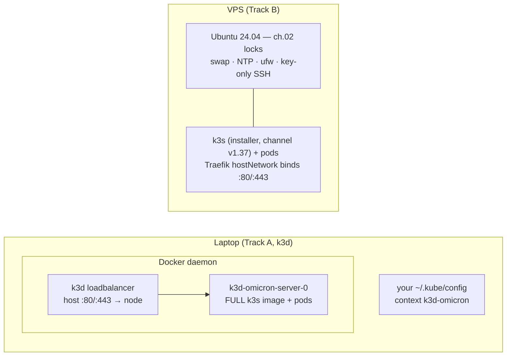

# 03 · K3s — one cluster engine, two runtimes

> **Why k3s:** complete Kubernetes in one package, maintained by the same
> folks as k8s, small enough for one node. We pin its channel like every
> other component (INFRA §1) — "latest" is how clusters break overnight.

> **Two runtimes, one engine.** **k3d** does not "stand in for" k3s — it
> *runs* the official k3s (as the `rancher/k3s` container image) inside
> Docker on your laptop. The **VPS** runs the same k3s installed by script
> onto bare Ubuntu. Same binaries, same flags, same behavior; the estate
> rehearse-and-ship symmetry (00a's Track A→B) rests on this sentence.
> The only real deltas are how ports get published and whose host
> guarantees we're standing on — table in §3.



## 1. Runtime A — k3d (local, mandatory first execution)

Install per [01 §4](01-prerequisites.md), Docker running, then the one
command block this estate uses everywhere (00a's A2 copies it verbatim —
don't fork a variant):

```bash
k3d cluster create omicron \
  --servers 1 --agents 0 \
  --k3s-arg "--disable=servicelb@server:0" \
  --k3s-arg "--disable=traefik@server:0" \
  -p "80:80@loadbalancer" -p "443:443@loadbalancer"
```

✅ check: `kubectl get nodes` → `k3d-omicron-server-0` **Ready** (k3d
merged a `k3d-omicron` context into your kubeconfig automatically — there
is no `/etc/rancher/k3s/k3s.yaml` step on this track). Note the `rancher/k3s`
image tag k3d printed: it must be on the **v1.37** line to match the VPS
plan — pin the same minor with `--image rancher/k3s:v1.37.x-k3s1` if the
default drifts.

> **Why `--disable=servicelb` and `--disable=traefik`:** identical reasons
> to the VPS (§2) — the estate pins ONE Traefik shape (chart 42.3.2, §5)
> everywhere, and k3s's auto-installed copies would create two edges and
> silent split-brain routing; the bundled load-balancer is for
> multi-node clusters and just sits confused on one node. On k3d,
> LoadBalancer-type Services are served by k3d's own loadbalancer container
> — which is what the `-p 80/443` mappings talk to (§5).

> **Why one server, no agents:** the production shape is a single node,
> and `vortex/overlays/production/*` collapse placement through
> `components/single-node`. Rehearsing a 3-node k3d against single-node
> overlays would rehearse a topology nobody ships.

## 2. Runtime B — k3s on the VPS (as the user with sudo)

```bash
curl -sfL https://get.k3s.io | INSTALL_K3S_CHANNEL=v1.37 sh -s - server \
  --disable=servicelb --disable=traefik
```

✅ check: `systemctl status k3s --no-pager | head -3` → active (running).

Then make it yours:

```bash
sudo chmod 644 /etc/rancher/k3s/k3s.yaml   # kubeconfig readable by ops
kubectl get nodes -o wide                  # Ready
```

> **Why pin the channel (v1.37 — the version the estate rehearses on;
> bump deliberately, never "latest"):** every manifest in `vortex` is
> tested against a known k3s/k8s. **If your k3d rehearsal and the VPS
> don't run the same minor, you rehearsed the wrong thing.**
> **Why the same two disables as §1:** one Traefik shape, no confused
> servicelb — and on the VPS there is no k3d proxy to fall back on, so
> publishing happens via hostNetwork (§5).

## 3. What differs between the runtimes (honest table)

| | k3d (laptop) | VPS |
|---|---|---|
| k3s comes from | `rancher/k3s` container image (tag = k3s version) | `get.k3s.io` installer, `INSTALL_K3S_CHANNEL=v1.37` |
| 80/443 publish | `-p` mappings → k3d loadbalancer → Traefik **Service type LoadBalancer** | Traefik **hostNetwork** binds the host's ports; no LB |
| kubeconfig | auto-merged context `k3d-omicron` | `/etc/rancher/k3s/k3s.yaml` (copy to laptop later via ch.11 tunnel) |
| node name | `k3d-omicron-server-0` | the hostname |
| host concerns (ch.02: SSH locks, ufw, swap, NTP) | **not applicable** — Docker's host is your laptop; this is why Track A skips 02 | mandatory, walked first |
| PVC data dir lifetime | inside the node container: survives pod restarts **and PVC deletion** (Retain!), but dies with `k3d cluster delete` | on the node's disk: survives almost everything except the documented wipe (§4) |
| resources | 32 GB box = slack | 8 GB = the budget chapters care about (INFRA §1) |

Everything ABOVE the table is identical on both tracks: every later
chapter (04 Argo, 05 vault, 06 apps, 07 public path) runs the same
commands against whichever kubeconfig is current.

## 4. The node-pool label (both runtimes)

```bash
# k3d:
kubectl label node k3d-omicron-server-0 node-pool=platform --overwrite
# VPS:
kubectl label node "$(hostname)" node-pool=platform --overwrite
```

✅ check: `kubectl get node --show-labels | grep node-pool=platform`.

> **Why the label:** Argo's pinned manifests carry a `node-pool=platform`
> pinning patch (the estate's placement doctrine). The production shapes
> currently *relax* node selectors via `components/single-node`, so nothing
> sits Pending without the label — but label it anyway: parity with the
> base manifests, and the scale-out story (drop the component, placement
> returns) has a labeled node to land on.

## 5. Storage: local-path (k3s ships it — both runtimes)

Real k3s ships StorageClass `local-path` natively, inside the image AND
under the installer, which is exactly what `vortex` PVCs ask for.
**Nothing to alias** (the `standard`-alias trick in the archived rehearsal
log was a minikube-only quirk — see 01 §5's demotion note).

> ⚠️ **Why PVC deletion is NOT a wipe here:** the estate's k3s installs keep
> `reclaimPolicy: Retain` — data directories under `/var/lib/rancher/k3s/
> storage` (check `kubectl get sc local-path -o yaml | grep configDir`)
> survive on purpose, because the vault and database never trust Git to
> hold them. Consequences documented by *both* incidents that taught it:
> a recreated PVC with the same name remounts the same old directory
> (Meilisearch engine-bump trap), and a "lost" vault is usually sitting in
> its directory the whole time. On k3d the directory lives *inside the node
> container*, so it keeps biting across pod/PVC churn — only
> `k3d cluster delete` truly forgets (that is a feature for Track A). The
> wipe procedure lives in [05 vault → vault reborn](05-vault.md) and
> [10 observability → data reset](10-observability.md).

## 6. Traefik — one pinned chart, two publish shapes

The estate's edge is chart **42.3.2**, applied by hand on both tracks (it
pre-dates Argo taking over, ch.04; the `ingress` namespace and flags below
are what `vortex` Ingresses are written against). Shared flags: CRD
provider, prometheus metrics, http→https bounce, TLS port — then ONE
difference per runtime.

**VPS (hostNetwork):**

```bash
helm repo add traefik https://traefik.github.io/charts && helm repo update
helm install traefik traefik/traefik --version 42.3.2 -n ingress --create-namespace \
  --set deployment.hostNetwork=true \
  --set service.type=ClusterIP --set service.enabled=false \
  --set providers.kubernetesCRD.enabled=true \
  --set 'additionalArguments[0]=--metrics.prometheus' \
  --set 'ports.web.redirectTo=websecure' \
  --set 'ports.websecure.tls.enabled=true'
```

**k3d (port mappings instead of hostNetwork):** same command with the
`hostNetwork`/`service.enabled` lines dropped and the Service pinned to
`LoadBalancer`:

```bash
helm install traefik traefik/traefik --version 42.3.2 -n ingress --create-namespace \
  --set service.type=LoadBalancer \
  --set providers.kubernetesCRD.enabled=true \
  --set 'additionalArguments[0]=--metrics.prometheus' \
  --set 'ports.web.redirectTo=websecure' \
  --set 'ports.websecure.tls.enabled=true'
```

✅ check (both): `kubectl -n ingress wait --for=condition=Ready pod -l
app.kubernetes.io/name=traefik --timeout=180s`.

> **Why hostNetwork on the VPS:** one node has no load-balancer to point
> at; binding 80/443 directly is honest and matches the ch.02 firewall
> (only Cloudflare IPs get answers). **Why LoadBalancer on k3d:** the node
> is a container — "host network" would be the container's network, not
> your laptop's; k3d's own loadbalancer container + the `-p 80/443`
> mappings do the publish honestly. This is the whole difference; routing
> rules, providers and flags are identical, which is exactly what the
> rehearsal is for.
> **Why redirect-to-websecure:** http must be a polite bounce off the
> https front door, not a second front door.
> **Why the chart is version-pinned:** 42.x moved the `service.type` knob
> under `service.spec` — the estate walked that upgrade and got schema
> errors the rehearsal recorded.

## 7. Checkpoint

```bash
kubectl get pods -A        # ingress/traefik-* Running, kube-system healthy
# VPS:
curl -s -o /dev/null -w '%{http_code}\n' http://<server-ip>/    # 404 from Traefik = edge up
# k3d:
curl -s -o /dev/null -w '%{http_code}\n' http://localhost/      # same 404 = mappings + edge up
```

✅ Cluster up, labelled, storage correct, edge bound — on the laptop that
means Track A can proceed to [04 GitOps](04-gitops.md) right now; the VPS
walk of §2 is a later, boring repeat. Next on the VPS track: ch.02's locks
should already be on (they come FIRST there — see 00a).
