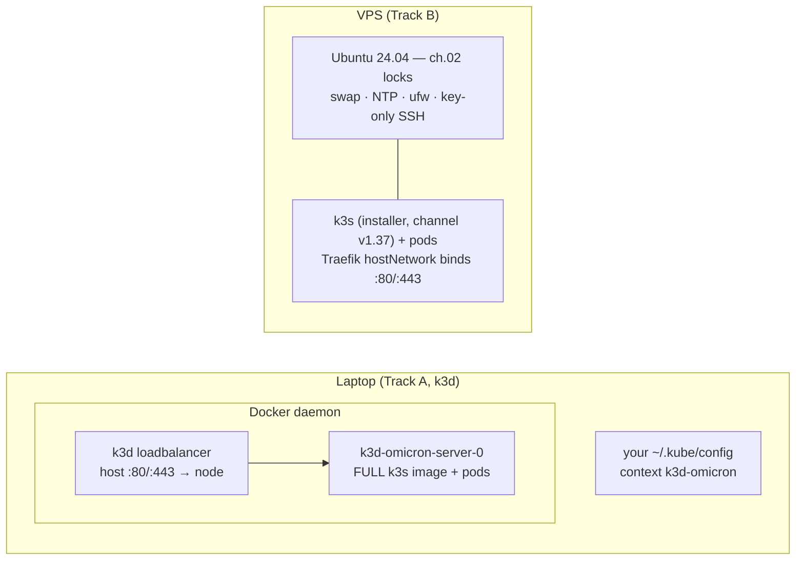

# 03 · K3s — one cluster engine, two runtimes

> **Why k3s:** complete Kubernetes in one package, maintained by the same
> folks as k8s, small enough for one node. We pin its channel like every
> other component (INFRA §1) — "latest" is how clusters break overnight.

> **Two runtimes, one engine.** **k3d** does not "stand in for" k3s — it
> *runs* the official k3s (as the `rancher/k3s` container image) inside
> Docker on your laptop. The **VPS** runs the same k3s installed by script
> onto bare Ubuntu. Same binaries, same flags, same behavior; the estate
> rehearse-and-ship symmetry (00a's Track A→B) rests on this sentence.
> The only real deltas are how ports get published and whose host
> guarantees we're standing on — table in §3.



## 1. Runtime A — k3d (local, mandatory first execution)

Install per [01 §4](01-prerequisites.md), Docker running, then the one
command block this estate uses everywhere (00a's A2 copies it verbatim —
don't fork a variant):

```bash
k3d cluster create omicron \
  --servers 1 --agents 0 \
  --k3s-arg "--disable=servicelb@server:0" \
  --k3s-arg "--disable=traefik@server:0" \
  -p "80:80@loadbalancer" -p "443:443@loadbalancer"
```

✅ check: `kubectl get nodes` → `k3d-omicron-server-0` **Ready** (k3d
merged a `k3d-omicron` context into your kubeconfig automatically — there
is no `/etc/rancher/k3s/k3s.yaml` step on this track). Note the `rancher/k3s`
image tag k3d printed: it must be on the **v1.37** line to match the VPS
plan — if it printed some other minor, recreate the cluster with the
newest `v1.37.*-k3s1` tag from the k3s releases page (linked in
[13 References](13-references.md)), e.g. `--image rancher/k3s:v1.37.4-k3s1`
(write the actual newest v1.37 tag — never a bare `v1.37.x`).

> **Why `--disable=servicelb` and `--disable=traefik`:** identical reasons
> to the VPS (§2) — the estate pins ONE Traefik shape (chart 42.3.2, §5)
> everywhere, and k3s's auto-installed copies would create two edges and
> silent split-brain routing; the bundled load-balancer is for
> multi-node clusters and just sits confused on one node. On k3d,
> LoadBalancer-type Services are served by k3d's own loadbalancer container
> — which is what the `-p 80/443` mappings talk to (§5).

> **Why one server, no agents:** the shipped single-VPS shape is a single
> node, and every `vortex/environments/*/*` overlay collapses placement
> through `components/single-node`. Rehearsing a 3-node k3d against
> single-node overlays would rehearse a topology nobody ships (the
> 3-node shape waits for the blueprint hub, `bootstrap/apps-hub.yaml`).

## 2. Runtime B — k3s on the VPS (as `ops`, the sudo user from ch.02)

```bash
curl -sfL https://get.k3s.io | sudo INSTALL_K3S_CHANNEL=v1.37 sh -s - server \
  --disable=servicelb --disable=traefik
```

> The installer writes `/usr/local/bin` and systemd units — **it must run
> under sudo**; the `sudo VAR=val cmd` form forwards the channel variable
> correctly.

✅ check: `sudo systemctl status k3s --no-pager | head -3` → active (running).

Then make kubectl yours (the installer leaves the kubeconfig root-only at
`/etc/rancher/k3s/k3s.yaml`; plain `kubectl` looks at `~/.kube/config` and
would fail until you copy it):

```bash
mkdir -p ~/.kube
sudo cp /etc/rancher/k3s/k3s.yaml ~/.kube/config
sudo chown "$USER":"$USER" ~/.kube/config && chmod 600 ~/.kube/config
kubectl get nodes -o wide                  # Ready
```

> **Why the copy:** `/etc/rancher/k3s/k3s.yaml` is chmod 600 root:root by
> default — `chmod 644` on it works too, but a per-user copy is the boring,
> standard shape every later chapter assumes.

> **Why pin the channel (v1.37 — the version the estate rehearses on;
> bump deliberately, never "latest"):** every manifest in `vortex` is
> tested against a known k3s/k8s. **If your k3d rehearsal and the VPS
> don't run the same minor, you rehearsed the wrong thing.**
> **Why the same two disables as §1:** one Traefik shape, no confused
> servicelb — and on the VPS there is no k3d proxy to fall back on, so
> publishing happens via hostNetwork (§5).

## 3. What differs between the runtimes (honest table)

| | k3d (laptop) | VPS |
|---|---|---|
| k3s comes from | `rancher/k3s` container image (tag = k3s version) | `get.k3s.io` installer, `INSTALL_K3S_CHANNEL=v1.37` |
| 80/443 publish | `-p` mappings → k3d loadbalancer → Traefik **Service type LoadBalancer** | Traefik **hostNetwork** binds the host's ports; no LB |
| kubeconfig | auto-merged context `k3d-omicron` | copied to `~/.kube/config` in §2 (laptop copy via ch.11 tunnel) |
| node name | `k3d-omicron-server-0` | the hostname |
| host concerns (ch.02: SSH locks, ufw, swap, NTP) | **not applicable** — Docker's host is your laptop; this is why Track A skips 02 | mandatory, walked first |
| PVC data dir lifetime | inside the node container: survives pod restarts **and PVC deletion** (Retain!), but dies with `k3d cluster delete` | on the node's disk: survives almost everything except the documented wipe (§4) |
| resources | 32 GB box = slack | 8 GB = the budget chapters care about (INFRA §1) |

Everything ABOVE the table is identical on both tracks: every later
chapter (04 Argo, 05 vault, 06 apps, 07 public path) runs the same
commands against whichever kubeconfig is current.

## 4. The node-pool label (both runtimes)

```bash
# k3d:
kubectl label node k3d-omicron-server-0 node-pool=platform --overwrite
# VPS:
kubectl label node "$(hostname)" node-pool=platform --overwrite
```

✅ check: `kubectl get node --show-labels | grep node-pool=platform`.

> **Why the label:** Argo's pinned manifests carry a `node-pool=platform`
> pinning patch (the estate's placement doctrine). The env overlays
> currently *relax* node selectors via `components/single-node`, so nothing
> sits Pending without the label — but label it anyway: parity with the
> base manifests, and the scale-out story (drop the component, placement
> returns) has a labeled node to land on.

## 5. Storage: local-path (k3s ships it — both runtimes)

Real k3s ships StorageClass `local-path` natively, inside the image AND
under the installer, which is exactly what `vortex` PVCs ask for.
**Nothing to alias** (the `standard`-alias trick in the archived rehearsal
log was a minikube-only quirk — see 01 §5's demotion note).

> ⚠️ **Why PVC deletion is NOT a wipe here:** the estate's k3s installs keep
> `reclaimPolicy: Retain` — data directories under `/var/lib/rancher/k3s/
> storage` (check `kubectl get sc local-path -o yaml | grep configDir`)
> survive on purpose, because the vault and database never trust Git to
> hold them. Consequences documented by *both* incidents that taught it:
> a recreated PVC with the same name remounts the same old directory
> (Meilisearch engine-bump trap), and a "lost" vault is usually sitting in
> its directory the whole time. On k3d the directory lives *inside the node
> container*, so it keeps biting across pod/PVC churn — only
> `k3d cluster delete` truly forgets (that is a feature for Track A). The
> wipe procedure lives in [05 vault → vault reborn](05-vault.md) and
> [10 observability → data reset](10-observability.md).

## 6. Traefik — one pinned chart, two publish shapes

The estate's edge is chart **42.3.2** (Traefik v3.7.17), applied by hand
on both tracks (it pre-dates Argo taking over, ch.04; the `ingress`
namespace and flags below are what `vortex` Ingresses are written
against). Shared flags: CRD provider, prometheus metrics, http→https
bounce — TLS is on by default in this chart line; then the publish-shape
flags differ per runtime.

**k3d (port mappings) — WALKED GREEN 2026-11-14; these flags are proven,
not derived:**

```bash
helm install traefik traefik/traefik --version 42.3.2 -n ingress --create-namespace \
  --set service.spec.type=LoadBalancer \
  --set providers.kubernetesCRD.enabled=true \
  --set 'additionalArguments[0]=--metrics.prometheus' \
  --set 'ports.web.http.redirections.entryPoint.to=websecure' \
  --set 'ports.web.http.redirections.entryPoint.permanent=true' \
  --set metrics.prometheus.addEntryPointsLabels=true \
  --set metrics.prometheus.addRoutersLabels=true \
  --set metrics.prometheus.addServicesLabels=true \
  --set metrics.otlp.enabled=true \
  --set metrics.otlp.grpc.enabled=true \
  --set metrics.otlp.grpc.endpoint=alloy-otlp.observability.svc.cluster.local:4317 \
  --set metrics.otlp.grpc.insecure=true \
  --set accessLog.enabled=true \
  --set deployment.podLabels.omicron/env=shared
```

> **The observability feeds (shared by both shapes — walked 2026-11-14):**
> the three `add*Labels` flags turn on entrypoint/router/service request
> metrics — `addRoutersLabels` is **false by default** and the others are
> spelled out so chart defaults can never silently change the contract
> (all three are LAZY: each series appears on the first request through
> that router/entrypoint/service — a traffic-free edge shows only the
> globals). The `metrics.otlp.*` set points traefik's OpenTelemetry push
> at Alloy's receiver — the only path carrying the OTel semconv
> `http.server.request.duration` (ch.10 §4.7; `insecure=true` is plain
> h2c inside the cluster, not TLS). `accessLog.enabled` sends per-request
> CLF lines to stdout, where Alloy's labeled tail ships them to Loki.
> `deployment.podLabels.omicron/env=shared` joins the env-label contract
> (the chart already renders the `prometheus.io/*` scrape annotations by
> default — walked). To update an existing install: the same command with
> `helm upgrade` instead of `helm install`.

**VPS (hostNetwork; derived from the chart's own `values.schema.json` +
`_podtemplate.tpl` — PROVEN only when walked on Track B):**

```bash
helm repo add traefik https://traefik.github.io/charts && helm repo update
helm install traefik traefik/traefik --version 42.3.2 -n ingress --create-namespace \
  --set hostNetwork=true \
  --set ports.web.port=80 \
  --set ports.websecure.port=443 \
  --set service.enabled=false \
  --set securityContext.capabilities.add={NET_BIND_SERVICE} \
  --set providers.kubernetesCRD.enabled=true \
  --set 'additionalArguments[0]=--metrics.prometheus' \
  --set 'ports.web.http.redirections.entryPoint.to=websecure' \
  --set 'ports.web.http.redirections.entryPoint.permanent=true' \
  --set metrics.prometheus.addEntryPointsLabels=true \
  --set metrics.prometheus.addRoutersLabels=true \
  --set metrics.prometheus.addServicesLabels=true \
  --set metrics.otlp.enabled=true \
  --set metrics.otlp.grpc.enabled=true \
  --set metrics.otlp.grpc.endpoint=alloy-otlp.observability.svc.cluster.local:4317 \
  --set metrics.otlp.grpc.insecure=true \
  --set accessLog.enabled=true \
  --set deployment.podLabels.omicron/env=shared
```

(Caveat for this shape: with `hostNetwork`, traefik's automatic k8s
resource-attribute detection is off — the OTLP semconv metrics arrive
without `k8s_namespace_name`/`k8s_pod_name` labels. Everything else is
identical, ch.10 §4.7.)

✅ check (both): `kubectl -n ingress wait --for=condition=Ready pod -l
app.kubernetes.io/name=traefik --timeout=180s`.

> **Why hostNetwork on the VPS:** one node has no load-balancer to point
> at; binding 80/443 directly is honest and matches the ch.02 firewall
> (only Cloudflare IPs get answers). **Why LoadBalancer on k3d:** the node
> is a container — "host network" would be the container's network, not
> your laptop's; k3d's own loadbalancer container + the `-p 80/443`
> mappings do the publish honestly. This is the whole difference; routing
> rules, providers and flags are identical, which is exactly what the
> rehearsal is for.
> **Why redirect-to-websecure:** http must be a polite bounce off the
> https front door, not a second front door.
> **Why the flags look like this (42.3.2 reality, verified against the
> chart's `values.schema.json` and `_podtemplate.tpl` after the schema
> rejected the older draft):**
> - `service.type` moved under **`service.spec.type`** (and its default is
>   already `LoadBalancer` — the k3d line is explicit for readability);
> - `ports.web.redirectTo` became **`ports.web.http.redirections.entryPoint.to`**
>   (the template validates the target name and renders `to=:<exposedPort>`
>   → `:443`; `permanent=true` makes the bounce deterministic);
> - `ports.websecure.tls.enabled` moved under `http.tls` **and defaults to
>   true** — the flag is gone from both blocks on purpose;
> - `hostNetwork` is a **top-level** value (`deployment.hostNetwork` does
>   not exist), and with hostNetwork the entrypoints bind **`$config.port`** —
>   the defaults are 8000/8443, so the VPS block pins `ports.web.port=80` +
>   `ports.websecure.port=443` explicitly;
> - the chart's default securityContext runs as uid 65532 with ALL
>   capabilities dropped (`runAsNonRoot: true`) — binding :80 needs
>   **`NET_BIND_SERVICE`** added back.

## 7. Checkpoint

```bash
kubectl get pods -A        # ingress/traefik-* Running, kube-system healthy
# VPS:
curl -s -o /dev/null -w '%{http_code}\n' http://<server-ip>/    # 404 from Traefik = edge up
# k3d:
curl -s -o /dev/null -w '%{http_code}\n' http://localhost/      # same 404 = mappings + edge up
```

✅ Cluster up, labelled, storage correct, edge bound — on the laptop that
means Track A can proceed to [04 GitOps](04-gitops.md) right now; the VPS
walk of §2 is a later, boring repeat. Next on the VPS track: ch.02's locks
should already be on (they come FIRST there — see 00a).
