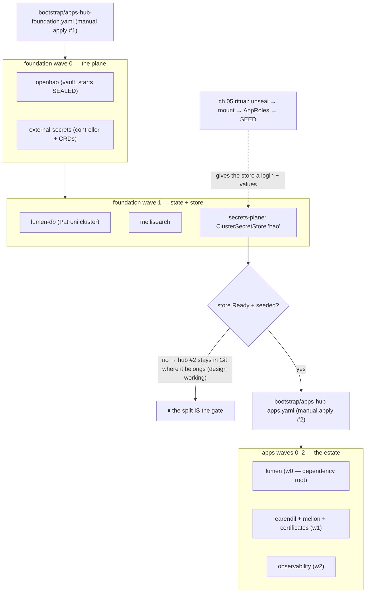

# 04 · GitOps & Argo CD — how software arrives, and in what order

> **Why GitOps:** "SSH in and kubectl apply" leaves no memory, no undo, and
> no answer to "why does prod differ from yesterday?". Here the **YAML repo
> is the truth** (`vortex`), and a robot (Argo CD) keeps reality equal to it,
> forever, in the visible way. Rollback = `git revert`. That's the whole
> philosophy.

The apps' YAML already exists — bases under `vortex/applications/`,
production views under `vortex/overlays/production/`, fleet pointers under
`vortex/apps/foundation/` and `vortex/apps/applications/`. This chapter is:
install the robot, point it at the folders, and understand the order things
wake up in (because the *between-the-hubs* wait for chapter 05 is the whole
design — §3).

## 1. A design decision to internalize first: `vortex` is PUBLIC

The whole cluster's YAML — every namespace, ingress, resource budget, image
pin — is readable by anyone on the internet. That is deliberate:

- **Zero values live there** (ch. 05's doctrine: Git holds templates, Bao
  holds values), so a reader learns the *shape* of your estate, never its
  secrets.
- **Argo needs no repo credentials.** Look at any CR in
  `vortex/apps/foundation/` — e.g. `openbao-app.yaml` carries a plain
  `repoURL: 'https://github.com/kanatabi/vortex.git'` with **no**
  `repoSecret` reference. Nothing to leak, nothing to rotate, nothing to
  lose. Private-repo GitOps means a credential that outlives your memory.

> **Why public, then — what about the 404 story?** The walk found that a
> private repo Argo can't see shows as `repository not found` (404), not
> 403 — indistinguishable from a typo'd path, and it burned a debugging
> afternoon. That lesson belongs to the repos that *are* still private —
> **`earendil` and `mellon`** (app code with unreleased features) — not to
> `vortex`. Keep it as: "when Argo says repo-not-found, check visibility
> before path."

## 2. The manual applies: two hubs + three pinned one-time installs (say them out loud)

GitOps cannot install the foundations it needs to do GitOps — chicken and
egg. The honest count of manual applies on a production cluster is
**five**: the two hub files of §3 (one documented *pair* — the entrypoints
themselves) plus exactly **three** pinned one-time installs:

| What | Pin | Command (from a cloned `vortex`) | Why it can't ride the hub |
|---|---|---|---|
| **Argo CD** | v3.6.1 | `kubectl apply -k platform/argocd/ --server-side --force-conflicts` | the robot can't host itself |
| **Zalando postgres-operator** | v1.13.0 | `kubectl apply -f https://raw.githubusercontent.com/zalando/postgres-operator/v1.13.0/manifests/operator-manifests.yaml` (pinned in the header comment of `applications/lumen-db/postgresql.yaml`) | the CRD that defines `postgresql.yaml` must exist before any app applies it |
| **cert-manager** | v1.16.2 | `kubectl apply -f https://github.com/cert-manager/cert-manager/releases/download/v1.16.2/cert-manager.yaml` (prereq comment in `applications/certificates/kustomization.yaml`) | its CRDs gate the certificates app; Namespace ships with the install, deliberately untracked |

Anything else you catch yourself `kubectl apply`-ing to the cluster is a
bug in this document — tell the next reader.

### 2.1 Argo install details that bit us

- **`--server-side` is not optional.** Argo's own CRDs exceed the 256 KiB
  `last-applied-configuration` annotation limit; client-side apply dies with
  a confusing "metadata.annotations too long". `platform/argocd/` pins the
  upstream `install.yaml` by tag (`v3.6.1`, raised from v2.13.2 on first
  rehearsal evidence) — exact versions, same rule as everything.
- The controller is a **StatefulSet**: check
  `kubectl -n argocd get sts argocd-application-controller` — `deploy/`
  would miss it.
- Admin bootstrap (creds exist only at first boot — one of the
  **never-losables**; record it offline in the same place as the unseal
  keys, ch. 05):

  ```bash
  kubectl -n argocd get secret argocd-initial-admin-secret \
    -o jsonpath='{.data.password}' | base64 -d
  # after first login: change it, and disable the local admin:
  kubectl -n argocd patch cm argocd-cm -p '{"data":{"admin.enabled":"false"}}'
  ```

  Real admin logins afterwards ride the SSH tunnels (the Access-from-Laptop
  chapter); the portal/console surfaces stay non-public forever per GATE #10.

## 3. The app-of-apps: the fleet starts in two acts (two hubs, M3 between)

From a cloned `vortex`, after Argo is up, the entrypoint is a **pair**:

```bash
kubectl apply -f bootstrap/apps-hub-foundation.yaml   # act 1: the plane
# → NOW run chapter 05's vault ritual against what this brought up
kubectl apply -f bootstrap/apps-hub-apps.yaml          # act 2: the estate
```

> **Why TWO hubs:** each hub is a single Application synced
> **non-recursively** over its own dir — `apps/foundation/` (openbao,
> external-secrets, secrets-plane, lumen-db, meilisearch) and
> `apps/applications/` (lumen, earendil, mellon, certificates,
> observability); those files are themselves Argo Applications. Neither
> hub can manage itself, so the two manual applies ARE the documented
> chicken-and-egg exception (the hub headers say it verbatim: "exactly
> one foundation+apps pair may own a cluster"). The split's real product
> is **ordering**: with one hub, "seed before apps" lived in sync-wave
> numbers *inside* the fleet; with two, it lives in the entrypoints —
> chapter 05 slots between the applies, so the application plane has
> never existed yet when the vault is empty. Adding an app = new YAML
> under `applications/<app>/` (plus an overlay) + a new Application CR in
> the hub dir its role belongs to; the hub dirs never get raw manifests
> (their prune would delete them).

The production PAIR differs from the rehearsal single-node hub
(`apps-hub-single-node.yaml`) in exactly the ways the headers list:
`overlays/production/*` sources — Bao values from `kv/{app}/production`
and **real ACME TLS** via the certificates app, never the `selfsigned`
component — plus the two-entrypoint order just described, which the
one-file rehearsal hub can't express.

## 4. What wakes up in what order (the waits are features)

The sync-wave numbers are **structural** — encoded in the
`argocd.argoproj.io/sync-wave` annotation of every CR in `apps/foundation/`
and `apps/applications/`, not cosmetic. **Waves restart per hub** — each
hub syncs its own fleet from 0:

| Hub | Wave | Apps | Depends on |
|---|---|---|---|
| foundation | 0 | `openbao`, `external-secrets` | nothing — this is the plane everything else waits for |
| foundation | 1 | `lumen-db` (Patroni), `meilisearch`, `secrets-plane` | wave 0 (ESO's CRDs must exist; storage exists) |
| — | *between* | **chapter 05: unseal → AppRoles → seed** | the entrypoint order IS the gate |
| apps | 0 | `lumen` | the seeded, Ready `bao` store — which existed **before this hub did** |
| apps | 1 | `earendil`, `mellon`, `certificates` | wave 0 (they reach lumen in-cluster; certificates' `cf-token` feed is a store consumer) |
| apps | 2 | `observability` | the estate serving around it |



> **Why the SEED gates the second hub instead of "just start":** apps booted
> with empty config crash-loop on `""` passwords and hide the real problem
> (unseeded vault) under app-shaped errors. The foundation's
> `secrets-plane-app.yaml` header says it flatly: the store "stays NOT-Ready
> until runbook M3 seeds the vault, and the APPS hub — where the consumers
> live — is applied by hand only after M3. The seed-before-apps order moved
> from 'wave number inside one hub' to 'the two-hub entrypoint itself' (a
> design, not a suggestion)" — and `apps/applications/lumen-app.yaml` names
> the consequence verbatim: "the gate that used to be 'wave 2 waits for the
> Ready store' is now the two-hub entrypoint order itself". The PreSync
> migrate Job (`lumen migrate`, schema-gates-deploy ruling) is the same idea
> one level in: **a rollout blocked by a failed prerequisite is the design
> working.**

**Applied out of order, this looks broken:** apps hub in before the ritual
finishes, and you get red ExternalSecrets (`could not get secret data from
provider`) and "Progressing" forever — chapter 05's to-do list rendered as
dashboard noise. The split exists so you never see that: in order, the apps
plane's *first ever* sync already has values. (The repair walk for an
accidental early apply is still the old one: unseal → seed → force ES sync
(`kubectl delete externalsecret …`, selfHeal recreates it fresh) → pods roll
with real env — ch. 05 §8.)

**Certificates rides the apps hub's wave 1, next to earendil and mellon** —
and `certificates-app.yaml` carries the reasoning as a comment worth
reading: it's the *earliest* wave in its hub structurally gated on the Ready
store (its `cf-token` feed is a store consumer), while no app depends on it
(an Ingress missing its TLS Secret is merely not-yet-terminating; Traefik
picks the cert up the moment issuance lands).

### 4.1 The ignoreDifferences lesson (live walk, 2026-11-10)

`earendil-app.yaml`, `mellon-app.yaml`, `certificates-app.yaml` and
`observability-app.yaml` all carry the same block:

```yaml
ignoreDifferences:
  - group: external-secrets.io
    kind: ExternalSecret
    jqPathExpressions:
      - .spec.target.creationPolicy
      - .spec.target.deletionPolicy
      - .spec.target.template.engineVersion
      - .spec.target.template.mergePolicy
```

> **Why:** ESO's webhook *defaults* those fields server-side — they never
> exist in Git, so without this the app is PERPETUALLY OutOfSync and
> selfHeal thrashes the ExternalSecret forever. If you add a new
> store-consuming app, copy the block. (The foundation hub's apps consume no
> ExternalSecrets, so they don't need it — compare `openbao-app.yaml`.)

## 5. The rules of the road (selfHeal = the robot always wins)

- **Never `kubectl patch/edit/apply` the cluster directly** to "fix"
  something — Argo reverts it within minutes, and you've got a drift story
  nobody can read. Fix the YAML in `vortex`, open the PR, let the robot
  copy it. *(One exception class: k8s-native debug verbs — `get`,
  `describe`, `logs`, `exec` — are always fine.)*
- **Hand-seeded objects live outside Git's love** — the bootstrap-paradox
  Secrets of ch. 05 (`bao-approle-credentials`, `lumen-bao-credentials`),
  the Patroni-generated DB credentials, and the manual applies of §2–§3
  (three pinned installs + the two hubs) are simply unknown to Argo.
  That's why they exist as *applied-once* objects, not patches.
- Steady-state check, any day of the week:

  ```bash
  kubectl -n argocd get applications        # all Synced/Healthy = quiet
  kubectl get events -A --sort-by=.lastTimestamp | tail   # what moved, when
  ```

- Image pins live **only** in each app's `applications/<name>/kustomization.yaml`
  (`images:` stanza) and are changed only by the release chain — that's the
  next-but-one chapter: [09 · Releases](09-releases.md).

✅ **End-of-chapter check:** `kubectl -n argocd get applications` lists the
five foundation apps from `apps/foundation/` (each hub counts itself not —
it manages everything under its dir except itself), waves 0–1 Healthy and
the `bao` store Ready once chapter 05's ritual is done. Only then does the
second apply go in — the full ten-app estate, Synced/Healthy, is chapter
06's ✅.

Next → [05 · Secrets Vault](05-vault.md)
