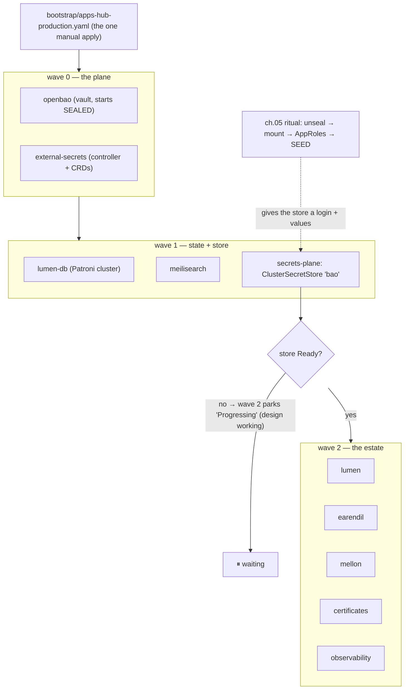

# 04 · GitOps & Argo CD — how software arrives, and in what order

> **Why GitOps:** "SSH in and kubectl apply" leaves no memory, no undo, and
> no answer to "why does prod differ from yesterday?". Here the **YAML repo
> is the truth** (`vortex`), and a robot (Argo CD) keeps reality equal to it,
> forever, in the visible way. Rollback = `git revert`. That's the whole
> philosophy.

The apps' YAML already exists — bases under `vortex/applications/`,
production views under `vortex/overlays/production/`, fleet pointers under
`vortex/apps/production/`. This chapter is: install the robot, point it at
the folder, and understand the order things wake up in (because some of that
order *waits for chapter 05 on purpose*).

## 1. A design decision to internalize first: `vortex` is PUBLIC

The whole cluster's YAML — every namespace, ingress, resource budget, image
pin — is readable by anyone on the internet. That is deliberate:

- **Zero values live there** (ch. 05's doctrine: Git holds templates, Bao
  holds values), so a reader learns the *shape* of your estate, never its
  secrets.
- **Argo needs no repo credentials.** Look at any CR in
  `vortex/apps/production/` — e.g. `openbao-app.yaml` carries a plain
  `repoURL: 'https://github.com/kanatabi/vortex.git'` with **no**
  `repoSecret` reference. Nothing to leak, nothing to rotate, nothing to
  lose. Private-repo GitOps means a credential that outlives your memory.

> **Why public, then — what about the 404 story?** The walk found that a
> private repo Argo can't see shows as `repository not found` (404), not
> 403 — indistinguishable from a typo'd path, and it burned a debugging
> afternoon. That lesson belongs to the repos that *are* still private —
> **`earendil` and `mellon`** (app code with unreleased features) — not to
> `vortex`. Keep it as: "when Argo says repo-not-found, check visibility
> before path."

## 2. The three never-GitOps'd installs (bootstrap exceptions, say them out loud)

GitOps cannot install the foundations it needs to do GitOps — chicken and
egg. Exactly **three** things are applied by hand, once, and pinned:

| What | Pin | Command (from a cloned `vortex`) | Why it can't ride the hub |
|---|---|---|---|
| **Argo CD** | v3.6.1 | `kubectl apply -k platform/argocd/ --server-side --force-conflicts` | the robot can't host itself |
| **Zalando postgres-operator** | v1.13.0 | `kubectl apply -f https://raw.githubusercontent.com/zalando/postgres-operator/v1.13.0/manifests/operator-manifests.yaml` (pinned in the header comment of `applications/lumen-db/postgresql.yaml`) | the CRD that defines `postgresql.yaml` must exist before any app applies it |
| **cert-manager** | v1.16.2 | `kubectl apply -f https://github.com/cert-manager/cert-manager/releases/download/v1.16.2/cert-manager.yaml` (prereq comment in `applications/certificates/kustomization.yaml`) | its CRDs gate the certificates app; Namespace ships with the install, deliberately untracked |

Anything else you catch yourself `kubectl apply`-ing to the cluster is a
bug in this document — tell the next reader.

### 2.1 Argo install details that bit us

- **`--server-side` is not optional.** Argo's own CRDs exceed the 256 KiB
  `last-applied-configuration` annotation limit; client-side apply dies with
  a confusing "metadata.annotations too long". `platform/argocd/` pins the
  upstream `install.yaml` by tag (`v3.6.1`, raised from v2.13.2 on first
  rehearsal evidence) — exact versions, same rule as everything.
- The controller is a **StatefulSet**: check
  `kubectl -n argocd get sts argocd-application-controller` — `deploy/`
  would miss it.
- Admin bootstrap (creds exist only at first boot — one of the
  **never-losables**; record it offline in the same place as the unseal
  keys, ch. 05):

  ```bash
  kubectl -n argocd get secret argocd-initial-admin-secret \
    -o jsonpath='{.data.password}' | base64 -d
  # after first login: change it, and disable the local admin:
  kubectl -n argocd patch cm argocd-cm -p '{"data":{"admin.enabled":"false"}}'
  ```

  Real admin logins afterwards ride the SSH tunnels (the Access-from-Laptop
  chapter); the portal/console surfaces stay non-public forever per GATE #10.

## 3. The app-of-apps: ONE command starts the fleet

From a cloned `vortex`, after Argo is up:

```bash
kubectl apply -f bootstrap/apps-hub-production.yaml
```

> **Why the hub shape:** the hub is a single Application pointing at
> `apps/production/`, synced **non-recursively** — those files are
> themselves Argo Applications. The hub can't manage itself, so this one
> manual apply is the intended, documented exception (hub header says it
> verbatim: "exactly one hub may own a cluster"). Adding an app = new YAML
> under `applications/<app>/` (plus an overlay) + a new Application CR in
> `apps/production/`; the hub dir never gets raw manifests (its prune would
> delete them).

The production hub differs from the rehearsal one (`apps-hub-single-node.yaml`)
in exactly the ways the header comment lists: source paths land on
`overlays/production/*` — Bao values from `kv/{app}/production` and **real
ACME TLS** via the certificates app, never the `selfsigned` component.

## 4. What wakes up in what order (the waits are features)

The sync-wave numbers are **structural** — encoded in the
`argocd.argoproj.io/sync-wave` annotation of every CR in
`apps/production/`, not cosmetic:

| Wave | Apps | Depends on |
|---|---|---|
| 0 | `openbao`, `external-secrets` | nothing — this is the plane everything else waits for |
| 1 | `lumen-db` (Patroni), `meilisearch`, `secrets-plane` | wave 0 (ESO's CRDs must exist; storage exists) |
| 2 | `lumen`, `earendil`, `mellon`, `certificates`, `observability` | **the `bao` ClusterSecretStore being Ready — which waits for chapter 05's seeding** |



> **Why wave 2 gates on the store instead of "just start":** apps booted
> with empty config crash-loop on `""` passwords and hide the real problem
> (unseeded vault) under app-shaped errors. `secrets-plane-app.yaml` says it
> flatly: the store's Ready condition "STRUCTURALLY forces the
> seed-before-apps order of the runbook (a design, not a suggestion)". The
> PreSync migrate Job (`lumen migrate`, schema-gates-deploy ruling) is the
> same idea one level in: **a rollout blocked by a failed prerequisite is
> the design working.**

**During the bootstrap this looks broken:** wave-2 apps OutOfSync, red
ExternalSecrets (`could not get secret data from provider`), apps
"Progressing" forever. That's chapter 05's to-do list rendered as dashboard
noise. The order that makes it green: unseal → seed → force ES sync (`kubectl
delete externalsecret …`, selfHeal recreates it fresh) → pods roll with real
env.

**Certificates join wave 2, not 1 or 3** — and `certificates-app.yaml`
carries the reasoning as a comment worth reading: it's the *earliest* wave
structurally gated on the Ready store (its `cf-token` feed is a store
consumer), while no app depends on it (an Ingress missing its TLS Secret is
merely not-yet-terminating; Traefik picks the cert up the moment issuance
lands).

### 4.1 The ignoreDifferences lesson (live walk, 2026-11-10)

`earendil-app.yaml`, `mellon-app.yaml`, `certificates-app.yaml` and
`observability-app.yaml` all carry the same block:

```yaml
ignoreDifferences:
  - group: external-secrets.io
    kind: ExternalSecret
    jqPathExpressions:
      - .spec.target.creationPolicy
      - .spec.target.deletionPolicy
      - .spec.target.template.engineVersion
      - .spec.target.template.mergePolicy
```

> **Why:** ESO's webhook *defaults* those fields server-side — they never
> exist in Git, so without this the app is PERPETUALLY OutOfSync and
> selfHeal thrashes the ExternalSecret forever. If you add a new
> store-consuming app, copy the block. (Wave-0/1 apps without ES consumers
> don't need it — compare `openbao-app.yaml`.)

## 5. The rules of the road (selfHeal = the robot always wins)

- **Never `kubectl patch/edit/apply` the cluster directly** to "fix"
  something — Argo reverts it within minutes, and you've got a drift story
  nobody can read. Fix the YAML in `vortex`, open the PR, let the robot
  copy it. *(One exception class: k8s-native debug verbs — `get`,
  `describe`, `logs`, `exec` — are always fine.)*
- **Hand-seeded objects live outside Git's love** — the bootstrap-paradox
  Secrets of ch. 05 (`bao-approle-credentials`, `lumen-bao-credentials`),
  the Patroni-generated DB credentials, and the three pinned installs above
  are simply unknown to Argo. That's why they exist as *applied-once*
  objects, not patches.
- Steady-state check, any day of the week:

  ```bash
  kubectl -n argocd get applications        # all Synced/Healthy = quiet
  kubectl get events -A --sort-by=.lastTimestamp | tail   # what moved, when
  ```

- Image pins live **only** in each app's `applications/<name>/kustomization.yaml`
  (`images:` stanza) and are changed only by the release chain — that's the
  next-but-one chapter: [09 · Releases](09-releases.md).

✅ **End-of-chapter check:** `kubectl -n argocd get applications` lists all
ten apps from `apps/production/` (hub counts itself not — it manages
everything under `apps/production/` except itself). Waves 0–1 should be
Healthy; wave 2 *correctly* waits on the store until you finish chapter 05.

Next → [05 · Secrets Vault](05-vault.md)
