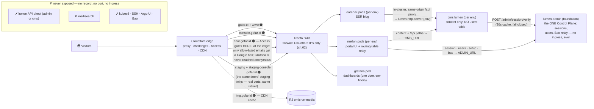
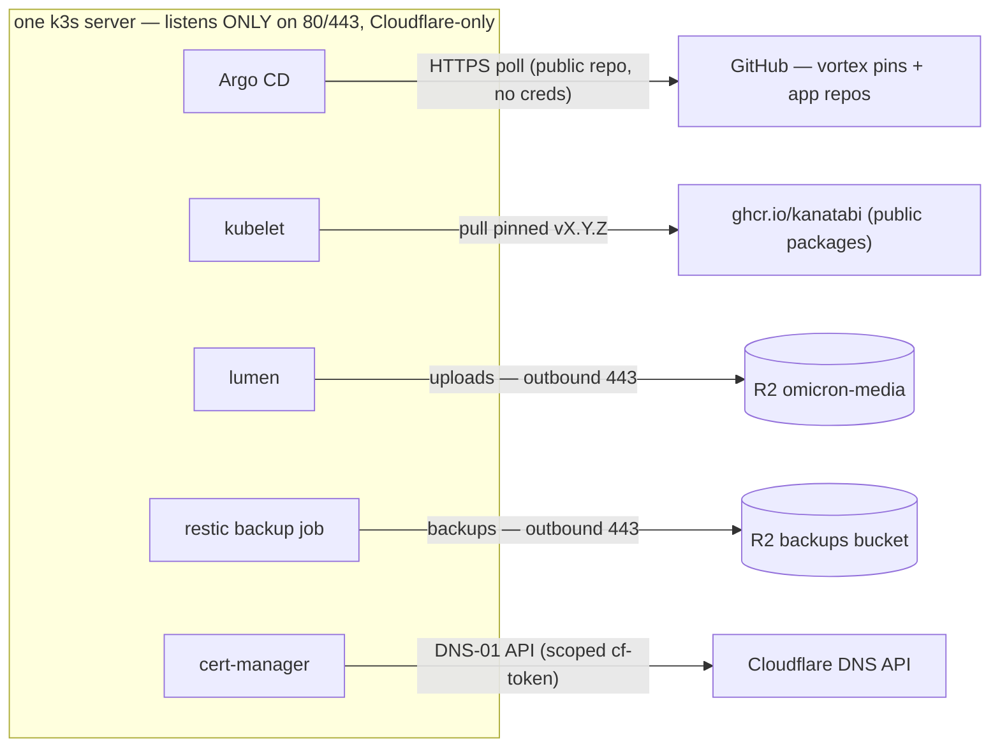
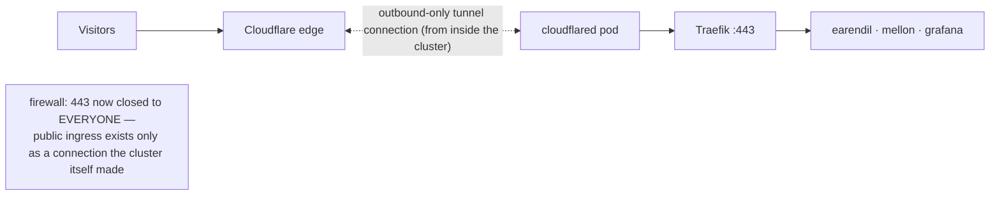

# 07 · Go Public — DNS, guard, TLS, the guest list, and photos

Everything so far ran behind a firewall with no public records. This chapter
opens the doors the design says are the ONLY ones — `gofar.id` (content) and
`console.gofar.id` (portal), plus the dashboard `anor.gofar.id` behind a
guest list, plus `img.gofar.id` for photos — and never the API, database,
search, vault, or kubectl. Do the acts in order; each one's ✅ check gates
the next.

Three layers people constantly mix up. Keep them separate:

| Layer | What the visitor sees | Question it answers |
|---|---|---|
| **Proxy (orange cloud)** | nothing | "is my server hidden from floods and scanners?" |
| **Managed challenge** | *"checking your browser…"* | "are you a real browser, not a bot?" |
| **Access** | your email + a Google login | "you're human… but are you *allowed in here*?" |

## Act 1 — DNS (move the zone to Cloudflare)

### 1.1 Hand the zone to Cloudflare (once)

1. Cloudflare dashboard → **Add a site** → `gofar.id` → **Free plan**.
   *(The site was already added in [01 §2a](01-prerequisites.md) — if you
   followed that chapter, skip this step; this act only cuts the zone over.)*
2. Cloudflare shows two nameservers (e.g. `ana.ns.cloudflare.com`).
3. At your **registrar**, replace the current nameservers with those two.
4. Wait (minutes to hours). ✅ check:
   `dig +short NS gofar.id` → answers show Cloudflare servers.

> **Why:** the proxy, challenges, Access, and R2 custom-domains all hang off
> Cloudflare's DNS. Records on another DNS provider get **none** of it.

### 1.2 The record table (Dashboard → DNS → Records)

| Type | Name | Target | Proxy | Why |
|---|---|---|---|---|
| A | `@` | server IPv4 | 🟠 Proxied | the blog; CF hides the IP and absorbs floods |
| CNAME | `www` | `gofar.id` | 🟠 Proxied | second spelling of the same door (both hosts are in the `gofar-id` Certificate's dnsNames) — **production-only** (owner ruling: staging never wears www) |
| A | `console` | server IPv4 | 🟠 Proxied | the portal — the door to your vault wants the guard most |
| A | `anor` | server IPv4 | 🟠 Proxied | Grafana; Access (Act 4) holds the guest list — the ONE door, serving dashboards for both envs |
| A | `staging` | server IPv4 | 🟠 Proxied | `staging.gofar.id` — staging's earendil (real cert via the same DNS-01 issuer; there is no self-signed plane anymore) |
| A | `staging-console` | server IPv4 | 🟠 Proxied | staging's mellon — same challenge budget applies if you care; the door is private-by-obscure-zone today |
| CNAME | `img` | *created FOR you by the R2 domain binding (Act 5)* | 🟠 | photos served by the CDN; bucket itself stays private; BOTH envs share it — `LUMEN_MEDIA_PREFIX` keeps their objects apart |
| — | *(nothing for kubectl/Argo/SSH/API)* | — | — | admin roads never get public records (ch. 02 firewall + the tunnels chapter) |

**The proxied law:** every record that *serves humans* is 🟠 Proxied. Grey
cloud ("DNS only") means: no DDoS protection, no caching, and — worse —
**your real server IP becomes public**, which quietly breaks ch. 02's
"Cloudflare-only" firewall **for your visitors**: their browsers now come
straight to a server that only answers Cloudflare. 502/connection-refused
after "just a DNS setting" is almost always this. ✅ undo: back to 🟠, wait
a minute, `dig +short console.gofar.id` must show CF IPs, **never** your
server's.

### 1.3 DNSSEC (10 minutes, prevents an entire class of lies)

1. Cloudflare → DNS → DNSSEC → **Enable** → it gives a DS record.
2. Paste that DS record at the registrar's DNSSEC form. ✅ check:
   `dig +short DNSKEY gofar.id` non-empty and registrar shows "delegated".

> **Why:** DNSSEC stops a rogue network from inventing fake answers about
> `gofar.id` between the world and Cloudflare. Cheap once, boring forever.

## Act 2 — "verify you are human" (the managed challenges)

Settings live in Cloudflare → **Security**. Three knobs, use them honestly:

| Knob | What it does | Our stance |
|---|---|---|
| **WAF custom rules** (5 per zone on Free) | challenge *exactly* what you name | the workhorse — spend them like a budget |
| **Security level** (slider) | broadly suspicious-traffic checks | leave on the default; it's heuristic |
| **"I'm Under Attack" mode** | challenges EVERY visitor, big hammer | 🔴 **panic button only.** Toggle during a flood; turn off after. It also blocks RSS readers, uptime monitors and any `curl` client — living with it ON as "extra safety" makes your blog quietly unreachable to non-browsers |

Spend the rule budget (one-time in dashboard, all **Action = Managed
challenge**):

1. `console.gofar.id` paths `/login`, `/setup`, `/admin*` → challenge
   *(login-form brute force never reaches the portal)*
2. `console.gofar.id` all paths where method ≠ GET → challenge
3. `anor.gofar.id` **entire hostname** → challenge *(in front of Access:
   bots don't even get to the email step)*
4. *(spare)* uptime monitor bypass if/when you add one
5. *(spare)*

> **Why the blog gets none:** a first-visit reader challenged on every page
> is a lost reader; the blog's real protection is Act 1 (proxied) + ch. 02
> (origin answers only Cloudflare). Managed challenges stay *invisible* for
> real browsers when they do fire — the animation is what suspicious clients
> get.

## Act 3 — TLS certificates (one-time install, then GitOps keeps them alive)

### 3.1 cert-manager — the third bootstrap exception (ch. 04 §2's table)

```bash
kubectl apply -f https://github.com/cert-manager/cert-manager/releases/download/v1.16.2/cert-manager.yaml
kubectl -n cert-manager wait --for=condition=Available deploy/cert-manager --timeout=180s
```

Exactly pinned v1.16.2 — the version the prereq comment in
`bases/certificates/kustomization.yaml` names. One-time manual apply,
same class as Argo CD and the Zalando operator; the certificates app is
already synced (ch. 04 — PRODUCTION hub wave 1) and has been *visibly
waiting* for this Namespace to exist.

### 3.2 The token — scoped, never global

Cloudflare → My Profile → API Tokens → Create Token:
- Permission: **Zone · DNS · Edit**, scoped to zone `gofar.id` **only**
- TTL: set one (a year), calendar the rotation (Operations chapter)

Then it goes to the vault — and the placeholder lesson from ch.05 §6
applies: export first, then the put (ch. 05 §6's replace-the-whole-map
rule: one call, then re-verify the key set):

```bash
export CF_API_TOKEN=<paste the token you just created>
X "export VAULT_TOKEN=$ROOT; bao kv put kv/cert-manager/production CF_API_TOKEN=$CF_API_TOKEN"
```

From there the estate renders it with no
human middleman: `bases/certificates/externalsecret.yaml` maps
`cert-manager/production::CF_API_TOKEN` → Secret **`cf-token`**, key
**`api-token`**, namespace `cert-manager`, where the issuer's solver reads
it. If you seeded this path before the token existed (ch. 05 does),
`kubectl delete externalsecret cf-dns-token -n cert-manager` → selfHeal
re-creates → syncs now (ch. 05 §8's timing trick).

> **Why scoped:** this token can change your DNS records — nothing else. The
> global "Global API Key" can reset your password. One leaked token should
> cost you a domain afternoon, not the account.

### 3.3 What's already in Git (read, don't write)

The old plan of hand-writing an issuer is retired — `bases/certificates/`
is the whole TLS story, synced by the `certificates` app:

- **`issuer.yaml`** — ClusterIssuer `letsencrypt-prod`, dns01/Cloudflare
  solver pointing at `cf-token`/`api-token`. Its `email: dev@gofar.id` is
  the estate's **documented literal exception** (owner ruling printed in the
  file header): an ACME contact is a *public identifier* in LE account
  metadata, not runtime-tunable config — putting it behind ESO would make
  the issuer depend on its own secret plane at bootstrap. Everything else
  stays in Bao.
- **`certificates.yaml`** — FIVE Certificates, one per serving door, each
  in the namespace of the workload whose Ingress consumes it:
  `gofar-id` → **`tls-gofar`** (earendil; SANs `gofar.id` + `www.gofar.id`),
  `console-gofar-id` → **`tls-console`** (mellon), `anor-gofar-id` →
  **`tls-anor`** (observability/Grafana), plus staging's two:
  `staging-gofar-id` → **`tls-gofar-staging`** (earendil ns) and
  `staging-console-gofar-id` → **`tls-console-staging`** (mellon ns).
  Staging rides the SAME ClusterIssuer — DNS-01 works from any cluster, so
  the self-signed rehearsal component is retired and nothing wears a fake
  cert. All with
  `duration: 2160h0m0s` / `renewBefore: 720h0m0s` — note the *hours*
  spelling: these are **Go duration strings and there is no day unit**, so
  90/30 days are written 2160/720 hours (the file comments them `# 90d` and
  `# 30d` so nobody re-derives it).
- **Why explicit Certificates instead of the annotation:** the env overlays
  author their Ingresses ANNOTATION-FREE — each
  `environments/<env>/<app>/ingress.yaml` states hosts, backend service name
  and `tls.secretName` final (env-model ingress retirement, 2026-11-14; the
  bases carry no Ingress at all anymore) —
  because left in place the ingress-shim would auto-create a *shadow*
  Certificate with its own Secret for the same hostnames, double-issuing
  against Let's Encrypt rate limits (the Secret-name match is the
  whole binding; `bases/observability/ingress.yaml` was written
  annotation-free from day one for the same reason).

✅ checks:

```bash
kubectl get certificate -A                          # all five Ready=True
kubectl get order -A                                # dns01 challenge solved
echo | openssl s_client -connect 127.0.0.1:443 -servername gofar.id 2>/dev/null | openssl x509 -noout -issuer
```

> **Why DNS-01 and not HTTP-01:** behind a proxied zone + Cloudflare-only
> firewall, HTTP-01 validation fights your own defenses; DNS-01 asks
> Cloudflare's API instead — no ports involved, works even while everything
> else is closed, and renews invisibly forever.

### 3.4 Maintenance (the actual "keeping TLS" part)

- **Renewal is automatic:** cert-manager re-issues 30 days before death
  (`renewBefore: 720h0m0s`). You should never *do* this — only notice if it
  stopped happening.
- **The alert that replaces vigilance:** the "certificate expires < 21 days"
  rule among the five estate alerts provisioned in
  `environments/foundation/observability/alerting.yaml` (`certmanager_certificate_expiration_timestamp_seconds`).
  One line beats a calendar.
- **The drill (quarterly, Operations chapter):** delete one test
  `Certificate` → selfHeal re-applies → Ready again in minutes. Proves
  issuer+token+permissions without waiting for a real expiry to discover
  them broken.
- **What dying looks like:** a browser privacy error on ONE hostname;
  `kubectl get certificate` shows `False` with a `failed to…` reason — 90%
  of causes are the scoped token expired or was edited. Fix: new token in
  Bao (ch. 05 §6) → `kubectl delete externalsecret cf-dns-token -n
  cert-manager` → `kubectl -n cert-manager rollout restart
  deploy/cert-manager`.

## Act 4 — Access: the dashboard's guest list (one login, not two)

Cloudflare dashboard → **Zero Trust → Access → Applications → Add → the
Grafana SaaS template** (it knows the OAuth plumbing) → domain
`anor.gofar.id` → identity provider **Google** → policy **Allow · the
listed emails** (session **7 days**). The template hands you a client-id +
secret; those are *values*, so they go to the vault, not a dashboard-living
Grafana config:

```bash
# The admin password was GENERATED at ch. 05 §6.5 seeding — you never wrote
# it down, and that's fine: read it back from the vault (variant A's X; on
# variant B swap the read for the curl -field equivalent):
GF_ADMIN_PW=$(X "export VAULT_TOKEN=$ROOT; bao kv get -field=GF_SECURITY_ADMIN_PASSWORD kv/grafana/production")
[ -n "$GF_ADMIN_PW" ] || echo "WARNING: read came back empty — check the vault path before continuing"

# the OIDC pair from the Access app you just created — export, don't paste
# angle brackets into an X block (ch. 05 §6's redirection trap):
export GF_CLIENT_ID=<from Access>
export GF_CLIENT_SECRET=<from Access>

X "export VAULT_TOKEN=$ROOT; bao kv put kv/grafana/production \
  GF_SERVER_ROOT_URL=https://anor.gofar.id \
  GF_SECURITY_ADMIN_PASSWORD=$GF_ADMIN_PW \
  GF_AUTH_GENERIC_OAUTH_CLIENT_ID=$GF_CLIENT_ID \
  GF_AUTH_GENERIC_OAUTH_CLIENT_SECRET=$GF_CLIENT_SECRET"
```

— exactly the four keys `bases/observability/externalsecret.yaml`
declares (remember: one put, whole map, re-verify). Then
`kubectl -n observability delete externalsecret grafana-config grafana-secrets`
(ES re-sync) and `kubectl -n observability rollout restart deploy/grafana`
(envFrom binds at container start — ch. 05 §8's duo, needed every time).
Grafana now stops showing its own login page: Access answers "who", Grafana
answers "what may you touch".

> **Why this beats two logins:** a password in front of an email-code is one
> more secret to lose and zero more real security. The **break-glass** local
> Grafana admin *stays configured* (`GF_SECURITY_ADMIN_PASSWORD` is still in
> the render — you need it the day Cloudflare itself is down) but is
> effectively **invisible**: with OAuth enabled the login form is never
> publicly reached — Access stands in front of the whole host (Act 2, rule
> 3). To invite family/friends later: add their emails to this one policy —
> that's the whole of "user management".

**If you choose `beacon.gofar.id` instead of `anor`:** exactly four places
hold the name — (1) the DNS record (Act 1), (2) the `anor-gofar-id`
Certificate's dnsNames/secretName in `bases/certificates/certificates.yaml`
+ the `tls.secretName` binding in
`bases/observability/ingress.yaml`, (3) the Access application
domain, (4) `GF_SERVER_ROOT_URL` in the vault. Rename all four in one
sitting; the doc's examples use `anor`.

## Act 5 — Media's public face (R2 was built in the setup chapter; now point it)

The `omicron-media` bucket and lumen's `LUMEN_MEDIA_*` seed already exist
(ch. 05 §6). Today the upload path works but no photo has a public URL:

1. R2 → bucket `omicron-media` → **Manage Domain Bindings → Connect a
   custom domain**: `img.gofar.id`. This **creates the 🟠 CNAME record for
   you** — Act 1's `img` table row appears without you typing it. ✅
   `dig +short img.gofar.id` shows CF IPs.
2. Public access: **"via Domain Bindings only"** — checked during the
   wizard. The bucket itself stays unlistable; the *domain* is the only
   public face.
3. The R2 API token (minted in the setup chapter, **Object Read & Write,
   scoped to `omicron-media` only**) already sits in
   `kv/lumen/production::LUMEN_MEDIA_ACCESS_KEY/_SECRET_KEY`;
   `LUMEN_MEDIA_CDN_BASE=https://img.gofar.id` and
   `LUMEN_MEDIA_FORCE_PATH=false` (R2 speaks virtual-host style fine —
   MinIO-era tutorials will say "true"; R2 says no need).

✅ smoke test (the monthly one from here on): portal → upload a tiny png →
its `img.gofar.id` URL → `curl -sI` shows `cf-cache-status: HIT|MISS`
(both fine; **absence** of either = not behind the CDN) → delete.

The shape to keep in your head: *you* upload through the portal → mellon
relays → lumen validates and PUTs bytes to the private bucket → posts store
the URL; *readers* fetch `https://img.gofar.id/<path>.jpg` from Cloudflare's
cache. Your server never stores photos, and nobody can list the bucket.

> **Cost truth:** 10 GB + 1M Class-B ops/month free tier; a blog lives at
> $0 unless it gets *famous* famous. And the cross-bucket rule stands:
> media bucket ≠ backup bucket ≠ any other purpose.

### The upgrade nobody needs yet: **presigned uploads**

*(kept from the old media chapter so future-you decides with facts)*
Instead of lumen relaying bytes, it issues a short-lived signed *ticket* and
the browser uploads **straight to R2**.

| | Relay (today) | Presigned (maybe) |
|---|---|---|
| Path | browser → lumen → R2 | browser → R2 |
| Server load | bytes pass through your node | your node moves *zero* bytes |
| Big files / many uploads | the pain point (RAM/bandwidth of a $12 box) | the reason to switch |
| Rules enforcement | lumen validates everything, one door | ticket is a *blank check up to its limits* → needs an extra "confirm" step after upload so the BE still curates what becomes a post |
| Extra pieces | — | bucket CORS config, size/type policy baked into tickets, orphan-cleanup for abandoned uploads, one more secret-shaped thing to think about |

**Trigger sentence to remember:** *"the day originals get big (RAW photos,
video stills, gallery-heavy posts), this becomes a PR-shaped upgrade"* —
sign endpoint + confirm step + CORS. Not before. Keeping it simple *is* the
plan, and the plan writes its upgrade path down so simplicity is a choice,
not a hole.

## The config epoch — the contract under every vault write in this chapter

Acts 3 and 4 put real values into the vault (`cf-token`, the grafana
OIDC pair). Each save is a **versioned config-plane write** — head moves
— and three contracts quietly hold the estate honest about it:

- **The pin is a lock** (ch. 05 §7.1): while a path is pinned, the relay
  refuses saves — 403 `{"error":"pinned at v<N> — unpin first"}`. The
  root-token CLI puts above are the operator's break-glass road; the
  gate downstream is what catches any disagreement.
- **`components/config-gate`** — a PreSync Job shipped in EVERY
  environment overlay of `lumen`, `earendil` and `mellon` (foundation
  included, where lumen-admin's gate runs `--app lumen --env shared`) —
  runs `lumen config check-epoch --app <app> --env <env> --declared N`
  before every sync of those apps. Pass iff
  the declared epoch (the **TRIO**: pod annotation + gate arg + ES
  annotation, all three byte-equal, CI-enforced) equals vault head and
  no pin lock disagrees; failure
  blocks the sync with exactly one remedy line. The full bump flow —
  dispatch `release.yml` from the existing tag with the optional
  `config-epoch` input (honored ONLY on a single-environment dispatch) —
  is [06 §4](06-apps-first-release.md). Why the
  gate pulls the *lumen* image: it is the one estate config checker,
  on deliberately the tag the backend itself runs, so a gate can never
  read config with a stale decoder.
- **`validate-all` is STRUCTURAL** (anvil CI): every assertion reads
  rendered output and directory shape, never app names — the
  Deployment inline-literal ban, ES+Deployment⇒`envFrom`,
  `*migrate*`⇒PreSync, epoch-TRIO equality. No script knows lumen,
  earendil or mellon exist; that's how the gate, the fence and the
  assertions cover a new app the moment its YAML follows the convention
  — the registry IS the convention (ch. 14).

✅ check (cheap, do it once here): `kubectl -n lumen get jobs config-gate`
→ `Complete` from the env hubs' first sync; and a deliberate half-bump
(a 2-of-3 TRIO edit) in a throwaway vortex draft PR turns
`validate-manifests` red with a `FAIL epoch` line — prove the alarm,
then throw the draft away.

## Traffic Anatomy — the whole estate in four pictures

### 1. What comes IN (four routes, three big NOs)



Note the asymmetries the picture makes obvious: **photos bypass the VPS
entirely** (edge→R2, your server isn't in the read path), every cluster
route terminates at Traefik on exactly one firewall-allowed port pair, and
the **mellon relay is now a router** — `src/lib/api/routing.ts` decides
per-path which lumen gets the call (`/admin/session·users·setup·bao` →
`ADMIN_URL`; `/admin/posts·photos·tags·collections·media·search` + `/api`
→ `CMS_URL`; anything else throws a RoutingError instead of guessing — a
mis-routed secrets call riding the content plane is a security story, so
the table refuses rather than defaults).

### 2. A reader asking for the blog (two TLS legs, one in-pod hop)

```mermaid
sequenceDiagram
    autonumber
    participant B as Browser
    participant CF as Cloudflare edge
    participant T as Traefik (in-cluster)
    participant E as earendil pod
    participant L as lumen pod
    B->>CF: GET https://gofar.id/ — TLS leg 1 (edge cert, visitor↔CF)
    Note over B,CF: managed challenge ONLY if suspicious — blog has no rules (Act 2); real browsers pass silently
    CF->>T: proxied request — TLS leg 2 (origin cert tls-gofar, cert-manager-issued)
    T->>E: route earendil-web-server-production
    E->>L: server load: API_BASE=http://lumen-http-server-production.lumen.svc (SEEDED value naming the suffixed Service; in-cluster, never public)
    L-->>E: posts JSON (rendered as-is — no FE filtering)
    E-->>CF: HTML; the page's own browser calls ride /api/* — the same-origin proxy inside the SSR pod
    CF-->>B: page (+ images later from img.gofar.id, edge→R2, VPS not involved)
```

The two TLS legs are why BOTH certs matter: the edge cert is Cloudflare's
problem, the origin cert (`tls-gofar`) is yours — Act 3's. And the note
about `/api/*`: the browser talks only to `gofar.id`; the SSR pod relays
in-cluster. The public API never exists (design rule, INFRA §2).

### 3. What goes OUT (and the silence in between)



Every arrow is **outbound 443** — nothing on the server waits for anyone.
If a packet question ever starts "who can reach…", the honest answer list
is: Cloudflare edge (80/443), your SSH tunnels (admin road), **nothing
else listens**.

### 4. The Level-2 variant: tunnel instead of open port

Later hardening replaces the firewall's "Cloudflare IPs only" with a
stronger shape: `cloudflared` runs as a pod and makes **outbound-only**
connections to Cloudflare, so port 443 closes even to Cloudflare:



Same four routes, same Access placement — you change *how* traffic arrives,
never *who may* arrive. (This is an optional level; Acts 1–5 above stand
either way. The Access/OIDC callback on `anor` needs no change: it lives at
the edge, not the origin.)

## Failure Anatomy (what "broken" looks like from each angle)

| Symptom | What it actually means | First move |
|---|---|---|
| "Checking your browser…" on console login paths | Managed challenge (Act 2) **working** | nothing |
| **Google login box on `anor.gofar.id`** | **Access is working** — the guest list checked before Grafana was ever reached | not on the list? add the email to the one Access policy (Act 4) |
| All sites 502/refused right after a DNS tweak | You grey-clouded a record → real IP exposed → ch. 02 firewall rejects the visitors | back to 🟠; `dig` must show CF IPs (Act 1.2) |
| One hostname shows a browser privacy error | Its Certificate stuck; 90% = CF token expired/edited | `kubectl get certificate -A` + Act 3.4's dying-look recipe |
| Certs fine but a NEW hostname never issues | Shadow-cert prevention working as designed — the shim annotation is removed in the env overlays; a bare Ingress gets nothing | add the Certificate in `bases/certificates/` (Git PR), don't re-add the annotation |
| Blog unreachable to RSS readers/monitors but fine in browsers | "I'm Under Attack" left ON | panic button off — Act 2 |
| Photos 404 while the site renders | `img` binding or `LUMEN_MEDIA_CDN_BASE` drift | Act 5's smoke test + `curl -sI` the URL |
| Everything down, Cloudflare status green (tunnel variant) | `cloudflared` lost its outbound connection | `kubectl logs deploy/cloudflared` — the Level-2 shape fails *loudly at one pod* |

✅ **End-of-chapter state:** production's four hostnames live (+ staging's
two, on the same rules), all five Certificates
Ready, guest list enforced at the edge, photos served entirely off-cluster —
and `lumen` (both planes), `meilisearch`, `bao`, and kubectl still have no
public face at
all. That's not a coincidence; that was the design from INFRA §2, now
proven by `dig`.

Next → the release ritual in [09 · Releases](09-releases.md); the daily
rhythm in the Operations calendar chapter.
