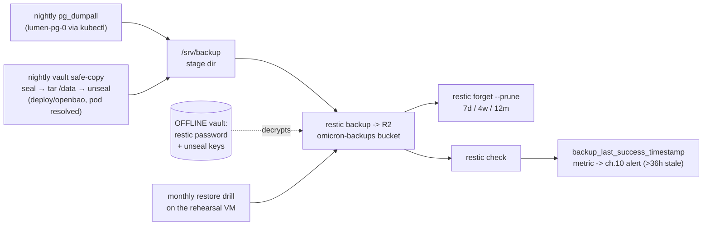

# 08 · Backups — the promise, and how to keep it

> **M6 — do this when everything else is boring.** Nothing before it
> depends on it; the estate runs fine until the first reader you can't
> apologize to exists. It becomes **mandatory** the day real readers
> exist. And the estate's rule stands: *a backup you have never restored
> is a rumor* — nightly, encrypted before upload, verified monthly by
> actually restoring.

## 1. What gets backed up — and what doesn't (the honest table)

| Thing | Reconstructable without a backup? | Plan |
|---|---|---|
| Postgres data (posts, users, media DB pointers) | ❌ **the only copy** | nightly `pg_dumpall` → restic — `dumpall`, not per-DB: the ONE Patroni (`lumen-pg`) holds all three logical DBs (`lumen_admin`, `lumen_staging`, `lumen_production`), and the admin DB is the one with the users table |
| OpenBao `/data` (every secret ever seeded) | ❌ | nightly **seal → tar `/data` → unseal** via kubectl → restic (§4 — the file backend's consistent moment; never rsync the live dir) |
| Media photos | ✅ already offsite (R2, ch.07) — but the **database** rows linking them are the fragile memory | covered by the DB backup |
| Meilisearch index | ✅ rebuilds from Postgres (wipe the host dir + `cmd/seed` reconcile — the archived root `RUNBOOK.md` recipe, A-numbered in the rehearsal log — not to be confused with 00a's A11) | not backed up |
| K8s objects, all YAML, images | ✅ Git = truth, ghcr = released tags | GitHub + the GitLab mirrors already do it |
| TLS certs | ✅ re-issued in minutes | not backed up |
| Unseal keys · restic password · root tokens | ❌❌ **NOT in any backup** — these unlock the backups | *offline: password manager + paper, separate physical places* |

> **The keys-in-backup rule:** unseal keys NEVER go in the bucket (the
> bucket is encrypted by a password you would then be storing inside it —
> a lock with the key hanging in it). The **restic password is the
> offline-vault companion**: same drawer, same paper ritual, as the
> unseal keys. Backups without it are a brick; with it, they're
> everything.

## 2. Where: one honest repo string, one dedicated bucket

`restic` speaks the **S3 API**; R2 *is* an S3 endpoint. So there is only
one correct way to say it — no `s3.amazonaws.com` placeholder, no extra
`--repo-endpoint` flag (an earlier draft of this chapter wrote both,
which is how beginners end up with two half-true commands; the doc was
wrong, this is the fix):

```bash
# ONE repo string, used identically in every restic command below:
export RESTIC_REPOSITORY="s3:https://<account>.r2.cloudflarestorage.com/omicron-backups"
# + RESTIC_PASSWORD (the offline-vault item) + AWS_ACCESS_KEY_ID /
#   AWS_SECRET_ACCESS_KEY (an R2 token scoped to this bucket only)
restic init    # once — client-side encrypts from here on; R2 never sees plaintext
```

Bucket discipline: the **backup bucket was created back in M0 (ch.01)**,
alongside the media bucket — *two different buckets, two different
tokens*. One purpose per bucket = one accident can't hit both your
photos and your photos-about-the-past.

## 3. The lifecycle (the whole chapter in one picture)



## 4. The nightly loop (systemd timers or one cron file)

**One-time setup** — the stage dirs and the env file the whole loop reads
(cron inherits NO shell environment; without sourcing, every `restic`
command fails with "repository not configured"):

```bash
sudo mkdir -p /srv/backup/pg /srv/backup/bao
sudo tee /etc/omicron-backup.env >/dev/null <<'EOF'
# chmod 600, root-owned. The restic values are §2's; BAO_UNSEAL_KEY is
# one of the three unseal keys — see the honesty note below the cron.
export RESTIC_REPOSITORY="s3:https://<account>.r2.cloudflarestorage.com/omicron-backups"
export RESTIC_PASSWORD="<the offline-vault item>"
export AWS_ACCESS_KEY_ID="<R2 token scoped to this bucket>"
export AWS_SECRET_ACCESS_KEY="<R2 token scoped to this bucket>"
export BAO_UNSEAL_KEY="<one of the three unseal keys>"
export KUBECONFIG=/etc/rancher/k3s/k3s.yaml
EOF
sudo chmod 600 /etc/omicron-backup.env
```

**The Bao safe-copy helper** — one-time on the server:

```bash
sudo tee /usr/local/bin/bao-safe-copy >/dev/null <<'EOF'
#!/usr/bin/env bash
# openbao runs the FILE storage backend (vortex bases/openbao ConfigMap,
# storage "file" path=/data) — `bao snapshot save` is Raft-only and would
# fail nightly. The file backend's consistent moment is SEALED (zero
# writes), so: seal → tar /data → unseal.
set -euo pipefail
. /etc/omicron-backup.env   # BAO_UNSEAL_KEY lives here, not in cron
POD=$(kubectl -n secrets get pod -l app=openbao -o jsonpath='{.items[0].metadata.name}')
kubectl -n secrets exec "$POD" -- bao operator seal
kubectl -n secrets exec "$POD" -- tar -cf - -C /data . \
  | gzip > /srv/backup/bao/vault-$(date +%F).tar.gz
kubectl -n secrets exec "$POD" -- bao operator unseal "$BAO_UNSEAL_KEY"
kubectl -n external-secrets rollout restart deploy/external-secrets  # skip ESO's error backoff
EOF
sudo chmod 700 /usr/local/bin/bao-safe-copy
```

**The cron** (`/etc/cron.d/omicron-backup`; timers also fine — each line
sources the env file itself, because cron does not):

```cron
# /etc/cron.d/omicron-backup
02 3 * * * root . /etc/omicron-backup.env && kubectl -n db exec lumen-pg-0 -- \
  pg_dumpall -U postgres > /srv/backup/pg/dump-$(date +\%F).sql && \
  restic backup /srv/backup/pg --tag pg
03 3 * * * root /usr/local/bin/bao-safe-copy && \
  . /etc/omicron-backup.env && restic backup /srv/backup/bao --tag bao
04 3 * * * root . /etc/omicron-backup.env && restic backup /srv/backup && \
  restic forget --prune --keep-daily 7 --keep-weekly 4 --keep-monthly 12 && restic check
```

> **Why seal-and-copy, honestly:** the chapter first drafted `bao snapshot
> save` — a real command, but only for **integrated Raft storage**; the
> shipped vault is `storage "file"` and the command fails every night,
> silently (cron mails nobody — that's the failure mode that kills backup
> systems). Sealing is the file backend's ONLY consistency guarantee:
> sealed = zero writers = the tar is a coherent database. The unseal key
> lives in root's 600 env file — **documented trade, not an accident:**
> node-root can already read `/data` directly, so the key on the node adds
> no new exposure; the 3/2 offline math still guards every *other*
> location (laptop, paper, backups).
> **Why `pg_dumpall` stays:** same consistency story, done by Postgres
> itself. Neither method ever touches a live database directory.

**Retention reality:** 7 daily / 4 weekly / 12 monthly ≈ a year of "what
Tuesday looked like" in a few gigabytes. Restic dedups; blog data is
tiny; disk is the least of your worries. *(Backlog note: moving openbao
to integrated Raft storage in vortex would restore the one-line
`bao snapshot save` ritual and real snapshot/restore — recorded as an
owner decision, not invented silently.)*

**The freshness metric:** the ch.10 alert rule *Backups stale (no
success in 36h)* (`environments/foundation/observability/alerting.yaml`)
queries `backup_last_success_timestamp_seconds` — a name that is not
invented on this page. The loop above does not yet export it (an export
needs a push to the observability plane — the statsd listener exists in
the Alloy config but stays commented, per the no-sidecar contract),
so until a small exporter ships, that rule is **inert by design**
(noData → OK): the alert is provisioning that becomes alive, not a
broken promise. *An old backup is not a backup, it's a hope* — the
timer turns the hope into a schedule; the exporter is what turns it
into a measurement.

## 5. The monthly drill (the actual job; the rest is plumbing)

First Saturday, 20 minutes, **on the rehearsal VM — never prod**:

1. `restic restore latest --target /tmp/verify` (env from §2, pointed at
   the same repo).
2. Feed `dump-*.sql` into a scratch Postgres pod;
   `psql -c 'select count(*) from posts;'` → **the number must match the
   dashboard number**. That single sentence is the only thing in this
   chapter that *proves* a backup works. Everything else is plumbing.
3. Restore the Bao tarball into a throwaway instance: a scratch
   directory + a throwaway `bao server -config=…` pointed at it (file
   storage = just files), then unseal it with the offline keys. **Restoring
   the vault = you also need the offline unseal keys → drill both together
   or you've drilled half the plane.**

## 6. Total-loss runbook (the "VPS burned down" sequence)

1. New VPS → **this folder, in order**: 02 (hardening) → 03 (k3s) →
   **04 (Argo — the foundation hub first: it creates the openbao pod you
   are about to restore INTO, plus Patroni)** → 05 (restore the vault,
   then §3.5's hand-made Secrets) → 06 (apps) → 07 (DNS/TLS/media, buy
   time on 07 while anything is still pointed elsewhere). *The old
   order restored Bao before Argo — impossible for a literal follower:
   the openbao pod comes from the foundation hub (ch.04 §3 act 1).*
2. Restore Bao: fresh pod (foundation hub did it) → untar the latest
   vault-*.tar.gz into the pod's `/data` → restart the pod → unseal
   (offline keys) → the vault's *content* is whatever was backed up.
   Then re-create the **hand-made k8s Secrets** (ch.05 §3.5) that ride
   no backup: `bao-approle-credentials` + `lumen-bao-credentials`
   (mint the pairs from the restored vault exactly as ch.05 §3.5 says)
   and `search/meilisearch-master-key` — read `MASTER_KEY` back from
   the restored vault (run on the laptop, `$ROOT` from ch.05 §3.3):
   `kubectl -n secrets exec deploy/openbao -- sh -c \
   "VAULT_TOKEN=$ROOT bao kv get -field=MASTER_KEY kv/meilisearch/production"`.
3. Restore Postgres: Patroni comes up empty → load `pg_dumpall` into the
   primary → ESO is already syncing (its values came from step 2).
4. Argo reconciles everything Git owns; images live in ghcr (immutable
   tags, ch.09), media in R2, search reindexes (wipe the host dir +
   `cmd/seed` — the archived root `RUNBOOK.md` recipe).
5. RTO honesty: with these chapters, a rebuild is an afternoon. The long
   tail is DNS TTLs and *your own memory of the order* — which is why
   this folder exists and why the drill is monthly.

## 7. Provider snapshots ≠ backups (why both exist)

Contabo/sumopod whole-machine snapshots are a great shortcut and a lousy
strategy: same vendor, same building, often same firewall. **R2 + restic
is the encrypted off-vendor copy; a provider snapshot (if you enable
one) is the fast local undo.** If forced to pick one, pick this
chapter's loop.

Next → [09 Releases](09-releases.md)
