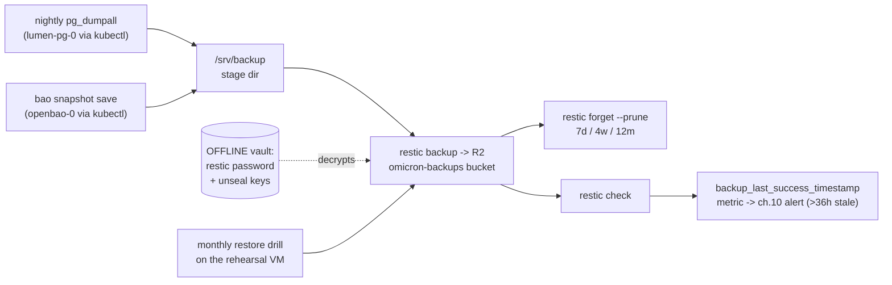

# 08 · Backups — the promise, and how to keep it

> **M6 — do this when everything else is boring.** Nothing before it
> depends on it; the estate runs fine until the first reader you can't
> apologize to exists. It becomes **mandatory** the day real readers
> exist. And the estate's rule stands: *a backup you have never restored
> is a rumor* — nightly, encrypted before upload, verified monthly by
> actually restoring.

## 1. What gets backed up — and what doesn't (the honest table)

| Thing | Reconstructable without a backup? | Plan |
|---|---|---|
| Postgres data (posts, users, media DB pointers) | ❌ **the only copy** | nightly `pg_dumpall` → restic |
| OpenBao `/data` (every secret ever seeded) | ❌ | `bao snapshot save` via kubectl → restic (see §3b — never rsync the live dir) |
| Media photos | ✅ already offsite (R2, ch.07) — but the **database** rows linking them are the fragile memory | covered by the DB backup |
| Meilisearch index | ✅ rebuilds from Postgres (the A11 recipe: wipe the host dir + `cmd/seed` reconcile — archived rehearsal log, ch.13) | not backed up |
| K8s objects, all YAML, images | ✅ Git = truth, ghcr = released tags | GitHub + the GitLab mirrors already do it |
| TLS certs | ✅ re-issued in minutes | not backed up |
| Unseal keys · restic password · root tokens | ❌❌ **NOT in any backup** — these unlock the backups | *offline: password manager + paper, separate physical places* |

> **The keys-in-backup rule:** unseal keys NEVER go in the bucket (the
> bucket is encrypted by a password you would then be storing inside it —
> a lock with the key hanging in it). The **restic password is the
> offline-vault companion**: same drawer, same paper ritual, as the
> unseal keys. Backups without it are a brick; with it, they're
> everything.

## 2. Where: one honest repo string, one dedicated bucket

`restic` speaks the **S3 API**; R2 *is* an S3 endpoint. So there is only
one correct way to say it — no `s3.amazonaws.com` placeholder, no extra
`--repo-endpoint` flag (an earlier draft of this chapter wrote both,
which is how beginners end up with two half-true commands; the doc was
wrong, this is the fix):

```bash
# ONE repo string, used identically in every restic command below:
export RESTIC_REPOSITORY="s3:https://<account>.r2.cloudflarestorage.com/omicron-backups"
# + RESTIC_PASSWORD (the offline-vault item) + AWS_ACCESS_KEY_ID /
#   AWS_SECRET_ACCESS_KEY (an R2 token scoped to this bucket only)
restic init    # once — client-side encrypts from here on; R2 never sees plaintext
```

Bucket discipline: the **backup bucket was created back in M0 (ch.01)**,
alongside the media bucket — *two different buckets, two different
tokens*. One purpose per bucket = one accident can't hit both your
photos and your photos-about-the-past.

## 3. The lifecycle (the whole chapter in one picture)



## 4. The nightly loop (systemd timers or one cron file)

```bash
# /etc/cron.d/omicron-backup (cron shown for clarity; timers also fine)
02 3 * * * root KUBECONFIG=/etc/rancher/k3s/k3s.yaml kubectl -n db exec lumen-pg-0 -- \
  pg_dumpall -U postgres > /srv/backup/pg/dump-$(date +\%F).sql && \
  restic backup /srv/backup/pg --tag pg
03 3 * * * root kubectl -n secrets exec openbao-0 -- bao snapshot save /tmp/snap && \
  kubectl cp secrets/openbao-0:/tmp/snap /srv/backup/bao/snapshot && \
  restic backup /srv/backup/bao --tag bao
04 3 * * * root restic backup /srv/backup && restic forget --prune \
  --keep-daily 7 --keep-weekly 4 --keep-monthly 12 && restic check
```

(The environment vars from §2 live in `root`'s env file — values stay out
of the crontab, same doctrine as everywhere else.)

> **Why a snapshot API, not a copy of the PVC directory:** copying a live
> database directory gets you a backup that restores to *corruption* —
> the classic half-written-file surprise. Bao's `snapshot save` is
> consistent by design; Postgres's `pg_dumpall` is consistent by design.
> Neither touches storage files directly.

**Retention reality:** 7 daily / 4 weekly / 12 monthly ≈ a year of "what
Tuesday looked like" in a few gigabytes. Restic dedups; blog data is
tiny; disk is the least of your worries.

**The freshness metric:** step 04's `restic check` success is what
exports `backup_last_success_timestamp_seconds`. That name is not
invented on this page — it is exactly the metric the ch.10 alert rule
*Backups stale (no success in 36h)* (`overlays/production/observability/alerting.yaml`)
queries. Until the timer exists, that rule is **inert by design**
(noData → OK): the alert is provisioning that becomes alive, not a
broken promise. *An old backup is not a backup, it's a hope* — the
timer turns the hope into a measurement.

## 5. The monthly drill (the actual job; the rest is plumbing)

First Saturday, 20 minutes, **on the rehearsal VM — never prod**:

1. `restic restore latest --target /tmp/verify` (env from §2, pointed at
   the same repo).
2. Feed `dump-*.sql` into a scratch Postgres pod;
   `psql -c 'select count(*) from posts;'` → **the number must match the
   dashboard number**. That single sentence is the only thing in this
   chapter that *proves* a backup works. Everything else is plumbing.
3. Restore the Bao snapshot into a throwaway instance (`bao operator
   migrate -command` or straight-into-datadir) and unseal it with the
   offline keys. **Restoring the vault = you also need the offline
   unseal keys → drill both together or you've drilled half the plane.**

## 6. Total-loss runbook (the "VPS burned down" sequence)

1. New VPS → **this folder, in order**: 02 (hardening) → 03 (k3s) →
   05 (restore Bao first — everything else reads its secrets from there)
   → 04 (Argo) → 06 (apps) → 07 (DNS/TLS/media, buy time on 07 while
   anything is still pointed elsewhere).
2. Restore Bao: fresh pod → restore snapshot → unseal (offline keys) →
   the vault's *content* is whatever was backed up. Re-issue AppRole
   creds only if the vault was lost, not restored (ch.05).
3. Restore Postgres: Patroni comes up empty → load `pg_dumpall` into the
   primary → ESO is already syncing (its values came from step 2).
4. Argo reconciles everything Git owns; images live in ghcr (immutable
   tags, ch.09), media in R2, search reindexes (the A11 recipe).
5. RTO honesty: with these chapters, a rebuild is an afternoon. The long
   tail is DNS TTLs and *your own memory of the order* — which is why
   this folder exists and why the drill is monthly.

## 7. Provider snapshots ≠ backups (why both exist)

Contabo/sumopod whole-machine snapshots are a great shortcut and a lousy
strategy: same vendor, same building, often same firewall. **R2 + restic
is the encrypted off-vendor copy; a provider snapshot (if you enable
one) is the fast local undo.** If forced to pick one, pick this
chapter's loop.

Next → [09 Releases](09-releases.md)
