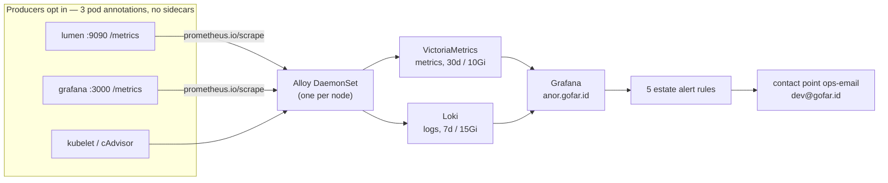

# 10 · Observability — the estate's eyes (Grafana LGTM + VictoriaMetrics)

> **Why this chapter:** everything so far can fail quietly. The point of
> metrics + logs + dashboards is that **the estate tells you before the
> readers do** — cert about to die, backup gone stale, vault sealed, pod
> crash-looping. Also: this is the family's learning wall.

## 1. The four tools, in one honest paragraph each

| Tool | Job | Analogy |
|---|---|---|
| **Grafana Alloy** (DaemonSet) | one small collector per node: scrapes everything + listens for pushed logs/metrics | the building's single wiring closet |
| **VictoriaMetrics** | stores **metrics** (numbers over time), PromQL-compatible | the ticker tape |
| **Loki** | stores **logs** (labeled lines, LogQL) | the mailroom, index-only |
| **Grafana** (pinned `11.2.0`) | the face: dashboards + unified alerting | the wall of screens |

> **Why Alloy one-per-node instead of a per-app agent army:** the INFRA
> decision (Phase 5) — small machines don't fit ~150 Mi of exporters per
> pod; Alloy remotely scrapes kubelet/cAdvisor and reads pods'
> `/metrics`, so apps opt in with **three pod annotations** and zero
> sidecars. **Why VictoriaMetrics over plain Prometheus:** single-binary,
> storage-efficient, drop-in PromQL — and it was the owner's stack ruling
> (2026-11-13; INFRA carries the amendment next to the LGTM name).

## 2. The pipeline (the whole chapter in one picture)



## 3. Turning it on (already templated — GitOps like everything else)

`applications/observability/` is the base (alloy, victoria-metrics, loki,
grafana, namespace, ingress, externalsecret — pinned images),
`overlays/production/observability/` is the prod view, and
`apps/applications/observability-app.yaml` is the Argo Application (sync
**wave 2** — the first wave gated on the Ready `bao` store, which
Grafana's config feeds consume; Grafana degrades to defaults via
`optional: true`, never a blocked wave). `apps/applications/` also carries
`certificates-app.yaml` now — the `anor` door's Certificate arrives in
wave 1 of the same hub. The store gating that used to be "wave 2 waits"
now lives at the entrypoint boundary: hub #2 (this chapter's app) is only
applied after the M3 seed. The single-node rehearsal hub *deliberately* excludes the
stack (a 2 GB node can't afford the eyes); on the VPS it's merged, not
installed — *no manual installs.*

**Sizing on the 4c/8G box:** VM retention **30d / ~10 Gi PVC**, Loki
**7d / ~15 Gi PVC**, Grafana 1 Gi PVC. Say it plainly: the base
**already matches the INFRA §1 VPS budget line for line**, so the prod
overlay adds **no sizing patches** — inventing no-op patches would fake
a drift that doesn't exist and give real drift a place to hide. What the
overlay *does* own: the alerting file (§6) and any future per-VPS knob.
If disk pressure shows up, shrink *Loki retention first* — metrics are
cheaper to keep than logs. Traces stay OFF (no Tempo — deliberate).

## 4. The no-sidecar contract (how anything gets in)

Any pod that should be watched gets:

```yaml
annotations:
  prometheus.io/scrape: "true"
  prometheus.io/port: "9090"    # the unrouted admin port — never an Ingress
  prometheus.io/path: "/metrics"
```

lumen already does (admin port 9090, not public); structured stdout logs
are picked up automatically. Grafana watches *itself* on its HTTP port —
`prometheus.io/port: "3000"` in `applications/observability/grafana.yaml`
(dashboard-alert latency for the thing that watches everything else).
The OTLP receiver is configured-but-waiting (the Go OTel SDK forward
path — "add, not a rewrite" is the INFRA line; nothing to do today).

## 5. The door: `anor.gofar.id` — plumbing as verified in vortex

- **Ingress** (`applications/observability/ingress.yaml`): Traefik,
  host `anor.gofar.id`, TLS secret **`tls-anor`** — served by the
  explicit `Certificate` in `applications/certificates/` (no
  ingress-shim annotation, or it would shadow-issue a duplicate).
- **Service**: `grafana` ClusterIP, `port: 3000, targetPort: http`
  (verified in `grafana.yaml` — this is the port ch.11's tunnel uses).
- **Config feeds** (`externalsecret.yaml`, both from Bao kv path
  `grafana/production`, store `bao`):
  - ConfigMap **`grafana-config`** (ESO generic `target.manifest`
    render): `GF_SERVER_ROOT_URL` (a VALUE → Bao), plus the constants
    `GF_AUTH_GENERIC_OAUTH_ENABLED="true"` and
    `GF_ANALYTICS_REPORTING_ENABLED="false"` — the deployment carries
    **zero config literals** (owner ruling 2026-11-11; the old env block
    moved here).
  - Secret **`grafana-secrets`**: `GF_SECURITY_ADMIN_PASSWORD`,
    `GF_AUTH_GENERIC_OAUTH_CLIENT_ID`, `GF_AUTH_GENERIC_OAUTH_CLIENT_SECRET`.
- **Datasources** (provisioned, `grafana-datasources` ConfigMap) carry
  **explicit uids** — `victoria-metrics` (default) and `loki` — because
  alert rules bind to datasources *by UID*, and an auto-generated UID is
  not a reviewable contract.
- The only public path in is Cloudflare→Access→edge: **no NodePort, no
  public origin exposure**.

## 6. Identity (owner ruling): Google → Access → Grafana, plus a kept break-glass

| Who | Road | Role |
|---|---|---|
| You + humans | Google login → **Cloudflare Access policy** → Grafana generic-OAuth OIDC | auto-provisioned **Viewer** on first visit |
| `lab-friends` team | same road | **Editor — scoped to one folder: `Learning`** |
| BREAK-GLASS built-in `admin` | **only** via the SSH tunnel → `http://localhost:3000` (ch.11) | password generated into Bao (`grafana/production`) — kept on purpose |

The login form stays **enabled but invisible**: Access fronts the public
path, so a human never sees it — but the tunnel path hits the form
directly, which is exactly what a dark day needs. The loop for guests:
add an email to the **Access policy** → their first visit auto-creates
the Grafana user; remove = delete from the policy (no second password
system to forget). Editor-on-`Learning` means friends can build and
wreck dashboards all afternoon inside that folder and nothing outside it
— a homelab classroom without a `sudo` list.

> **The honest caveat:** every Viewer sees all metrics/logs of this
> estate (that's what Grafana *is*). For family: a feature. For a
> stranger: don't invite strangers; org-level isolation is a later
> exercise, not tonight.

Starter dashboards (community-proven imports): node exporter (the
machine), kubernetes cluster (the pods), the Loki log explorer. A
`Learning` folder with one blank panel and a query you can type is the
actual teaching tool.

## 7. The five estate alerts — and why they're green today

`overlays/production/observability/alerting.yaml` → ConfigMap
**`grafana-alerting`**, Grafana file-provisioning format
(`monitoring.grafana.com/v1alpha1`, live since 10.4), mounted at
`/etc/grafana/provisioning/alerting` by the prod overlay. One folder
(`Estate`), one group (`estate-vital-signs`, 5m interval), **five
rules**, each against its target metric:

| Rule | Expression (abridged) | Fires when |
|---|---|---|
| TLS certificate expires < 21 days | `certmanager_certificate_expiration_timestamp_seconds - time() < 1814400` | renewal is broken, not merely near |
| Backups stale (no success in 36h) | `time() - backup_last_success_timestamp_seconds > 129600` | one missed nightly window + grace (source: ch.08's timer) |
| OpenBao is sealed | `bao_monitor_sealed == 1` | the reboot incident's symptom, in advance |
| Pod restart spike (>5 in 30m) | `increase(kube_pod_container_status_restarts_total[30m]) > 5` | crashloop past rollout noise |
| Disk usage above 80% | `node_filesystem_avail_bytes / … > 80` (tmpfs/overlay excluded) | the quiet killer on an 80 GB box |

> **Inert-by-design, stated honestly:** every rule carries
> `noDataState: OK` — and **no metric source exists in-cluster yet**
> (cert-manager isn't annotated for the scrape contract; the restic
> timer is ch.08/M6 work; Bao's telemetry gauge needs enabling + an
> authenticated scrape; kube-state-metrics and node-exporter are Phase 5
> backlog). So today all five sit green. **This is provisioning that
> becomes alive the moment each source lands — zero further Git change —
> not five broken promises.** One known blind spot, printed rather than
> hidden: a *sealed* Bao serves no metrics, so the sealed case arrives
> as NoData→OK; the belt-and-braces upgrade is `noDataState: Alert` once
> an always-on exporter (blackbox or node script on `/sys/seal-status`)
> exists. The gap is not silent.

**Delivery:** one ContactPoint `ops-email` → **`dev@gofar.id`**. Yes,
that's a literal address in Git — the *second documented exception* to
the no-literals rule, same class as the ACME contact email (public
operational mailbox, not a secret, not app runtime config). No
NotificationPolicy is provisioned: Grafana's default fan-out delivers
all five rules to that one inbox.

Next → [11 Access from Your Laptop](11-access.md)
