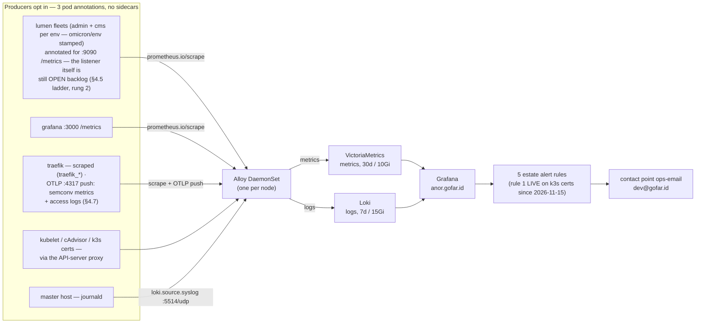
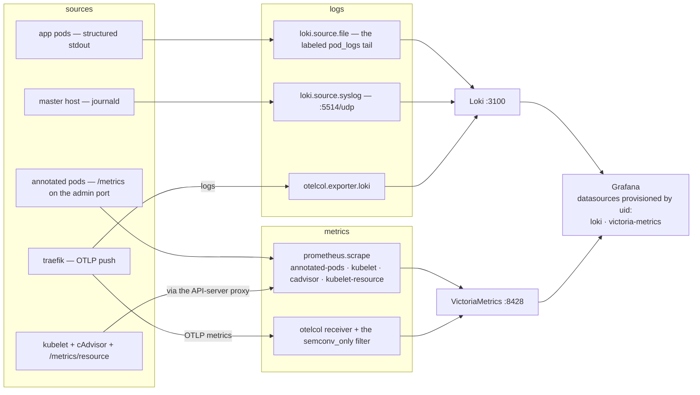
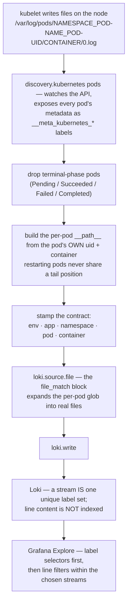
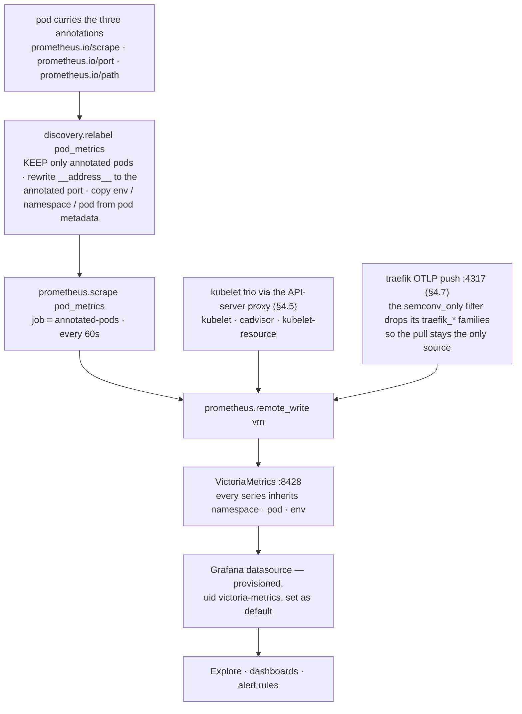

# 10 · Observability — the estate's eyes (Grafana LGTM + VictoriaMetrics)

> **Why this chapter:** everything so far can fail quietly. The point of
> metrics + logs + dashboards is that **the estate tells you before the
> readers do** — cert about to die, backup gone stale, vault sealed, pod
> crash-looping. Also: this is the family's learning wall.

## 1. The four tools, in one honest paragraph each

| Tool | Job | Analogy |
|---|---|---|
| **Grafana Alloy** (DaemonSet) | one small collector per node: scrapes everything + listens for pushed logs/metrics | the building's single wiring closet |
| **VictoriaMetrics** | stores **metrics** (numbers over time), PromQL-compatible | the ticker tape |
| **Loki** | stores **logs** (labeled lines, LogQL) | the mailroom, index-only |
| **Grafana** (pinned `13.3.1`) | the face: dashboards + unified alerting | the wall of screens |

> **Why Alloy one-per-node instead of a per-app agent army:** the INFRA
> decision (Phase 5) — small machines don't fit ~150 Mi of exporters per
> pod; Alloy remotely scrapes kubelet/cAdvisor and reads pods'
> `/metrics`, so apps opt in with **three pod annotations** and zero
> sidecars. **Why VictoriaMetrics over plain Prometheus:** single-binary,
> storage-efficient, drop-in PromQL — and it was the owner's stack ruling
> (2026-11-13; INFRA carries the amendment next to the LGTM name).

## 2. The pipeline (the whole chapter in one picture)



## 3. Turning it on (already templated — GitOps plus one manual gate)

`bases/observability/` is the base (alloy, victoria-metrics, loki,
grafana, namespace, ingress, dashboards, externalsecret — images pinned
in the env tree), `environments/foundation/observability/` is the plane
view (placement collapse + the alerting file), and
`apps/observability/observability.yaml` is the Argo Application — it
rides its **own hub, `bootstrap/apps-hub-observability.yaml`, applied by
hand as the manual GATE** (2026-11-14 hub split): only after (a) the
foundation hub's apps are Synced/Healthy, (b) chapter 05's ritual is
done, and (c) ch.05 §6.5's **grafana four-key put is verified** — an
ExternalSecret errors on ANY missing declared key, so a fresh apply
before the seed wedges the sync op (the wedge that ate a day; card 11).
The single stack serves **BOTH staging and production from day one**:
Alloy relabels scrapes/logs with the pod's `omicron/env` label, and
every dashboard filters by env (00a A10's fifth proof). The `anor`
door's Certificate arrives with the certificates app (production hub
wave 1, rendered by `bases/certificates/`).
*No manual installs* — on the VPS the stack is merged, not installed.

**Sizing on the 4c/8G box:** VM retention **30d / ~10 Gi PVC**, Loki
**7d / ~15 Gi PVC**, Grafana 1 Gi PVC. Say it plainly: the base
**already matches the INFRA §1 VPS budget line for line**, so the
foundation overlay adds **no sizing patches** — inventing no-op patches
would fake a drift that doesn't exist and give real drift a place to
hide. What the overlay *does* own: the alerting file (§6) and any
future per-VPS knob.
If disk pressure shows up, shrink *Loki retention first* — metrics are
cheaper to keep than logs. Traces stay OFF (no Tempo — deliberate).

## 4. The no-sidecar contract (how anything gets in)

The whole estate's data flow, at a glance — every ingest route, its sink,
and where Grafana meets them (§4.5–§4.8 are the drill-downs):



Any pod that should be watched gets:

```yaml
annotations:
  prometheus.io/scrape: "true"
  prometheus.io/port: "9090"    # the unrouted admin port — never an Ingress
  prometheus.io/path: "/metrics"
```

lumen already does (admin port 9090, not public); structured stdout logs
are picked up automatically. Grafana watches *itself* on its HTTP port —
`prometheus.io/port: "3000"` in `bases/observability/grafana.yaml`
(dashboard-alert latency for the thing that watches everything else).
The OTLP receiver is **live** — traefik pushes into it and the OTel
semconv `http.server.request.duration` histogram lands in
VictoriaMetrics (§4.7).

### 4.5. System metrics per pod and per node — what Alloy scrapes (walked 2026-11-14)

The annotations above cover **app-exposed** metrics (custom counters
included — a scrape is a full dump of the endpoint; nothing filters by
metric name, and every series inherits `namespace`/`pod`/`env`). The
**system** metrics — cpu, memory, disk, network for every pod on the
node — come from three kubelet surfaces Alloy pulls over the **API-server
proxy** (no direct node dialing; identical on k3d and the VPS):

| Scrape job | Path (via `kubernetes.default.svc:443`) | What lands |
|---|---|---|
| `kubelet` | `/api/v1/nodes/<node>/proxy/metrics` | `kubelet_*` (111 families): pod counts, volume stats `kubelet_volume_stats_*` (PVC fullness), cgroup managers |
| `cadvisor` | `…/proxy/metrics/cadvisor` | per-pod/per-container `container_cpu_usage_seconds_total`, `container_memory_working_set_bytes`, `container_fs_*`, `container_network_*` |
| `kubelet-resource` | `…/proxy/metrics/resource` | node aggregates: `node_cpu_usage_seconds_total`, `node_memory_working_set_bytes` |

Auth is the pod SA bearer (the `alloy` ClusterRole carries `nodes/proxy`
— that's the whole RBAC ask); TLS verifies against the SA `ca.crt`.
Verify with:

```bash
kubectl -n observability port-forward svc/victoria-metrics 18428:8428
curl -s http://127.0.0.1:18428/api/v1/query?query=up | python3 -m json.tool | grep '"job"'
# every job up=1; series sanity: curl …/api/v1/label/__name__/values
```

**Known gaps, printed honestly** (the two `up=0` targets you may still
see): lumen's pod carries the annotations but its server **doesn't listen
on 9090 yet** (`listening on :8080` is its only bind — the metrics
endpoint is a lumen backlog item); meilisearch's `/metrics` answers
**401** — Meili gates it behind the master key, and the annotation
contract has no auth story (its visibility rides logs + kubelet series
until someone adds a scrape-auth decision). The provisioned **Estate
overview** dashboard (folder `Estate`) draws exactly the verified series:
node cpu/memory, per-pod cpu/memory/disk top-10, PVC usage %.

**Router / entrypoint / service request metrics are LAZY** (walked
2026-11-14, this bit bit us): each series is instantiated by the FIRST
request through that router/entrypoint/service — on a traffic-free edge
you see only the three global families
(`traefik_config_*`, `traefik_open_connections`) and conclude the scrape
is broken. It isn't. Probe it:

```bash
kubectl -n observability exec deploy/grafana -- sh -c \
  'curl -s -o /dev/null -w "%{http_code}" http://<traefik-podIP>:8000/ -H "Host: anor.gofar.id"'
```

And `traefik_router_requests_total` is **OFF by default** —
`--metrics.prometheus.addrouterslabels` defaults to false (verified from
the live binary's `--help`); the ch.03 §6 install command now sets
`metrics.prometheus.addRoutersLabels=true` explicitly, alongside the
entrypoints/services flags spelled out so defaults can never silently
change the contract.

> Two Alloy lessons live as comments in `config.alloy` — worth knowing:
> River relabel rules default `replacement` to `"$1"`, so a multi-capture
> rule without an explicit `replacement = "$1:$2"` **silently drops the
> port** (every target scraped port 80 → up=0 estate-wide); and River
> comments are `//` — an inline `#` is a parse error that CrashLoops the
> DaemonSet.

### 4.6. Pod logs, labeled — the log-label contract (walked 2026-11-14)

**Where the logs physically live** (the kubelet layer — Kubernetes does
this for us before any Alloy is involved): every container's stdout and
stderr is captured by the kubelet into plain files on the node, in a
fixed layout:

```text
/var/log/pods/<namespace>_<pod-name>_<pod-uid>/<container-name>/<0,1,…>.log
```

A lumen-admin pod's log is a path like
`/var/log/pods/lumen_lumen-admin-http-server-d8f86d685-wbrk2_a66d2f75…/lumen-admin-http-server/0.log`.
The `<pod-uid>` segment is the trick: **it changes every time the pod is
recreated**, so each pod generation gets its own fresh directory and
never competes for a tail position with its predecessor. (Kubernetes
reference: [Logging
Architecture](https://kubernetes.io/docs/concepts/cluster-administration/logging/).)

**What the original config did — and why Explore looked broken.** The
first cut of `config.alloy` was as naive as it gets — one glob, tail
everything, ship it:

```alloy
local.file_match "pod_logs" {
    path_targets = [{
    __path__  = "/var/log/pods/*/*/*.log",   // every file on the node
    instance  = env("HOSTNAME"),
    job       = "kubelet-pods",
    }]
}
loki.source.file "pod_logs" {
    targets    = local.file_match.pod_logs.targets
    forward_to = [loki.write.loki.receiver]
}
```

Logs arrived fine — but every single stream carried the SAME three
labels: `job="kubelet-pods"`, `instance=<node>`, and
`filename=<path-with-uuid>`. Loki knew *where a file came from* and
nothing else about it. The symptom in Explore: only the chatty pods
surfaced (argocd, postgres — recent streams, no way to narrow), and
"show me lumen's errors" was literally unanswerable without knowing the
uuid of the pod you cared about.

**Why labels matter — Loki's index model** (the one paragraph worth
memorizing, from [Loki's "Understand
labels"](https://grafana.com/docs/loki/latest/get-started/labels/)):
*Loki does not index the content of log lines — it indexes labels.* Log
entries sharing one label set form a **stream**; a query first finds the
streams matching your label selectors, then greps within just those.
Four consequences:

- **Too few labels = unusable queries.** With only
  `job/instance/filename`, the only selectors available were node-level
  or a uuid path. "Errors from lumen" meant scanning EVERY stream on the
  node with `|= "error"` and eyeballing filenames.
- **Labels must be low-cardinality and bounded.** `env`, `app`,
  `namespace`, `container` — bounded sets, perfect. `pod` rotates, but
  each value lives exactly as long as a pod — acceptable. What you must
  never label: request IPs, user IDs, status codes, uuids — the Loki
  docs' cardinality example shows how `action`×`status_code`×`ip`
  explodes into thousands of short-lived streams that melt the index.
  Our old `filename`-with-uuid label was exactly that failure mode in
  miniature.
- **Labels are how ONE stack serves BOTH environments.** The
  `omicron/env` pod label → `env` log label is the contract that lets a
  single observability deployment serve staging and production —
  `{env="shared"}` on k3d today, `{env="production"}` on the VPS: no
  second stack, no second query grammar.
- **Bonus:** Loki auto-derives a `service_name` label (for Explore and
  Logs Drilldown) by looking at `app` / `app_kubernetes_io_name` /
  `container` in that order — our labels feed that machinery for free
  (you can see `service_name="traefik"` on traefik streams).

That is what the contract below is FOR. Every pod's stdout is indexed
with **five labels**, stamped by
`discovery.relabel "pod_logs"` in `config.alloy` (targets come from
`discovery.kubernetes` pods, and the per-pod log-file path is built from
the pod's own uid + container — restarting pods never share a tail
position):

| Label | Source | Example |
|---|---|---|
| `env` | pod label `omicron/env` | `shared` |
| `app` | pod label `app`, falling back to `app.kubernetes.io/name` | `lumen-admin-http-server` |
| `namespace` | — | `lumen` |
| `pod` | — | `lumen-admin-http-server-d8f86d685-wbrk2` |
| `container` | — | `lumen-admin-http-server` |

**The pipeline, end to end** (what `config.alloy` now does):



Step by step:

1. **`discovery.kubernetes "pods"`** watches the Kubernetes API and
   exposes each pod's metadata as `__meta_kubernetes_*` labels —
   namespace, pod name, **uid**, pod phase, container names, and every
   pod label (`__meta_kubernetes_pod_label_<x>`; dashes and dots in the
   label name become underscores).
2. **`discovery.relabel "pod_logs"`** turns that metadata into targets
   and stamps the contract: drop terminal-phase pods (finished Job pods
   stop being tailed; `kubectl logs` still reads them); keep
   `job=kubelet-pods` and `instance=$HOSTNAME`; **build
   `__path__ = /var/log/pods/*_<uid>/<container>/*.log` from the pod's
   own uid + container** — one target per container of one pod
   generation; copy `namespace` / `pod` / `container`; take `env` from
   the `omicron/env` pod label; take `app` from the
   `app.kubernetes.io/name` fallback FIRST and the short `app` label
   LAST (the precedence lesson below).
3. **`loki.source.file`** tails the files. The
   `file_match { enabled = true }` block is **not optional here**: our
   `__path__` is a glob, and without that block the component demands
   absolute literal paths.
4. **`loki.write`** ships every line to Loki with the labels attached.

**How to add a label:** one replace rule in `discovery.relabel
"pod_logs"` copying `__meta_kubernetes_pod_label_<x>` (dashes/dots in the
label name become underscores). **Precedence lesson (walked the hard
way):** relabel rules apply in order and a matching replace OVERWRITES —
set the `app.kubernetes.io/name` fallback FIRST and the short `app` label
LAST, or the fallback stomps the real name (every lumen stream collapsed
to `app="lumen"` in the first cut). System pods (argocd, kube-system,
cert-manager) carry no `omicron/env` label — their streams simply have no
`env` label. Completed Jobs stop being tailed (terminal-phase drop);
`kubectl logs` still reads them. Traefik's access log (CLF, stdout —
enabled in ch.03 §6) flows through the same labeled tail. The old
unlabeled streams (label set `job/instance/filename` only) age out on
their own.

**Design choice: tailing files vs the API.** The Alloy guide offers a
second route — `loki.source.kubernetes`, which streams logs straight
through the Kubernetes API with natively labeled targets (less machinery
to write). We stayed with file-tailing: the files are owned by the
kubelet on the node, so collection keeps working through API-server
hiccups, tail positions survive reconnects, and it's the battle-tested
promtail model. The API route couples log availability to API
responsiveness — the wrong default for an estate that must survive a
flaky edge. And the discovery + relabel layer is shared with the metrics
scrape (§4.8), so it isn't extra complexity: one mechanism, two uses.

Query examples:

```logql
{app="lumen-admin-http-server"}                     # one app's logs
{env="shared"} |= "error"                           # errors in the shared plane
{namespace="ingress", container="traefik"}          # the edge, access + ERR lines
{namespace="db"}                                    # lumen-pg (StatefulSet carries no
                                                    # app label — filter by ns)
```

**Official documentation** (all fetched and verified 2026-11-15):

| Doc | What it covers |
|---|---|
| [Collect Kubernetes logs and forward them to Loki](https://grafana.com/docs/alloy/latest/collect/logs-in-kubernetes/) | the curated Alloy guide — the exact component chain this section uses |
| [`discovery.kubernetes` reference](https://grafana.com/docs/alloy/latest/reference/components/discovery/discovery.kubernetes/) | every `__meta_kubernetes_*` label the pod role exposes (uid, phase, labels…) |
| [`discovery.relabel` reference](https://grafana.com/docs/alloy/latest/reference/components/discovery/discovery.relabel/) | rule semantics — top-down order, replace overwrites, drop/replace actions |
| [`loki.source.file` reference](https://grafana.com/docs/alloy/latest/reference/components/loki/loki.source.file/) | the `file_match` block requirement for glob `__path__` |
| [`loki.source.kubernetes` reference](https://grafana.com/docs/alloy/latest/reference/components/loki/loki.source.kubernetes/) | the API-based alternative we chose not to use |
| [Loki — Understand labels](https://grafana.com/docs/loki/latest/get-started/labels/) | the index model ("content not indexed"), cardinality rules |
| [Loki — LogQL / Query](https://grafana.com/docs/loki/latest/query/) | how label-selector-first queries execute |
| [Kubernetes — Logging Architecture](https://kubernetes.io/docs/concepts/cluster-administration/logging/) | the `/var/log/pods/…` file layout the kubelet produces |

### 4.7. The OTLP door goes live — traefik's semconv metrics (walked 2026-11-14)

Traefik (chart values in ch.03 §6) is the first live producer into the
`otelcol.receiver.otlp` door (`:4317` gRPC via the `alloy-otlp` Service).
Its push is the ONLY source of the OpenTelemetry semantic-convention
histogram — `http.server.request.duration`, landed in VictoriaMetrics as
`http_server_request_duration_seconds_{bucket,sum,count}` with
`http_request_method`, `http_response_status_code`,
`network_protocol_name`, `server_address` and — via
`resource_to_telemetry_conversion` — `k8s_namespace_name`, `k8s_pod_name`,
`k8s_pod_uid`, `job="traefik"` (traefik auto-detects those k8s attributes;
**on the hostNetwork VPS shape the k8s.\* attrs are absent** — detection
needs pod networking). `http_client_request_duration_seconds_*` rides
along (traefik's own outgoing probes).

**The ownership split** (enforced by the `semconv_only` filter in
`config.alloy`): the push ALSO carries traefik's own `traefik_*` counters,
which the Prometheus pull above already exports — without the filter
those families would exist TWICE with different label sets and every
unfiltered `sum(rate(...))` would double-count. Pull owns all
`traefik_*`; the push owns only the semconv metrics. Traces stay OFF (no
Tempo, §1) — this is metrics-OTLP only.

### 4.8. How a metric reaches Grafana — the scrape path, the enable checklist, the missing-metric ladder (walked 2026-11-15)

§4.5 lists WHAT Alloy scrapes; §4.7 covers the OTLP push. This section is
the HOW, end to end — so a future "metric is missing" hour is a ladder to
walk, not an archaeology dig.

**The scrape path for an app pod** (from `config.alloy`, walked
2026-11-14):



Five things worth knowing about that path:

- **A scrape is a full dump.** Nothing filters by metric name — every
  series the endpoint exposes lands in VM, inheriting
  `namespace` / `pod` / `env`. Filtering happens at QUERY time.
- **The port rewrite is spelled out deliberately.** The relabel rule
  rewriting `__address__` carries `replacement = "$1:$2"`: relabel's
  `$1` DEFAULT silently discards capture 2 (the port), and the first
  cut scraped every annotated pod on port 80 — `up=0` estate-wide
  (walked 2026-11-14).
- **The scrape interval is the default 60s.** A brand-new counter takes
  up to a minute (plus Grafana's refresh) to appear — don't debug a
  metric that hasn't had its first scrape yet.
- **env attribution has no shortcut.** There is no per-environment
  `external_labels` on the Alloy fleet — the `env` label exists only
  because the pipeline copies each pod's `omicron/env` label. A pod
  without it gets no env label (system components do exactly this, by
  design).
- **Labels come from pod metadata at scrape time.** Changing a pod
  label changes the metric labels on the next scrape; the old series
  age out on their own.

**How Grafana gets them — provisioning, not clicking.** Neither the
datasources nor the dashboards were created in the UI:

- Datasources are **provisioned** from the `grafana-datasources`
  ConfigMap (`bases/observability/grafana.yaml`), mounted at
  `/etc/grafana/provisioning/datasources`: **Loki with `uid: loki`** and
  **VictoriaMetrics with `uid: victoria-metrics`** (type prometheus) as
  the default.
- Dashboards are provisioned the same way (the `grafana-dashboards`
  ConfigMap → `/etc/grafana/provisioning/dashboards`) — the **Estate
  overview** board (folder `Estate`) is a checked-in artifact, not a
  hand-built one.
- The explicit `uid`s are a reviewable contract: a provisioned
  datasource without a uid gets a GENERATED one, and **alert rules bind
  datasources BY uid** — an unuided datasource silently orphans its
  alerts.
- The doctrine this teaches: a new datasource or dashboard is a
  **vortex edit** (ConfigMap → Argo sync), never a UI click.
  UI-created things live in Grafana's PVC and die with the pod;
  provisioned things survive and are reviewable.

**Enable checklist — metrics for a NEW app** (paste-safe, in order):

1. The app **listens on `/metrics` on the unrouted admin port 9090**
   (never an Ingress — §4's doctrine; structured stdout logs ride the
   labeled log tail automatically, §4.6).
2. The pod template carries the three annotations (the §4 block):
   `prometheus.io/scrape: "true"`, `prometheus.io/port: "9090"`,
   `prometheus.io/path: "/metrics"`.
3. The pod template carries **`omicron/env: shared|staging|production`**
   (every env overlay's labels transformer stamps it) — no label, no
   env attribution.
4. The pod has its **ServiceAccount CR** (owner ruling — every app/pod
   carries one).
5. Verify, in this order:

```bash
# 1. annotations present?
kubectl -n <ns> get pod <pod> -o jsonpath='{.metadata.annotations}' | tr ',' '\n' | grep prometheus
# 2. the app actually answers there?
kubectl -n observability exec deploy/grafana -- \
  curl -s -o /dev/null -w '%{http_code}\n' http://<podIP>:9090/metrics
# 3. the scrape job is up in VictoriaMetrics?
kubectl -n observability port-forward svc/victoria-metrics 18428:8428
curl -s -G http://127.0.0.1:18428/api/v1/query \
  --data-urlencode 'query=up{job="annotated-pods"}' | python3 -m json.tool
# 4. the family you expect exists?
curl -s http://127.0.0.1:18428/api/v1/label/__name__/values \
  | python3 -c "import json,sys; print([n for n in json.load(sys.stdin)['data'] if 'myapp' in n])"
# 5. then Grafana: Explore → VictoriaMetrics → query it.
```

**"A metric is missing" — the ladder** (walk each rung top-down; every
rung has a walked example somewhere in this estate):

1. **Is the pod annotated at all?** No annotations → the relabel `keep`
   drops it → not even an `up` series exists. (Command: step 5.1 above.)
2. **Does the app actually LISTEN on the annotated port?** *Walked
   example:* lumen's pod carries the annotations but its server binds
   only `:8080` — no 9090 listener yet, so its `up` is 0 despite a
   perfect contract (backlog, §4.5).
3. **Does the endpoint answer without auth?** *Walked example:*
   meilisearch's `/metrics` returns **401** — gated behind the master
   key; the annotation contract has no auth story yet (§4.5).
4. **Is the target `up` but your series absent?** Check the lazy trap
   first (§4.5): router/entrypoint/service request series instantiate on
   the FIRST request — traefik showed only the three global families
   until probed.
5. **Is it in VM but not in Grafana?** Wrong datasource is the classic:
   the provisioned VM datasource is `uid: victoria-metrics` — a query
   against Loki (or against a UI-created datasource pointing elsewhere)
   shows nothing. Then check the time range and the `env=` filter: a
   series filtered to an env the pod never carried is invisible.
6. **Still nothing?** Read Alloy's own log — a relabel/scrape config
   error shows there (`kubectl -n observability logs ds/alloy`) — and
   prove the config Argo ships matches what you think you wrote
   (`kubectl kustomize environments/foundation/observability`, run from
   vortex).

## 5. The door: `anor.gofar.id` — plumbing as verified in vortex

- **Ingress** (`bases/observability/ingress.yaml`): Traefik,
  host `anor.gofar.id`, TLS secret **`tls-anor`** — served by the
  explicit `Certificate` in `bases/certificates/` (no
  ingress-shim annotation, or it would shadow-issue a duplicate).
- **Service**: `grafana` ClusterIP, `port: 3000, targetPort: http`
  (verified in `grafana.yaml` — this is the port ch.11's tunnel uses).
- **Config feeds** (`externalsecret.yaml`, both from Bao kv path
  `grafana/production`, store `bao`):
  - ConfigMap **`grafana-config`** (ESO generic `target.manifest`
    render): `GF_SERVER_ROOT_URL` (a VALUE → Bao), plus the constants
    `GF_AUTH_GENERIC_OAUTH_ENABLED="true"` and
    `GF_ANALYTICS_REPORTING_ENABLED="false"` — the deployment carries
    **zero config literals** (owner ruling 2026-11-11; the old env block
    moved here).
  - Secret **`grafana-secrets`**: `GF_SECURITY_ADMIN_PASSWORD`,
    `GF_AUTH_GENERIC_OAUTH_CLIENT_ID`, `GF_AUTH_GENERIC_OAUTH_CLIENT_SECRET`.
- **Datasources** (provisioned, `grafana-datasources` ConfigMap) carry
  **explicit uids** — `victoria-metrics` (default) and `loki` — because
  alert rules bind to datasources *by UID*, and an auto-generated UID is
  not a reviewable contract.
- The only public path in is Cloudflare→Access→edge: **no NodePort, no
  public origin exposure**.

## 6. Identity (owner ruling): Google → Access → Grafana, plus a kept break-glass

| Who | Road | Role |
|---|---|---|
| You + humans | Google login → **Cloudflare Access policy** → Grafana generic-OAuth OIDC | auto-provisioned **Viewer** on first visit |
| `lab-friends` team | same road | **Editor — scoped to one folder: `Learning`** |
| BREAK-GLASS built-in `admin` | **only** via the SSH tunnel → `http://localhost:3000` (ch.11) | password generated into Bao (`grafana/production`) — kept on purpose |

The login form stays **enabled but invisible**: Access fronts the public
path, so a human never sees it — but the tunnel path hits the form
directly, which is exactly what a dark day needs. The loop for guests:
add an email to the **Access policy** → their first visit auto-creates
the Grafana user; remove = delete from the policy (no second password
system to forget). Editor-on-`Learning` means friends can build and
wreck dashboards all afternoon inside that folder and nothing outside it
— a homelab classroom without a `sudo` list.

> **The honest caveat:** every Viewer sees all metrics/logs of this
> estate (that's what Grafana *is*). For family: a feature. For a
> stranger: don't invite strangers; org-level isolation is a later
> exercise, not tonight.

The provisioned **Estate overview** (folder `Estate`, uid
`estate-overview`) is the starting board — six panels on verified
series. Community imports (node exporter full, the kubernetes cluster
board) want node-exporter's wider series — Phase 5 backlog. A
`Learning` folder with one blank panel and a query you can type is the
actual teaching tool.

## 7. The five estate alerts — and why they're green today

`environments/foundation/observability/alerting.yaml` → ConfigMap
**`grafana-alerting`**, Grafana file-provisioning format
(`monitoring.grafana.com/v1alpha1`, live since 10.4), mounted at
`/etc/grafana/provisioning/alerting` by the foundation overlay. One folder
(`Estate`), one group (`estate-vital-signs`, 5m interval), **five
rules**, each against its target metric:

| Rule | Expression (abridged) | Fires when |
|---|---|---|
| k3s control-plane certificate expires < 21 days | `min(k3s_certificate_expiration_seconds) < 1814400` | rotation is broken — a node that never restarts (LIVE 2026-11-15) |
| Backups stale (no success in 36h) | `time() - backup_last_success_timestamp_seconds > 129600` | one missed nightly window + grace (source: ch.08's timer) |
| OpenBao is sealed | `bao_monitor_sealed == 1` | the reboot incident's symptom, in advance |
| Pod restart spike (>5 in 30m) | `increase(kube_pod_container_status_restarts_total[30m]) > 5` | crashloop past rollout noise |
| Disk usage above 80% | `node_filesystem_avail_bytes / … > 80` (tmpfs/overlay excluded) | the quiet killer on an 80 GB box |

> **One rule LIVE, four inert by design, stated honestly:** as of
> 2026-11-15 rule 1 is real, and its road there taught the chapter's
> sharpest lesson. First: this cert-manager (pinned v1.16.2) exports
> **no `certmanager_certificate_expiration_timestamp_seconds`**
> (verified against VictoriaMetrics — only
> `certmanager_clock_time_seconds*` and
> `certmanager_controller_sync_call_count` exist), so the original TLS
> rule sat NoData→OK forever; it was re-pointed to the LIVE
> `k3s_certificate_expiration_seconds` (the kubelet job scrapes it via
> the API-server proxy, §4.5). Second: that gauge counts **seconds
> REMAINING, not an expiry epoch** — proven by the countdown drift test
> (`max_over_time - min_over_time` over a 3h window = exactly 10800s on
> all 22 series) — so the first re-point's `… - time()` arithmetic was
> always-true (it evaluated to ≈ −20,407 "days") and the rule sat
> Firing from its first eval; caught in the functional check minutes
> before `for: 30m` would have paged, fixed to the bare threshold. The
> lesson that survives both mistakes: **evaluate the shipped expression
> against live VM before calling a rule done.** The other four carry
> `noDataState: OK` and stay green today: the restart-spike rule needs
> kube-state-metrics and the disk rule node-exporter (both Phase 5
> backlog), the restic timer is ch.08/M6 work, and Bao's telemetry
> gauge needs enabling + an authenticated scrape. **This is
> provisioning that becomes alive the moment each source lands — zero
> further Git change — not four broken promises.** One known blind
> spot, printed rather than hidden: a *sealed* Bao serves no metrics,
> so the sealed case arrives as NoData→OK; the belt-and-braces upgrade
> is `noDataState: Alert` once an always-on exporter (blackbox or node
> script on `/sys/seal-status`) exists. Still open on rule 1 too: the
> PUBLIC door certs (LE-issued: anor / console / blog) have no
> in-cluster gauge — a blackbox prober on the doors is the Phase 5
> follow-up. The gaps are not silent.

**Delivery:** one ContactPoint `ops-email` → **`dev@gofar.id`**. Yes,
that's a literal address in Git — the *second documented exception* to
the no-literals rule, same class as the ACME contact email (public
operational mailbox, not a secret, not app runtime config). No
NotificationPolicy is provisioned: Grafana's default fan-out delivers
all five rules to that one inbox.

Next → [11 Access from Your Laptop](11-access.md)
