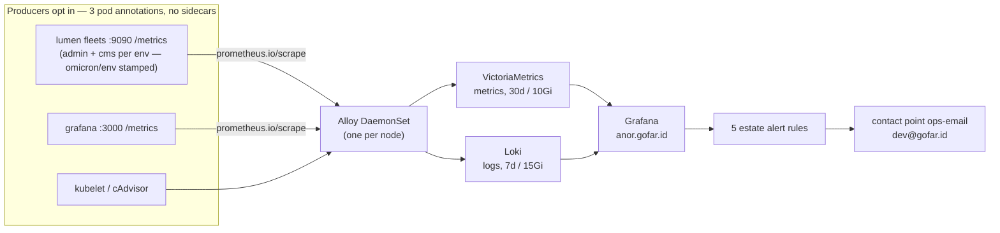

# 10 · Observability — the estate's eyes (Grafana LGTM + VictoriaMetrics)

> **Why this chapter:** everything so far can fail quietly. The point of
> metrics + logs + dashboards is that **the estate tells you before the
> readers do** — cert about to die, backup gone stale, vault sealed, pod
> crash-looping. Also: this is the family's learning wall.

## 1. The four tools, in one honest paragraph each

| Tool | Job | Analogy |
|---|---|---|
| **Grafana Alloy** (DaemonSet) | one small collector per node: scrapes everything + listens for pushed logs/metrics | the building's single wiring closet |
| **VictoriaMetrics** | stores **metrics** (numbers over time), PromQL-compatible | the ticker tape |
| **Loki** | stores **logs** (labeled lines, LogQL) | the mailroom, index-only |
| **Grafana** (pinned `13.3.1`) | the face: dashboards + unified alerting | the wall of screens |

> **Why Alloy one-per-node instead of a per-app agent army:** the INFRA
> decision (Phase 5) — small machines don't fit ~150 Mi of exporters per
> pod; Alloy remotely scrapes kubelet/cAdvisor and reads pods'
> `/metrics`, so apps opt in with **three pod annotations** and zero
> sidecars. **Why VictoriaMetrics over plain Prometheus:** single-binary,
> storage-efficient, drop-in PromQL — and it was the owner's stack ruling
> (2026-11-13; INFRA carries the amendment next to the LGTM name).

## 2. The pipeline (the whole chapter in one picture)



## 3. Turning it on (already templated — GitOps plus one manual gate)

`bases/observability/` is the base (alloy, victoria-metrics, loki,
grafana, namespace, ingress, dashboards, externalsecret — images pinned
in the env tree), `environments/foundation/observability/` is the plane
view (placement collapse + the alerting file), and
`apps/observability/observability.yaml` is the Argo Application — it
rides its **own hub, `bootstrap/apps-hub-observability.yaml`, applied by
hand as the manual GATE** (2026-11-14 hub split): only after (a) the
foundation hub's apps are Synced/Healthy, (b) chapter 05's ritual is
done, and (c) §6.5's **grafana four-key put is verified** — an
ExternalSecret errors on ANY missing declared key, so a fresh apply
before the seed wedges the sync op (the wedge that ate a day; card 11).
The single stack serves **BOTH staging and production from day one**:
Alloy relabels scrapes/logs with the pod's `omicron/env` label, and
every dashboard filters by env (00a A10's fifth proof). The `anor`
door's Certificate arrives with the certificates app (production hub
wave 1, rendered by `bases/certificates/`).
*No manual installs* — on the VPS the stack is merged, not installed.

**Sizing on the 4c/8G box:** VM retention **30d / ~10 Gi PVC**, Loki
**7d / ~15 Gi PVC**, Grafana 1 Gi PVC. Say it plainly: the base
**already matches the INFRA §1 VPS budget line for line**, so the
foundation overlay adds **no sizing patches** — inventing no-op patches
would fake a drift that doesn't exist and give real drift a place to
hide. What the overlay *does* own: the alerting file (§6) and any
future per-VPS knob.
If disk pressure shows up, shrink *Loki retention first* — metrics are
cheaper to keep than logs. Traces stay OFF (no Tempo — deliberate).

## 4. The no-sidecar contract (how anything gets in)

Any pod that should be watched gets:

```yaml
annotations:
  prometheus.io/scrape: "true"
  prometheus.io/port: "9090"    # the unrouted admin port — never an Ingress
  prometheus.io/path: "/metrics"
```

lumen already does (admin port 9090, not public); structured stdout logs
are picked up automatically. Grafana watches *itself* on its HTTP port —
`prometheus.io/port: "3000"` in `bases/observability/grafana.yaml`
(dashboard-alert latency for the thing that watches everything else).
The OTLP receiver is **live** — traefik pushes into it and the OTel
semconv `http.server.request.duration` histogram lands in
VictoriaMetrics (§4.7).

### 4.5. System metrics per pod and per node — what Alloy scrapes (walked 2026-11-14)

The annotations above cover **app-exposed** metrics (custom counters
included — a scrape is a full dump of the endpoint; nothing filters by
metric name, and every series inherits `namespace`/`pod`/`env`). The
**system** metrics — cpu, memory, disk, network for every pod on the
node — come from three kubelet surfaces Alloy pulls over the **API-server
proxy** (no direct node dialing; identical on k3d and the VPS):

| Scrape job | Path (via `kubernetes.default.svc:443`) | What lands |
|---|---|---|
| `kubelet` | `/api/v1/nodes/<node>/proxy/metrics` | `kubelet_*` (111 families): pod counts, volume stats `kubelet_volume_stats_*` (PVC fullness), cgroup managers |
| `cadvisor` | `…/proxy/metrics/cadvisor` | per-pod/per-container `container_cpu_usage_seconds_total`, `container_memory_working_set_bytes`, `container_fs_*`, `container_network_*` |
| `kubelet-resource` | `…/proxy/metrics/resource` | node aggregates: `node_cpu_usage_seconds_total`, `node_memory_working_set_bytes` |

Auth is the pod SA bearer (the `alloy` ClusterRole carries `nodes/proxy`
— that's the whole RBAC ask); TLS verifies against the SA `ca.crt`.
Verify with:

```bash
kubectl -n observability port-forward svc/victoria-metrics 18428:8428
curl -s http://127.0.0.1:18428/api/v1/query?query=up | python3 -m json.tool | grep '"job"'
# every job up=1; series sanity: curl …/api/v1/label/__name__/values
```

**Known gaps, printed honestly** (the two `up=0` targets you may still
see): lumen's pod carries the annotations but its server **doesn't listen
on 9090 yet** (`listening on :8080` is its only bind — the metrics
endpoint is a lumen backlog item); meilisearch's `/metrics` answers
**401** — Meili gates it behind the master key, and the annotation
contract has no auth story (its visibility rides logs + kubelet series
until someone adds a scrape-auth decision). The provisioned **Estate
overview** dashboard (folder `Estate`) draws exactly the verified series:
node cpu/memory, per-pod cpu/memory/disk top-10, PVC usage %.

**Router / entrypoint / service request metrics are LAZY** (walked
2026-11-14, this bit bit us): each series is instantiated by the FIRST
request through that router/entrypoint/service — on a traffic-free edge
you see only the three global families
(`traefik_config_*`, `traefik_open_connections`) and conclude the scrape
is broken. It isn't. Probe it:

```bash
kubectl -n observability exec deploy/grafana -- sh -c \
  'curl -s -o /dev/null -w "%{http_code}" http://<traefik-podIP>:8000/ -H "Host: anor.gofar.id"'
```

And `traefik_router_requests_total` is **OFF by default** —
`--metrics.prometheus.addrouterslabels` defaults to false (verified from
the live binary's `--help`); the ch.03 §6 install command now sets
`metrics.prometheus.addRoutersLabels=true` explicitly, alongside the
entrypoints/services flags spelled out so defaults can never silently
change the contract.

> Two Alloy lessons live as comments in `config.alloy` — worth knowing:
> River relabel rules default `replacement` to `"$1"`, so a multi-capture
> rule without an explicit `replacement = "$1:$2"` **silently drops the
> port** (every target scraped port 80 → up=0 estate-wide); and River
> comments are `//` — an inline `#` is a parse error that CrashLoops the
> DaemonSet.

### 4.6. Pod logs, labeled — the log-label contract (walked 2026-11-14)

Every pod's stdout is indexed with **five labels**, stamped by
`discovery.relabel "pod_logs"` in `config.alloy` (targets come from
`discovery.kubernetes` pods, and the per-pod log-file path is built from
the pod's own uid + container — restarting pods never share a tail
position):

| Label | Source | Example |
|---|---|---|
| `env` | pod label `omicron/env` | `shared` |
| `app` | pod label `app`, falling back to `app.kubernetes.io/name` | `lumen-admin-http-server` |
| `namespace` | — | `lumen` |
| `pod` | — | `lumen-admin-http-server-d8f86d685-wbrk2` |
| `container` | — | `lumen-admin-http-server` |

**How to add a label:** one replace rule in `discovery.relabel
"pod_logs"` copying `__meta_kubernetes_pod_label_<x>` (dashes/dots in the
label name become underscores). **Precedence lesson (walked the hard
way):** relabel rules apply in order and a matching replace OVERWRITES —
set the `app.kubernetes.io/name` fallback FIRST and the short `app` label
LAST, or the fallback stomps the real name (every lumen stream collapsed
to `app="lumen"` in the first cut). System pods (argocd, kube-system,
cert-manager) carry no `omicron/env` label — their streams simply have no
`env` label. Completed Jobs stop being tailed (terminal-phase drop);
`kubectl logs` still reads them. Traefik's access log (CLF, stdout —
enabled in ch.03 §6) flows through the same labeled tail. The old
unlabeled streams (label set `job/instance/filename` only) age out on
their own.

Query examples:

```logql
{app="lumen-admin-http-server"}                     # one app's logs
{env="shared"} |= "error"                           # errors in the shared plane
{namespace="ingress", container="traefik"}          # the edge, access + ERR lines
{namespace="db"}                                    # lumen-pg (StatefulSet carries no
                                                    # app label — filter by ns)
```

### 4.7. The OTLP door goes live — traefik's semconv metrics (walked 2026-11-14)

Traefik (chart values in ch.03 §6) is the first live producer into the
`otelcol.receiver.otlp` door (`:4317` gRPC via the `alloy-otlp` Service).
Its push is the ONLY source of the OpenTelemetry semantic-convention
histogram — `http.server.request.duration`, landed in VictoriaMetrics as
`http_server_request_duration_seconds_{bucket,sum,count}` with
`http_request_method`, `http_response_status_code`,
`network_protocol_name`, `server_address` and — via
`resource_to_telemetry_conversion` — `k8s_namespace_name`, `k8s_pod_name`,
`k8s_pod_uid`, `job="traefik"` (traefik auto-detects those k8s attributes;
**on the hostNetwork VPS shape the k8s.\* attrs are absent** — detection
needs pod networking). `http_client_request_duration_seconds_*` rides
along (traefik's own outgoing probes).

**The ownership split** (enforced by the `semconv_only` filter in
`config.alloy`): the push ALSO carries traefik's own `traefik_*` counters,
which the Prometheus pull above already exports — without the filter
those families would exist TWICE with different label sets and every
unfiltered `sum(rate(...))` would double-count. Pull owns all
`traefik_*`; the push owns only the semconv metrics. Traces stay OFF (no
Tempo, §1) — this is metrics-OTLP only.

## 5. The door: `anor.gofar.id` — plumbing as verified in vortex

- **Ingress** (`bases/observability/ingress.yaml`): Traefik,
  host `anor.gofar.id`, TLS secret **`tls-anor`** — served by the
  explicit `Certificate` in `bases/certificates/` (no
  ingress-shim annotation, or it would shadow-issue a duplicate).
- **Service**: `grafana` ClusterIP, `port: 3000, targetPort: http`
  (verified in `grafana.yaml` — this is the port ch.11's tunnel uses).
- **Config feeds** (`externalsecret.yaml`, both from Bao kv path
  `grafana/production`, store `bao`):
  - ConfigMap **`grafana-config`** (ESO generic `target.manifest`
    render): `GF_SERVER_ROOT_URL` (a VALUE → Bao), plus the constants
    `GF_AUTH_GENERIC_OAUTH_ENABLED="true"` and
    `GF_ANALYTICS_REPORTING_ENABLED="false"` — the deployment carries
    **zero config literals** (owner ruling 2026-11-11; the old env block
    moved here).
  - Secret **`grafana-secrets`**: `GF_SECURITY_ADMIN_PASSWORD`,
    `GF_AUTH_GENERIC_OAUTH_CLIENT_ID`, `GF_AUTH_GENERIC_OAUTH_CLIENT_SECRET`.
- **Datasources** (provisioned, `grafana-datasources` ConfigMap) carry
  **explicit uids** — `victoria-metrics` (default) and `loki` — because
  alert rules bind to datasources *by UID*, and an auto-generated UID is
  not a reviewable contract.
- The only public path in is Cloudflare→Access→edge: **no NodePort, no
  public origin exposure**.

## 6. Identity (owner ruling): Google → Access → Grafana, plus a kept break-glass

| Who | Road | Role |
|---|---|---|
| You + humans | Google login → **Cloudflare Access policy** → Grafana generic-OAuth OIDC | auto-provisioned **Viewer** on first visit |
| `lab-friends` team | same road | **Editor — scoped to one folder: `Learning`** |
| BREAK-GLASS built-in `admin` | **only** via the SSH tunnel → `http://localhost:3000` (ch.11) | password generated into Bao (`grafana/production`) — kept on purpose |

The login form stays **enabled but invisible**: Access fronts the public
path, so a human never sees it — but the tunnel path hits the form
directly, which is exactly what a dark day needs. The loop for guests:
add an email to the **Access policy** → their first visit auto-creates
the Grafana user; remove = delete from the policy (no second password
system to forget). Editor-on-`Learning` means friends can build and
wreck dashboards all afternoon inside that folder and nothing outside it
— a homelab classroom without a `sudo` list.

> **The honest caveat:** every Viewer sees all metrics/logs of this
> estate (that's what Grafana *is*). For family: a feature. For a
> stranger: don't invite strangers; org-level isolation is a later
> exercise, not tonight.

The provisioned **Estate overview** (folder `Estate`, uid
`estate-overview`) is the starting board — six panels on verified
series. Community imports (node exporter full, the kubernetes cluster
board) want node-exporter's wider series — Phase 5 backlog. A
`Learning` folder with one blank panel and a query you can type is the
actual teaching tool.

## 7. The five estate alerts — and why they're green today

`environments/foundation/observability/alerting.yaml` → ConfigMap
**`grafana-alerting`**, Grafana file-provisioning format
(`monitoring.grafana.com/v1alpha1`, live since 10.4), mounted at
`/etc/grafana/provisioning/alerting` by the foundation overlay. One folder
(`Estate`), one group (`estate-vital-signs`, 5m interval), **five
rules**, each against its target metric:

| Rule | Expression (abridged) | Fires when |
|---|---|---|
| TLS certificate expires < 21 days | `certmanager_certificate_expiration_timestamp_seconds - time() < 1814400` | renewal is broken, not merely near |
| Backups stale (no success in 36h) | `time() - backup_last_success_timestamp_seconds > 129600` | one missed nightly window + grace (source: ch.08's timer) |
| OpenBao is sealed | `bao_monitor_sealed == 1` | the reboot incident's symptom, in advance |
| Pod restart spike (>5 in 30m) | `increase(kube_pod_container_status_restarts_total[30m]) > 5` | crashloop past rollout noise |
| Disk usage above 80% | `node_filesystem_avail_bytes / … > 80` (tmpfs/overlay excluded) | the quiet killer on an 80 GB box |

> **Inert-by-design, stated honestly:** every rule carries
> `noDataState: OK`. As of the 2026-11-14 metrics round the picture is:
> cert-manager's pods ARE annotated and their metrics **flow** (3
> `certmanager_*` families verified in VictoriaMetrics) — but this
> cert-manager version exports **no
> `certmanager_certificate_expiration_timestamp_seconds`**, so the TLS
> rule sits NoData→OK until its export name is re-verified against the
> installed version. The restart-spike rule needs kube-state-metrics and
> the disk rule node-exporter (both Phase 5 backlog), the restic timer is
> ch.08/M6 work, and Bao's telemetry gauge needs enabling + an
> authenticated scrape. So the five sit green. **This is provisioning
> that becomes alive the moment each source lands — zero further Git
> change — not five broken promises.** One known blind spot, printed rather than
> hidden: a *sealed* Bao serves no metrics, so the sealed case arrives
> as NoData→OK; the belt-and-braces upgrade is `noDataState: Alert` once
> an always-on exporter (blackbox or node script on `/sys/seal-status`)
> exists. The gap is not silent.

**Delivery:** one ContactPoint `ops-email` → **`dev@gofar.id`**. Yes,
that's a literal address in Git — the *second documented exception* to
the no-literals rule, same class as the ACME contact email (public
operational mailbox, not a secret, not app runtime config). No
NotificationPolicy is provisioned: Grafana's default fan-out delivers
all five rules to that one inbox.

Next → [11 Access from Your Laptop](11-access.md)
