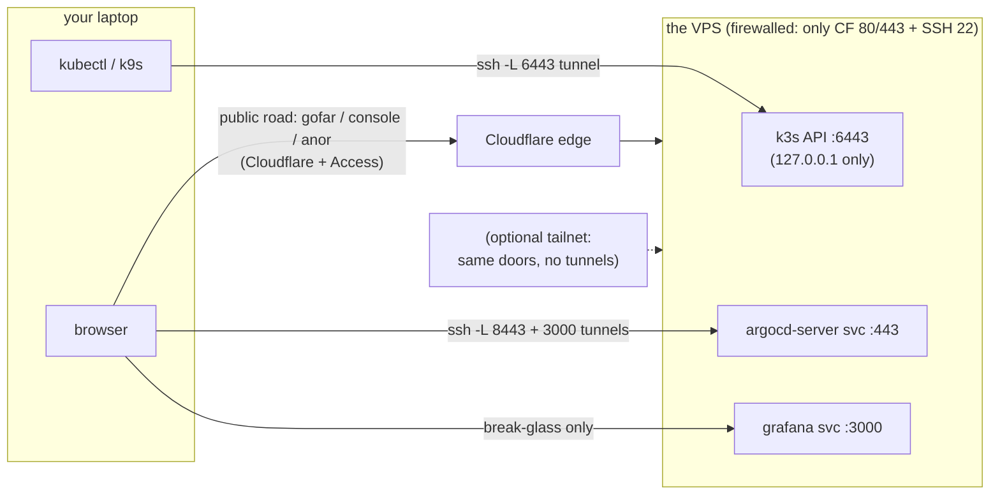

# 11 · Access from Your Laptop — the admin roads

> **Why dedicated roads:** ch.02 closed every admin port to the internet
> on purpose. That means *you* need a defined way in, and the way in
> should be boring, logged, and revocable. Two roads: SSH tunnels (day
> one, zero new software) and Tailscale (optional comfort upgrade).

## 1. The roads, on one map



## 2. Do k9s first (the fastest "I can see the cluster" path)

If you do one thing from this chapter, do this — a terminal UI over the
same tunnel makes the whole estate legible:

```bash
# 1) fetch the server's kubeconfig to a SEPARATE file (NEVER overwrite
#    ~/.kube/config — your k3d/minikube contexts live there):
ssh ops@<server-ip> 'sudo cat /etc/rancher/k3s/k3s.yaml' > ~/.kube/config-omicron
# 2) point the COPY at the tunnel (scoped to that file only):
sed -i 's|server:.*|server: https://127.0.0.1:6443|' ~/.kube/config-omicron
# 3) merge it into your kubeconfig (flattening keeps credentials inline)…
KUBECONFIG=~/.kube/config:~/.kube/config-omicron kubectl config view --flatten > ~/.kube/config.tmp \
  && mv ~/.kube/config.tmp ~/.kube/config && chmod 600 ~/.kube/config
#    …and give the context a real name:
kubectl config rename-context default omicron
# 4) keep the tunnel up (one terminal, Ctrl-C closes the road):
ssh -N -L 6443:127.0.0.1:6443 ops@<server-ip> &
# 5) prove it, then launch:
kubectl config use-context omicron && kubectl get nodes   # Ready within seconds, through the tunnel
k9s                       # reads THE SAME ~/.kube/config — zero k9s-side setup
```

k3s writes its own kubeconfig with `127.0.0.1:6443` already, so step 2
is belt-and-braces — but keeping it identical on every machine is the
point: one recipe, no snowflake configs.

## 3. The SSH tunnel pattern (learn once, use forever)

A tunnel = "pretend a cluster-only door is on my laptop." ClusterIP
targets aren't reachable by `ssh -L` alone, so each recipe runs
port-forward **on the server** and tunnels **to it**.

The three doors (service ports cited from the manifests that define
them). The helper itself, installed on the server once:

```bash
ssh ops@<server-ip>
sudo tee /usr/local/bin/tunnel >/dev/null <<'EOF'
#!/usr/bin/env bash
# usage: tunnel <svc> <ns> <node-bind-port> <svc-port>  — localhost-bound
# NOTE the LAST TWO are SEPARATE arguments — bind and service port are
# not the same number, and an earlier draft of this chapter conflated
# them (that is how the grafana line below got fixed).
kubectl -n "$2" port-forward "svc/$1" "127.0.0.1:$3:$4" &
FPID=$!; trap "kill $FPID" EXIT INT TERM; wait $FPID
EOF
sudo chmod +x /usr/local/bin/tunnel
exit
```

| Want | Server runs | Laptop runs | Then open |
|---|---|---|---|
| **Argo UI** | `tunnel argocd-server argocd 8443 443` | `ssh -N -L 8443:127.0.0.1:8443 ops@ip` | https://localhost:8443 (self-signed warning = honest: this hop isn't the public door) |
| **kubectl / k9s** | *(nothing)* | the §2 tunnel | `kubectl get nodes` |
| **Grafana break-glass** (edge-down day) | `tunnel grafana observability 3000 3000` | `ssh -N -L 3000:127.0.0.1:3000 ops@ip` | http://localhost:3000 — the login form + **built-in admin**, password from Bao `grafana/production` (ch.10 §6) |

**Port audit (re-checked 2026-11-13, the old table's bug is gone):**
the grafana Service is `port: 3000, targetPort: http` in
`vortex/bases/observability/grafana.yaml` — the old doc's
`tunnel grafana observability 3000 80` would have forwarded to a port
that doesn't exist. Argo's server service is the standard `443` from
the pinned upstream install (remote-pinned, so not greppable in-repo —
the value carried from the rehearsed walk).

> **Why this is enough:** kubectl-over-tunnel keeps 6443 firewalled
> (ch.02), and every session is SSH-key-authenticated and logged in
> `/var/log/auth.log`. Two commands per work session is the honest cost
> of a small attack surface.

## 4. Optional comfort: Tailscale (mesh VPN)

> **Why optional:** it removes the two-terminal dance forever — server
> and laptop join a private WireGuard network and "being on the
> tailnet" *is* the credential. Owner ruling 2026-11-13: Tailscale
> replaces the INFRA doc's NetBird plan (client open source, free for
> personal use, zero ops). **Headscale** exists as the later
> self-host-the-control-plane escape hatch.

```bash
# both machines, once:
curl -fsSL https://tailscale.com/install.sh | sh && tailscale up
tailscale ip -4    # e.g. 100.x.y.z — a stable private address
```

- **kubectl/k9s:** copy the kubeconfig once, `sed` the server to
  `https://<tailscale-ip-of-server>:6443`. No tunnels, ever again.
- **Tailscale SSH:** with `tailscale set --ssh` on the server, `tsh ssh
  ops@<server>` ( folks alias it `tsssh`) replaces raw SSH too — Access
  web-authorized, Cloudflare-logged sessions. Keep the port-22 road
  until you trust it.
- **ACLs (the zero-trust bit):** Tailscale admin → ACLs →
  **default-deny**, then allow `laptop:* → server:22,6443` only. A
  stolen laptop that isn't on your tailnet learns those ports don't
  exist.
- **Server firewall:** `ufw allow in on tailscale0`;
  `tailscale set --advertise-accept-routes=false` — admin road only,
  not a router.
- **A device mesh is NOT a service mesh** (worth answering in one
  line): service meshes (Istio-style) reroute traffic *between your own
  pods* — a 3-app single node doesn't have that problem yet. This
  estate adds a private *network*, not a second architecture.

**Rollback:** `tailscale down` + uninstall — §3's SSH roads keep working
independently, which is why they're written first.

## 5. NetBird, in one honest paragraph

NetBird is **fully open source including its control plane** — the
difference isn't features, it's who runs the coordinator. Choosing it
means *you* operate the NetBird/Headscale-style server forever (upgrades,
availability, its own secrets). That's the right answer **if
self-hosting the coordination plane is a requirement, not a
preference**; with Tailscale's open client + Headscale as the hatch, the
requirement can be met later without re-architecting the roads today.

## 6. House rules (revocation is the point of all this)

- New machine/phone needs access? Add it to the tailnet (or issue an
  SSH key — treat `authorized_keys` like IAM).
- **Lost laptop → remove the device from Tailscale AND delete its SSH
  key, both, same minute.** Small estate: fast revocation is a feature.
- `ssh ops@<server>` is the only login mode; never enable passwords
  back "just for now" — every "just for now" becomes someone else's
  foothold. (Exception that proves the rule: Grafana's break-glass form
  password is fine because it's reachable *only* through these roads —
  ch.10 §6.)

Next → [12 Operations Calendar](12-operations.md)
