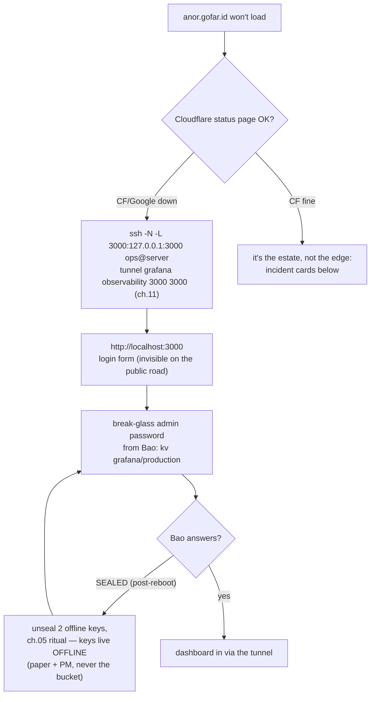

# 12 · Operations Calendar & Incident Cards

> **Why a calendar:** every mechanism in this runbook fails *quietly and
> late* — expired tokens, stale backups, lapsed PATs, sealed vaults
> after a reboot. The calendar is the noise-making layer until ch.10's
> alerts are awake; the incident cards are what the noise means.

## The meta-ritual: status promotion

This folder keeps its honesty in frontmatter. The rule: **each chapter
walked green on the VPS → update its `status:` line (draft → PROVEN
live, with the date) → add one line to the walk ledger.** No chapter
promotes itself; the promotion *is* the proof event. That single
habit is why "what's real vs rehearsed" never needs an archaeology
session. (Level-2 rehearsal option: walk a chapter's admin steps over
the ch.11 tunnels from a clean laptop — a road you've never driven is
a rumor, same doctrine as the restore drill.)

## Weekly (5 min — mostly a glance at anor)

- [ ] Alerts inbox (`dev@gofar.id`): any fire? (certs/backup/vault/
      restarts/disk — ch.10 §7; remember they're **inert until their
      sources land**, so *no mail* is honest, not reassuring, until
      M6/M7 says otherwise)
- [ ] Argo: all Synced/Healthy? Anything "OutOfSync" you didn't expect?
- [ ] GitHub: any open bump PR waiting on you? (a forgotten Waiting job
      also silently queues the ci lane behind it — approve/decline,
      don't expire by neglect — ch.09 §1)

## Monthly (30–45 min — Saturday, calm)

- [ ] **Four-route smoke** (10 min): blog page loads (gofar.id) →
      portal login works (console.gofar.id) → **anor loads via
      Google→Access** (the OIDC road, ch.10 §6) → media pixel
      **upload → `img.gofar.id` loads → delete** (ch.07's media flow).
- [ ] **Restore drill** (ch.08 §5) — the one line that keeps backups
      honest; pass criterion is the `count(*)` sentence.
- [ ] **Cloudflare-only firewall** (ch.02): the CF ranges change
      occasionally — `ufw reload` alone does NOT re-derive the per-CIDR
      allow rules; run the refresh script (install it once below):
      `sudo cf-firewall-refresh` → `ufw status numbered | head` still
      shows a CF-shaped allow set, no strays
- [ ] Cert-manager: nothing due (auto-renews) — confirm every Certificate
      is Ready: `kubectl get certificates -A` — **five** live (production's
      three + staging's two), each in its workload's namespace —
      earendil / mellon / observability, per
      `bases/certificates/certificates.yaml`
- [ ] **"Under Attack mode" still OFF?** (ch.07 — the panic switch is
      never a lifestyle; if it's on, note the date it was earned)
- [ ] OS: `apt list --upgradable` glance (unattended handles security;
      you handle the *reboot* — in a window, then ch.05's unseal
      ritual — Bao returns SEALED after every restart, that's by
      design)

The firewall-refresh script the monthly item calls (install once, on
the server — it re-runs ch.02 §3's loop and prunes the ranges CF
retired, which `ufw reload` alone never does):

```bash
sudo tee /usr/local/bin/cf-firewall-refresh >/dev/null <<'EOF'
#!/usr/bin/env bash
set -euo pipefail
curl -sL https://api.cloudflare.com/client/v4/ips | python3 -c \
  "import sys,json;[print(p['cidr']) for p in json.load(sys.stdin)['result'] if ':' not in p['cidr']]" \
  | sudo tee /etc/cloudflare-v4.txt >/dev/null
# prune every rule that cites the old list, then re-allow the fresh one:
for cidr in $(sudo ufw status | grep -oE 'from [0-9./]+' | awk '{print $2}'); do
  grep -qxF "$cidr" /etc/cloudflare-v4.txt || sudo ufw --force delete allow from "$cidr" to any port 80,443 proto tcp
done
for c in $(cat /etc/cloudflare-v4.txt); do sudo ufw allow from "$c" to any port 80,443 proto tcp; done
sudo ufw reload
EOF
sudo chmod 700 /usr/local/bin/cf-firewall-refresh
sudo /usr/local/bin/cf-firewall-refresh && sudo ufw status numbered | head -8   # sanity: fresh CF set
```

## Quarterly (60–90 min)

- [ ] **PAT day ~75** — `RELEASE_BOT_PAT` + `VORTEX_BOT_PAT` expire at
      90 days; *calendar the rotation at day ~75* (ch.09 §5's trio
      table; symptom: release dies at tag-push 403 / bump-PR 401 and
      nothing else breaks — quiet by design, which is why it's a
      calendar line, not an alert).
- [ ] Access/Teams review (ch.10 §6 + ch.11 §6): people you invited
      once for one weekend are still in it — remove from the Access
      policy *and* the tailnet, and delete any retired SSH key
- [ ] Bao: keys still readable offline (paper doesn't fade, but
      drawers get moved); snapshot-restore half of the ch.08 drill
- [ ] Version hygiene (deliberate, never auto): k3s channel, helm
      charts, Argo, ESO, cert-manager — bump one at a time in PRs a
      human merges; each rides the ch.09 machine. (Helm-pin anecdote,
      keep it alive: `get-helm-3` *at tag v3.22.1* still resolved a
      mutable CDN pointer — "a pin that pins nothing; today it happens
      to say 3.22.1" — so CI installs the v3.22.1 tarball directly,
      sha256-verified; when you bump helm, bump the version AND the
      checksum.)
- [ ] **Walk the gate** (~15 min, ch.05 §7.1 + ch.06 §4): pin a scratch
      path, try a save — read the 403 copy; run unpin→restore→save and
      take the "pin vN?" offer; then bump ONE side of an epoch TRIO (pod
      annotation vs `--declared` vs ES annotation) to a wrong number in a
      throwaway vortex PR and watch the class-4 TRIO assertion go red.
      The lock, the road back, the no-lie gate: prove they still bite.
- [ ] **Gate-audit still armed?** (ch.09 §6): every `deploy-<env>`
      environment across lumen/earendil/mellon exists AND has required
      reviewers — the CI job fails closed if not, but a RED gate-audit
      mid-release is an afternoon you didn't budget. Five minutes in
      Settings → Environments, three repos.

## Yearly / evergreen

- [ ] DR: walk the full rebuild on the rehearsal VM once a year
      (ch.08 §6)
- [ ] Domain + registrar renewal dates; Cloudflare billing contact correct
- [ ] The *legal* identity anchors survive you (About page, © footer,
      the Person JSON-LD — root AGENTS brand notes)

## The dark day, as one tree (when anor itself won't load)



## Incident cards (eleven — each one real, most already happened once)

**1. Everything red, "could not get secret data from provider"**
→ Bao sealed (host reboot? someone's fault?). Do ch.05 §9's unseal ritual
(2 offline keys as ARGUMENTS, non-tty), bounce ESO. Symptom-check:
`kubectl -n secrets exec deploy/openbao -- bao status` — `sealed: true`.
Trust `describe`'s Last Transition Time, not `get`'s "last sync", to date it.

**2. New pods ImagePullBackOff: `unauthorized`**
→ GHCR package inherited private repo visibility (ch.09 §5.4 — the
public-flip one-timer was never undone, but a NEW app repo starts
private). Flip the package public (or wire pull secrets — B-pattern).
Old pods keep serving: the blog is fine until you roll.

**3. Release approved but nothing deployed, jobs all "green"**
→ The cascade's classic corpse: tag pushed with a token that can't
cascade (missing Workflow permission — ch.09 §1). Check the events
API: a tag with ReleaseEvent but NO PushEvent. Fix the PAT permission,
then dispatch `release.yml` with the tag typed in — the redeploy door
(ch.09 §3b) exists precisely for this.

**4. Bump PR never auto-merges though validate is green**
→ The guard's fault-silence, always logged as `NOT eligible:` in the
auto-merge run. Top causes, in the order they bit us: **the check-name
contract** (the guard waits 15 min for `validate-manifests`/`validate`
and dumps what it saw — if the vortex job got renamed, that's you,
fix together with the guard, ch.09 §4); `DEPLOY_AUTOMERGE` absent/off
(**it is read from the ENV the workflow passes — if someone
"simplifies" the script back to a variables-API call, GITHUB_TOKEN
403s and the switch silently reads ABSENT = off**, by design); or the
change walks outside the **fence** — files must live under
`environments/<env>/**` (the env parsed from the
`bump/<app>-<env>-<tag>` branch; the legacy `bump/<app>-<tag>` grammar
means production and is DEPRECATED, an unparseable env BAILS the merger
to a human), lines in the `images:` stanza ∪ an epoch-TRIO line
(`config.epoch` / `--declared`) (by design: human PRs are
never auto-merged). Merge by hand; the PR tells you which.

**5. Search empty after engine bump / site 500s "503 from /api"**
→ Meilisearch refused the old data volume (ch.03 + the archived root
  `RUNBOOK.md` reseed recipe — wipe the host dir + `cmd/seed`):
wipe the **host directory** (PVC delete alone remounts the same old
dir — Retain is deliberate), let the engine boot empty, run `cmd/seed`
reconcile (port-forwards to DB+engine; indexes only PUBLISHED posts,
leaves rows alone). Verify `/indexes/posts/stats`
`numberOfDocuments` == published count.

**6. Portal matrix missing an app row → "seed went off-contract"**
→ mellon's app matrix shows a gap or an app that won't seed: someone
wrote secrets to a path the apps don't read. The contract is
**`kv/<app>/<env>`** — one path per app per env, `shared` being the
foundation env (lumen/shared, mellon/shared) — and the proof is a
`ListPaths` walk of the mount: every app dir listed, every consumer's
ExternalSecret `remoteRef` key matches a listed path, nothing else
lives there. Fix = move the secret to the contract path (ch.05),
*not* teaching the app to read the off-contract one.

**7. Sync red: `config-gate: <app>/<env> declared N; vault head H, pin
P|unset — …`** → the PreSync gate blocked the rollout because Git's
declared epoch and the vault disagree — the block is the design
working. One-line remedy: **do exactly what the machine printed**, it
already contains the fix — declared ≠ head → *"align the epoch bump with
the vault (materialize the pin via unpin→restore→save, or re-dispatch
with the number the matrix shows)"*; pinned ≠ head → *"pin is a lock and
it disagrees with head: unpin to release the head, or restore the pinned
version's content as new head"* (flow: ch.06 §4).

**8. Portal save refused: 403 `pinned at v2 — unpin first`** → not an
outage — the pin is a LOCK and it just told you so (ch.05 §7.1, block
mode). Remedy in three verbs: **unpin → act → re-pin** (restore-draft
the version you mean, save as vN, answer the "pin vN?" offer). Head kept
serving the whole time; readers never felt the freeze.

**9. Release parked… then un-parked itself with no click (the gate
incident, 2026-11-13)** → if a `deploy-<env>` job EXECUTES without ever
showing an amber Waiting badge, the protected environment is gone (or
never existed — GitHub auto-creates referenced-but-missing environments
UNPROTECTED, which is how v3.0.0/v2.0.0 opened five bump PRs
unattended). Today the chain's `gate-audit` job fails RED before that
can repeat, so the live symptom is the opposite: **gate-audit red =
Settings → Environments lost a required reviewer (or an env) — recreate
and protect, then re-run.** Second red signature (walked 2026-11-14):
the audit reads `ENV_AUDIT_PAT` — missing, expired, or under-granted
(without Administration: read) PAT = the same RED. Refresh the secret,
then re-run. Full record + the walked resolution: ch.09 §6. Bump PRs
born of an unparked chain are INVALID evidence: merge only after a
human park, or deliberately supersede them.

**10. Deploy job red after 30 min: "bump PR did not merge" — but no PR
was ever opened (walked 2026-11-14, lumen staging v4.0.2)** → two
failure classes, now separately named by the deploy job (anvil
`set-image-pr.sh` guards both — re-pin `6e210f5`):

- **Push rejected:** `! [remote rejected] bump/… (failed)` with EMPTY
  `remote:` lines. GitHub-side and TRANSIENT — that day one push in ~9
  failed; the repo had no rulesets (API-verified `[]`), the PAT was
  alive (a `gh pr list` dedupe check ran clean seconds earlier), and
  same-PAT sibling pushes from the same run succeeded minutes apart.
  The script now retries ×3/15s and REDs with the raw git error and
  the true state: **branch NOT on GitHub, pin NOT on main. Recovery:
  workflow_dispatch re-run of that env** — transients don't repeat
  (proven: the re-run rode green end-to-end).
- **PR-create failed:** the bump branch IS on GitHub but no PR exists
  (the old zombie: `gh pr create` failed unguarded with `GraphQL: Head
  sha can't be blank…` and the await loop polled the nonexistent PR
  for the full deadline). RED is immediate now. Recovery: open the PR
  by hand, or dispatch re-run — the run dedupes by branch (reuse, not
  duplicate).

**Dispatch UX note:** the release workflow's `tag` input is OPTIONAL
when you dispatch FROM the tag's ref (the ref name provides it — leave
the box empty). Dispatching from `main` REQUIRES typing the tag; a
fail-closed guard makes an empty box there RED before checkout —
released `vX.Y.Z` or nothing. This re-run door is the recovery path
for BOTH classes above (cf. card 3's redeploy door).

**11. Argo app stuck OutOfSync/Progressing forever — sync op wedged
"Running" (walked 2026-11-14, observability; four ops + a CR recreate;
re-confirmed the same day by the dashboard-CM variant — and the app now
rides its OWN hub, `bootstrap/apps-hub-observability.yaml`, applied by
hand only after the grafana four-key seed, so the first-bullet class
becomes a checklist rather than a race)**
→ A sync operation that cannot complete BLOCKS ALL later operations on
that app (nothing new fires while one is "Running"), and it cannot
complete whenever ANY resource of a wave waits on a health that will
never come. Three never-healthy resources bit in ONE app — each alone
is a wedge; check for all three before declaring victory:

- **Unseeded ExternalSecret** (`could not get secret data from
  provider`): the CR is wave 0 and its health NEVER passes until the
  store has every declared key (ch.05 §6.5's grafana block now has the
  four-key put). Seed first — A7's rule is load-bearing.
- **An orphan PVC** (`WaitForFirstConsumer`, never Bound): loki.yaml
  shipped a standalone PVC the STS never referenced (it uses its own
  volumeClaimTemplates). An unbound PVC is never healthy → deleted
  from Git and the cluster; the STS provisions its own.
- **A k3d Ingress** (empty `status.loadBalancer`): on k3d an Ingress is
  PERMANENTLY Degraded — and Argo waits for the LAST wave's health
  too, so no wave placement escapes it. The design answer:
  `argocd.argoproj.io/skip-health-check: "true"` on the ingress (the
  door still applies; a real VPS LB makes it healthy anyway).
- **A Deployment whose ConfigMap never renders** (walked 2026-11-14,
  third variant): kustomize renders ONLY files explicitly listed in the
  base's `kustomization.yaml` — a new file committed but unlisted is
  silently absent from every render, the Deployment references a CM no
  sync ever creates, the pod loops on `FailedMount`, the deployment
  blows its progress deadline, and the op wedges on
  `waiting for healthy state of Deployment/grafana`. Fix the listing,
  then terminate + re-sync (and hard-refresh if the repo-server's clone
  is stale).

Diagnosis order: controller log
(`waiting for healthy state of …` names the hostage), `get pvc`
(WaitForFirstConsumer?), `get externalsecret` (Ready?). Remedies, in
order of escalation: fix the seed / delete the orphan → terminate the
wedged op (`kubectl -n argocd patch application <app> --type merge -p
'{"status":{"operationState":{"phase":"Failed"}}}'` — the
Failed-transition is what lets the automated policy fire a fresh op);
if a forbidden STS patch loops (`Forbidden: updates to statefulset
spec…` — patch-vs-create semantics, kubectl-apply-created STS), orphan
the STS and cycle the child CR (finalizers → null, delete, the hub
recreates it) so Argo CREATEs instead of PATCHes. And NEVER hand-apply
a BASE render on an env-model app — the base carries placement
(doctrine #3); the env overlay collapses it (`components/single-node`);
base-rendered workloads can't schedule on k3d. Hand-apply the
**env-tree** render only.

## The one meta-line

Every incident above is *already* in this calendar as a prevention line
— and when a new surprise happens, it earns a card here the same week,
or the rehearsal paid for nothing.

Next → [13 References](13-references.md)
