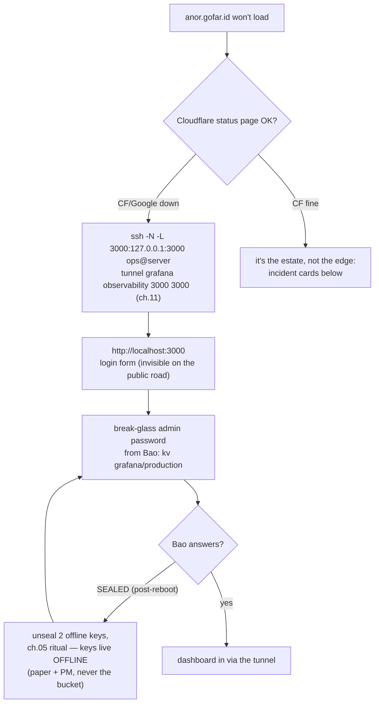

# 12 · Operations Calendar & Incident Cards

> **Why a calendar:** every mechanism in this runbook fails *quietly and
> late* — expired tokens, stale backups, lapsed PATs, sealed vaults
> after a reboot. The calendar is the noise-making layer until ch.10's
> alerts are awake; the incident cards are what the noise means.

## The meta-ritual: status promotion

This folder keeps its honesty in frontmatter. The rule: **each chapter
walked green on the VPS → update its `status:` line (draft → PROVEN
live, with the date) → add one line to the walk ledger.** No chapter
promotes itself; the promotion *is* the proof event. That single
habit is why "what's real vs rehearsed" never needs an archaeology
session. (Level-2 rehearsal option: walk a chapter's admin steps over
the ch.11 tunnels from a clean laptop — a road you've never driven is
a rumor, same doctrine as the restore drill.)

## Weekly (5 min — mostly a glance at anor)

- [ ] Alerts inbox (`dev@gofar.id`): any fire? (certs/backup/vault/
      restarts/disk — ch.10 §7; remember they're **inert until their
      sources land**, so *no mail* is honest, not reassuring, until
      M6/M7 says otherwise)
- [ ] Argo: all Synced/Healthy? Anything "OutOfSync" you didn't expect?
- [ ] GitHub: any open bump PR waiting on you? (a forgotten Waiting job
      also silently queues the ci lane behind it — approve/decline,
      don't expire by neglect — ch.09 §1)

## Monthly (30–45 min — Saturday, calm)

- [ ] **Four-route smoke** (10 min): blog page loads (gofar.id) →
      portal login works (console.gofar.id) → **anor loads via
      Google→Access** (the OIDC road, ch.10 §6) → media pixel
      **upload → `img.gofar.id` loads → delete** (ch.07's media flow).
- [ ] **Restore drill** (ch.08 §5) — the one line that keeps backups
      honest; pass criterion is the `count(*)` sentence.
- [ ] **Cloudflare-only firewall** (ch.02): re-pull CF IP ranges into
      `/etc/cloudflare-v4.txt` (they change occasionally), `ufw reload`
- [ ] Cert-manager: nothing due (auto-renews) — confirm every Certificate
      is Ready: `kubectl get certificates -A` (each lives in its
      workload's namespace — earendil / mellon / observability, per
      `applications/certificates/certificates.yaml`)
- [ ] **"Under Attack mode" still OFF?** (ch.07 — the panic switch is
      never a lifestyle; if it's on, note the date it was earned)
- [ ] OS: `apt list --upgradable` glance (unattended handles security;
      you handle the *reboot* — in a window, then ch.05's unseal
      ritual — Bao returns SEALED after every restart, that's by
      design)

## Quarterly (60–90 min)

- [ ] **PAT day ~75** — `RELEASE_BOT_PAT` + `VORTEX_BOT_PAT` expire at
      90 days; *calendar the rotation at day ~75* (ch.09 §5's trio
      table; symptom: release dies at tag-push 403 / bump-PR 401 and
      nothing else breaks — quiet by design, which is why it's a
      calendar line, not an alert).
- [ ] Access/Teams review (ch.10 §6 + ch.11 §6): people you invited
      once for one weekend are still in it — remove from the Access
      policy *and* the tailnet, and delete any retired SSH key
- [ ] Bao: keys still readable offline (paper doesn't fade, but
      drawers get moved); snapshot-restore half of the ch.08 drill
- [ ] Version hygiene (deliberate, never auto): k3s channel, helm
      charts, Argo, ESO, cert-manager — bump one at a time in PRs a
      human merges; each rides the ch.09 machine. (Helm-pin anecdote,
      keep it alive: `get-helm-3` *at tag v3.22.1* still resolved a
      mutable CDN pointer — "a pin that pins nothing; today it happens
      to say 3.22.1" — so CI installs the v3.22.1 tarball directly,
      sha256-verified; when you bump helm, bump the version AND the
      checksum.)
- [ ] **Walk the gate** (~15 min, ch.05 §7.1 + ch.06 §4): pin a scratch
      path, try a save — read the 403 copy; run unpin→restore→save and
      take the "pin vN?" offer; then bump `--declared` to a wrong number
      in a throwaway vortex PR and watch the epoch-pair assertion go red.
      The lock, the road back, the no-lie gate: prove they still bite.

## Yearly / evergreen

- [ ] DR: walk the full rebuild on the rehearsal VM once a year
      (ch.08 §6)
- [ ] Domain + registrar renewal dates; Cloudflare billing contact correct
- [ ] The *legal* identity anchors survive you (About page, © footer,
      the Person JSON-LD — root AGENTS brand notes)

## The dark day, as one tree (when anor itself won't load)

## Incident cards (eight — each one real, most already happened once)

**1. Everything red, "could not get secret data from provider"**
→ Bao sealed (host reboot? someone's fault?). Do ch.05 §9's unseal ritual
(2 offline keys as ARGUMENTS, non-tty), bounce ESO. Symptom-check:
`kubectl -n secrets exec openbao-0 -- bao status` — `sealed: true`.
Trust `describe`'s Last Transition Time, not `get`'s "last sync", to date it.

**2. New pods ImagePullBackOff: `unauthorized`**
→ GHCR package inherited private repo visibility (ch.09 §5.4 — the
public-flip one-timer was never undone, but a NEW app repo starts
private). Flip the package public (or wire pull secrets — B-pattern).
Old pods keep serving: the blog is fine until you roll.

**3. Release approved but nothing deployed, jobs all "green"**
→ The cascade's classic corpse: tag pushed with a token that can't
cascade (missing Workflow permission — ch.09 §1). Check the events
API: a tag with ReleaseEvent but NO PushEvent. Fix the PAT permission,
then dispatch `release.yml` with the tag typed in — the redeploy door
(ch.09 §3b) exists precisely for this.

**4. Bump PR never auto-merges though validate is green**
→ The guard's fault-silence, always logged as `NOT eligible:` in the
auto-merge run. Top causes, in the order they bit us: **the check-name
contract** (the guard waits 15 min for `validate-manifests`/`validate`
and dumps what it saw — if the vortex job got renamed, that's you,
fix together with the guard, ch.09 §4); `DEPLOY_AUTOMERGE` absent/off
(**it is read from the ENV the workflow passes — if someone
"simplifies" the script back to a variables-API call, GITHUB_TOKEN
403s and the switch silently reads ABSENT = off**, by design); or the
change walks outside the **fence of patterns** — files
`applications/*/kustomization.yaml` + `overlays/production/<app>/*.yaml`
(app parsed from the bump branch), lines in the `images:` stanza ∪ a
`config.epoch` line ∪ a `--declared` line (by design: human PRs are
never auto-merged). Merge by hand; the PR tells you which.

**5. Search empty after engine bump / site 500s "503 from /api"**
→ Meilisearch refused the old data volume (ch.03 + the A11 recipe):
wipe the **host directory** (PVC delete alone remounts the same old
dir — Retain is deliberate), let the engine boot empty, run `cmd/seed`
reconcile (port-forwards to DB+engine; indexes only PUBLISHED posts,
leaves rows alone). Verify `/indexes/posts/stats`
`numberOfDocuments` == published count.

**6. Portal matrix missing an app row → "seed went off-contract"**
→ mellon's app matrix shows a gap or an app that won't seed: someone
wrote secrets to a path the apps don't read. The contract is
**`kv/<app>/<env>`** — one path per app per env — and the proof is a
`ListPaths` walk of the mount: every app dir listed, every consumer's
ExternalSecret `remoteRef` key matches a listed path, nothing else
lives there. Fix = move the secret to the contract path (ch.05),
*not* teaching the app to read the off-contract one.

**7. Sync red: `config-gate: <app>/<env> declared N; vault head H, pin
P|unset — …`** → the PreSync gate blocked the rollout because Git's
declared epoch and the vault disagree — the block is the design
working. One-line remedy: **do exactly what the machine printed**, it
already contains the fix — declared ≠ head → *"align the epoch bump with
the vault (materialize the pin via unpin→restore→save, or re-dispatch
with the number the matrix shows)"*; pinned ≠ head → *"pin is a lock and
it disagrees with head: unpin to release the head, or restore the pinned
version's content as new head"* (flow: ch.06 §4).

**8. Portal save refused: 403 `pinned at v2 — unpin first`** → not an
outage — the pin is a LOCK and it just told you so (ch.05 §7.1, block
mode). Remedy in three verbs: **unpin → act → re-pin** (restore-draft
the version you mean, save as vN, answer the "pin vN?" offer). Head kept
serving the whole time; readers never felt the freeze.

## The one meta-line

Every incident above is *already* in this calendar as a prevention line
— and when a new surprise happens, it earns a card here the same week,
or the rehearsal paid for nothing.

Next → [13 References](13-references.md)
